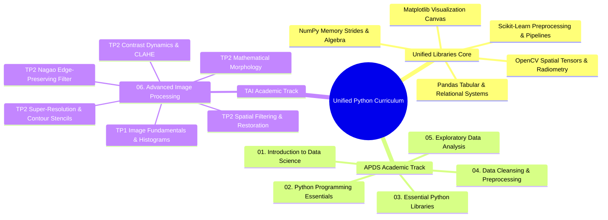
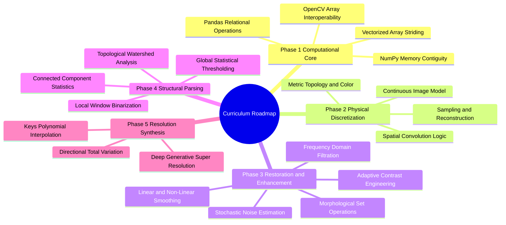
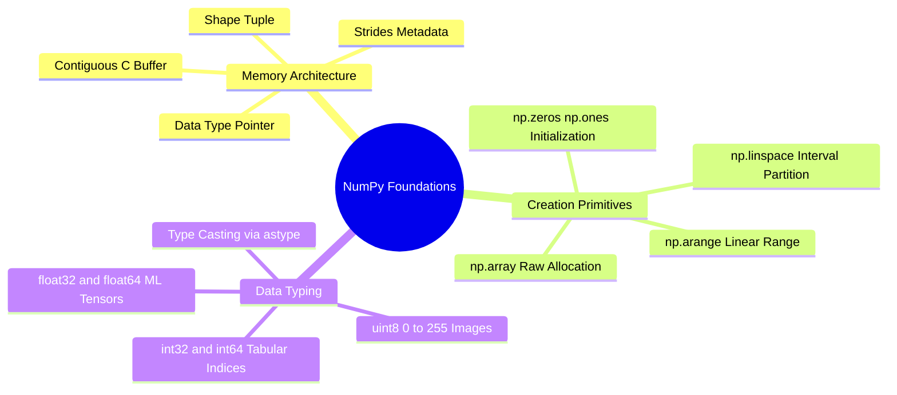
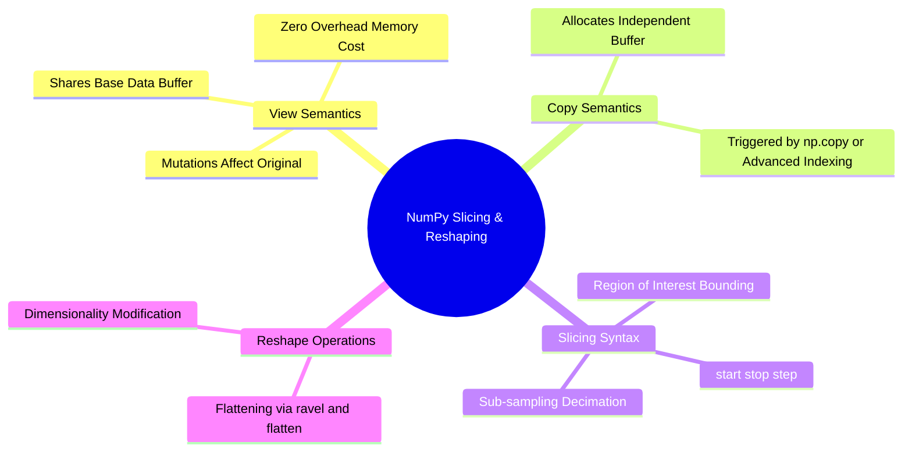

# 00. Master Curriculum Roadmap

## 1. Curriculum Architecture
This knowledge base unifies **Data Science & Machine Learning (APDS)** with **Advanced Image Processing & Computer Vision (TAI)** on top of a single, shared Python computational foundation.



---

## 2. Master Navigation Index

### 2.1 Unified Library Learning Path (`Libraries/`)
*Study these foundational notes before applying the concepts in the academic chapters.*

| Note | Core Topics Covered |
| :--- | :--- |
| [[00. Library Learning Roadmap]] | Dependency graph and prerequisite order |
| [[01. NumPy Foundations - Memory Layout, ndarray Anatomy, and Array Instantiation]] | Contiguous C-buffers, shapes, strides, data types |
| [[02. NumPy Array Manipulation - Slicing, Strides, Shapes, and Vectorized Indexing]] | Strided memory views, boolean masking, coordinate lookup |
| [[03. Matplotlib Core Architecture - Figure, Axes, and Canvas Visualization Mechanics]] | Figure, Axes, subplots, object-oriented canvas |
| [[04. NumPy Mathematical Engine - Vectorization, ufuncs, and Broadcasting Rules]] | Vectorized operations, multi-axis reduction, broadcasting |
| [[05. NumPy Linear Algebra and Advanced Numerical Computation]] | Matrix products, inverses, determinants, linear systems |
| [[06. Pandas Structural Primitives - Series and DataFrame Architecture]] | 1D Series, 2D DataFrames, BlockManager memory |
| [[07. Pandas Data Ingestion, Inspection, and Type Coercion]] | Parsing CSV/Excel, dtypes, memory audit, null checks |
| [[08. Pandas Indexing, Slicing, and Query Mechanics (loc, iloc, query, at)]] | Label vs position slicing, query engine, fast scalar lookups |
| [[09. Pandas Data Cleansing - Handling Nulls, Deduplication, and String Normalization]] | Imputation, deduplication, vectorized string methods |
| [[10. Matplotlib and Seaborn Statistical Plotting for Tabular Data]] | Histograms, KDE, box plots, violin plots, correlation heatmaps |
| [[11. Pandas Grouping, Split-Apply-Combine, and Statistical Aggregations]] | GroupBy mechanics, multi-metric agg, transform windowing |
| [[12. Pandas Relational Operations - Joins, Merging, and Concatenation]] | SQL-style joins, vertical/horizontal concatenation |
| [[13. Pandas Data Reshaping - Pivoting, Unpivoting, Stacking, and Melting]] | Wide vs long formats, pivot tables, melting |
| [[14. Pandas Temporal Mechanics - Time Series and Datetime Calculations]] | DatetimeIndex, resampling, rolling averages, shifts |
| [[15. Interactive Visualization and Geospatial Mapping - Plotly and Cartopy]] | Web-ready charts, geographic projections, Cartopy |
| [[16. OpenCV Core Architecture - Matrix Representation, Channels, and Color Constellations]] | BGR memory layout, scanline access, color spaces |
| [[17. Image Spatial Transformations - Interpolation, Scaling, Cropping, and Affine Warping]] | ROI cropping, nearest/bilinear/bicubic resampling, rotations |
| [[18. Visual Frequency and Radiometry - Histograms, Equalization, AHE, and CLAHE]] | PMF, CDF, dynamic range expansion, global equalization, CLAHE |
| [[19. Spatial Image Restoration - Noise Models, Linear Convolution, and Fast Integral Filters]] | AWGN, salt-and-pepper noise, box/Gaussian filters, integral images |
| [[20. Non-Linear and Edge-Preserving Filtering - Median, Bilateral, and Nagao Filters]] | Order-statistic median, bilateral filtering, 9-region Nagao |
| [[21. Mathematical Morphology - Set Theory, Structuring Elements, and Thinning]] | Erosion, dilation, opening, closing, Zhang-Suen thinning |
| [[22. Objective Image Quality Assessment - MSE, PSNR, and SSIM Metrics]] | Mathematical derivations for MSE, PSNR (dB), and SSIM |
| [[23. Super-Resolution and Edge-Adaptive Interpolation - Pascal Getreuer Contour Stencils]] | Total Variation along curves, 12 directional stencils, 2x/4x SR |

---

### 2.2 Academic Chapters

#### Chapter 01: Introduction to Data Science
- [[01.1. Data Science Foundations and CRISP-DM Workflow]]
- [[01.2. The Modern Data Ecosystem and Professional Roles]]
- [[01.3. Setting Up the Professional Python and Data Science Environment]]
- [[01.4. Tutorial 02 - Hospital Patient Cohort Initialization and Environment Audit]]

#### Chapter 02: Python Programming Essentials
- [[02.1. Python Runtime, Dynamic Typing, and Core Primitives]]
- [[02.2. Python Lists, Sequence Operations, and Internal Memory Architecture]]
- [[02.3. Dictionaries, Sets, Tuples, and High-Performance Collections]]
- [[02.4. Control Flow, Conditionals, and Comprehensions Mastery]]
- [[02.5. Exhaustive Guide to Iteration, Iterables, and the Iterator Protocol]]
- [[02.6. Generators, Lazy Evaluation, and Asynchronous Streaming Pipelines]]
- [[02.7. The 1 Million Records Memory Explosion Autopsy and Production Streaming Solutions]]
- [[02.8. Object-Oriented Programming and Class Design Patterns]]
- [[02.9. Robust Exception Handling and Resource Management]]
- [[02.10. Code Modularity, Packaging, and Standard Library Systems]]
- [[02.11. Tutorial 03 - Modular Sales Inventory Processing Pipeline]]
- [[02.12. Tutorial 03 - Student Cohort Generation and Statistical Analysis System]]

#### Chapter 03: Essential Python Libraries
- [[03.1. Contextual Data Science Computing with NumPy and Pandas]]
- [[03.2. Tutorial 04 - Multi-City Temperature Array Analysis with NumPy]]
- [[03.3. Tutorial 04 - Academic Performance Statistical Analysis with NumPy and Matplotlib]]
- [[03.4. Tutorial 04 - Hospital Department Patient Analytics with Pandas]]
- [[03.5. Tutorial 04 - Longitudinal Sales Forecasting Project]]

#### Chapter 04: Data Cleansing and Preprocessing
- [[04.1. Missing Data Mechanisms and Statistical Imputation]]
- [[04.2. Statistical Outlier Detection and Consistency Rectification]]
- [[04.3. Categorical Feature Encoding and Text Normalization]]
- [[04.4. Feature Scaling, Standardization, and Normalization Theory]]
- [[04.5. Tutorial 05 - End-to-End Medical Cohort Preprocessing Pipeline]]
- [[04.6. Tutorial 05 - Titanic Predictive Modeling Pipeline and Classifier Evaluation]]

#### Chapter 05: Exploratory Data Analysis
- [[05.1. Exploratory Data Analysis Principles, Distributions, and Correlation Metrics]]

#### Chapter 06: Advanced Image Processing (TAI)
- [[06.0. Advanced Image Processing Index and Curriculum MOC]]
- [[06.9.1. TP1 - Digital Image Acquisition, Matrix Topologies, and Fixed Thresholding]]
- [[06.9.2. TP1 - Spatial Transformations, ROI Extraction, and Multi-Channel Histograms]]
- [[06.9.3. TP2 Part 1 - Discrete Noise Models and Spatial Convolution Smoothing]]
- [[06.9.4. TP2 Part 1 Homework - Fast Integral Filtering and Adaptive Smoothing]]
- [[06.9.5. TP2 Part 2 - Edge-Preserving Non-Linear Smoothing with Nagao Filter]]
- [[06.9.6. TP2 Part 3 - Mathematical Morphology, Cell Counting, and Skeletonization]]
- [[06.9.7. TP2 Part 4 - Contrast Dynamics, Histogram Equalization, and CLAHE]]
- [[06.9.8. TP2 Part 5 - Single-Frame Super-Resolution and Contour Stencils]]

---

## Integrated Subject Knowledge: 00.2. Course Roadmap and Unified Learning Path

This roadmap provides the operational sequence for traversing the knowledge base. It enforces a strict dependency rule: **No mathematical model, computational method, or library syntax is deployed in an academic chapter or lab before being fully defined and derived in the foundational notes.**



### Stage-by-Stage Dependency Architecture

#### Phase 1: The Computational Engine
* Goal: Master $N$-dimensional array manipulation, memory layout, vectorization, and data structures.
* Primary Notes: [[01.01. NumPy Foundations - Array Creation, Memory Layout, and Data Types]] through [[01.14. Scikit-Learn Primitives - Clustering, Dimensionality, and Metrics]].
* Prerequisite Knowledge: Standard Python data types (integers, floats, lists, tuples, dictionaries).

#### Phase 2: Discrete Optics and Signal Foundations
* Goal: Understand physical light propagation, sensor quantization, colorimetry, discrete metrics, and convolution.
* Primary Notes: [[06.9.1. TP1 - Digital Image Acquisition, Matrix Topologies, and Fixed Thresholding]] through [[06.1.8. Three-Level Vision Processing Hierarchy (Low, Mid, High)]].
* Applications: [[06.1. Laboratory 1 - Development Environment, NumPy Array Manipulation, and Grayscale Thresholding]], [[06.10. Worked Image Processing Exercises and End-to-End Solutions]].

#### Phase 3: Filtering, PDE Methods, and Spectral Analysis
* Goal: Master noise attenuation, high-pass edge isolation, non-linear statistics, spatial-frequency duality, morphological operators, and contrast engineering.
* Primary Notes: [[06.2.1. Physical Noise Models (PSF, Gaussian, Impulse Salt-and-Pepper, Speckle)]] through [[06.9.5. TP2 Part 2 - Edge-Preserving Non-Linear Smoothing with Nagao Filter]].
* Applications: [[06.2. Laboratory 2 - Synthetic Noise Injection, Spatial Filtering, and Metric Benchmarking]], [[06.10. Worked Image Processing Exercises and End-to-End Solutions]], [[06.4. Laboratory 4 - Applied Mathematical Morphology, Cellular Counting, and Skeletonization]].

#### Phase 4: Segmentation and Structural Measurement
* Goal: Isolate foreground entities from backgrounds via global, local, dynamic, and marker-controlled topological operations, followed by boundary evaluation.
* Primary Notes: [[06.9. Image Segmentation Axioms, Thresholding, and Connected Components]] through [[06.7.8. Segmentation Evaluation Benchmarks (Dice DSC, Jaccard IoU, Hausdorff Distance)]].
* Applications: [[06.10.2. Exercise 2 - Exhaustive Step-by-Step Optimization of Otsu's Inter-Class Variance]].

#### Phase 5: Continuous Reconstruction and Super-Resolution
* Goal: Interpolate continuous surfaces from discrete lattices, direct interpolation along gradients, and infer high frequencies via deep adversarial learning.
* Primary Notes: [[06.8.1. Continuous Image Reconstruction (Nearest, Bilinear, and Keys' Bicubic Spline)]] through [[06.9.8. TP2 Part 5 - Single-Frame Super-Resolution and Contour Stencils]].
* Applications: [[06.10. Worked Image Processing Exercises and End-to-End Solutions]].

---

## 01. Unified Python Libraries Foundation

### 01.01. NumPy Foundations - Array Creation, Memory Layout, and Data Types.md

# NumPy Foundations: Array Creation, Memory Layout, and Data Types

The numerical computing foundation of both Data Science and Image Processing relies on `numpy.ndarray`. A digital image is physically represented as an array of numerical values, as is a tabular dataset or machine learning feature matrix.



### 1. Memory Architecture: The C-Contiguous Buffer
A Python `list` is an array of pointers to arbitrary memory blocks, incurring pointer indirection and object header overhead. In contrast, a `numpy.ndarray` is a contiguous block of homogeneous memory wrapped by a Python metadata header:

$$\text{Data Pointer} \longrightarrow [b_0, b_1, b_2, b_3, b_4, \dots, b_K]$$

The array object stores:
1. **`data`**: Pointer to the first byte in the raw contiguous memory buffer.
2. **`dtype`**: The descriptor detailing how many bytes belong to each element and how those bits are interpreted (e.g., unsigned integer, IEEE 754 float).
3. **`shape`**: A tuple of integers describing the dimension sizes $(D_0, D_1, \dots, D_{d-1})$.
4. **`strides`**: A tuple of integers detailing how many bytes must be jumped in memory to advance by one step along each dimension.

For an 8-bit grayscale image of shape $(H, W)$ in C-order (row-major), advancing one row requires jumping $W \times 1$ bytes. Advancing one column requires jumping $1$ byte:

$$\text{Strides}_{(H, W)} = (W \cdot \text{itemsize}, \ \text{itemsize})$$

### 2. Standard Numerical Data Types (`dtype`)
Selecting the appropriate numerical type prevents overflow, underflow, and out-of-memory errors:

| `dtype` | Byte Size | Value Range | Primary Use Case |
| :--- | :--- | :--- | :--- |
| `np.uint8` | 1 byte | $0$ to $255$ ($2^8-1$) | Standard grayscale/color pixels, binary masks |
| `np.int16` | 2 bytes | $-32,768$ to $+32,767$ | Medical DICOM (Hounsfield Units) |
| `np.int32` | 4 bytes | $-2.14 \times 10^9$ to $+2.14 \times 10^9$ | Tabular discrete counters, connected component labels |
| `np.float32` | 4 bytes | $\approx \pm 3.4 \times 10^{38}$ (7 decimals) | Deep learning tensors, spatial image gradients |
| `np.float64` | 8 bytes | $\approx \pm 1.8 \times 10^{308}$ (16 decimals) | High-precision scientific optimization, statistical metrics |

### 3. Syntax and Construction Primitives

#### `np.array(object, dtype=None)`
Constructs an array from an existing sequence (Python list, nested list, or tuple).

```python
import numpy as np

# Constructing a 1D tabular vector (e.g., patient ages in Data Science)
ages = np.array([25, 42, 37, 61], dtype=np.int32)

# Constructing a 2D 3x3 pixel matrix (e.g., high-pass kernel or image patch)
patch = np.array([
    [100, 130, 110],
    [110,  90, 100],
    [130, 100,  90]
], dtype=np.uint8)

print("Ages Shape:", ages.shape, "| Strides:", ages.strides)
print("Patch Shape:", patch.shape, "| Strides:", patch.strides)
```

#### `np.zeros(shape, dtype=float)` and `np.ones(shape, dtype=float)`
Allocates a contiguous block of memory initialized to zero or one. Essential for pre-allocating output images in spatial filtering loops to prevent continuous dynamic reallocation.

```python
# Pre-allocating an empty HD grayscale image buffer (1080 rows, 1920 columns)
canvas_gray = np.zeros((1080, 1920), dtype=np.uint8)

# Pre-allocating a normalized 3-channel RGB image buffer
canvas_rgb = np.ones((512, 512, 3), dtype=np.float32)
```

#### `np.arange(start, stop, step, dtype=None)`
Generates values within a half-open interval $[start, stop)$ with discrete step sizes. Useful for building iteration counters and coordinate vectors.

```python
# Discrete coordinate steps along a 1D signal
steps = np.arange(0, 10, 2, dtype=np.int32)  # [0, 2, 4, 6, 8]
```

#### `np.linspace(start, stop, num=50, endpoint=True)`
Generates `num` evenly spaced samples over the closed interval $[start, stop]$. Essential for constructing continuous mathematical test signals, probability densities, and synthetic test gradients.

```python
# Constructing a normalized intensity ramp from 0.0 to 1.0 across 256 discrete levels
intensity_ramp = np.linspace(0.0, 1.0, num=256, dtype=np.float32)
```

#### Safe Type Casting: `.astype(dtype, copy=True)`
Never perform arithmetic on raw `np.uint8` arrays when values can exceed $255$ or drop below $0$. If you subtract two `uint8` values ($100 - 150$), unsigned modulo arithmetic wraps around:

$$100_{\text{uint8}} - 150_{\text{uint8}} = 206$$

To avoid this, cast the array to signed integers or floating-point values before computation:

```python
pixel_a = np.array([100], dtype=np.uint8)
pixel_b = np.array([150], dtype=np.uint8)

# Arithmetic error:
broken_diff = pixel_a - pixel_b  # Yields array([206], dtype=uint8)

# Correct procedure:
correct_diff = pixel_a.astype(np.float32) - pixel_b.astype(np.float32)  # Yields array([-50.], dtype=float32)
```

Related concepts: [[01.02. NumPy Array Manipulation - Reshaping, Slicing, and Striding]], [[06.1.2. Sampling, Quantization, Bit Depth, and Nyquist-Shannon Theorem]], [[06.1. Laboratory 1 - Development Environment, NumPy Array Manipulation, and Grayscale Thresholding]].

---

### 01.02. NumPy Array Manipulation - Reshaping, Slicing, and Striding.md

# NumPy Array Manipulation: Reshaping, Slicing, and Striding

Extracting sub-regions, altering tensor shapes, flattening matrices, and processing sub-windows require a clear understanding of array view-vs-copy semantics and indexing mechanics.



### 1. Slicing Syntax and Region of Interest (ROI)
The slicing operator follows Python's extended indexing syntax:

$$\text{array}[\text{start}_0:\text{stop}_0:\text{step}_0, \quad \text{start}_1:\text{stop}_1:\text{step}_1, \quad \dots]$$

In 2D image matrices, the first index indexes **rows** (spatial $y$-axis, vertical height), while the second index indexes **columns** (spatial $x$-axis, horizontal width).

```python
import numpy as np

# Create synthetic 6x6 test image
img = np.arange(36, dtype=np.uint8).reshape((6, 6))

# Extracting a 3x3 Region of Interest (ROI) from row 1 to 4, column 2 to 5
# Note: stop index is exclusive
roi = img[1:4, 2:5]

# Spatial Downsampling / Decimation by factor of 2 (skipping every second pixel)
decimated = img[::2, ::2]
```

### 2. Views vs. Deep Copies
Basic slicing creates a **view** of the original buffer, not a new copy. Modifying the slice directly alters the underlying data.

```python
base_canvas = np.zeros((4, 4), dtype=np.uint8)
view_slice = base_canvas[1:3, 1:3]
view_slice[:] = 255  # Modifying view directly modifies base_canvas!

print(base_canvas)
# [[  0   0   0   0]
#  [  0 255 255   0]
#  [  0 255 255   0]
#  [  0   0   0   0]]

# To prevent mutation, explicitly enforce a deep copy:
independent_copy = base_canvas[1:3, 1:3].copy()
independent_copy[:] = 42  # base_canvas remains unchanged
```

### 3. Structural Reshaping and Dimensionality Modification

#### `ndarray.reshape(new_shape, order='C')`
Changes the shape of an array without altering its underlying data buffer. The total number of elements $\prod D_i$ must remain constant.

```python
# Converting a 1D feature vector of length 784 (e.g., MNIST digit) into a 28x28 2D image
feature_vector = np.zeros(784, dtype=np.float32)
image_matrix = feature_vector.reshape((28, 28))

# Automatic dimension inference using -1:
# Let NumPy determine the column length given 28 rows:
image_inferred = feature_vector.reshape((28, -1))
```

#### Flattening Arrays: `ndarray.ravel()` vs. `ndarray.flatten()`
* `ravel()`: Returns a contiguous 1D view whenever possible. Extremely fast; no allocation.
* `flatten()`: Allocates and returns an independent 1D copy in memory.

```python
# Flattening a 2D matrix into a 1D sequence for computing an intensity histogram
hist_data = image_matrix.ravel()
```

#### Adding Axes: `np.newaxis` and `np.expand_dims(a, axis)`
Converts a 2D grayscale image $(H, W)$ into a 3D single-channel volume $(H, W, 1)$ or a 4D batch $(1, H, W, 1)$ for deep neural network ingestion:

```python
gray_img = np.zeros((256, 256), dtype=np.uint8)

# Expanding dimensions using np.newaxis
volume_img = gray_img[:, :, np.newaxis]       # Shape: (256, 256, 1)

# Expanding dimensions using np.expand_dims
batch_tensor = np.expand_dims(volume_img, axis=0)  # Shape: (1, 256, 256, 1)
```

Related concepts: [[04. NumPy Mathematical Engine - Vectorization, ufuncs, and Broadcasting Rules]], [[06.9.2. TP1 - Spatial Transformations, ROI Extraction, and Multi-Channel Histograms]], [[06.1. Laboratory 1 - Development Environment, NumPy Array Manipulation, and Grayscale Thresholding]].
