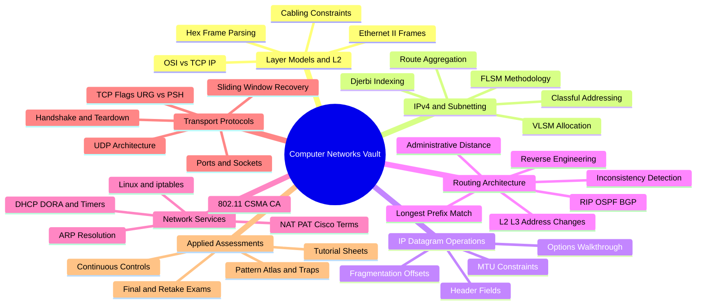

# Computer Networks — Master Vault Index

Unified study vault combining the course theory notes, the advanced syllabus material, the
assessment archive, and the chapter quiz banks into one coherent structure. Every topic from
both source versions is preserved exactly once, in its proper section, and every gap flagged
by the external audit (TCP deep dive, DHCP architecture, 802.11 wireless, Cisco NAT
terminology, Djerbi subnet indexing, fragmentation with options, Linux/iptables, hop-by-hop
tracing, cabling constraints, hex parsing) now has a dedicated note.

## Suggested Study Flow

1. **Foundations** → Section 01 (models, Ethernet, cabling, hex parsing)
2. **Addressing** → Section 02 (classful, FLSM, VLSM, summarization, Djerbi indexing) — the highest-yield exam skill
3. **Datagram mechanics** → Section 03 (header fields, fragmentation, options walkthrough)
4. **Device operation** → Section 04 (Cisco IOS CLI and access security)
5. **Routing** → Sections 05 (table anatomy, LPM, static/default, inconsistency, reverse-engineering) and 07 (RIPv2, OSPF/Dijkstra, BGP)
6. **Services & perimeter** → Section 06 (ARP, hop-by-hop tracing, DHCP, NAT/PAT, Linux/iptables, 802.11)
7. **Transport** → Section 08 (ports, UDP, TCP header/flags, handshake/teardown, sliding window)
8. **Assessment** → Section 09 (14 graded papers with solutions + the pattern atlas) and the Quiz banks

## Vault Map

| Section | Contents |
| :--- | :--- |
| [[01 Physical & Data Link Layers/01.00 Introduction\|01 — Physical & Data Link Layers]] | OSI/TCP-IP models, MAC classification, Ethernet II frames, hubs vs. switches, cabling constraints, Wireshark hex parsing |
| [[02 IPv4 Network Layer/02.00 Introduction\|02 — IPv4 Network Layer]] | Classful addressing, FLSM, VLSM, route summarization, gateway constraints, memory palace, mathematical subnet indexing |
| [[03 IP Datagram & Fragmentation/03.00 Introduction\|03 — IP Datagram & Fragmentation]] | IPv4 header fields, fragmentation mathematics, worked walkthroughs (incl. IP options) |
| [[04 Cisco IOS CLI Reference/04.00 Introduction\|04 — Cisco IOS CLI Reference]] | EXEC modes, configuration commands, device access security, diagnostics and file management |
| [[05 IP Routing Architectures/05.00 Introduction\|05 — IP Routing Architectures]] | Route entries & AD, longest prefix match, static & default routing, inconsistency detection, topology reverse-engineering |
| [[06 Network Services & L2-L3 Interfacing/06.00 Introduction\|06 — Network Services & L2-L3 Interfacing]] | ARP, hop-by-hop packet tracing, DHCP architecture, NAT/PAT (incl. Cisco terminology), Linux tools & iptables, IEEE 802.11 wireless |
| [[07 Advanced - Routing Protocols & Algorithms/07.00 Introduction\|07 — Routing Protocols & Algorithms]] | Router operations, static vs. dynamic paradigms, RIPv2 (incl. update logic), OSPF multi-area & Dijkstra, BGP |
| [[08 Advanced - Transport Layer Protocols & Mechanics/08.00 Introduction\|08 — Transport Layer Protocols & Mechanics]] | Transport role, ports & sockets, UDP, TCP header & flags, TCP handshake & teardown math, TCP sliding window & loss recovery |
| [[09 Exams & Assessments/09.00 Introduction\|09 — Exams & Assessments]] | 14 graded assessments (2020–2025) with official solutions + the exam pattern atlas (12 patterns, trap table) |
| Quiz | Chapter question banks (05–08) with source-linked flashcards |

