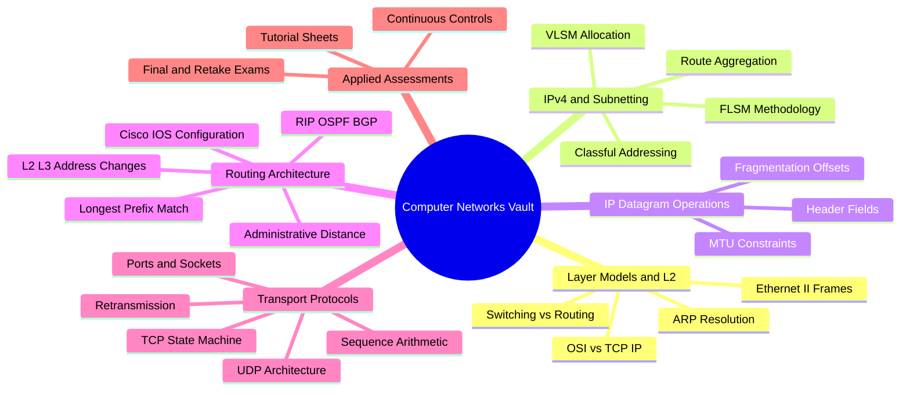

# Computer Networks — Master Vault Index

Unified study vault combining the course theory notes, the advanced syllabus material, the
assessment archive, and the chapter quiz banks into one coherent structure. Every topic from
both source versions is preserved exactly once, in its proper section.

## Suggested Study Flow

1. **Foundations** → Section 01 (models, Ethernet, switching)
2. **Addressing** → Section 02 (classful, FLSM, VLSM, summarization) — the highest-yield exam skill
3. **Datagram mechanics** → Section 03 (header fields, fragmentation)
4. **Device operation** → Section 04 (Cisco IOS CLI)
5. **Routing** → Sections 05 and 07 (static, inconsistency detection, RIP, OSPF, BGP)
6. **Perimeter & transport** → Sections 06 and 08 (ARP, NAT/PAT, ports, UDP, TCP)
7. **Assessment** → Section 09 (graded exams with solutions) + the Quiz banks

## Vault Map

| Section | Contents |
| :--- | :--- |
| [[01 Physical & Data Link Layers/01.00 Introduction\|01 — Physical & Data Link Layers]] | OSI/TCP-IP models, MAC classification, Ethernet II frames, hubs vs. switches, L1 media |
| [[02 IPv4 Network Layer/02.00 Introduction\|02 — IPv4 Network Layer]] | Classful addressing, FLSM, VLSM, route summarization, gateway constraints, memory palace |
| [[03 IP Datagram & Fragmentation/03.00 Introduction\|03 — IP Datagram & Fragmentation]] | IPv4 header fields, fragmentation mathematics, worked fragmentation walkthroughs |
| [[04 Cisco IOS CLI Reference/04.00 Introduction\|04 — Cisco IOS CLI Reference]] | EXEC modes, configuration commands, diagnostics and file management |
| [[05 IP Routing Architectures/05.00 Introduction\|05 — IP Routing Architectures]] | Route entries & AD, static routing, RIP, OSPF/Dijkstra, inconsistency detection, topology reverse-engineering |
| [[06 Advanced - Network Fundamentals & L2-L3 Interfaces/06.00 Introduction\|06 — Network Fundamentals & L2-L3 Interfaces]] | ARP deep dive, NAT & PAT |
| [[07 Advanced - Routing Protocols & Algorithms/07.00 Introduction\|07 — Routing Protocols & Algorithms]] | Router operations, LPM, static vs. dynamic, RIPv2, OSPF multi-area, BGP |
| [[08 Advanced - Transport Layer Protocols & Mechanics/08.00 Introduction\|08 — Transport Layer Protocols & Mechanics]] | Transport role, ports & sockets, UDP, TCP header, TCP connection management |
| [[09 Exams & Assessments/09.00 Introduction\|09 — Exams & Assessments]] | 14 graded assessments (2020–2027) with official solutions |
| Quiz | Chapter question banks (05–08) with source-linked flashcards |

