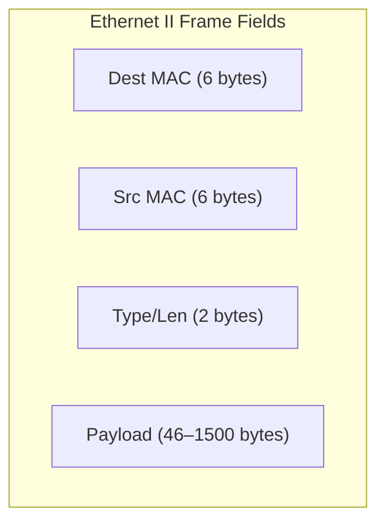

### 1.2 Ethernet Frame Structure & Header Decoding

An Ethernet II frame (excluding the Preamble and Frame Check Sequence) has a minimum length of 64 bytes and a maximum length of 1518 bytes.



#### Parsing Field Margins

1. **Destination MAC (Bytes 1–6):** The hardware address of the receiving interface or group.
2. **Source MAC (Bytes 7–12):** The hardware address of the transmitting interface (must be unicast).
3. **EtherType (Bytes 13–14):** Identifies the network layer protocol encapsulated within the payload. Common values include:
   * `0x0800` $\implies$ IPv4
   * `0x0806` $\implies$ ARP (Address Resolution Protocol)
   * `0x86DD` $\implies$ IPv6
4. **Data / Payload (Bytes 15 to $N$):** The encapsulated packet. If the payload is smaller than 46 bytes, it is padded to meet the minimum Ethernet frame size.

#### Walkthrough: Parsing a Raw Frame Capture

```
ffff ffff ffff 09ab 14d8 0548 0806 0001
0800 0604 0001 09ab 14d8 0548 7d05 300a
0000 0000 0000 7d12 6e03
```

* **Destination MAC:** `ffff ffff ffff` (Broadcast address)
* **Source MAC:** `09-ab-14-d8-05-48` (Unicast address)
* **EtherType:** `0806` (Decodes to **ARP**)
* **Payload:** Starts at byte 15 (`0001 0800 0604...`). This represents the ARP payload (Hardware type: Ethernet, Protocol type: IPv4, etc.).

---

#### Complete Frame Anatomy (Including Preamble and FCS)

The full Ethernet II transmission unit adds synchronization and error-detection fields around the addressed frame core:

```
[Preamble: 7 Bytes] [SFD: 1 Byte] [Dest MAC: 6 Bytes] [Source MAC: 6 Bytes] [Type: 2 Bytes] [Data and Padding: 46 - 1500 Bytes] [FCS: 4 Bytes]
```

* **Preamble (7 Bytes):** Pattern of alternating `10101010` bits to synchronize receiving NIC clock frequencies.
* **Start Frame Delimiter (SFD) (1 Byte):** Concludes synchronization with `10101011`, indicating payload fields follow immediately.
* **Frame Check Sequence (FCS) (4 Bytes):** 32-bit CRC calculation checking for bit errors sustained during physical transmission.

The minimum frame size of 64 bytes and maximum of 1518 bytes apply to the addressed portion (Destination MAC through FCS); the preamble and SFD are not counted.


---

#### Second Walkthrough: IPv4 Frame Capture

When analyzing network frame captures in hexadecimal format:

```text
00 1a 73 24 44 89 00 12 17 41 c2 c7 08 00 45 00 00 3c 00 29 00 00 96 01 ...
```

1. **Bytes 0 to 5:** Destination MAC (`00:1a:73:24:44:89`).
2. **Bytes 6 to 11:** Source MAC (`00:12:17:41:c2:c7`).
3. **Bytes 12 to 13:** EtherType (`0x0800` $\implies$ IPv4).
4. **Byte 14 onwards:** Beginning of the encapsulated IPv4 header.
