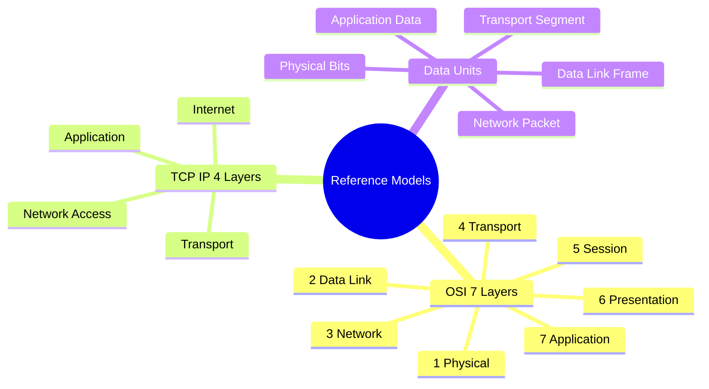

### 1.4 OSI & TCP/IP Reference Models and Encapsulation

This note establishes the layered reference frameworks on which every other section of the vault depends. Layer responsibilities, protocol data units (PDUs), and the encapsulation sequence defined here are referenced throughout the theory notes and the examination archive.

---

### Theoretical Framework
Computer network architectures organize communication protocols into layered hierarchies. Two dominant conceptual frameworks describe this organization:

1. **The Open Systems Interconnection (OSI) Reference Model:** Formulated by the International Organization for Standardization (ISO), it establishes a theoretical, seven-layer modular architecture to standardize inter-vendor communication.
2. **The TCP/IP Model (Internet Protocol Suite):** Developed through DARPA research for the ARPANET, this architecture focuses on practical, scalable network interconnections across diverse physical media.

### Layer Mapping and Protocol Data Units

| Layer Number | OSI Layer Name | TCP/IP Updated Layer | Primary Functional Responsibility | Protocol Data Unit (PDU) | Example Protocols / Hardware |
| :---: | :---: | :---: | :---: | :---: | :---: |
| **7** | Application | Application | User-facing interface, network service access | Data / Payload | HTTP, HTTPS, DNS, SMTP, FTP, SSH, DHCP |
| **6** | Presentation | Application | Data representation, character encoding, compression, encryption | Data / Payload | TLS, SSL, ASCII, JPEG, MPEG |
| **5** | Session | Application | Inter-host dialogue control, session checkpointing, session synchronization | Data / Payload | NetBIOS, RPC, Sockets |
| **4** | Transport | Transport | End-to-end logical process communication, flow control, reliability, error handling | Segment (TCP) / Datagram (UDP) | TCP, UDP, SCTP |
| **3** | Network | Internet | Logical host addressing, path determination across internetworks, route calculation | Packet | IPv4, IPv6, ICMP, IPsec, OSPF, RIP, BGP |
| **2** | Data Link | Network Access / Data Link | Node-to-node framing, physical MAC addressing, media access control, error detection | Frame | Ethernet (802.3), Wi-Fi (802.11), PPP, Switches |
| **1** | Physical | Network Access / Physical | Raw unstructured bitstream encoding over physical copper, optical, or radio channels | Bits | Cables (Cat6, Fiber), Hubs, Repeaters, Transceivers |

### Data Encapsulation and Protocol Multiplexing
Communication flows downward through the sender's protocol stack:
1. The **Application layer** prepares payload data (e.g., an HTTP GET request).
2. The **Transport layer** appends a header containing source and destination port numbers to create a **Segment**.
3. The **Network layer** attaches source and destination IP addresses, producing an **IP Packet**.
4. The **Data Link layer** encapsulates the packet into an **Ethernet Frame** with Layer 2 MAC addresses and a Cyclic Redundancy Check (CRC) trailer.
5. The **Physical layer** encodes these frame bits into electrical voltages, light pulses, or radio frequencies.

Upon receipt, the destination system moves upward through the stack, stripping headers at each layer (decapsulation).
