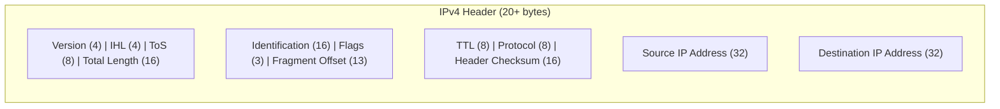

### 3.1 IP Header Fields



* **Version (4 bits):** Set to `4` for IPv4.
* **Internet Header Length - IHL (4 bits):** The length of the header in 32-bit (4-byte) words.
  $$\text{Header Length in Bytes} = \text{IHL Value} \times 4$$
  * *Example:* If the IHL value is `5`, the header length is 20 bytes.
* **Total Length (16 bits):** The size of the entire IP packet (Header + Payload) in bytes.
  $$\text{Payload Data Size} = \text{Total Length} - (\text{IHL Value} \times 4)$$
* **Identification (16 bits):** A unique identifier shared by all fragments of an exploded datagram, used by the receiving host to reassemble the packet.
* **Flags (3 bits):**
  * **Bit 0 (Reserved):** Must be `0`.
  * **Bit 1 - Don't Fragment (DF):** If set to `1`, the router cannot fragment the packet. If the packet exceeds the path MTU, it is dropped and an ICMP Destination Unreachable message is returned.
  * **Bit 2 - More Fragments (MF):** Set to `1` for all intermediate fragments; set to `0` for the final fragment.
* **Fragment Offset (13 bits):** Specifies the position of the fragmented payload relative to the start of the original payload, measured in **8-byte blocks (64-bit blocks)**.

---

#### Complete Header Layout (RFC 791)

```
 0                   1                   2                   3
 0 1 2 3 4 5 6 7 8 9 0 1 2 3 4 5 6 7 8 9 0 1 2 3 4 5 6 7 8 9 0 1
+-+-+-+-+-+-+-+-+-+-+-+-+-+-+-+-+-+-+-+-+-+-+-+-+-+-+-+-+-+-+-+-+
|Version|  IHL  |Type of Service|          Total Length         |
+-+-+-+-+-+-+-+-+-+-+-+-+-+-+-+-+-+-+-+-+-+-+-+-+-+-+-+-+-+-+-+-+
|         Identification        |Flags|      Fragment Offset    |
+-+-+-+-+-+-+-+-+-+-+-+-+-+-+-+-+-+-+-+-+-+-+-+-+-+-+-+-+-+-+-+-+
|  Time to Live |    Protocol   |        Header Checksum        |
+-+-+-+-+-+-+-+-+-+-+-+-+-+-+-+-+-+-+-+-+-+-+-+-+-+-+-+-+-+-+-+-+
|                       Source IP Address                       |
+-+-+-+-+-+-+-+-+-+-+-+-+-+-+-+-+-+-+-+-+-+-+-+-+-+-+-+-+-+-+-+-+
|                    Destination IP Address                     |
+-+-+-+-+-+-+-+-+-+-+-+-+-+-+-+-+-+-+-+-+-+-+-+-+-+-+-+-+-+-+-+-+
|                    Options (if any)           |    Padding    |
+-+-+-+-+-+-+-+-+-+-+-+-+-+-+-+-+-+-+-+-+-+-+-+-+-+-+-+-+-+-+-+-+
```

Fields not covered above:

* **Type of Service (TOS) / DSCP (8 bits):** Quality of Service markings and Congestion Notifications.
* **Time to Live (TTL) (8 bits):** Hop counter decremented by 1 at every routing node. If TTL reaches 0, the router discards the packet and sends an ICMP Time Exceeded message back to the source, preventing infinite loops.
* **Protocol (8 bits):** Identifies the next higher-layer protocol:
  * `1`: ICMP (Internet Control Message Protocol)
  * `6`: TCP (Transmission Control Protocol)
  * `17`: UDP (User Datagram Protocol)
* **Header Checksum (16 bits):** Error-detection field calculated over header contents only. It is recalculated at every hop because the TTL field changes.
* **Source / Destination IP Addresses (32 bits each):** Originating sender and ultimate destination IP endpoints.
* **Options and Padding (variable):** Up to 40 bytes of optional fields; the maximum IHL of 15 ($15 \times 4 = 60$ bytes) bounds the total header size.
