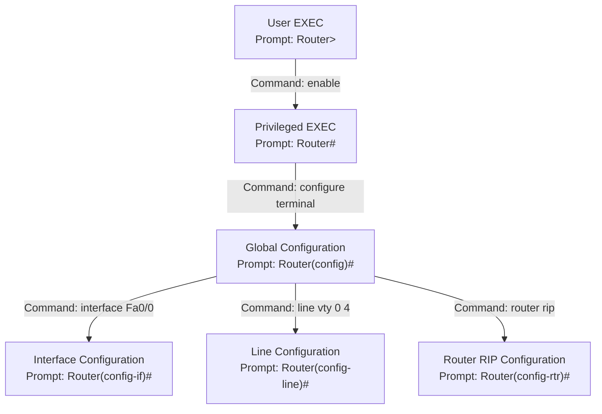

### 4.1 CLI Executive Modes & Prompts

Cisco IOS uses a hierarchical command-line structure. Each mode provides access to a specific set of commands.

---

#### Mode Descriptions

* **User EXEC Mode (`Router>`):** Read-only mode used to check basic device connectivity.
* **Privileged EXEC Mode (`Router#`):** Provides administrative access, system debugging, and configuration file operations. Entered with `enable`.
* **Global Configuration Mode (`Router(config)#`):** Used to apply system-wide settings, routing protocols, and global interfaces. Entered with `configure terminal`.
* **Interface Configuration Mode (`Router(config-if)#`):** Modifies port-specific attributes, assigns IP addresses, and toggles physical administrative state. Entered with `interface <type> <slot/port>`.
