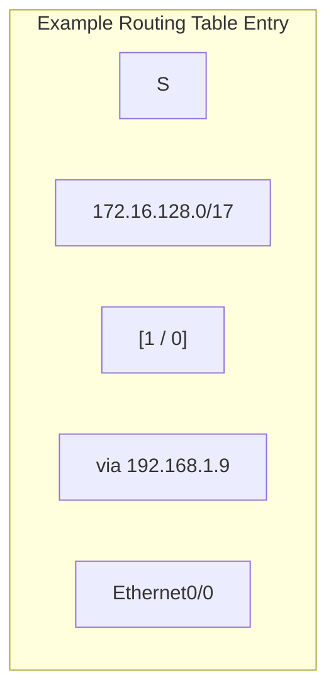

### 5.1 Route Entries & Administrative Distance

A router makes forwarding decisions by looking up the destination IP address in its routing table. 



#### Administrative Distance (AD)
AD represents the trustworthiness of a route source. If a router learns multiple paths to the same destination from different sources, it installs the path with the **lowest AD** in the routing table.

| Route Source | Default AD | Trustworthiness Level |
| :--- | :---: | :--- |
| **Directly Connected Interface** | $0$ | Most Trustworthy |
| **Static Route** | $1$ | Highly Trustworthy |
| **External BGP** | $20$ | High (Internet Inter-AS) |
| **EIGRP (Internal)** | $90$ | High |
| **OSPF** | $110$ | Medium |
| **IS-IS** | $115$ | Medium |
| **RIP** | $120$ | Low |

#### Route Lookup Logic
When forwarding a packet, the router parses its routing table and selects the route that matches the destination IP address with the **longest prefix length** (longest match rule).

---

#### Reading a Complete Routing Table Entry

An entry generated by dynamic or static routing displays the following information:

```text
O 10.1.5.0/24 [110/20] via 192.168.12.2, 00:14:22, GigabitEthernet0/1
```
* **Protocol Code (`O`):** Learned via OSPF (`C` = Connected, `L` = Local, `S` = Static, `R` = RIP).
* **Destination Prefix (`10.1.5.0/24`):** Target network address and subnet mask.
* **Administrative Distance (`110`):** Trustworthiness rating of the route source.
* **Metric (`20`):** Path cost calculated by the protocol algorithm.
* **Next-Hop IP (`via 192.168.12.2`):** IP address of the neighboring router interface.
* **Uptime (`00:14:22`):** Time since the route was installed or refreshed.
* **Exit Interface (`GigabitEthernet0/1`):** Local hardware port used to forward traffic.
