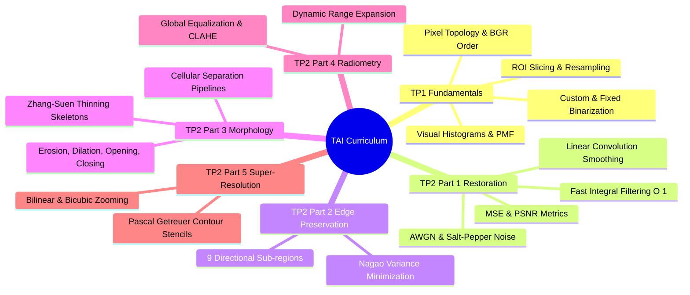

# 06.0. Advanced Image Processing Index and Curriculum MOC

## 1. Track Overview
The Advanced Image Processing (*Traitement Avancé des Images* - TAI) curriculum covers the mathematical foundations, spatial mechanics, and algorithm design patterns required to process, enhance, and reconstruct digital images.



## 2. Note Sequence and Coursework Mapping

| Chapter Document | Focus Topics | Coursework Reference | Key Library Connections |
| :--- | :--- | :--- | :--- |
| **06.1. Digital Image Acquisition & Thresholding** | Ingestion, BGR memory layout, scanline editing, binary thresholding | TP1 Ex 1, 2, 3 | [[16. OpenCV Core Architecture - Matrix Representation, Channels, and Color Constellations]] |
| **06.2. Spatial Transformations & Histograms** | ROI cropping, affine rotations, Matplotlib multi-channel histograms | TP1 Ex 4, 5 | [[17. Image Spatial Transformations - Interpolation, Scaling, Cropping, and Affine Warping]], [[18. Visual Frequency and Radiometry - Histograms, Equalization, AHE, and CLAHE]] |
| **06.3. Noise Models & Convolution Smoothing** | Additive Gaussian noise, impulse corruption, linear spatial filters, PSNR/MSE | TP2 Ex 1, 2 | [[19. Spatial Image Restoration - Noise Models, Linear Convolution, and Fast Integral Filters]], [[22. Objective Image Quality Assessment - MSE, PSNR, and SSIM Metrics]] |
| **06.4. Fast Integral Filtering & Adaptive Smoothing** | Constant-time $O(1)$ box filtering, summed-area tables, adaptive smoothing | TP2 Ex 2 Homework | [[19. Spatial Image Restoration - Noise Models, Linear Convolution, and Fast Integral Filters]] |
| **06.5. Nagao Filter Smoothing** | Non-linear edge preservation, 9 sub-regions, local variance minimization | TP2 Ex 3 | [[20. Non-Linear and Edge-Preserving Filtering - Median, Bilateral, and Nagao Filters]] |
| **06.6. Mathematical Morphology & Skeletonization** | Structuring elements, erosion, dilation, cell counting, Zhang-Suen thinning | TP2 Ex 4 | [[21. Mathematical Morphology - Set Theory, Structuring Elements, and Thinning]] |
| **06.7. Contrast Dynamics, Equalization & CLAHE** | Contrast stretching, global equalization, tile-based CLAHE | TP2 Ex 5 | [[18. Visual Frequency and Radiometry - Histograms, Equalization, AHE, and CLAHE]] |
| **06.8. Super-Resolution & Contour Stencils** | Single-frame SR, Total Variation along curves, Getreuer stencils | TP2 Ex 6 | [[22. Objective Image Quality Assessment - MSE, PSNR, and SSIM Metrics]], [[23. Super-Resolution and Edge-Adaptive Interpolation - Pascal Getreuer Contour Stencils]] |
```

---

---
