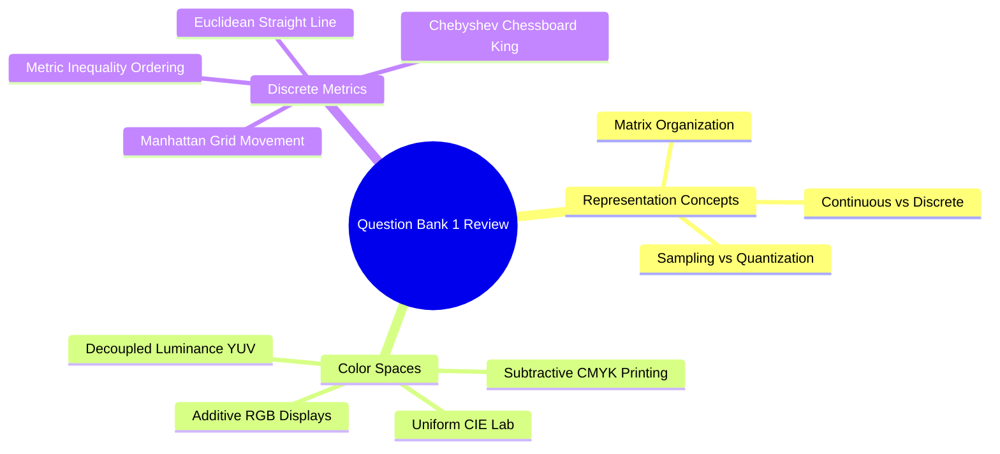

# Question Bank 1: Digital Image Fundamentals, Color Spaces, and Topology

---

### Section 1: Conceptual True / False

> [!question] A digital image is an inherently continuous representation of a physical visual scene.
>> [!success]- Answer
>> **False.** A digital image is discrete in both spatial coordinates (via spatial sampling) and intensity amplitudes (via quantization). Continuous physical scenes must be converted to discrete numerical matrices for computer processing.

> [!question] Vector images lose visual sharpness when scaled up because they are composed of a fixed grid of pixels.
>> [!success]- Answer
>> **False.** Vector images are stored as mathematical parametric descriptions (e.g., lines, Bézier curves, polygons) and are resolution-independent. Raster (bitmap) images are composed of a fixed pixel grid and lose quality when scaled up.

> [!question] In OpenCV and NumPy, an image is indexed using Cartesian coordinates `[x, y]` where `x` represents horizontal width.
>> [!success]- Answer
>> **False.** In NumPy and OpenCV array representations, matrices are indexed in row-major order: `[row, column]`, which corresponds to `[y, x]`. The first index represents vertical height ($y$), and the second represents horizontal width ($x$).

> [!question] The metric ordering inequality $d_\infty(P, Q) \le d_2(P, Q) \le d_1(P, Q)$ holds for any two pixels on a discrete integer grid.
>> [!success]- Answer
>> **True.** Chebyshev distance ($d_\infty$) allows diagonal steps without distance penalties, making it the shortest metric. Manhattan distance ($d_1$) restricts movement to horizontal and vertical steps only, making it the longest. Straight-line Euclidean distance ($d_2$) lies between the two.

> [!question] Applying histogram equalization independently to the Red, Green, and Blue channels of an RGB image is the standard method for color contrast enhancement.
>> [!success]- Answer
>> **False.** Equalizing RGB channels independently changes the relative ratios between colors, causing severe shifts in hue. To enhance contrast safely, the image should be converted to a decoupled luminance-chrominance space (such as CIE $L^*a^*b^*$ or HSV), where equalization is applied only to the luminance channel ($L^*$ or $V$).

---

### Section 2: Multiple Choice Questions

> [!question] Which mathematical step converts continuous spatial coordinates $(x, y)$ into discrete integer grid indices $[m, n]$?
> a) Amplitude Quantization  
> b) Spatial Sampling  
> c) Color Demosaicing  
> d) Histogram Specification  
>> [!success]- Answer
>> **b) Spatial Sampling.** Sampling discretizes continuous spatial coordinates $(x, y)$, while quantization discretizes continuous intensity amplitudes $f(x, y)$.

> [!question] How many distinct colors can be represented in a standard 24-bit True Color RGB image?
> a) $256$  
> b) $65,536$  
> c) $16,777,216$ ($2^{24}$)  
> d) $4,294,967,296$ ($2^{32}$)  
>> [!success]- Answer
>> **c) $16,777,216$ ($2^{24}$).** Each of the three color channels (Red, Green, Blue) uses 8 bits ($2^8 = 256$ levels), yielding $256 \times 256 \times 256 = 16,777,216$ possible colors.

> [!question] Which color space is designed to be perceptually uniform, meaning Euclidean coordinate distances match differences perceived by human vision?
> a) RGB  
> b) CMYK  
> c) CIE $L^*a^*b^*$  
> d) YCbCr  
>> [!success]- Answer
>> **c) CIE $L^*a^*b^*$.** CIE $L^*a^*b^*$ was mathematically derived so that the Euclidean distance $\Delta E^*$ between two color vectors directly corresponds to the perceptual difference perceived by human observers.

> [!question] What is the standard formula for converting RGB values to grayscale luminance while accounting for human visual sensitivity?
> a) $Y = \frac{R + G + B}{3}$  
> b) $Y = 0.333R + 0.333G + 0.333B$  
> c) $Y = 0.299R + 0.587G + 0.114B$  
> d) $Y = \max(R, G, B)$  
>> [!success]- Answer
>> **c) $Y = 0.299R + 0.587G + 0.114B$.** This weighted sum (ITU-R BT.601) reflects the distribution of cone cells in the human retina, which is most sensitive to green wavelengths and least sensitive to blue.

> [!question] Which distance metric describes the movement of a king on a chessboard?
> a) Euclidean Distance ($d_2$)  
> b) Manhattan Distance ($d_1$)  
> c) Chebyshev Distance ($d_\infty$)  
> d) Mahalanobis Distance  
>> [!success]- Answer
>> **c) Chebyshev Distance ($d_\infty$).** Defined as $d_\infty(P, Q) = \max(|x_p - x_q|, |y_p - y_q|)$, matching the king's ability to move one square horizontally, vertically, or diagonally.

---

### Section 3: Matching Concept Associations

> [!question] Match each distance metric with its geometric property.
>> [!example] Column A
>> a) Manhattan Distance ($d_1$)  
>> b) Euclidean Distance ($d_2$)  
>> c) Chebyshev Distance ($d_\infty$)  
>
>> [!example] Column B
>> 1) Straight-line distance using the Pythagorean theorem; forms circular contours.  
>> 2) Restricts movement to horizontal and vertical steps; forms diamond-shaped contours.  
>> 3) Maximum of coordinate differences; forms square contours.  
>
>> [!success]- Answer
>> * a) $\to$ 2)
>> * b) $\to$ 1)
>> * c) $\to$ 3)

> [!question] Match each image format with its primary characteristic.
>> [!example] Column A
>> a) PNG  
>> b) JPEG  
>> c) DICOM  
>> d) RAW  
>
>> [!example] Column B
>> 1) Lossy compression using DCT; introduces $8 \times 8$ blocking artifacts at low bitrates.  
>> 2) Lossless compression using DEFLATE; supports alpha transparency channels.  
>> 3) Unprocessed sensor data with high bit-depth prior to camera demosaicing.  
>> 4) Bundles pixel data with clinical metadata, acquisition settings, and calibration parameters.  
>
>> [!success]- Answer
>> * a) $\to$ 2)
>> * b) $\to$ 1)
>> * c) $\to$ 4)
>> * d) $\to$ 3)
