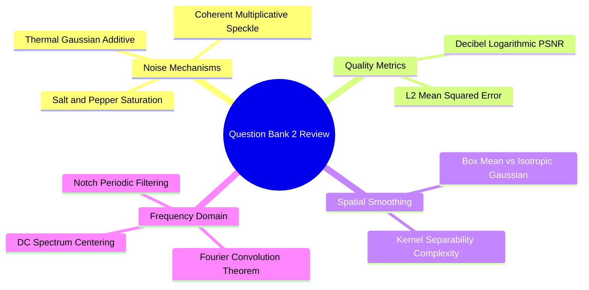

# Question Bank 2: Noise Models, Spatial Transformations, and Spectral Filters

---

### Section 1: Conceptual True / False

> [!question] Thermal sensor noise is most accurately modeled as impulsive salt-and-pepper noise.
>> [!success]- Answer
>> **False.** Thermal sensor noise is modeled as zero-mean additive Gaussian noise. Salt-and-pepper noise is caused by transmission bit errors, dead sensor photo-sites, or analog-to-digital converter failures.

> [!question] The Convolution Theorem states that 2D spatial convolution is mathematically equivalent to element-wise multiplication in the frequency domain.
>> [!success]- Answer
>> **True.** $f(x, y) * h(x, y) \iff F(u, v) \cdot H(u, v)$. This equivalence allows large spatial convolutions to be computed efficiently in the frequency domain using the Fast Fourier Transform (FFT).

> [!question] A higher Peak Signal-to-Noise Ratio (PSNR) indicates greater error and lower visual fidelity relative to the original image.
>> [!success]- Answer
>> **False.** PSNR is inversely proportional to the Mean Squared Error (MSE). Lower MSE values produce higher PSNR values, indicating better restoration quality and higher fidelity to the reference image.

> [!question] Decomposing a $W \times W$ 2D separable filter into two 1D passes reduces computational complexity from $\mathcal{O}(W^2)$ to $\mathcal{O}(2W)$ operations per pixel.
>> [!success]- Answer
>> **True.** For example, convolving an image with a $15 \times 15$ separable Gaussian filter requires only $15 + 15 = 30$ multiplications per pixel, compared to $15^2 = 225$ multiplications for a direct 2D convolution.

> [!question] A low-pass filter in the frequency domain attenuates high frequencies, producing an image sharpening effect.
>> [!success]- Answer
>> **False.** High frequencies correspond to sharp transitions, edges, and fine details. Attenuating high frequencies smooths and blurs the image. Image sharpening requires a high-pass filter.

---

### Section 2: Multiple Choice Questions

> [!question] Which noise model is described by the equation $G(x, y) = F(x, y) \cdot \eta(x, y)$?
> a) Additive Thermal Noise  
> b) Multiplicative Speckle Noise  
> c) Impulsive Salt-and-Pepper Noise  
> d) Uniform Quantization Noise  
>> [!success]- Answer
>> **b) Multiplicative Speckle Noise.** In multiplicative noise models, noise amplitude is proportional to the local signal intensity. It is common in coherent imaging systems like radar (SAR) and medical ultrasound.

> [!

question] What does the DC component at the center of a shifted 2D Fourier spectrum represent?
> a) The highest spatial frequency in the image  
> b) The total average luminance (brightness) of the entire image  
> c) The variance of high-frequency noise  
> d) The direction of the dominant edge gradient  
>> [!success]- Answer
>> **b) The total average luminance (brightness) of the entire image.** The DC term $F(0, 0)$ is the sum of all pixel intensities in the spatial domain: $F(0, 0) = \sum_{x} \sum_{y} f(x, y)$. When centered via `fftshift`, it represents the zero-frequency spatial baseline, which is directly proportional to the average image brightness.

> [!question] When designing a spatial Gaussian filter, what is the effect of increasing the standard deviation parameter $\sigma$?
> a) The filter kernel size automatically shrinks  
> b) The bell curve widens, smoothing across a larger spatial neighborhood and increasing blur  
> c) High-frequency details and sharp edges are accentuated  
> d) The kernel values become negative at the periphery  
>> [!success]- Answer
>> **b) The bell curve widens, smoothing across a larger spatial neighborhood and increasing blur.** As $\sigma$ increases, the Gaussian distribution spreads out, assigning more weight to distant neighboring pixels. This lowers the filter's cutoff frequency, attenuating more high frequencies and producing a stronger blurring effect.

> [!question] Which frequency-domain filter is most effective for removing structured, periodic patterns (such as electrical interference stripes)?
> a) Ideal Low-Pass Filter  
> b) Butterworth High-Pass Filter  
> c) Band-Reject (Notch) Filter  
> d) Homomorphic Filter  
>> [!success]- Answer
>> **c) Band-Reject (Notch) Filter.** Periodic patterns in the spatial domain manifest as concentrated, symmetrical impulse spikes at specific frequency coordinates $(u_0, v_0)$ in the Fourier spectrum. A notch reject filter places localized attenuation zeros directly over these frequency spikes without disturbing the rest of the spectrum.

---

### Section 3: Matching Concept Associations

> [!question] Match each noise type with its underlying physical cause.
>> [!example] Column A
>> a) Additive Gaussian Noise  
>> b) Impulsive Salt-and-Pepper Noise  
>> c) Multiplicative Speckle Noise  
>> d) Periodic Striping Noise  
>
>> [!example] Column B
>> 1) Sensor heating, electronic circuit thermal agitation (Johnson-Nyquist noise).  
>> 2) Coherent wave interference in ultrasound and Synthetic Aperture Radar (SAR).  
>> 3) Faulty analog-to-digital converters, dead detector photo-sites, or transmission dropouts.  
>> 4) AC electromagnetic interference from alternating current power lines.  
>
>> [!success]- Answer
>> * a) $\to$ 1)
>> * b) $\to$ 3)
>> * c) $\to$ 2)
>> * d) $\to$ 4)

> [!question] Match each spatial filter with its corresponding mathematical operation and purpose.
>> [!example] Column A
>> a) Normalized Box Mean Filter  
>> b) Discrete Laplacian Filter  
>> c) Separable Gaussian Filter  
>> d) Sobel Gradient Operator  
>
>> [!example] Column B
>> 1) Second-order spatial derivative used for edge sharpening and contour isolation.  
>> 2) Equal-weight spatial averaging that blurs edges and smears impulsive noise.  
>> 3) First-order directional finite difference for estimating edge magnitude and orientation.  
>> 4) Distance-weighted low-pass smoothing factorable into two orthogonal 1D passes.  
>
>> [!success]- Answer
>> * a) $\to$ 2)
>> * b) $\to$ 1)
>> * c) $\to$ 4)
>> * d) $\to$ 3)
