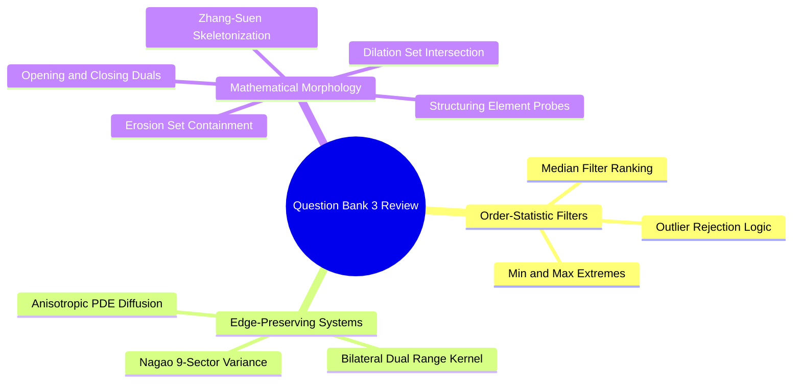

# Question Bank 3: Non-Linear Spatial Filters, Nagao Mechanics, and Morphology

---

### Section 1: Conceptual True / False

> [!question] The Median filter is a linear filter because its output is calculated using a convolution sum with a fixed weight matrix.
>> [!success]- Answer
>> **False.** The Median filter is **non-linear**. It relies on an order-statistic sorting operation: the pixels in the neighborhood are ranked in ascending order, and the middle value is selected. This operation cannot be expressed as a linear combination (weighted sum) of input pixels.

> [!question] In the Nagao edge-preserving filter, the central pixel is replaced by the mean of the sub-region that exhibits the maximum intensity variance.
>> [!success]- Answer
>> **False.** The Nagao filter selects the sub-region with the **minimum** variance ($\arg\min \sigma_k^2$). The region with the lowest variance is the most homogeneous, meaning it does not cross an edge. Averaging within this region smooths flat areas without blurring across boundaries.

> [!question] Morphological Opening is defined as an Erosion followed by a Dilation using the same Structuring Element.
>> [!success]- Answer
>> **True.** Opening is $A \circ B = (A \ominus B) \oplus B$. The initial erosion removes small isolated foreground noise and thins connections; the subsequent dilation restores surviving objects to their original dimensions without reintroducing the removed noise.

> [!question] Increasing the range parameter $\sigma_r$ in a Bilateral Filter causes it to behave more like an edge-preserving filter with sharper boundaries.
>> [!success]- Answer
>> **False.** The range parameter $\sigma_r$ controls sensitivity to photometric intensity differences. As $\sigma_r \to \infty$, the radiometric weight $G_{\sigma_r}(|I(p) - I(q)|) \to 1$ for all pixel pairs, causing the Bilateral Filter to degenerate into a standard linear Gaussian blur that blurs across edges.

> [!question] In the Perona-Malik anisotropic diffusion equation, the diffusion rate approaches zero in regions where the spatial gradient $\|\nabla I\|$ is significantly larger than the threshold parameter $K$.
>> [!success]- Answer
>> **True.** The conductance functions $c(\|\nabla I\|)$ are designed such that when $\|\nabla I\| \gg K$, $c(\|\nabla I\|) \to 0$. This stops diffusion across high-contrast boundaries, preserving sharp edges while allowing smoothing to continue in flat regions where $\|\nabla I\| \approx 0$.

> [!question] The Zhang-Suen thinning algorithm can alter the topological connectivity of a binary object during skeletonization.
>> [!success]- Answer
>> **False.** The Zhang-Suen algorithm uses strict topological conditions (such as checking for exactly one $0 \to 1$ transition in the ordered neighborhood: $A(P_1) = 1$) to ensure that removing a boundary pixel does not break an object into disconnected components or create interior holes.

---

### Section 2: Multiple Choice Questions

> [!question] Why is the Median filter substantially more effective at removing salt-and-pepper noise than the Mean filter?
> a) It computes the Fast Fourier Transform internally  
> b) Extreme outlier values ($0$ and $255$) are sorted to the ends of the rank-ordered list and discarded  
> c) It multiplies out-of-bounds pixels by zero  
> d) It amplifies high-frequency image gradients  
>> [!success]- Answer
>> **b) Extreme outlier values ($0$ and $255$) are sorted to the ends of the rank-ordered list and discarded.** In a sorting operation, extreme noise spikes fall at the beginning or end of the ordered sequence. As long as corrupted pixels make up less than half of the neighborhood window ($< 50\%$), the median value is drawn from the uncorrupted background pixels.

> [!question] How many pixels are contained within each of the 9 directional sub-regions of a standard $5 \times 5$ Nagao filter?
> a) $3$ pixels  
> b) $5$ pixels  
> c) $7$ pixels  
> d) $9$ pixels  
>> [!success]- Answer
>> **c) $7$ pixels.** In the classical Nagao-Matsuyama formulation, each of the nine sub-regions (one central cross, four cardinal directions, four diagonal corners) consists of exactly $7$ pixels, including the central pivot pixel.

> [!question] Which morphological operation is best suited for closing small interior holes and bridging narrow cracks within foreground objects?
> a) Erosion  
> b) Morphological Opening  
> c) Morphological Closing  
> d) Skeleton Thinning  
>> [!success]- Answer
>> **c) Morphological Closing.** Closing is a Dilation followed by an Erosion ($A \bullet B = (A \oplus B) \ominus B$). The initial dilation expands boundaries, merging nearby edges and filling interior holes; the subsequent erosion restores the outer dimensions of the object.

> [!question] What is the mathematical definition of the Morphological Gradient?
> a) $(A \oplus B) + (A \ominus B)$  
> b) $(A \oplus B) - (A \ominus B)$  
> c) $(A \circ B) - (A \bullet B)$  
> d) $A - (A \ominus B)$  
>> [!success]- Answer
>> **b) $(A \oplus B) - (A \ominus B)$.** The morphological gradient subtracts the eroded image (which shrinks object boundaries) from the dilated image (which expands boundaries), isolating the structural boundary contours of the foreground regions.

> [!question] In the Bilateral Filter, what two weights are multiplied together to determine the filtering contribution of a neighbor pixel $q$ to center pixel $p$?
> a) Spatial Euclidean distance and spectral Fourier magnitude  
> b) Spatial geometric distance kernel $G_{\sigma_s}$ and photometric intensity difference kernel $G_{\sigma_r}$  
> c) Directional gradient orientation and local variance  
> d) Structuring element shape and dynamic range clip limit  
>> [!success]- Answer
>> **b) Spatial geometric distance kernel $G_{\sigma_s}$ and photometric intensity difference kernel $G_{\sigma_r}$.** The bilateral filter weights each neighbor by $G_{\sigma_s}(\|p - q\|) \cdot G_{\sigma_r}(|I(p) - I(q)|)$, ensuring that only pixels that are both spatially close *and* similar in intensity contribute to the smoothed result.

> [!question] What unwanted artifact can occur when running iterative anisotropic diffusion (Perona-Malik) for too many iterations?
> a) False contouring and staircasing (turning smooth continuous gradients into piecewise flat steps)  
> b) Ringing Gibbs oscillations around high-contrast edges  
> c) High-frequency salt-and-pepper noise amplification  
> d) Inversion of grayscale luminance values  
>> [!success]- Answer
>> **a) False contouring and staircasing (turning smooth continuous gradients into piecewise flat steps).** Because anisotropic diffusion stops smoothing across gradients that exceed $K$, smooth continuous ramps (such as skies or soft shading) can segment into flat plateaus separated by sharp artificial steps, an effect known as "staircasing."

---

### Section 3: Matching Concept Associations

> [!question] Match each morphological operation with its primary visual and geometric effect.
>> [!example] Column A
>> a) Binary Erosion ($A \ominus B$)  
>> b) Binary Dilation ($A \oplus B$)  
>> c) Morphological Opening ($A \circ B$)  
>> d) Morphological Closing ($A \bullet B$)  
>
>> [!example] Column B
>> 1) Expands foreground boundaries, bridges small gaps, and fills interior holes.  
>> 2) Shrinks foreground boundaries, eliminates small outer noise specks, and breaks thin bridges.  
>> 3) Fills interior holes and joins nearby components without permanently expanding object size.  
>> 4) Eliminates small isolated noise specks and smooths contours from the inside without permanently shrinking object size.  
>
>> [!success]- Answer
>> * a) $\to$ 2)
>> * b) $\to$ 1)
>> * c) $\to$ 4)
>> * d) $\to$ 3)

> [!question] Match each non-linear edge-preserving algorithm with its core mathematical mechanism.
>> [!example] Column A
>> a) Nagao Filter  
>> b) Bilateral Filter  
>> c) Perona-Malik Filter  
>> d) Median Filter  
>
>> [!example] Column B
>> 1) Evaluates local variance across 9 directional sectors and averages within the most homogeneous one.  
>> 2) Multiplies a spatial Gaussian kernel by a range Gaussian kernel based on radiometric intensity differences.  
>> 3) Non-linear Partial Differential Equation (PDE) where conductance depends on the local spatial gradient magnitude.  
>> 4) Order-statistic rank selection that replaces the central pixel with the median of the sorted local window.  
>
>> [!success]- Answer
>> * a) $\to$ 1)
>> * b) $\to$ 2)
>> * c) $\to$ 3)
>> * d) $\to$ 4)
