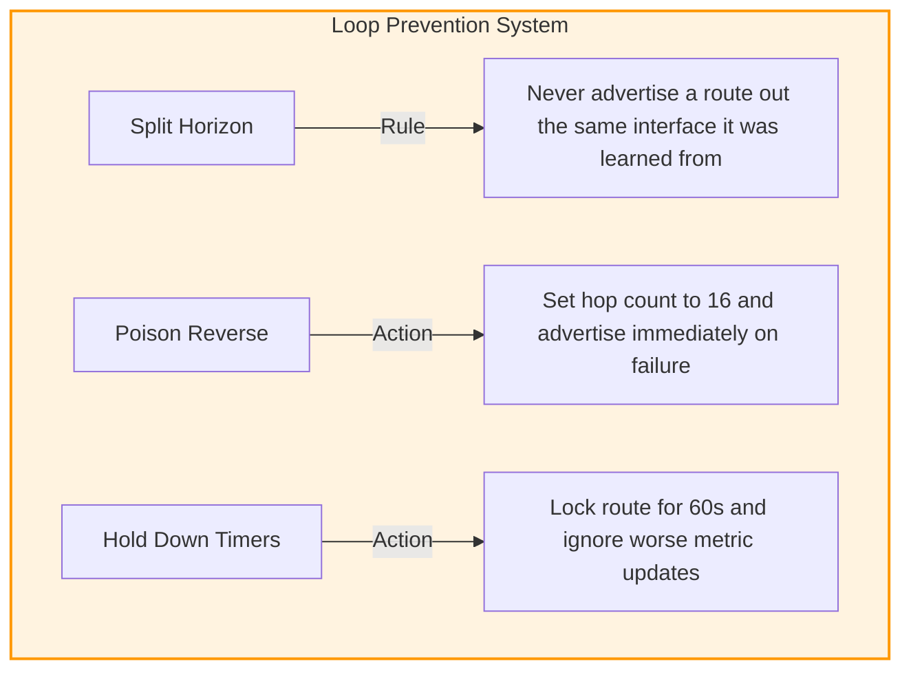

### 7.3 Distance Vector Protocols and RIPv2

#### 1. Algorithmic Basis and Operating Mechanics
Distance-vector routing protocols rely on the Bellman-Ford algorithm to calculate the shortest path to remote networks. Known as "routing by rumor," distance-vector routers do not have a complete map of the entire network topology. Instead, each router relies on the routing tables of its directly connected neighbors to learn about remote networks and build its own routing table.


* **Periodic Updates:** Routers periodically transmit their entire routing table to directly connected neighbors.
* **Routing Updates:**
  * **RIPv1:** Broadcasts updates to the general destination IP `255.255.255.255` every 30 seconds.
  * **RIPv2:** Multicasts updates to the reserved destination IP `224.0.0.9` every 30 seconds.
* **Failure Discovery:** If a router does not receive an update from a neighbor within a designated period (the **Invalid Timer**, typically 180 seconds), it marks the associated routes as unreachable (setting the hop count to 16).

---

#### 2. Detailed Loop Prevention Mechanisms

Distance-vector protocols are prone to routing loops, especially during convergence after a link failure. To prevent loops, RIP implements several key mechanisms:



##### Split Horizon
* **Mechanism:** A router never advertises a route back out the same interface through which it learned that route. This prevents adjacent routers from bouncing packets back and forth, generating a local routing loop.

##### Poison Reverse
* **Mechanism:** When a router detects that a directly connected link has failed, it immediately poisons the route by setting its hop count to an infinite value (16) and advertises it to its neighbors. This immediately informs the network that the route is offline, bypassing the standard periodic update timer.

##### Hold-Down Timers (60 seconds)
* **Mechanism:** When a router receives an update indicating that a route is unreachable, it places that route into a hold-down state for 60 seconds. During this period, the router ignores any routing updates for that subnet that offer a worse metric than the original route. This allows the topology changes to propagate across the entire network and stabilize before the route is re-evaluated.

---

#### 3. RIPv1 vs. RIPv2 Comparative Matrix

| Protocol Characteristic | RIPv1 (RFC 1058) | RIPv2 (RFC 2453) |
| :--- | :--- | :--- |
| **Addressing Support** | **Classful Only.** Does not transmit subnet masks in routing updates. | **Classless.** Transmits subnet masks in routing updates. |
| **VLSM & CIDR Support**| Not supported. | Fully supported. |
| **Egress Frame Destination**| Broadcast IP (`255.255.255.255`). | Multicast IP (`224.0.0.9`). |
| **Authentication** | Not supported. | Supported (Plaintext or MD5 hashing). |
| **Routing Metric** | Hop Count (Max 15 hops; 16 is unreachable). | Hop Count (Max 15 hops; 16 is unreachable). |
| **Packet Size Overhead** | Standard 512-byte payload. | Optimized 144-byte routing payload. |
| **Network Efficiency** | Low. Floods local segments with broadcast traffic, forcing non-routing hosts to process the frames. | Moderate. Multicast updates are processed only by OSPF/RIP routers. |

---

#### 4. RIP Configuration Reference (Cisco IOS)

```ios
-- Enable RIP Routing Process
R1(config)# router rip

-- Enforce Version 2 (Required for VLSM/Classless Routing)
R1(config-router)# version 2

-- Disable Classful Auto-Summarization
R1(config-router)# no auto-summary

-- Associate Networks (RIP advertises interfaces matching classful networks)
R1(config-router)# network 192.168.1.0
R1(config-router)# network 10.0.0.0

-- Configure Passive Interfaces
R1(config-router)# passive-interface fastethernet 0/0
```

*Note:* The `passive-interface` command prevents the router from transmitting periodic RIP
routing updates out of the specified interface (saving local network bandwidth and securing
the local segment), while still allowing RIP to advertise that interface's subnet to other
routing neighbors.

---

#### 5. RIP Route Table Update Logic (Step-by-Step Processing)

When a router running RIP receives a routing update from a neighbor:

1. **Increment the metric** (hop count) of all incoming route entries by 1.
2. **Compare each entry** against the current routing table:
   * **New Route:** destination not present $\implies$ install.
   * **Better Metric:** destination present, lower metric $\implies$ replace.
   * **Same Next Hop:** update came from the neighbor that originally advertised the route
     $\implies$ **overwrite unconditionally**, even if the new metric is worse (the neighbor
     knows the current truth).
   * **Worse Metric (Different Neighbor):** discard the update.

##### Worked Update Walkthrough

*Given R1's starting routing table:*
* `134.33.0.0/16` | Metric 1 | Directly Connected
* `145.108.0.0/16` | Metric 1 | Directly Connected
* `0.0.0.0/0` | Metric 1 | Next Hop `134.33.12.1`
* `34.0.0.0/8` | Metric 4 | Next Hop `145.108.1.9`
* `141.12.0.0/16` | Metric 3 | Next Hop `145.108.1.9`

*Update received from neighbor `145.108.1.9`:* `199.245.180.0/24` [3], `34.0.0.0/8` [2],
`141.12.0.0/16` [4].

1. **Increment all incoming metrics:** `199.245.180.0/24` $\to$ 4; `34.0.0.0/8` $\to$ 3;
   `141.12.0.0/16` $\to$ 5.
2. **Evaluate:**
   * `199.245.180.0/24` — not in table $\implies$ **install** (metric 4, via `145.108.1.9`).
   * `34.0.0.0/8` — in table at metric 4 via the *same* neighbor; update offers 3 < 4 $\implies$
     **improve to metric 3**.
   * `141.12.0.0/16` — in table at metric 3 via the *same* neighbor; update offers 5 > 3 $\implies$
     **same-neighbor rule forces the overwrite** to metric 5 (the metric worsened because the
     path behind that neighbor genuinely lengthened).

*Resulting R1 table:* `34.0.0.0/8` metric 3, `141.12.0.0/16` metric **5** (not 3!),
`199.245.180.0/24` metric 4 — all via `145.108.1.9`; connected and default routes unchanged.

> **Exam trap:** the same-neighbor overwrite is the rule students forget — a *worse* metric
> from the **original advertiser** must still be accepted.
