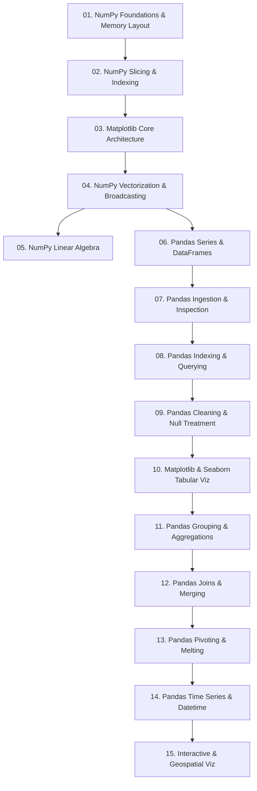

# 00. Library Learning Roadmap

## 1. Overview and Pedagogical Progression
This single directory contains the complete learning path for NumPy, Pandas, Matplotlib, and Seaborn. The notes are organized in a careful pedagogical sequence based on conceptual prerequisites and dependencies:



## 2. Note Sequence and Prerequisite Mapping

| Note | Focus Concepts | Prerequisites | Dependents |
| :--- | :--- | :--- | :--- |
| **01. NumPy Foundations** | `ndarray`, contiguous C-buffers, shapes, strides, data types | Python primitives | [[02. NumPy Array Manipulation - Slicing, Strides, Shapes, and Vectorized Indexing]] |
| **02. NumPy Array Manipulation** | Strided slicing, memory views, boolean masking, `np.where` | [[01. NumPy Foundations - Memory Layout, ndarray Anatomy, and Array Instantiation]] | [[03. Matplotlib Core Architecture - Figure, Axes, and Canvas Visualization Mechanics]], [[04. NumPy Mathematical Engine - Vectorization, ufuncs, and Broadcasting Rules]] |
| **03. Matplotlib Core** | Figure, Axes, Subplots, visual styling | [[02. NumPy Array Manipulation - Slicing, Strides, Shapes, and Vectorized Indexing]] | [[10. Matplotlib and Seaborn Statistical Plotting for Tabular Data]] |
| **04. NumPy Mathematical Engine** | Vectorization, universal functions, Broadcasting rules | [[02. NumPy Array Manipulation - Slicing, Strides, Shapes, and Vectorized Indexing]] | [[05. NumPy Linear Algebra and Advanced Numerical Computation]], [[06. Pandas Structural Primitives - Series and DataFrame Architecture]] |
| **05. NumPy Linear Algebra** | Matrix products, inverses, determinants, eigenvalues | [[04. NumPy Mathematical Engine - Vectorization, ufuncs, and Broadcasting Rules]] | Production ML modeling |
| **06. Pandas Structural Primitives** | Series and DataFrame memory architecture, index alignment | [[04. NumPy Mathematical Engine - Vectorization, ufuncs, and Broadcasting Rules]] | [[07. Pandas Data Ingestion, Inspection, and Type Coercion]] |
| **07. Pandas Data Ingestion** | Reading CSVs, Excel, memory inspection (`info`, `describe`) | [[06. Pandas Structural Primitives - Series and DataFrame Architecture]] | [[08. Pandas Indexing, Slicing, and Query Mechanics (loc, iloc, query, at)]] |
| **08. Pandas Indexing Mechanics** | `loc`, `iloc`, `at`, `iat`, boolean masks, `.query()` | [[07. Pandas Data Ingestion, Inspection, and Type Coercion]] | [[09. Pandas Data Cleansing - Handling Nulls, Deduplication, and String Normalization]] |
| **09. Pandas Data Cleansing** | Missing data imputation, deduplication, string methods | [[08. Pandas Indexing, Slicing, and Query Mechanics (loc, iloc, query, at)]] | [[10. Matplotlib and Seaborn Statistical Plotting for Tabular Data]], [[11. Pandas Grouping, Split-Apply-Combine, and Statistical Aggregations]] |
| **10. Matplotlib & Seaborn Tabular**| Visualizing DataFrames, heatmaps, violin plots, box plots | [[03. Matplotlib Core Architecture - Figure, Axes, and Canvas Visualization Mechanics]], [[09. Pandas Data Cleansing - Handling Nulls, Deduplication, and String Normalization]] | [[05. Exploratory Data Analysis/05.1. Exploratory Data Analysis Principles, Distributions, and Correlation Metrics]] |
| **11. Pandas Grouping & Agg** | Split-apply-combine, custom aggregations | [[09. Pandas Data Cleansing - Handling Nulls, Deduplication, and String Normalization]] | [[12. Pandas Relational Operations - Joins, Merging, and Concatenation]], [[13. Pandas Data Reshaping - Pivoting, Unpivoting, Stacking, and Melting]] |
| **12. Pandas Relational Ops** | Inner, left, right, outer joins, vertical/horizontal concat| [[11. Pandas Grouping, Split-Apply-Combine, and Statistical Aggregations]] | Feature engineering pipelines |
| **13. Pandas Data Reshaping** | `pivot`, `pivot_table`, unpivoting with `melt` | [[11. Pandas Grouping, Split-Apply-Combine, and Statistical Aggregations]] | Multi-index manipulation |
| **14. Pandas Time Series** | `to_datetime`, datetime indices, resample, rolling windows| [[08. Pandas Indexing, Slicing, and Query Mechanics (loc, iloc, query, at)]] | Temporal analytics |
| **15. Interactive & Geospatial** | Plotly dashboarding, Cartopy map projections | [[10. Matplotlib and Seaborn Statistical Plotting for Tabular Data]] | Advanced production interfaces |
```

---
