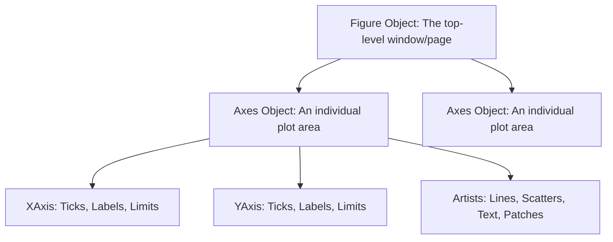

# 03. Matplotlib Core Architecture - Figure, Axes, and Canvas Visualization Mechanics

## 1. Overview
Matplotlib is Python's core plotting library. This note covers its rendering architecture, the difference between the functional and object-oriented interfaces, and subplot grid management.

## 2. Rendering Architecture



1. **Figure (`Figure`)**: The overall container window or canvas where visualizations are drawn. Manages figure dimensions, DPI, and subplots.
2. **Axes (`Axes`)**: An individual coordinate area within the figure. An `Axes` object manages the coordinate system and contains plotting methods (`plot`, `scatter`, `hist`, `bar`).
3. **Axis (`XAxis`, `YAxis`)**: Handles scale limits, tick marks, and tick labels.
4. **Artists**: Everything rendered on an Axes, including lines, markers, legend boxes, and title text.

## 3. Interfaces: Pyplot vs. Object-Oriented Interface

### The Pyplot Functional Interface (Quick Prototyping)
Maintains state implicitly using global references. Calling functions like `plt.plot()` draws on the most recently active Axes automatically:
```python
import matplotlib.pyplot as plt

plt.plot([1, 2, 3], [10, 20, 30])
plt.title("Functional Plot")
plt.show()
```

### The Object-Oriented Interface (Recommended for Production)
Instantiates `Figure` and `Axes` objects explicitly. This provides finer control and prevents conflicts across complex, multi-plot layouts:
```python
fig, ax = plt.subplots(figsize=(6, 4))
ax.plot([1, 2, 3], [10, 20, 30], color="crimson", linewidth=2.0, label="Metric")
ax.set_title("Object-Oriented Plot", fontsize=12, fontweight="bold")
ax.set_xlabel("Time (s)")
ax.set_ylabel("Amplitude (mV)")
ax.grid(True, linestyle=":", alpha=0.6)
ax.legend()
plt.tight_layout()
plt.show()
```

## 4. Multi-Plot Subplot Management
The `plt.subplots(nrows, ncols)` function creates a grid of subplots and returns them as a 2D array of `Axes` objects:

```python
fig, axs = plt.subplots(nrows=1, ncols=2, figsize=(10, 4))

# Left Subplot (axs[0])
axs[0].bar(["Module A", "Module B"], [15.2, 12.8], color="skyblue")
axs[0].set_title("Module Average Grades")

# Right Subplot (axs[1])
axs[1].hist([10, 12, 12, 14, 15, 18, 19], bins=5, color="salmon")
axs[1].set_title("Grade Distributions")

plt.tight_layout()  # Automatically adjusts subplot spacing to prevent overlapping labels
plt.show()
```

## 5. Connections to Other Topics
- Next step: [[04. NumPy Mathematical Engine - Vectorization, ufuncs, and Broadcasting Rules]].
- Used to plot distributions in [[03.3. Tutorial 04 - Academic Performance Statistical Analysis with NumPy and Matplotlib]].
```

---
