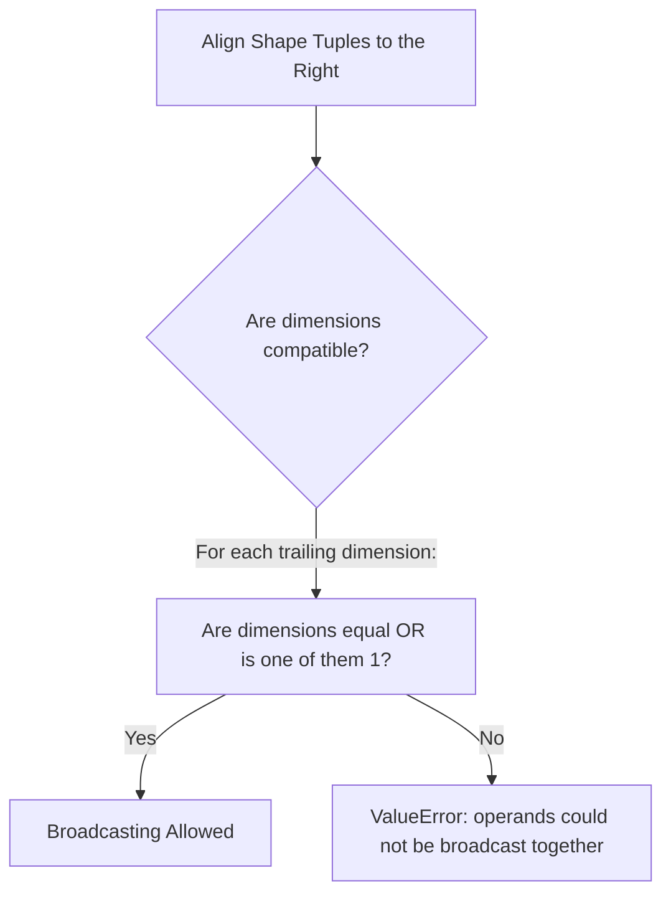
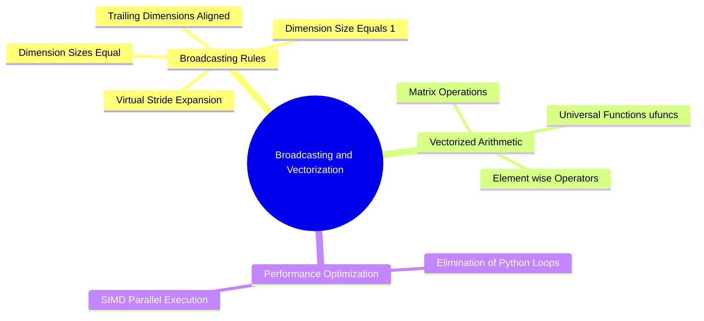
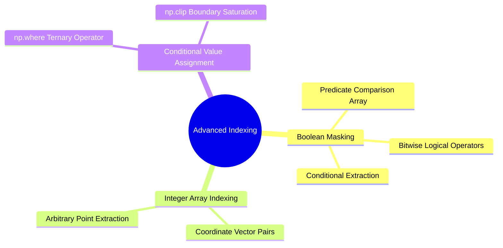
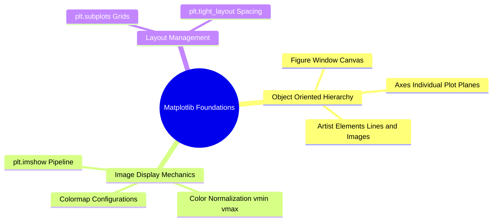
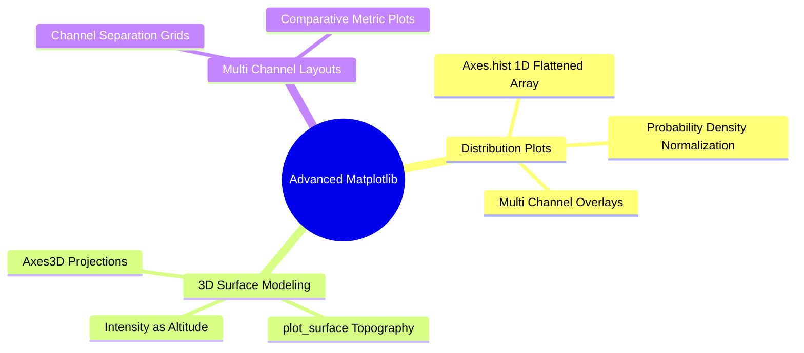
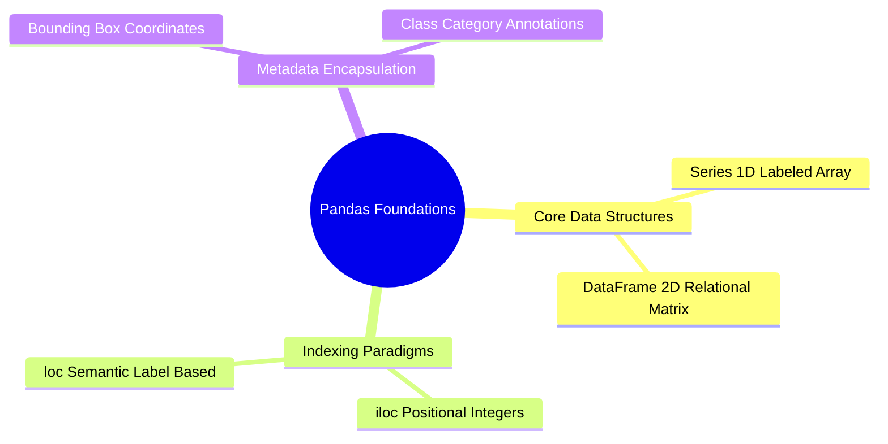
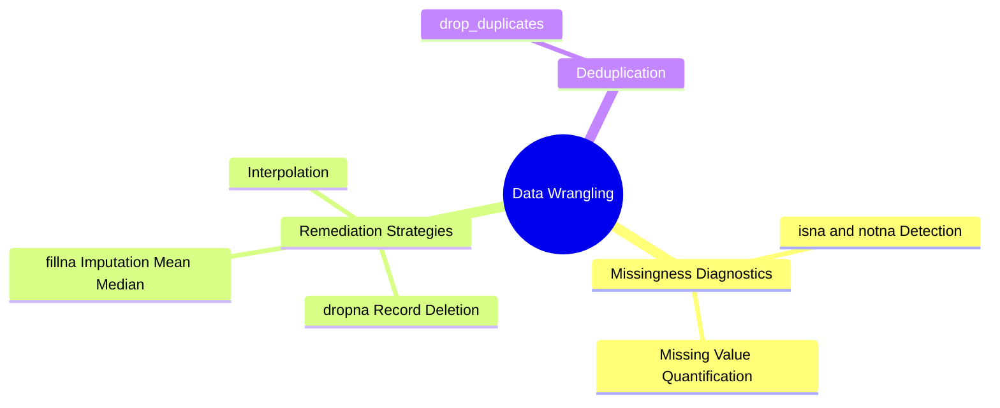
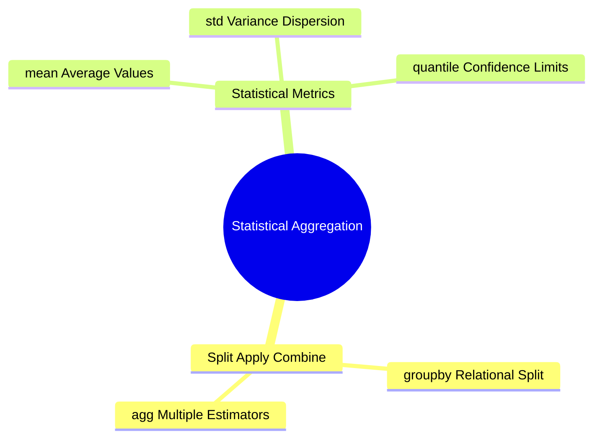
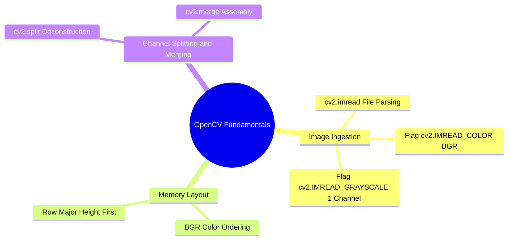

# 04. NumPy Mathematical Engine - Vectorization, ufuncs, and Broadcasting Rules

## 1. Overview
This note covers NumPy's mathematical computation engine, explaining universal functions (ufuncs), vectorization, multi-axis aggregations, array reshaping, stacking, and broadcasting rules.

## 2. Universal Functions (ufuncs)
A universal function (ufunc) operates on `ndarray` objects element-by-element in compiled C code:

```python
import numpy as np

x = np.array([1.0, 4.0, 9.0])
sqrt_x = np.sqrt(x)           # [1.0, 2.0, 3.0]
exp_x = np.exp([0.0, 1.0])    # [1.0, 2.71828...]
log_x = np.log([1.0, np.e])   # [0.0, 1.0]
sine_x = np.sin(np.pi / 2)    # 1.0
```

## 3. Multi-Axis Reductions and Aggregations
NumPy aggregation functions include an `axis` parameter that controls the direction of reduction:
- `axis=None`: Reduces the entire array to a single scalar value.
- `axis=0`: Collapses **rows** by computing statistics downward along each column.
- `axis=1`: Collapses **columns** by computing statistics across each row.

```python
a = np.array([
    [10, 20, 30],
    [40, 50, 60]
])

print("Total Array Sum:   ", np.sum(a))            # 210
print("Column-wise Means: ", np.mean(a, axis=0))    # [25., 35., 45.]
print("Row-wise Maxima:   ", np.max(a, axis=1))     # [30, 60]
print("Standard Deviation:", np.std(a))             # Overall standard deviation
```

## 4. Array Reshaping, Flattening, and Stacking

### Reshaping and Flattening
- `a.reshape(r, c)`: Returns a view of the array with a new shape $(r, c)$, provided $r \times c = \text{a.size}$.
- `a.ravel()`: Flattens an array into 1D without copying data whenever possible.
- `a.flatten()`: Flattens an array into 1D, always allocating an independent copy.

### Stacking Operations
```python
a = np.array([[1, 2], [3, 4]])
b = np.array([[5, 6], [7, 8]])

# Horizontal Stacking: Combine side-by-side along axis 1 (must share row count)
h_stacked = np.hstack((a, b))  # Shape: (2, 4)

# Vertical Stacking: Stack one above another along axis 0 (must share col count)
v_stacked = np.vstack((a, b))  # Shape: (4, 2)

# Generalized Concatenation:
cat_ax0 = np.concatenate((a, b), axis=0) # Equivalent to vstack
```

## 5. The Formal Rules of Array Broadcasting
Broadcasting allows arithmetic operations between arrays of different shapes by conceptually expanding the smaller array to match the larger array's dimensions without copying data.



### The Two Rules of Compatibility
1. **Right-to-Left Alignment**: Align the shape tuples of both arrays starting from their trailing (rightmost) dimensions.
2. **Dimension Compatibility**: Two dimensions are compatible if:
   - They have the same size, OR
   - One of them has a size of 1.

If a dimension has a size of 1, it is conceptually stretched along that axis to match the larger size. If a dimension is missing in the smaller array, it is padded with a leading dimension of size 1.

```python
# Example: Adding a 1D row vector to a 2D matrix
matrix = np.ones((4, 3))      # Shape: (4, 3)
vector = np.array([10, 20, 30])# Shape:    (3,) -> Aligns as (1, 3)

# Trailing dimensions match (3 == 3); leading dimension expands (1 -> 4)
result = matrix + vector      # Shape: (4, 3)
```

## 6. Connections to Other Topics
- Next step: [[05. NumPy Linear Algebra and Advanced Numerical Computation]].
- Explains DataFrame alignment in [[06. Pandas Structural Primitives - Series and DataFrame Architecture]].
```

---

---

## Integrated Subject Knowledge: 01.03. NumPy Broadcasting Mechanics and Vectorized Computations

Explicit nested `for` loops in pure Python introduce considerable interpreter overhead. NumPy avoids this by implementing vectorized computations compiled in C, governed by the **Broadcasting Rule**.



### 1. The Formal Broadcasting Rules
Two arrays can be combined in element-wise binary operations (addition, subtraction, multiplication) if their shapes satisfy compatibility checks, evaluated from **right to left** (trailing dimensions):

1. The dimensions are equal: $d_1 == d_2$
2. One of the dimensions is $1$: $d_1 == 1 \lor d_2 == 1$

If an array has fewer dimensions than the other, its shape is padded with ones on the left until the dimensionalities match. When a dimension size equals $1$, the array acts as if its data were repeated along that axis by setting the memory stride for that dimension to $0$.

```text
Dimension Alignment Example:
Array A (3D Image):    512 x 512 x 3
Array B (1D Weights):              3
-------------------------------------
Step 1: Pad B left:     1  x   1   x 3
Step 2: Check dims:    512    512    3
                       ↕      ↕      ↕
                        1      1     3  --> Compatible!
Resulting Shape:       512 x 512 x 3
```

### 2. Practical Applications in Data Science and Image Processing

#### Example A: Color Channel Weighting (Photometric Conversion)
Multiplying a color image of shape $(H, W, 3)$ by photometric luminance weights $(0.299, 0.587, 0.114)$ without manual loops:

```python
import numpy as np

# Generate a synthetic RGB image
img_rgb = np.ones((480, 640, 3), dtype=np.float32)

# Luminance coefficients vector
weights = np.array([0.299, 0.587, 0.114], dtype=np.float32)

# Element-wise broadcasting multiplication across channels:
weighted_channels = img_rgb * weights  # Shape: (480, 640, 3)

# Sum across the trailing color axis to produce a 2D luminance plane
grayscale_img = np.sum(weighted_channels, axis=2)  # Shape: (480, 640)
```

#### Example B: Data Feature Normalization (Data Science Feature Scaling)
Centering tabular features by subtracting the feature means and dividing by the standard deviations:

```python
# Synthetic tabular matrix: 1000 samples, 4 features
X = np.random.randn(1000, 4).astype(np.float32)

# Compute mean and standard deviation along the sample axis (axis=0)
mu = np.mean(X, axis=0)   # Shape: (4,)
sigma = np.std(X, axis=0) # Shape: (4,)

# Broadcast subtraction and division: (1000, 4) with (4,)
X_standardized = (X - mu) / sigma
```

### 3. Universal Functions (`ufuncs`)
NumPy provides vectorized universal functions (`ufuncs`) that operate element-wise on whole arrays at compiled speed:
* `np.add()`, `np.subtract()`, `np.multiply()`, `np.divide()`
* `np.exp()`, `np.log()`, `np.sqrt()`, `np.abs()`
* `np.sin()`, `np.cos()`, `np.arctan()`

```python
# Calculating the pixel magnitude of spatial derivatives Gx and Gy
Gx = np.array([[-1.0, 0.0, 1.0]], dtype=np.float32)
Gy = np.array([[1.0, 2.0, 1.0]], dtype=np.float32)

# Vectorized Euclidean hypotenuse: sqrt(Gx^2 + Gy^2)
gradient_magnitude = np.hypot(Gx, Gy)
```

Related concepts: [[01.04. NumPy Advanced Indexing, Masking, and Outlier Filtering]], [[06.1.4. Color Spaces (RGB, CMYK, YUV, YCbCr, HSV, CIE Lab) and Photometric Grayscale]], [[06.2. Laboratory 2 - Synthetic Noise Injection, Spatial Filtering, and Metric Benchmarking]].

---

### 01.04. NumPy Advanced Indexing, Masking, and Outlier Filtering.md

# NumPy Advanced Indexing, Masking, and Outlier Filtering

Advanced indexing uses boolean masks or integer coordinate vectors to select, filter, or reassign specific values. This is fundamental for thresholding, segmenting regions, and filtering outliers.



### 1. Boolean Masking
When a conditional relational operator is applied to an array, NumPy generates a boolean array of identical shape:

```python
import numpy as np

# Sample 1D array of intensity measurements
vals = np.array([12, 245, 18, 250, 89, 4], dtype=np.uint8)

# Relational evaluation yields a boolean mask
is_bright = vals > 100  # array([False,  True, False,  True, False, False])

# Advanced indexing extraction: extracts ONLY elements where mask is True
bright_pixels = vals[is_bright]  # array([245, 250], dtype=uint8)
```

#### Combining Logical Conditions
In NumPy, standard Python keywords `and`, `or`, and `not` **do not work** on element-wise array operations. You must use the bitwise operators:
* Bitwise AND: `&`
* Bitwise OR: `|`
* Bitwise NOT: `~`
* Enclose each comparison in parentheses to preserve operator precedence.

```python
# Filter pixels that lie strictly within an intensity band [100, 200]
in_band_mask = (vals >= 100) & (vals <= 200)
```

### 2. Value Clamping and Conditional Selection: `np.clip` and `np.where`

#### `np.clip(a, a_min, a_max, out=None)`
Restricts all array values to the closed interval $[a_{min}, a_{max}]$. Any value smaller than $a_{min}$ is mapped to $a_{min}$; any value larger than $a_{max}$ is mapped to $a_{max}$. This prevents arithmetic overflow when applying contrast enhancement filters.

```python
raw_intensities = np.array([-10, 50, 180, 260, 312], dtype=np.int32)
clamped_pixels = np.clip(raw_intensities, 0, 255).astype(np.uint8)
# Result: array([  0,  50, 180, 255, 255], dtype=uint8)
```

#### `np.where(condition, [x, y])`
The vectorized ternary operator. Evaluates `condition` element-wise: where `True`, yields $x$; where `False`, yields $y$.

```python
# Vectorized Binarization / Thresholding:
gray_canvas = np.array([[50, 180], [210, 30]], dtype=np.uint8)
threshold = 128

# If pixel >= 128 assign 255 (foreground), else assign 0 (background)
binary_mask = np.where(gray_canvas >= threshold, np.uint8(255), np.uint8(0))
# Result:
# [[  0 255]
#  [255   0]]
```

### 3. Outlier Filtering in Data Science
Filtering noisy samples using the statistical $Z$-score:

$$\mu = \frac{1}{N} \sum_{i=1}^{N} x_i, \quad \sigma = \sqrt{\frac{1}{N}\sum_{i=1}^{N}(x_i - \mu)^2}, \quad z_i = \left| \frac{x_i - \mu}{\sigma} \right|$$

```python
data_stream = np.array([10.2, 9.8, 10.1, 45.0, 10.0, 10.3], dtype=np.float32)

mean = np.mean(data_stream)
std = np.std(data_stream)
z_scores = np.abs((data_stream - mean) / std)

# Filter out elements whose Z-score exceeds 2 standard deviations
clean_data = data_stream[z_scores <= 2.0]
# Excludes the outlier 45.0
```

Related concepts: [[01.07. Pandas Foundations - Series, DataFrames, and Structural Indexing]], [[06.7.2. Global Optimal Statistical Thresholding (Otsu's Method Derivation)]], [[06.1. Laboratory 1 - Development Environment, NumPy Array Manipulation, and Grayscale Thresholding]].

---

### 01.05. Matplotlib Foundations - Figures, Subplots, and Color Mapping.md

# Matplotlib Foundations: Figures, Subplots, and Color Mapping

Matplotlib provides visualization tools for displaying images, plotting analytical distributions, and analyzing training metrics.



### 1. The Object-Oriented Interface (`Figure` and `Axes`)
Avoid state-machine calls (`plt.plot`, `plt.imshow`) when building production pipelines. Instead, use the object-oriented API by instantiating `Figure` and `Axes` objects:

```python
import matplotlib.pyplot as plt
import numpy as np

# Instantiate a canvas containing 1 row and 2 columns of subplots
fig, axes = plt.subplots(nrows=1, ncols=2, figsize=(10, 5), dpi=100)

# axes is a NumPy array containing references to the AxesSubplot instances
ax_left, ax_right = axes[0], axes[1]
```

### 2. Displaying Matrices: `Axes.imshow(X, cmap=None, vmin=None, vmax=None)`
`imshow` renders a 2D or 3D NumPy array as an image.

#### Key Parameters
* `X`: The array. Supported shapes:
  * $(M, N)$: 2D scalar array interpreted using a color map (`cmap`).
  * $(M, N, 3)$: 3D array interpreted as RGB floating-point values in $[0.0, 1.0]$ or unsigned integers in $[0, 255]$.
  * $(M, N, 4)$: 3D array with an Alpha channel (RGBA).
* `cmap`: Color lookup table for 2D scalar matrices. Common values:
  * `'gray'`: Linear grayscale ($0 \to \text{black}, \ 255 \to \text{white}$).
  * `'viridis'`: Perceptually uniform modern default.
  * `'jet'` / `'hsv'`: High-contrast rainbow spectra (can introduce visual artifacts).
* `vmin`, `vmax`: Normalization bounds. If set to `None`, Matplotlib scales the display linearly to the matrix's actual minimum and maximum values. **Always set `vmin=0, vmax=255` for 8-bit images** to prevent automatic scaling from exaggerating background noise in dark images.

```python
synthetic_matrix = np.array([
    [10, 20],
    [30, 40]
], dtype=np.uint8)

fig, ax = plt.subplots()

# Incorrect: Automatically stretches 10 to Black and 40 to White!
# ax.imshow(synthetic_matrix, cmap='gray')

# Correct: Explicitly anchors dynamic range to standard 8-bit limits
im = ax.imshow(synthetic_matrix, cmap='gray', vmin=0, vmax=255)
ax.set_title("Absolute 8-bit Grayscale Rendering")
plt.colorbar(im, ax=ax)
plt.show()
```

### 3. Rendering Multi-Panel Grids
Comparing an original image with its processed variants:

```python
# Creating an input signal and filtered counterpart
original = np.random.randint(0, 256, size=(100, 100), dtype=np.uint8)
filtered = np.zeros_like(original)

fig, axes = plt.subplots(1, 2, figsize=(8, 4))

axes[0].imshow(original, cmap='gray', vmin=0, vmax=255)
axes[0].set_title("Original Corrupted Signal")
axes[0].axis('off')  # Suppress axis ticks and labels

axes[1].imshow(filtered, cmap='gray', vmin=0, vmax=255)
axes[1].set_title("Restored Output")
axes[1].axis('off')

plt.tight_layout()
plt.show()
```

Related concepts: [[01.06. Matplotlib Advanced - Tonal Histograms, Surface Meshes, and Multi-Channel Grids]], [[01.10. OpenCV Fundamentals - Image Ingestion, Channels, and Memory Buffers]], [[06.1. Laboratory 1 - Development Environment, NumPy Array Manipulation, and Grayscale Thresholding]].

---

### 01.06. Matplotlib Advanced - Tonal Histograms, Surface Meshes, and Multi-Channel Grids.md

# Matplotlib Advanced: Tonal Histograms, Surface Meshes, and Multi-Channel Grids

Advanced visualization helps diagnose processing issues. This includes plotting intensity distributions, displaying 3D intensity terrains, and visualizing multi-channel frequency responses.



### 1. Tonal Histograms: `Axes.hist(x, bins=None, range=None, density=False)`
Plots the frequency distribution of pixel intensities across an image.

* `x`: Input data vector. Must be a **1D array**. Use `.ravel()` on 2D images.
* `bins`: Number of discrete bins. For an 8-bit grayscale image, use `bins=256`.
* `range`: Lower and upper bounds of the bins: `range=(0, 256)`.
* `density`: When `True`, normalizes the histogram so the total area under the curve equals $1$, forming an empirical Probability Density Function (PDF).

```python
import matplotlib.pyplot as plt
import numpy as np

img = np.random.normal(loc=128, scale=25, size=(256, 256)).clip(0, 255).astype(np.uint8)

fig, (ax_img, ax_hist) = plt.subplots(nrows=1, ncols=2, figsize=(10, 4))

# Visual representation of the matrix
ax_img.imshow(img, cmap='gray', vmin=0, vmax=255)
ax_img.set_title("Input Image Matrix")
ax_img.axis('off')

# Empirical intensity distribution
ax_hist.hist(img.ravel(), bins=256, range=(0, 256), color='black', alpha=0.7, density=True)
ax_hist.set_title("Normalized Intensity Distribution p(r_k)")
ax_hist.set_xlabel("Gray Level r_k")
ax_hist.set_ylabel("Probability Density")
ax_hist.set_xlim([0, 255])
ax_hist.grid(True, linestyle='--', alpha=0.5)

plt.tight_layout()
plt.show()
```

### 2. 3D Intensity Topography: `plot_surface`
Treating pixel values as elevation ($z$-axis) helps visualize why spatial gradients and morphological probes behave like physical surfaces.

```python
from mpl_toolkits.mplot3d import Axes3D

# Generate a synthetic 2D Gaussian bell curve
x = np.linspace(-2, 2, 50)
y = np.linspace(-2, 2, 50)
X, Y = np.meshgrid(x, y)
Z = np.exp(-(X**2 + Y**2))

fig = plt.figure(figsize=(8, 6))
ax = fig.add_subplot(111, projection='3d')

# Render the continuous topographical mesh
surf = ax.plot_surface(X, Y, Z, cmap='viridis', edgecolor='none')
ax.set_title("3D Intensity Topography")
fig.colorbar(surf, ax=ax, shrink=0.5)
plt.show()
```

Related concepts: [[01.05. Matplotlib Foundations - Figures, Subplots, and Color Mapping]], [[06.1.6. Tonal Histograms, Probability Densities, and Cumulative Distribution Functions]], [[06.4.1. Set-Theoretic Foundations, Binary Grids, and Structuring Elements]].

---

### 01.07. Pandas Foundations - Series, DataFrames, and Structural Indexing.md

# Pandas Foundations: Series, DataFrames, and Structural Indexing

Pandas provides structured data analysis tools. In computer vision, it handles image metadata, object bounding box coordinates, and performance benchmarks.



### 1. Data Structures: `pd.Series` and `pd.DataFrame`

* `pd.Series`: A one-dimensional labeled array built on top of a 1D NumPy array.
* `pd.DataFrame`: A two-dimensional tabular data structure with labeled axes (rows and columns). Each column is a `pd.Series` sharing a unified index.

```python
import pandas as pd
import numpy as np

# Constructing a DataFrame to hold image segmentation metrics
metrics_df = pd.DataFrame({
    'image_id': ['img_001.png', 'img_002.png', 'img_003.png'],
    'mse': [12.4, 45.1, 8.2],
    'psnr': [37.2, 31.6, 39.0],
    'is_corrupted': [False, True, False]
})

print(metrics_df.info())
```

### 2. Explicit Structural Indexing: `.iloc` vs. `.loc`

#### `.iloc[row_idx, col_idx]` (Integer-Location Based)
Selects rows and columns by their integer positions:

```python
# Extract the first two rows and the first three columns
subset_iloc = metrics_df.iloc[0:2, 0:3]
```

#### `.loc[row_label, col_label]` (Label/Name Based)
Selects rows and columns by their semantic labels or boolean masks:

```python
# Query images with a PSNR of at least 35 dB
high_fidelity_images = metrics_df.loc[metrics_df['psnr'] >= 35.0, ['image_id', 'psnr']]
```

Related concepts: [[01.08. Pandas Data Wrangling - Cleansing, Imputation, and Missing Values]], [[01.09. Pandas Statistical Aggregation, GroupBy, and Cross-Tabulation]], [[06.2.2. Quantitative Quality Benchmarks (MSE, PSNR, and SSIM)]].

---

### 01.08. Pandas Data Wrangling - Cleansing, Imputation, and Missing Values.md

# Pandas Data Wrangling: Cleansing, Imputation, and Missing Values

Real-world datasets and object detection annotations often contain missing values (`NaN`), formatting errors, and outliers that must be cleaned prior to training or analysis.



### 1. Identifying Missing Data
Pandas represents missing numerical values using IEEE 754 Floating-Point `NaN` (`np.nan`).

```python
import pandas as pd
import numpy as np

df = pd.DataFrame({
    'object_class': ['nucleus', 'cell', None, 'nucleus'],
    'area_pixels': [145.0, np.nan, 89.0, 150.0],
    'perimeter': [42.1, 75.3, 31.0, np.nan]
})

# Generate boolean presence mask
print(df.isna())

# Count missing values per column
print(df.isna().sum())
```

### 2. Handling Missing Values

#### Deletion: `df.dropna(axis=0, how='any', subset=None)`
Removes entire rows or columns containing missing values:

```python
# Drop any row where 'area_pixels' is missing
clean_rows = df.dropna(subset=['area_pixels'])
```

#### Imputation: `df.fillna(value=None, method=None)`
Replaces missing values with a statistical estimate (mean, median, or constant):

```python
# Impute missing numerical area measurements with the median
median_area = df['area_pixels'].median()
df['area_pixels'] = df['area_pixels'].fillna(median_area)

# Impute categorical annotations with a placeholder string
df['object_class'] = df['object_class'].fillna('unclassified')
```

Related concepts: [[01.07. Pandas Foundations - Series, DataFrames, and Structural Indexing]], [[01.09. Pandas Statistical Aggregation, GroupBy, and Cross-Tabulation]], [[06.7.7. Geometric Region Descriptors (AABB, OBB, Centroids, and Central Moments)]].

---

### 01.09. Pandas Statistical Aggregation, GroupBy, and Cross-Tabulation.md

# Pandas Statistical Aggregation, GroupBy, and Cross-Tabulation

Evaluating image processing benchmarks across multiple degradation categories requires grouping records and calculating summary statistics.



### 1. The Split-Apply-Combine Pattern (`df.groupby`)
Group statistics are computed using the split-apply-combine workflow:
1. **Split**: Segregates records into distinct subsets based on matching keys.
2. **Apply**: Computes summary statistics (e.g., mean, sum, variance) independently on each subset.
3. **Combine**: Merges the results back into a structured DataFrame.

```python
import pandas as pd

benchmark_data = pd.DataFrame({
    'filter_type': ['Median', 'Median', 'Gaussian', 'Gaussian', 'Nagao', 'Nagao'],
    'noise_level': [0.05, 0.20, 0.05, 0.20, 0.05, 0.20],
    'psnr': [34.2, 28.1, 31.0, 22.4, 36.5, 30.2],
    'execution_time_ms': [1.2, 1.3, 0.4, 0.4, 18.5, 19.1]
})

# Group by algorithm name and compute mean and standard deviation
performance_summary = benchmark_data.groupby('filter_type').agg({
    'psnr': ['mean', 'max'],
    'execution_time_ms': ['mean']
})

print(performance_summary)
```

Related concepts: [[01.07. Pandas Foundations - Series, DataFrames, and Structural Indexing]], [[06.2.2. Quantitative Quality Benchmarks (MSE, PSNR, and SSIM)]], [[06.10. Worked Image Processing Exercises and End-to-End Solutions]].

---

### 01.10. OpenCV Fundamentals - Image Ingestion, Channels, and Memory Buffers.md

# OpenCV Fundamentals: Image Ingestion, Channels, and Memory Buffers

OpenCV (`cv2`) is an industry-standard computer vision library. It uses NumPy arrays as its core image representation, enabling seamless integration between OpenCV algorithms and custom mathematical processing.



### 1. File Ingestion: `cv2.imread(filename, flags=cv2.IMREAD_COLOR)`
Reads an image file from disk and parses it into a NumPy array.

* `flags`:
  * `cv2.IMREAD_COLOR` (or `1`): Loads the image as an 8-bit unsigned integer array with 3 color channels. Discards any transparency/alpha channels.
  * `cv2.IMREAD_GRAYSCALE` (or `0`): Converts the image to a single 8-bit grayscale channel during loading.
  * `cv2.IMREAD_UNCHANGED` (or `-1`): Loads the image with all embedded channels intact, including 16-bit depths or 4-channel alpha transparency.

```python
import cv2
import numpy as np

# Load as 3-channel color image
img_color = cv2.imread('sample.png', cv2.IMREAD_COLOR)

# Load directly as single-channel grayscale
img_gray = cv2.imread('sample.png', cv2.IMREAD_GRAYSCALE)

print("Color Image Shape (H, W, C):", img_color.shape)  # e.g., (512, 512, 3)
print("Gray Image Shape (H, W):", img_gray.shape)        # e.g., (512, 512)
```

### 2. The BGR Channel Order
**Critical Insight:** OpenCV stores color images in **BGR (Blue, Green, Red)** channel order rather than the standard RGB order.

```text
Memory Index 0: Blue   Channel  --> I[:, :, 0]
Memory Index 1: Green  Channel  --> I[:, :, 1]
Memory Index 2: Red    Channel  --> I[:, :, 2]
```

If you display a raw OpenCV BGR image using Matplotlib's `plt.imshow` (which expects RGB), the red and blue channels will appear swapped, making human skin appear blue. You must swap the channels before displaying:

```python
# Convert BGR to RGB using OpenCV's conversion function
img_rgb = cv2.cvtColor(img_color, cv2.COLOR_BGR2RGB)

# Or swap channels using NumPy array slicing:
img_rgb_numpy = img_color[:, :, ::-1]
```

### 3. Channel Splitting and Merging
* `cv2.split(m)`: Separates a multi-channel image into individual single-channel arrays.
* `cv2.merge(mv)`: Combines a sequence of single-channel arrays into a multi-channel image.

```python
# Deconstruct into individual channels
b_chan, g_chan, r_chan = cv2.split(img_color)

# Reassemble into an OpenCV-compatible image
reconstructed_bgr = cv2.merge([b_chan, g_chan, r_chan])
```

Related concepts: [[16. OpenCV Core Architecture - Matrix Representation, Channels, and Color Constellations]], [[06.1.4. Color Spaces (RGB, CMYK, YUV, YCbCr, HSV, CIE Lab) and Photometric Grayscale]], [[06.1. Laboratory 1 - Development Environment, NumPy Array Manipulation, and Grayscale Thresholding]].
