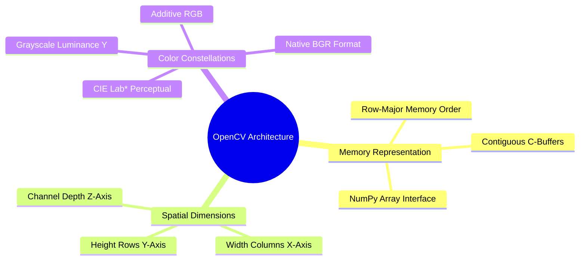
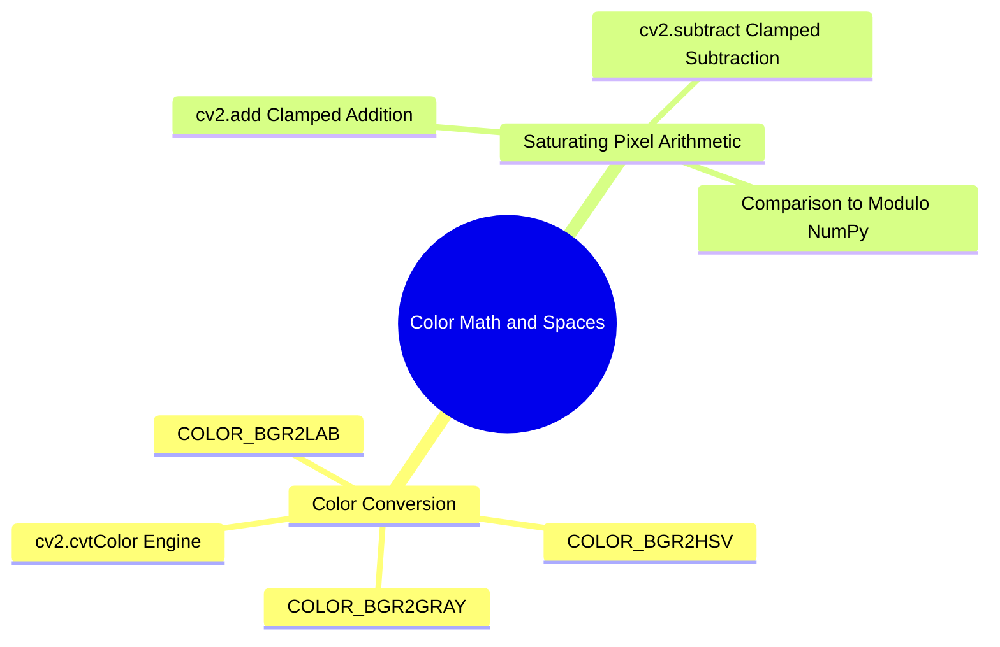
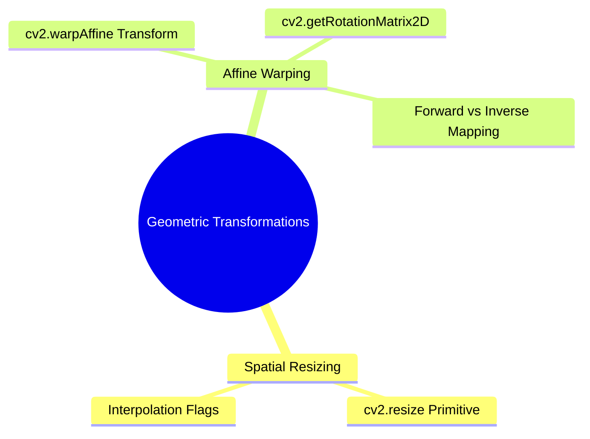

# 16. OpenCV Core Architecture - Matrix Representation, Channels, and Color Constellations

## 1. Mathematical and Computational Overview
Digital computer vision algorithms operate on digitized spatial energy fields. OpenCV (Open Source Computer Vision Library) models an image as a discretized, bounded two-dimensional or three-dimensional tensor mapped onto standard NumPy `ndarray` memory buffers.



## 2. Theoretical Foundations: Tensor Topologies

A digital image $I$ is mathematically represented as a discrete 2D matrix or 3D tensor defined on a spatial coordinate domain:

$$\Omega = \{ (y, x) \in \mathbb{Z}^2 \mid 0 \le y < H, \ 0 \le x < W \}$$

Where:
- $H$ represents image height (total rows).
- $W$ represents image width (total columns).
- $y \in [0, H-1]$ denotes the vertical scanline index.
- $x \in [0, W-1]$ denotes the horizontal column index.

### 2.1 Single-Channel Grayscale Matrices
For monochrome intensity imaging, each coordinate pair $(y, x)$ maps directly to a scalar radiance value $I(y, x) \in [0, 255]$, stored as an unsigned 8-bit integer (`numpy.uint8`):

$$I : \Omega \rightarrow [0, 2^{8}-1]$$

### 2.2 Multi-Channel Color Arrays and the BGR Convention
Color digital photography represents chromatic information via multiple discrete spectral bands. While standard display graphics operate in the red-green-blue (RGB) format, OpenCV historically adopted **BGR (Blue, Green, Red)** order due to early hardware and video capture standards:

- **Channel 0**: Blue photon absorption intensity ($\lambda \approx 450\text{ nm}$).
- **Channel 1**: Green photon absorption intensity ($\lambda \approx 540\text{ nm}$).
- **Channel 2**: Red photon absorption intensity ($\lambda \approx 700\text{ nm}$).

The memory layout of a pixel located at scanline $y$ and column $x$ is arranged consecutively in RAM as:

$$\text{Pixel}(y, x) = [B_{(y, x)}, \ G_{(y, x)}, \ R_{(y, x)}]$$

## 3. Systematic Function Reference

### 3.1 `cv2.imread(filename, flags)`
Loads an image matrix from non-volatile storage into volatile system RAM.
- **Parameters**:
  - `filename` (`str`): File path to the target image raster (e.g., `.bmp`, `.jpg`, `.png`).
  - `flags` (`int`): Ingestion mode flag.
    - `cv2.IMREAD_COLOR` ($1$): Forces ingestion as a 3-channel BGR image. Discards alpha transparency.
    - `cv2.IMREAD_GRAYSCALE` ($0$): Forces single-channel luminance reduction during decoding.
    - `cv2.IMREAD_UNCHANGED` ($-1$): Preserves native bit-depth and transparency channels.
- **Return Value**: An instantiated `numpy.ndarray`. Returns `None` if the file path is invalid or the codec fails.

### 3.2 `cv2.cvtColor(src, code)`
Executes linear or non-linear radiometric space transformations across image planes.
- **Mathematical Transformation (`cv2.COLOR_BGR2GRAY`)**:
  Calculates human photopic luminance ($Y$) according to ITU-R Recommendation BT.601:
  $$Y = 0.299 \cdot R + 0.587 \cdot G + 0.114 \cdot B$$
  The green channel receives the highest weighting ($\approx 59\%$) because the human ocular system exhibits maximum cone sensitivity near $555\text{ nm}$.
- **Mathematical Transformation (`cv2.COLOR_BGR2RGB`)**:
  Swaps outer channels:
  $$[R, G, B] = [B_{\text{old}}, G_{\text{old}}, R_{\text{old}}][::-1]$$

### 3.3 `cv2.imshow(winname, mat)` and Display Loop Mechanics
- `cv2.imshow(winname, mat)`: Renders pixel values within an operating system GUI window.
- `cv2.waitKey(delay)`: HighGUI event listener. Suspends CPU execution for `delay` milliseconds, checking the OS event queue for keyboard input. Setting `delay = 0` halts execution indefinitely until a keypress occurs.
- `cv2.destroyAllWindows()`: Deallocates all initialized X11, Win32, or Cocoa window handles from memory.

### 3.4 `cv2.imwrite(filename, img)`
Serializes in-memory NumPy tensors into standard image file formats, handling compression codecs automatically.

## 4. Code Implementation Examples

```python
import cv2
import numpy as np

# Ingest test image
bgr_image = cv2.imread("Images/BoatsColor.bmp", cv2.IMREAD_COLOR)

if bgr_image is None:
    raise FileNotFoundError("Image file 'Images/BoatsColor.bmp' could not be opened.")

# Inspect structural tensor properties
height, width, channels = bgr_image.shape
data_type = bgr_image.dtype
total_bytes = bgr_image.nbytes

print(f"Matrix Geometry: Height={height} rows, Width={width} columns, Depth={channels} channels")
print(f"Memory Buffer : Data type={data_type}, Total RAM footprint={total_bytes:,} bytes")

# Read color vector at coordinate y=100, x=150
b_val, g_val, r_val = bgr_image[100, 150]
print(f"Pixel Spectral Signature at (y=100, x=150): Blue={b_val}, Green={g_val}, Red={r_val}")

# Direct scanline manipulation: Draw horizontal pure red line across the middle
# Pure Red in BGR format is [0, 0, 255]
annotated_image = bgr_image.copy()
center_row = height // 2

# Vectorized scanline overwrite across all columns
annotated_image[center_row, :] = [0, 0, 255]

# Convert BGR to Grayscale using BT.601 weights
gray_image = cv2.cvtColor(bgr_image, cv2.COLOR_BGR2GRAY)

# Save results to disk
cv2.imwrite("Images/BoatsColor_red_centerline.bmp", annotated_image)
cv2.imwrite("Images/BoatsColor_grayscale_converted.bmp", gray_image)
```

## 5. Critical Pitfalls and Best Practices
- **OpenCV vs. Matplotlib Color Inversion**: Matplotlib expects RGB pixel arrays. Passing a raw OpenCV BGR image directly into `plt.imshow()` causes color channels to flip: human faces appear blue and skies appear orange. Always apply `cv2.cvtColor(img, cv2.COLOR_BGR2RGB)` before visualizing with Matplotlib.
- **Coordinate Order Inversion ($y, x$ vs. $x, y$)**: In NumPy indexing, row index corresponds to $y$ and column index corresponds to $x$ (`img[y, x]`). In OpenCV geometry functions (like `cv2.circle` or `cv2.rectangle`), coordinate tuples use Cartesian order: `(x, y)`. Mixing up these conventions can lead to out-of-bounds indexing errors.

## 6. Connections to Other Topics
- Relates directly to array memory layouts in [[01. NumPy Foundations - Memory Layout, ndarray Anatomy, and Array Instantiation]].
- Forms the basis for slicing in [[17. Image Spatial Transformations - Interpolation, Scaling, Cropping, and Affine Warping]].
- Applied practically in [[06.9.1. TP1 - Digital Image Acquisition, Matrix Topologies, and Fixed Thresholding]].
```

---

---

## Integrated Subject Knowledge: 01.11. OpenCV Color Space Transformations and Pixel Math

OpenCV provides functions for converting images between color coordinate spaces and performing bounded saturation arithmetic.



### 1. Color Space Transformations: `cv2.cvtColor(src, code)`
Converts an input image from one color space to another.

* `src`: The input NumPy array.
* `code`: The transformation flag specifying the source and target color spaces.
  * `cv2.COLOR_BGR2GRAY`: Computes luminance using the standard photometric formula: $Y = 0.299R + 0.587G + 0.114B$.
  * `cv2.COLOR_BGR2HSV`: Maps color values to Hue, Saturation, and Value components.
  * `cv2.COLOR_BGR2LAB`: Maps colors to the perceptually uniform CIE $L^*a^*b^*$ space.

```python
import cv2

bgr_input = cv2.imread('scene.png', cv2.IMREAD_COLOR)

# Transform to single-channel luminance
gray = cv2.cvtColor(bgr_input, cv2.COLOR_BGR2GRAY)

# Transform to CIE L*a*b* space for contrast enhancement
lab = cv2.cvtColor(bgr_input, cv2.COLOR_BGR2LAB)
```

### 2. Saturated vs. Modulo Arithmetic
A critical difference between OpenCV and NumPy is how they handle arithmetic overflow:
* **NumPy** uses standard computer arithmetic with modulo wrap-around:
  $$250_{\text{uint8}} + 20_{\text{uint8}} = 270 \pmod{256} = 14$$
* **OpenCV** uses saturated arithmetic that clamps values to the dynamic range:
  $$\text{cv2.add}(250_{\text{uint8}}, 20_{\text{uint8}}) = \min(270, 255) = 255$$
  $$\text{cv2.subtract}(10_{\text{uint8}}, 30_{\text{uint8}}) = \max(-20, 0) = 0$$

```python
import numpy as np
import cv2

p1 = np.array([250], dtype=np.uint8)
p2 = np.array([20], dtype=np.uint8)

print("NumPy Modulo Wrap-Around:", p1 + p2)             # Yields [14]
print("OpenCV Saturated Clamping:", cv2.add(p1, p2))    # Yields [[255]]
```

Related concepts: [[01.10. OpenCV Fundamentals - Image Ingestion, Channels, and Memory Buffers]], [[06.1.4. Color Spaces (RGB, CMYK, YUV, YCbCr, HSV, CIE Lab) and Photometric Grayscale]], [[06.5.1. Dynamic Range Expansion and Noise-Tolerant Contrast Stretching]].

---

### 01.12. OpenCV Geometric Transformations, Interpolation, and Affine Warping.md

# OpenCV Geometric Transformations, Interpolation, and Affine Warping

Geometric transformations alter the spatial layout of pixels by mapping input coordinates $(x, y)$ to new output coordinates $(x', y')$.



### 1. Spatial Resizing: `cv2.resize(src, dsize, fx=0, fy=0, interpolation=cv2.INTER_LINEAR)`
Rescales an image to a new spatial resolution.

* `dsize`: The output image dimensions given as a tuple of **`(width, height)`**. **Note:** This is the reverse of NumPy's `(rows, cols)` shape order!
* `fx`, `fy`: Optional scale factors along the horizontal and vertical axes when `dsize` is set to `(0, 0)`.
* `interpolation`: The analytical reconstruction algorithm:
  * `cv2.INTER_NEAREST`: Nearest-neighbor sampling. Fast, but produces visible pixelation and jagged edges.
  * `cv2.INTER_LINEAR`: Bilinear interpolation. Balanced performance; standard for general upsampling.
  * `cv2.INTER_CUBIC`: Bicubic spline interpolation over a $4 \times 4$ neighborhood. Produces sharper edges with fewer artifacts.
  * `cv2.INTER_AREA`: Resampling using pixel area relations. Preferred for downsampling images without aliasing.

```python
import cv2

img = cv2.imread('sample.png', cv2.IMREAD_GRAYSCALE)
h, w = img.shape[:2]

# Scale image by factor of 2 using Bicubic interpolation
upscaled = cv2.resize(img, (w * 2, h * 2), interpolation=cv2.INTER_CUBIC)
```

### 2. Affine Transformation: `cv2.warpAffine(src, M, dsize)`
Applies an affine transformation defined by a $2 \times 3$ transformation matrix:

$$\begin{pmatrix} x' \\ y' \end{pmatrix} = \begin{pmatrix} m_{00} & m_{01} \\ m_{10} & m_{11} \end{pmatrix} \begin{pmatrix} x \\ y \end{pmatrix} + \begin{pmatrix} m_{02} \\ m_{12} \end{pmatrix}$$

#### Image Rotation: `cv2.getRotationMatrix2D(center, angle, scale)`
Constructs the affine matrix for rotating an image around a specified center point:

```python
# Rotate 45 degrees counter-clockwise around the image center
center_point = (w // 2, h // 2)
rotation_matrix = cv2.getRotationMatrix2D(center=center_point, angle=45.0, scale=1.0)

# Warp the image onto an output canvas of size (w, h)
rotated_img = cv2.warpAffine(img, rotation_matrix, (w, h))
```

Related concepts: [[06.8.1. Continuous Image Reconstruction (Nearest, Bilinear, and Keys' Bicubic Spline)]], [[06.10. Worked Image Processing Exercises and End-to-End Solutions]].
