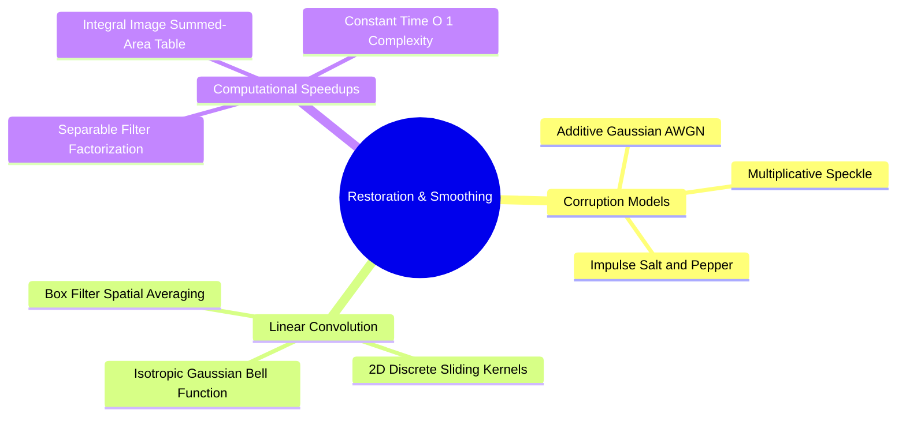
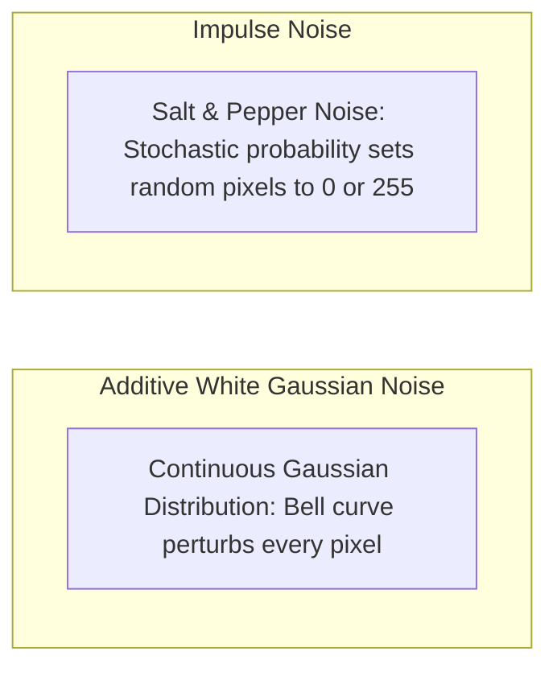
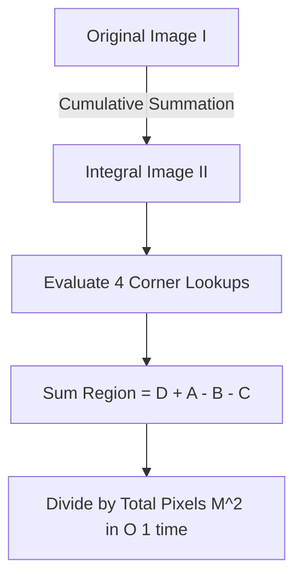
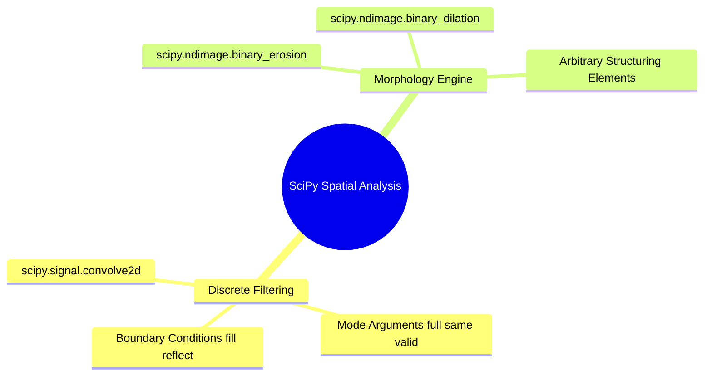
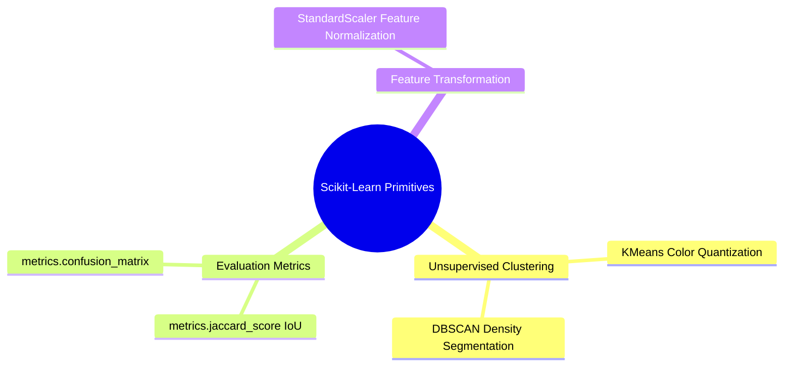

# 19. Spatial Image Restoration - Noise Models, Linear Convolution, and Fast Integral Filters

## 1. Overview
Digital images can suffer from various forms of corruption during acquisition, transmission, or sensor readout. This note covers mathematical noise models, 2D discrete convolution, box and Gaussian filtering, and $O(1)$ fast box filtering using integral images (summed-area tables).



## 2. Mathematical Noise Models



### 2.1 Additive White Gaussian Noise (AWGN)
Gaussian noise models thermal and electronic sensor fluctuations. It perturbs every pixel independently according to a normal distribution:

$$I_{\text{noisy}}(y, x) = \text{clip}\Big(I(y, x) + \eta(y, x), \ 0, \ 255\Big), \quad \eta(y, x) \sim \mathcal{N}(\mu, \sigma^2)$$

Where $\mu = 0$ is the mean error and $\sigma^2$ is the noise variance. As variance $\sigma^2$ increases, high-frequency image details are progressively obscured.

### 2.2 Impulse Noise (Salt-and-Pepper)
Impulse noise models transmission errors or faulty sensor photodiode elements. It alters a random fraction $p \in [0, 1]$ of pixels, replacing their values with extreme white (salt) or black (pepper) values:

$$I_{\text{noisy}}(y, x) = \begin{cases} 
255 & \text{with probability } \frac{p}{2} \quad (\text{Salt}) \\ 
0 & \text{with probability } \frac{p}{2} \quad (\text{Pepper}) \\ 
I(y, x) & \text{with probability } 1 - p \quad (\text{Uncorrupted}) 
\end{cases}$$

## 3. Linear Spatial Filtering and Convolution

Filtering modifies a pixel's value using a weighted combination of its spatial neighbors. For an odd kernel size $M \times M$ with half-width $k = \lfloor M / 2 \rfloor$:

$$I_{\text{conv}}(y, x) = \sum_{i=-k}^{k} \sum_{j=-k}^{k} I(y - i, \ x - j) \cdot K(i, j)$$

### 3.1 The Mean (Box) Filter
Replaces each pixel with the arithmetic mean of its local neighborhood:

$$K_{\text{box}} = \frac{1}{M^2} \begin{bmatrix} 1 & 1 & \cdots & 1 \\ 1 & 1 & \cdots & 1 \\ \vdots & \vdots & \ddots & \vdots \\ 1 & 1 & \cdots & 1 \end{bmatrix}_{M \times M}$$

- **Characteristics**: Smooths additive Gaussian noise effectively, but blurs sharp edge boundaries and introduces subtle rectangular artifacts.

### 3.2 The Gaussian Filter
Weights neighboring pixels according to a 2D Gaussian distribution:

$$G(x, y) = \frac{1}{2\pi\sigma^2} \exp\left( -\frac{x^2 + y^2}{2\sigma^2} \right)$$

Weights decay smoothly with spatial distance, reducing high-frequency noise while better preserving broader structural boundaries.

## 4. Accelerated Box Filtering via Integral Images

Applying a large $M \times M$ filter directly requires $O(M^2)$ operations per pixel. Using an **Integral Image** (Summed-Area Table) allows computing arbitrary rectangular neighborhood sums in **$O(1)$ constant time**, regardless of kernel size.



### 4.1 Definition
The integral image $II(y, x)$ stores the sum of all pixel values located above and to the left of coordinate $(y, x)$:

$$II(y, x) = \sum_{y' \le y} \sum_{x' \le x} I(y', x')$$

The integral image can be constructed efficiently in a single pass ($O(H \cdot W)$) using dynamic programming:

$$II(y, x) = I(y, x) + II(y - 1, x) + II(y, x - 1) - II(y - 1, x - 1)$$

### 4.2 Constant Time $O(1)$ Window Summation
To calculate the sum of pixel values within a rectangular region defined by top-left corner $(y_1, x_1)$ and bottom-right corner $(y_2, x_2)$:

$$\text{Sum} = II(y_2, x_2) + II(y_1 - 1, x_1 - 1) - II(y_1 - 1, x_2) - II(y_2, x_1 - 1)$$

Dividing this sum by the window area $M^2$ yields the exact box filter output in $O(1)$ time.

## 5. Code Implementation Examples

```python
import cv2
import numpy as np

# 1. Noise Injection Functions
def add_gaussian_noise(image: np.ndarray, mean: float = 0.0, variance: float = 100.0) -> np.ndarray:
    """Injects Additive White Gaussian Noise into an image matrix."""
    sigma = np.sqrt(variance)
    gauss_noise = np.random.normal(mean, sigma, image.shape)
    noisy = image.astype(np.float64) + gauss_noise
    return np.clip(noisy, 0, 255).astype(np.uint8)

def add_salt_and_pepper_noise(image: np.ndarray, probability: float = 0.10) -> np.ndarray:
    """Injects impulse salt-and-pepper noise into an image matrix."""
    noisy = image.copy()
    random_matrix = np.random.rand(*image.shape[:2])
    
    # Salt noise (white pixels = 255)
    noisy[random_matrix < (probability / 2.0)] = 255
    # Pepper noise (black pixels = 0)
    noisy[(random_matrix >= (probability / 2.0)) & (random_matrix < probability)] = 0
    return noisy

# 2. Pure Python vs Accelerated Integral Image Box Filtering
def box_filter_integral(image: np.ndarray, ksize: int) -> np.ndarray:
    """Fast box filtering in O(1) time using an integral image."""
    h, w = image.shape[:2]
    pad = ksize // 2
    padded = np.pad(image.astype(np.float64), pad, mode="reflect")
    
    # Compute Integral Image
    integral = np.zeros((padded.shape[0] + 1, padded.shape[1] + 1), dtype=np.float64)
    integral[1:, 1:] = np.cumsum(np.cumsum(padded, axis=0), axis=1)
    
    filtered = np.zeros((h, w), dtype=np.uint8)
    area = ksize * ksize
    
    for y in range(h):
        for x in range(w):
            y1, x1 = y, x
            y2, x2 = y + ksize, x + ksize
            window_sum = integral[y2, x2] + integral[y1, x1] - integral[y1, x2] - integral[y2, x1]
            filtered[y, x] = int(round(window_sum / area))
            
    return filtered
```

## 6. Connections to Other Topics
- Relates to quality benchmarks in [[22. Objective Image Quality Assessment - MSE, PSNR, and SSIM Metrics]].
- Succeeded by non-linear edge-preserving filters in [[20. Non-Linear and Edge-Preserving Filtering - Median, Bilateral, and Nagao Filters]].
- Applied practically in [[06.9.3. TP2 Part 1 - Discrete Noise Models and Spatial Convolution Smoothing]].
```

---

---

## Integrated Subject Knowledge: 01.13. SciPy Signal and Spatial Operations - 2D Filtering and Morphology

The `scipy.ndimage` and `scipy.signal` modules provide scientific algorithms for discrete 2D spatial filtering, frequency responses, and multi-dimensional analysis.



### 1. 2D Spatial Convolution: `scipy.signal.convolve2d(in1, in2, mode='full', boundary='fill', fillvalue=0)`
Computes the mathematically exact discrete two-dimensional convolution of two matrices:

* `mode`:
  * `'full'`: Computes convolution across all points of overlap. Output shape: $(M_1 + M_2 - 1, N_1 + N_2 - 1)$.
  * `'same'`: Returns the central portion of the convolution, matching the shape of `in1`.
  * `'valid'`: Computes output only for positions where the filter kernel overlaps completely with the input image. Output shape: $(M_1 - M_2 + 1, N_1 - N_2 + 1)$.
* `boundary`: Method for handling image edges:
  * `'fill'`: Pads borders with a constant value specified by `fillvalue`.
  * `'symm'` / `'reflect'`: Mirrors pixel values across the boundary.
  * `'wrap'`: Treats the image as periodic, wrapping values from the opposite edge.

```python
import numpy as np
from scipy import signal

# Define a 5x5 test image and a 3x3 averaging kernel
image = np.ones((5, 5), dtype=np.float32)
kernel = np.full((3, 3), 1.0 / 9.0, dtype=np.float32)

# Compute convolution with reflection padding, maintaining identical output dimensions
smooth = signal.convolve2d(image, kernel, mode='same', boundary='symm')
```

Related concepts: [[06.1.7. 2D Discrete Spatial Convolution, Cross-Correlation, and Boundary Padding]], [[06.10. Worked Image Processing Exercises and End-to-End Solutions]].

---

### 01.14. Scikit-Learn Primitives - Clustering, Dimensionality, and Metrics.md

# Scikit-Learn Primitives: Clustering, Dimensionality, and Metrics

Scikit-Learn (`sklearn`) provides machine learning algorithms used in mid-level image processing, such as color-based pixel clustering, dimensionality reduction, and evaluation metrics.



### 1. Pixel Feature Clustering: `sklearn.cluster.KMeans`
Partitions pixel colors into $K$ discrete clusters to perform color quantization or unsupervised segmentation:

```python
import numpy as np
from sklearn.cluster import KMeans

# Synthesize an image: 100 rows, 100 cols, 3 color channels
img = np.random.randint(0, 256, size=(100, 100, 3), dtype=np.uint8)

# Reshape the 3D image into a 2D feature matrix: (N_pixels, 3_features)
pixel_features = img.reshape((-1, 3)).astype(np.float32)

# Fit KMeans to group pixels into 3 color clusters
kmeans = KMeans(n_clusters=3, random_state=42, n_init='auto')
labels = kmeans.fit_predict(pixel_features)

# Reshape the 1D cluster labels back into the original 2D image shape
segmented_labels = labels.reshape((100, 100))
```

### 2. Segmentation Evaluation: `sklearn.metrics.jaccard_score`
Calculates the Jaccard similarity index (Intersection-over-Union, IoU) to measure overlap between a predicted binary segmentation and a ground-truth reference:

$$J(A, B) = \frac{|A \cap B|}{|A \cup B|}$$

```python
from sklearn.metrics import jaccard_score

# Flatten 2D binary masks to 1D arrays
gt_mask = np.array([0, 1, 1, 0, 1, 0], dtype=np.uint8)
pred_mask = np.array([0, 1, 0, 0, 1, 0], dtype=np.uint8)

iou = jaccard_score(gt_mask, pred_mask)
print("Jaccard IoU Score:", iou)
```

Related concepts: [[06.9.5. TP2 Part 2 - Edge-Preserving Non-Linear Smoothing with Nagao Filter]], [[06.7.8. Segmentation Evaluation Benchmarks (Dice DSC, Jaccard IoU, Hausdorff Distance)]].

---

## 02. Introduction to Digital Images
