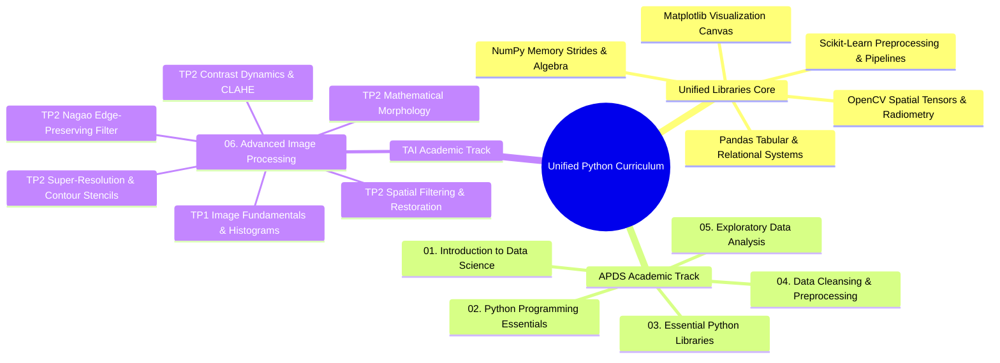

# 00. Master Curriculum Roadmap

## 1. Curriculum Architecture
This knowledge base unifies **Data Science & Machine Learning (APDS)** with **Advanced Image Processing & Computer Vision (TAI)** on top of a single, shared Python computational foundation.

---

## 2. Master Navigation Index

### 2.1 Unified Library Learning Path (`Libraries/`)
*Study these foundational notes before applying the concepts in the academic chapters.*

| Note | Core Topics Covered |
| :--- | :--- |
| [[00. Library Learning Roadmap]] | Dependency graph and prerequisite order |
| [[01. NumPy Foundations - Memory Layout, ndarray Anatomy, and Array Instantiation]] | Contiguous C-buffers, shapes, strides, data types |
| [[02. NumPy Array Manipulation - Slicing, Strides, Shapes, and Vectorized Indexing]] | Strided memory views, boolean masking, coordinate lookup |
| [[03. Matplotlib Core Architecture - Figure, Axes, and Canvas Visualization Mechanics]] | Figure, Axes, subplots, object-oriented canvas |
| [[04. NumPy Mathematical Engine - Vectorization, ufuncs, and Broadcasting Rules]] | Vectorized operations, multi-axis reduction, broadcasting |
| [[05. NumPy Linear Algebra and Advanced Numerical Computation]] | Matrix products, inverses, determinants, linear systems |
| [[06. Pandas Structural Primitives - Series and DataFrame Architecture]] | 1D Series, 2D DataFrames, BlockManager memory |
| [[07. Pandas Data Ingestion, Inspection, and Type Coercion]] | Parsing CSV/Excel, dtypes, memory audit, null checks |
| [[08. Pandas Indexing, Slicing, and Query Mechanics (loc, iloc, query, at)]] | Label vs position slicing, query engine, fast scalar lookups |
| [[09. Pandas Data Cleansing - Handling Nulls, Deduplication, and String Normalization]] | Imputation, deduplication, vectorized string methods |
| [[10. Matplotlib and Seaborn Statistical Plotting for Tabular Data]] | Histograms, KDE, box plots, violin plots, correlation heatmaps |
| [[11. Pandas Grouping, Split-Apply-Combine, and Statistical Aggregations]] | GroupBy mechanics, multi-metric agg, transform windowing |
| [[12. Pandas Relational Operations - Joins, Merging, and Concatenation]] | SQL-style joins, vertical/horizontal concatenation |
| [[13. Pandas Data Reshaping - Pivoting, Unpivoting, Stacking, and Melting]] | Wide vs long formats, pivot tables, melting |
| [[14. Pandas Temporal Mechanics - Time Series and Datetime Calculations]] | DatetimeIndex, resampling, rolling averages, shifts |
| [[15. Interactive Visualization and Geospatial Mapping - Plotly and Cartopy]] | Web-ready charts, geographic projections, Cartopy |
| [[16. OpenCV Core Architecture - Matrix Representation, Channels, and Color Constellations]] | BGR memory layout, scanline access, color spaces |
| [[17. Image Spatial Transformations - Interpolation, Scaling, Cropping, and Affine Warping]] | ROI cropping, nearest/bilinear/bicubic resampling, rotations |
| [[18. Visual Frequency and Radiometry - Histograms, Equalization, AHE, and CLAHE]] | PMF, CDF, dynamic range expansion, global equalization, CLAHE |
| [[19. Spatial Image Restoration - Noise Models, Linear Convolution, and Fast Integral Filters]] | AWGN, salt-and-pepper noise, box/Gaussian filters, integral images |
| [[20. Non-Linear and Edge-Preserving Filtering - Median, Bilateral, and Nagao Filters]] | Order-statistic median, bilateral filtering, 9-region Nagao |
| [[21. Mathematical Morphology - Set Theory, Structuring Elements, and Thinning]] | Erosion, dilation, opening, closing, Zhang-Suen thinning |
| [[22. Objective Image Quality Assessment - MSE, PSNR, and SSIM Metrics]] | Mathematical derivations for MSE, PSNR (dB), and SSIM |
| [[23. Super-Resolution and Edge-Adaptive Interpolation - Pascal Getreuer Contour Stencils]] | Total Variation along curves, 12 directional stencils, 2x/4x SR |

---

### 2.2 Academic Chapters

#### Chapter 01: Introduction to Data Science
- [[01.1. Data Science Foundations and CRISP-DM Workflow]]
- [[01.2. The Modern Data Ecosystem and Professional Roles]]
- [[01.3. Setting Up the Professional Python and Data Science Environment]]
- [[01.4. Tutorial 02 - Hospital Patient Cohort Initialization and Environment Audit]]

#### Chapter 02: Python Programming Essentials
- [[02.1. Python Runtime, Dynamic Typing, and Core Primitives]]
- [[02.2. Python Lists, Sequence Operations, and Internal Memory Architecture]]
- [[02.3. Dictionaries, Sets, Tuples, and High-Performance Collections]]
- [[02.4. Control Flow, Conditionals, and Comprehensions Mastery]]
- [[02.5. Exhaustive Guide to Iteration, Iterables, and the Iterator Protocol]]
- [[02.6. Generators, Lazy Evaluation, and Asynchronous Streaming Pipelines]]
- [[02.7. The 1 Million Records Memory Explosion Autopsy and Production Streaming Solutions]]
- [[02.8. Object-Oriented Programming and Class Design Patterns]]
- [[02.9. Robust Exception Handling and Resource Management]]
- [[02.10. Code Modularity, Packaging, and Standard Library Systems]]
- [[02.11. Tutorial 03 - Modular Sales Inventory Processing Pipeline]]
- [[02.12. Tutorial 03 - Student Cohort Generation and Statistical Analysis System]]

#### Chapter 03: Essential Python Libraries
- [[03.1. Contextual Data Science Computing with NumPy and Pandas]]
- [[03.2. Tutorial 04 - Multi-City Temperature Array Analysis with NumPy]]
- [[03.3. Tutorial 04 - Academic Performance Statistical Analysis with NumPy and Matplotlib]]
- [[03.4. Tutorial 04 - Hospital Department Patient Analytics with Pandas]]
- [[03.5. Tutorial 04 - Longitudinal Sales Forecasting Project]]

#### Chapter 04: Data Cleansing and Preprocessing
- [[04.1. Missing Data Mechanisms and Statistical Imputation]]
- [[04.2. Statistical Outlier Detection and Consistency Rectification]]
- [[04.3. Categorical Feature Encoding and Text Normalization]]
- [[04.4. Feature Scaling, Standardization, and Normalization Theory]]
- [[04.5. Tutorial 05 - End-to-End Medical Cohort Preprocessing Pipeline]]
- [[04.6. Tutorial 05 - Titanic Predictive Modeling Pipeline and Classifier Evaluation]]

#### Chapter 05: Exploratory Data Analysis
- [[05.1. Exploratory Data Analysis Principles, Distributions, and Correlation Metrics]]

#### Chapter 06: Advanced Image Processing (TAI)
- [[06.0. Advanced Image Processing Index and Curriculum MOC]]
- [[06.1. Digital Image Acquisition, Matrix Topologies, and Fixed Thresholding (TP1)]]
- [[06.2. Spatial Transformations, ROI Extraction, and Multi-Channel Histograms (TP1)]]
- [[06.3. Discrete Noise Models and Spatial Convolution Smoothing (TP2 Part 1)]]
- [[06.4. Fast Integral Filtering and Adaptive Spatial Smoothing (TP2 Part 1 Homework)]]
- [[06.5. Edge-Preserving Non-Linear Smoothing with the Nagao Filter (TP2 Part 2)]]
- [[06.6. Mathematical Morphology, Cellular Counting, and Zhang-Suen Thinning (TP2 Part 3)]]
- [[06.7. Contrast Dynamics, Histogram Equalization, and CLAHE (TP2 Part 4)]]
- [[06.8. Single-Frame Super-Resolution and Getreuer Contour Stencils (TP2 Part 5)]]
