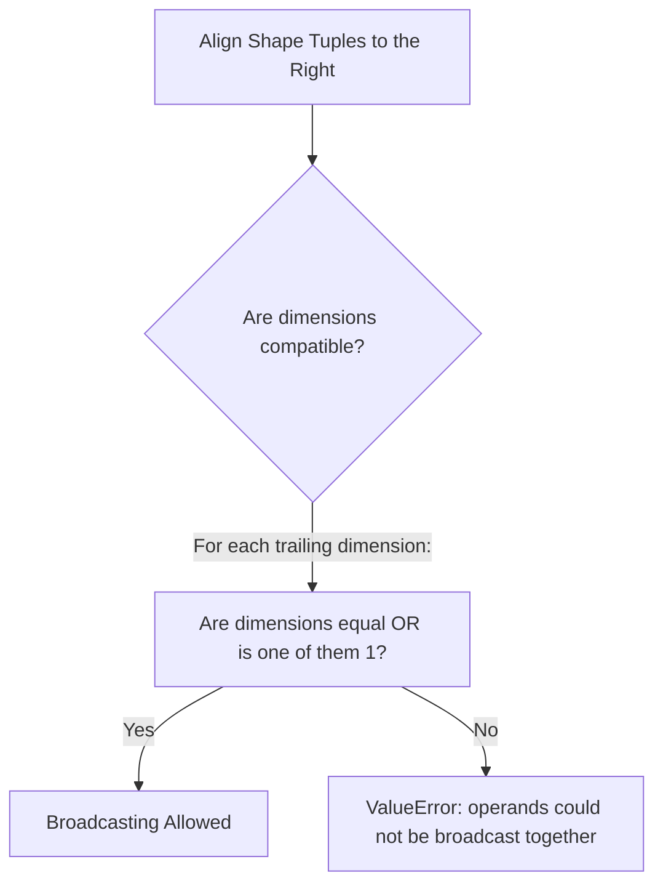

# 04. NumPy Mathematical Engine - Vectorization, ufuncs, and Broadcasting Rules

## 1. Overview
This note covers NumPy's mathematical computation engine, explaining universal functions (ufuncs), vectorization, multi-axis aggregations, array reshaping, stacking, and broadcasting rules.

## 2. Universal Functions (ufuncs)
A universal function (ufunc) operates on `ndarray` objects element-by-element in compiled C code:

```python
import numpy as np

x = np.array([1.0, 4.0, 9.0])
sqrt_x = np.sqrt(x)           # [1.0, 2.0, 3.0]
exp_x = np.exp([0.0, 1.0])    # [1.0, 2.71828...]
log_x = np.log([1.0, np.e])   # [0.0, 1.0]
sine_x = np.sin(np.pi / 2)    # 1.0
```

## 3. Multi-Axis Reductions and Aggregations
NumPy aggregation functions include an `axis` parameter that controls the direction of reduction:
- `axis=None`: Reduces the entire array to a single scalar value.
- `axis=0`: Collapses **rows** by computing statistics downward along each column.
- `axis=1`: Collapses **columns** by computing statistics across each row.

```python
a = np.array([
    [10, 20, 30],
    [40, 50, 60]
])

print("Total Array Sum:   ", np.sum(a))            # 210
print("Column-wise Means: ", np.mean(a, axis=0))    # [25., 35., 45.]
print("Row-wise Maxima:   ", np.max(a, axis=1))     # [30, 60]
print("Standard Deviation:", np.std(a))             # Overall standard deviation
```

## 4. Array Reshaping, Flattening, and Stacking

### Reshaping and Flattening
- `a.reshape(r, c)`: Returns a view of the array with a new shape $(r, c)$, provided $r \times c = \text{a.size}$.
- `a.ravel()`: Flattens an array into 1D without copying data whenever possible.
- `a.flatten()`: Flattens an array into 1D, always allocating an independent copy.

### Stacking Operations
```python
a = np.array([[1, 2], [3, 4]])
b = np.array([[5, 6], [7, 8]])

# Horizontal Stacking: Combine side-by-side along axis 1 (must share row count)
h_stacked = np.hstack((a, b))  # Shape: (2, 4)

# Vertical Stacking: Stack one above another along axis 0 (must share col count)
v_stacked = np.vstack((a, b))  # Shape: (4, 2)

# Generalized Concatenation:
cat_ax0 = np.concatenate((a, b), axis=0) # Equivalent to vstack
```

## 5. The Formal Rules of Array Broadcasting
Broadcasting allows arithmetic operations between arrays of different shapes by conceptually expanding the smaller array to match the larger array's dimensions without copying data.



### The Two Rules of Compatibility
1. **Right-to-Left Alignment**: Align the shape tuples of both arrays starting from their trailing (rightmost) dimensions.
2. **Dimension Compatibility**: Two dimensions are compatible if:
   - They have the same size, OR
   - One of them has a size of 1.

If a dimension has a size of 1, it is conceptually stretched along that axis to match the larger size. If a dimension is missing in the smaller array, it is padded with a leading dimension of size 1.

```python
# Example: Adding a 1D row vector to a 2D matrix
matrix = np.ones((4, 3))      # Shape: (4, 3)
vector = np.array([10, 20, 30])# Shape:    (3,) -> Aligns as (1, 3)

# Trailing dimensions match (3 == 3); leading dimension expands (1 -> 4)
result = matrix + vector      # Shape: (4, 3)
```

## 6. Connections to Other Topics
- Next step: [[05. NumPy Linear Algebra and Advanced Numerical Computation]].
- Explains DataFrame alignment in [[06. Pandas Structural Primitives - Series and DataFrame Architecture]].
```

---
