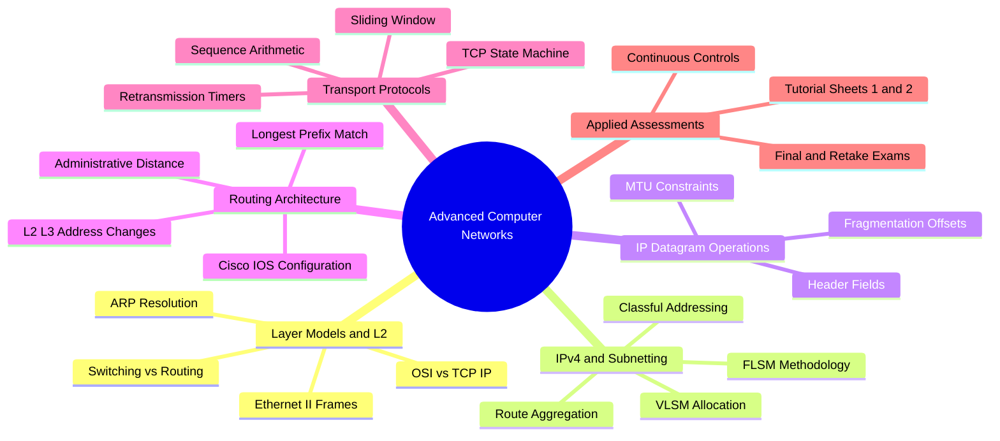
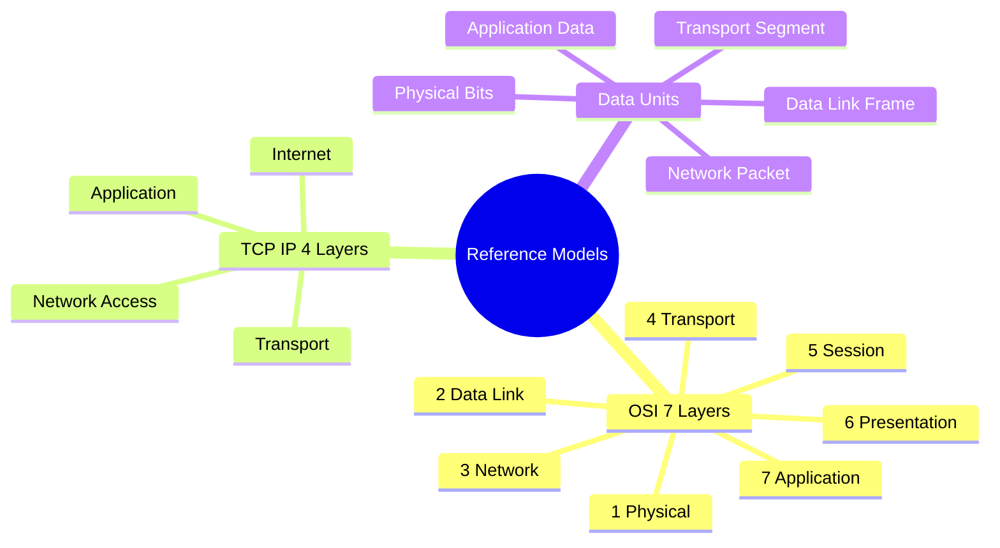
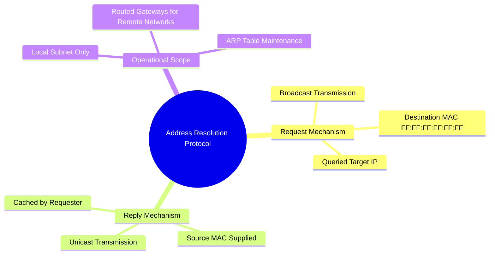
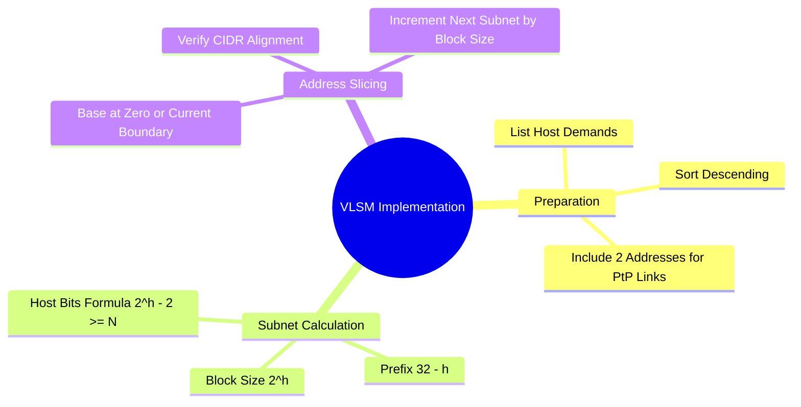
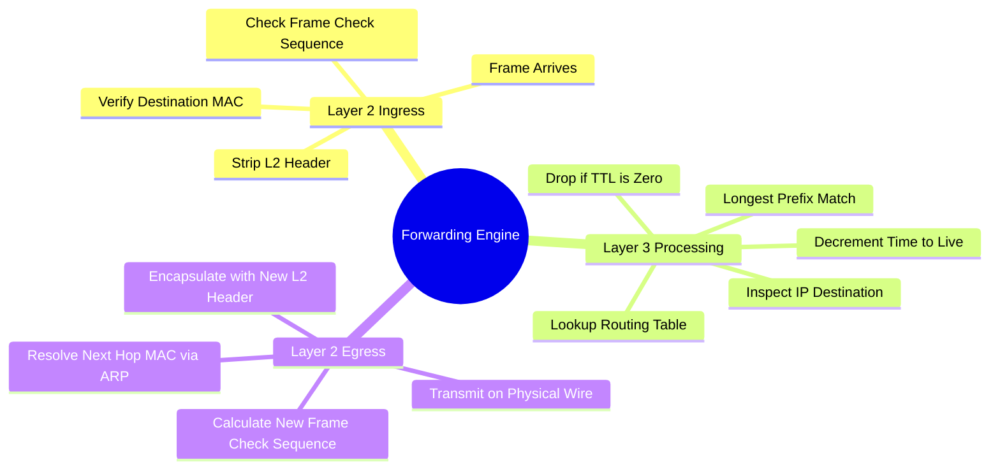

# Master Index and Architecture

```text
Advanced Computer Networks : {
    Chapter 1: Network Reference Models and Layer 2 Fundamentals
        - 1. 1. OSI and TCP IP Reference Models
        - 1. 2. Physical and Data Link Layer Operations
        - 1. 3. Ethernet II Frame Anatomy and Hexadecimal Decoding
        - 1. 4. Address Resolution Protocol and Hardware Discovery

    Chapter 2: IPv4 Addressing, Subnetting, and Design
        - 2. 1. IPv4 Classful Architecture and Special Ranges
        - 2. 2. Fixed Length Subnet Masking Mechanics
        - 2. 3. Variable Length Subnet Masking Algorithm
        - 2. 4. Subnet Membership and Binary Verification
        - 2. 5. Large Scale Campus and Enterprise Addressing Plans

    Chapter 3: IP Datagram Operations and Fragmentation
        - 3. 1. IPv4 Header Fields and Protocol Multiplexing
        - 3. 2. Datagram Fragmentation and Reassembly Algorithms

    Chapter 4: IP Routing Mechanics and Static Routing
        - 4. 1. Packet Forwarding Lifecycle and Address Rewriting
        - 4. 2. Routing Table Anatomy and Longest Prefix Match
        - 4. 3. Administrative Distance and Path Selection
        - 4. 4. Static and Default Route Configuration
        - 4. 5. Routing Table Inconsistency Detection
        - 4. 6. Reverse Engineering Network Topologies
        - 4. 7. Route Aggregation and CIDR Summarization

    Chapter 5: Transport Layer Protocols and State Management
        - 5. 1. TCP Header Architecture and Control Flags
        - 5. 2. TCP Three Way Handshake and Connection Teardown
        - 5. 3. Sliding Window Flow Control and Sequence Arithmetic
        - 5. 4. Packet Loss Recovery and Retransmission Analysis

    Chapter 6: Practical Laboratory Operations and Cisco CLI
        - 6. 1. Cisco IOS Operating Modes and Command Hierarchy
        - 6. 2. Router and Switch Interface Initialization
        - 6. 3. Device Access Security and Administrative Passwords
        - 6. 4. Diagnostic Show Commands and Verification
        - 6. 5. Packet Tracer Simulation and PDU Inspection

    Chapter 7: Examination and Assessment Archive
        - 7. 1. Tutorial Sheet 1. Computer Networks Review
        - 7. 2. Tutorial Sheet 2. Static Routing
        - 7. 3. Continuous Assessment 1. Academic Year 2023. FLSM and VLSM Design
        - 7. 4. Continuous Assessment 1. November 2023. Subnetting, NAT, and DHCP
        - 7. 5. Continuous Assessment 1. December 2023. Packet Tracing and CLI Security
        - 7. 6. Final Examination. February 2023. Network Protocols and Subnetting
        - 7. 7. Retake Examination. February 2023. Class A Mathematical Subnetting
        - 7. 8. Final Examination. January 2024. Network Design and TCP Flow Control
        - 7. 9. Continuous Assessment 1. November 2024. VLSM and IP Fragmentation
        - 7. 10. Final Examination. January 2025. Sequential Subnetting and Routing
        - 7. 11. Retake Examination. May 2025. Subnetting and Static Routing
        - 7. 12. Final Examination. Academic Year 2021 2022. Host Grouping and Services
        - 7. 13. Final Examination. Academic Year 2020. TCP Transport and DMZ Routing
        - 7. 14. Academic Exercise Set. Multi Class Subnet Analysis and DHCP Storage
}
```



---

# Chapter 1: Network Reference Models and Layer 2 Fundamentals

## 1. 1. OSI and TCP IP Reference Models

### Theoretical Framework
Computer network architectures organize communication protocols into layered hierarchies. Two dominant conceptual frameworks describe this organization:

1. **The Open Systems Interconnection (OSI) Reference Model:** Formulated by the International Organization for Standardization (ISO), it establishes a theoretical, seven-layer modular architecture to standardize inter-vendor communication.
2. **The TCP/IP Model (Internet Protocol Suite):** Developed through DARPA research for the ARPANET, this architecture focuses on practical, scalable network interconnections across diverse physical media.



### Layer Mapping and Protocol Data Units

| Layer Number | OSI Layer Name | TCP/IP Updated Layer | Primary Functional Responsibility | Protocol Data Unit (PDU) | Example Protocols / Hardware |
| :---: | :---: | :---: | :---: | :---: | :---: |
| **7** | Application | Application | User-facing interface, network service access | Data / Payload | HTTP, HTTPS, DNS, SMTP, FTP, SSH, DHCP |
| **6** | Presentation | Application | Data representation, character encoding, compression, encryption | Data / Payload | TLS, SSL, ASCII, JPEG, MPEG |
| **5** | Session | Application | Inter-host dialogue control, session checkpointing, session synchronization | Data / Payload | NetBIOS, RPC, Sockets |
| **4** | Transport | Transport | End-to-end logical process communication, flow control, reliability, error handling | Segment (TCP) / Datagram (UDP) | TCP, UDP, SCTP |
| **3** | Network | Internet | Logical host addressing, path determination across internetworks, route calculation | Packet | IPv4, IPv6, ICMP, IPsec, OSPF, RIP, BGP |
| **2** | Data Link | Network Access / Data Link | Node-to-node framing, physical MAC addressing, media access control, error detection | Frame | Ethernet (802.3), Wi-Fi (802.11), PPP, Switches |
| **1** | Physical | Network Access / Physical | Raw unstructured bitstream encoding over physical copper, optical, or radio channels | Bits | Cables (Cat6, Fiber), Hubs, Repeaters, Transceivers |

### Data Encapsulation and Protocol Multiplexing
Communication flows downward through the sender's protocol stack:
1. The **Application layer** prepares payload data (e.g., an HTTP GET request).
2. The **Transport layer** appends a header containing source and destination port numbers to create a **Segment**.
3. The **Network layer** attaches source and destination IP addresses, producing an **IP Packet**.
4. The **Data Link layer** encapsulates the packet into an **Ethernet Frame** with Layer 2 MAC addresses and a Cyclic Redundancy Check (CRC) trailer.
5. The **Physical layer** encodes these frame bits into electrical voltages, light pulses, or radio frequencies.

Upon receipt, the destination system moves upward through the stack, stripping headers at each layer (decapsulation).

---

## 1. 2. Physical and Data Link Layer Operations

### Layer 1 Transmission Media and Signal Conversion
The physical layer transmits uninterpreted bitstreams over physical transmission channels. Hardware at this layer does not interpret framing, headers, or logical addresses.
* **Copper Media (Twisted-Pair 100BASE-TX, 1000BASE-T):** Encodes binary ones and zeros into electrical voltage differentials.
* **Optical Fiber:** Uses infrared or visible laser pulses to represent data over long distances with minimal electromagnetic interference.
* **Wireless Radios (IEEE 802.11):** Modulates binary data into high-frequency electromagnetic waves across specified RF channels.

### Layer 2 Switching versus Layer 3 Routing
Network devices operate at distinct layers of the architecture to isolate traffic domains:

| Characteristic | Layer 2 Switching | Layer 3 Routing |
| :--- | :--- | :--- |
| **Addressing Used** | Media Access Control (MAC) | Internet Protocol (IP) |
| **Address Nature** | Physical, flat, burned into NIC hardware | Logical, hierarchical, administratively assigned |
| **Forwarding Engine** | MAC Address Table (CAM Table) | IP Routing Table (FIB) |
| **Handling Unknown Destinations** | **Floods** frame out all active ports except ingress | **Drops** packet and returns ICMP error |
| **Broadcast Scope** | Forwarded across the broadcast domain | Blocked; routers delimit broadcast domains |
| **Hardware Boundary** | Interconnects local segment devices | Connects distinct subnets across WANs |

---

## 1. 3. Ethernet II Frame Anatomy and Hexadecimal Decoding

### IEEE 802.3 and Ethernet II Frame Format
The Ethernet protocol structures packets from the network layer into standardized data frames:

```
[Preamble: 7 Bytes] [SFD: 1 Byte] [Dest MAC: 6 Bytes] [Source MAC: 6 Bytes] [Type: 2 Bytes] [Data and Padding: 46 - 1500 Bytes] [FCS: 4 Bytes]
```

* **Preamble (7 Bytes):** Pattern of alternating `10101010` bits to synchronize receiving NIC clock frequencies.
* **Start Frame Delimiter (SFD) (1 Byte):** Concludes synchronization with `10101011`, indicating payload fields follow immediately.
* **Destination MAC Address (6 Bytes):** Hardware address of the frame recipient.
* **Source MAC Address (6 Bytes):** Hardware address of the transmitting network interface.
* **EtherType (2 Bytes):** Protocol identifier for the encapsulated Network layer payload:
  * `0x0800`: Internet Protocol Version 4 (IPv4)
  * `0x0806`: Address Resolution Protocol (ARP)
  * `0x86DD`: Internet Protocol Version 6 (IPv6)
* **Data and Padding (46 to 1500 Bytes):** Network layer PDU. If payload is smaller than 46 bytes, padding bytes are appended to satisfy the 64-byte minimum frame size.
* **Frame Check Sequence (FCS) (4 Bytes):** 32-bit CRC calculation checking for bit errors sustained during physical transmission.

### Frame Decoding Technique
When analyzing network frame captures in hexadecimal format:

```text
00 1a 73 24 44 89 00 12 17 41 c2 c7 08 00 45 00 00 3c 00 29 00 00 96 01 ...
```

1. **Bytes 0 to 5:** Destination MAC (`00:1a:73:24:44:89`).
2. **Bytes 6 to 11:** Source MAC (`00:12:17:41:c2:c7`).
3. **Bytes 12 to 13:** EtherType (`0x0800` $\implies$ IPv4).
4. **Byte 14 onwards:** Beginning of the encapsulated IPv4 header.

---

## 1. 4. Address Resolution Protocol and Hardware Discovery

### Functional Role of ARP
Because network interfaces forward data across physical cables and switch fabrics using Layer 2 hardware addresses, a host must know the destination MAC address to communicate with an IP endpoint. The Address Resolution Protocol (RFC 826) maps logical IPv4 addresses to physical MAC addresses on the local network link.



### Complete Operational Cycle
1. **Cache Verification:** A source host (`10.10.10.1`) prepares a packet for a destination host (`10.10.10.2`). It checks its internal ARP cache table.
2. **ARP Request Construction:** If no entry exists, the source generates an ARP Request packet containing:
   * Sender IP: `10.10.10.1`, Sender MAC: `00:00:00:00:00:01`
   * Target IP: `10.10.10.2`, Target MAC: `00:00:00:00:00:00`
3. **Layer 2 Encapsulation:** Encapsulated inside an Ethernet frame with:
   * Source MAC: `00:00:00:00:00:01`
   * Destination MAC: `FF:FF:FF:FF:FF:FF` (Broadcast).
4. **Broadcast Propagation:** The local switch receives the broadcast frame and floods it to all active access ports in the VLAN.
5. **Frame Processing:** All connected hosts process the request. Non-target machines inspect the target IP, find no match, and drop the frame without replying.
6. **ARP Reply Generation:** The target machine (`10.10.10.2`) identifies its own IP, caches the requester's MAC address, and returns a unicast ARP reply:
   * Source MAC: `00:00:00:00:00:02`, Destination MAC: `00:00:00:00:00:01`.
7. **Cache Population:** The source receives the reply, writes `10.10.10.2 -> 00:00:00:00:00:02` into its ARP cache, and immediately transmits its pending data packets.

---

# Chapter 2: IPv4 Addressing, Subnetting, and Design

## 2. 1. IPv4 Classful Architecture and Special Ranges

### The Historical Class System
Standardized in RFC 791, IPv4 addresses consist of a 32-bit binary integer displayed as four decimal octets separated by periods (`X.X.X.X`). The historical class system allocated addresses based on their leading bit values:

| Class | High-Order Bits | First Octet Range | Default Subnet Mask | Default CIDR | Total Networks Available | Total Hosts per Network ($2^h - 2$) |
| :---: | :---: | :---: | :---: | :---: | :---: | :---: |
| **A** | `0...` | `1.0.0.0` to `126.0.0.0` | 255.0.0.0 | `/8` | $2^7 - 2 = 126$ | $2^{24} - 2 = 16,777,214$ |
| **B** | `10...` | `128.0.0.0` to `191.255.0.0` | 255.255.0.0 | `/16` | $2^{14} = 16,384$ | $2^{16} - 2 = 65,534$ |
| **C** | `110...` | `192.0.0.0` to `223.255.255.0` | 255.255.255.0 | `/24` | $2^{21} = 2,097,152$ | $2^8 - 2 = 254$ |
| **D** | `1110...` | `224.0.0.0` to `239.255.255.255` | Undefined | Undefined | Multicast Groups | Not assignable to unicast interfaces |
| **E** | `1111...` | `240.0.0.0` to `255.255.255.255` | Undefined | Undefined | Experimental / Research | Not assignable to unicast interfaces |

### Reserved and Special Use Addresses
* **Loopback Network (`127.0.0.0/8`):** Reserved for internal host communication and protocol stack diagnostics (`127.0.0.1` = Localhost). These packets never traverse a physical network wire.
* **Private Address Blocks (RFC 1918):** Unroutable across the public Internet; reserved for private enterprise topologies:
  * Class A Block: `10.0.0.0/8` (`10.0.0.0` to `10.255.255.255`)
  * Class B Block: `172.16.0.0/12` (`172.16.0.0` to `172.31.255.255`)
  * Class C Block: `192.168.0.0/16` (`192.168.0.0` to `192.168.255.255`)
* **Link Local / APIPA (`169.254.0.0/16`):** Automatically assigned by the host operating system when a DHCP request goes unanswered.
* **Limited Broadcast (`255.255.255.255`):** Targets every host in the local broadcast domain. Routers drop this traffic at subnet boundaries.

---

## 2. 2. Fixed Length Subnet Masking Mechanics

### Subnetting Mathematics
Fixed Length Subnet Masking (FLSM) divides a primary classful or classless network into multiple equal-sized sub-allocations, with every subnet using an identical subnet mask.

1. **Calculate Borrowed Subnet Bits ($n$):**  
   To produce at least $S$ distinct subnets from a base network prefix:
   $$2^n \ge S$$
2. **Calculate New Prefix Length:**
   $$\text{Prefix}_{\text{new}} = \text{Prefix}_{\text{base}} + n$$
3. **Calculate Remaining Host Bits ($h$):**
   $$h = 32 - \text{Prefix}_{\text{new}}$$
4. **Calculate Usable Host Capacity per Subnet:**
   $$\text{Usable Capacity} = 2^h - 2$$
   *(Subtracting 2: one address for the Network Identifier, one for the Directed Broadcast).*

### The Magic Number ($\Delta$) Calculation
To avoid time-consuming binary conversion during network calculations, compute the block size $\Delta$:
$$\Delta = 256 - \text{Decimal Value of the Modified Octet in the Subnet Mask}$$
The network address of each consecutive subnet increments by $\Delta$ within that modified octet, while all preceding octets remain constant.

---

## 2. 3. Variable Length Subnet Masking Algorithm

### Overcoming FLSM Inefficiencies
FLSM forces all subnets to the dimensions of the largest single network requirement. In heterogeneous enterprise layouts, this wastes address space. Variable Length Subnet Masking (VLSM) dynamically tailors the prefix length to each segment's specific host requirements.



### The Standardized VLSM Procedure
1. **Inventory and Sort:** List every required network segment and sort host counts in strictly descending order (largest first). Always assign 2 hosts to Point-to-Point (PtP) WAN connections.
2. **Determine Host Bits ($h$):** For each segment, find the smallest integer $h$ such that:
   $$2^h - 2 \ge \text{Required Hosts}$$
3. **Assign Prefix and Mask:** Compute $\text{Prefix} = 32 - h$ and derive the dotted-decimal subnet mask.
4. **Allocate Subnet Addresses Sequentially:**
   * Align the first subnet to the base network address.
   * Start each subsequent subnet at the next available boundary:
     $$\text{Next Network Address} = \text{Current Network Address} + 2^h$$
5. **Compute Ranges:**
   * $\text{First Usable Host} = \text{Network Address} + 1$
   * $\text{Broadcast Address} = \text{Next Subnet Network Address} - 1$
   * $\text{Last Usable Host} = \text{Broadcast Address} - 1$

---

## 2. 4. Subnet Membership and Binary Verification

To determine if an IP address belongs to a candidate subnet, compute the bitwise logical AND ($\text{AND}$) between the IP address and the subnet mask. If the result matches the candidate subnet address, the IP is a member.

$$\begin{array}{rcc}
\text{IP Address:} & \texttt{192.168.10.75} & \implies \texttt{11000000.10101000.00001010.01001011}_2 \\
\text{Mask (/26):} & \texttt{255.255.255.192} & \implies \texttt{11111111.11111111.11111111.11000000}_2 \\
\hline
\text{Network Result:} & \texttt{192.168.10.64} & \implies \texttt{11000000.10101000.00001010.01000000}_2
\end{array}$$

* **Broadcast Address:** Set all $h$ host bits to binary `1` $\implies \texttt{...01111111}_2 = \texttt{192.168.10.127}$.
* **Host Offset ID:** The numerical value of the remaining host bits $\implies \texttt{001011}_2 = 11_{10}$ (calculated as $75 - 64 = 11$).

---

# Chapter 3: IP Datagram Operations and Fragmentation

## 3. 1. IPv4 Header Fields and Protocol Multiplexing

The IPv4 datagram header formats packet control data:

```
 0                   1                   2                   3
 0 1 2 3 4 5 6 7 8 9 0 1 2 3 4 5 6 7 8 9 0 1 2 3 4 5 6 7 8 9 0 1
+-+-+-+-+-+-+-+-+-+-+-+-+-+-+-+-+-+-+-+-+-+-+-+-+-+-+-+-+-+-+-+-+
|Version|  IHL  |Type of Service|          Total Length         |
+-+-+-+-+-+-+-+-+-+-+-+-+-+-+-+-+-+-+-+-+-+-+-+-+-+-+-+-+-+-+-+-+
|         Identification        |Flags|      Fragment Offset    |
+-+-+-+-+-+-+-+-+-+-+-+-+-+-+-+-+-+-+-+-+-+-+-+-+-+-+-+-+-+-+-+-+
|  Time to Live |    Protocol   |        Header Checksum        |
+-+-+-+-+-+-+-+-+-+-+-+-+-+-+-+-+-+-+-+-+-+-+-+-+-+-+-+-+-+-+-+-+
|                       Source IP Address                       |
+-+-+-+-+-+-+-+-+-+-+-+-+-+-+-+-+-+-+-+-+-+-+-+-+-+-+-+-+-+-+-+-+
|                    Destination IP Address                     |
+-+-+-+-+-+-+-+-+-+-+-+-+-+-+-+-+-+-+-+-+-+-+-+-+-+-+-+-+-+-+-+-+
|                    Options (if any)           |    Padding    |
+-+-+-+-+-+-+-+-+-+-+-+-+-+-+-+-+-+-+-+-+-+-+-+-+-+-+-+-+-+-+-+-+
```

1. **Version (4 bits):** Identifies the protocol version (Binary `0100` = IPv4).
2. **Internet Header Length (IHL) (4 bits):** Length of the header measured in 32-bit (4-byte) words. The minimum value is $5$ ($5 \times 4 = 20\text{ bytes}$); the maximum is $15$ ($15 \times 4 = 60\text{ bytes}$, with 40 bytes of options).
3. **Type of Service (TOS) / DSCP (8 bits):** Quality of Service markings and Congestion Notifications.
4. **Total Length (16 bits):** Entire datagram size in bytes, including header and data payload. Maximum size is $2^{16} - 1 = 65,535\text{ bytes}$.
5. **Identification (16 bits):** Unique tracking integer assigned by the sender to reconstruct fragmented packets.
6. **Flags (3 bits):**
   * Bit 0: Reserved (must be `0`).
   * Bit 1: **Don't Fragment (DF):** If set to `1`, routers cannot fragment this packet.
   * Bit 2: **More Fragments (MF):** If set to `1`, more fragments follow. If set to `0`, this is the final fragment.
7. **Fragment Offset (13 bits):** Position of this fragment's data relative to the start of the original unfragmented payload, expressed in units of **8-byte blocks**.
8. **Time to Live (TTL) (8 bits):** Hop counter decremented by 1 at every routing node. If TTL reaches 0, the router discards the packet and sends an ICMP Time Exceeded message back to the source, preventing infinite loops.
9. **Protocol (8 bits):** Identifies the next higher-layer protocol:
   * `1`: ICMP (Internet Control Message Protocol)
   * `6`: TCP (Transmission Control Protocol)
   * `17`: UDP (User Datagram Protocol)
10. **Header Checksum (16 bits):** Error-detection field calculated over header contents only. It is recalculated at every hop because the TTL field changes.
11. **Source / Destination IP Addresses (32 bits each):** Originating sender and ultimate destination IP endpoints.

---

## 3. 2. Datagram Fragmentation and Reassembly Algorithms

### The Need for Fragmentation
Links connecting distinct networks enforce physical transmission limits known as the **Maximum Transmission Unit (MTU)**. Ethernet links usually enforce an MTU of $1500\text{ bytes}$. When a datagram's total size exceeds the outgoing interface MTU:
* If $\text{DF} = 0$, the router slices the payload into smaller fragments.
* If $\text{DF} = 1$, the router discards the packet and returns an ICMP Destination Unreachable message (*Fragmentation Needed and DF Set*).

### Fragmentation Math Rules
1. Every fragment gets its own duplicate IP header (minimum 20 bytes).
2. The payload in all non-terminal fragments **must be a multiple of 8 bytes** because the Fragment Offset field measures payload position in 8-byte blocks:
   $$\text{Max Payload Capacity} = \left\lfloor \frac{\text{Link MTU} - \text{Header Length}}{8} \right\rfloor \times 8$$
3. The Fragment Offset is computed as:
   $$\text{Offset} = \frac{\text{Total Payload Data Bytes Transmitted in Earlier Fragments}}{8}$$

---

# Chapter 4: IP Routing Mechanics and Static Routing

## 4. 1. Packet Forwarding Lifecycle and Address Rewriting

When a router receives a frame, it performs the following Layer 2 and Layer 3 operations:



1. **Ingress L2 Validation:** Inspects the destination MAC. If it matches the router's interface, it validates the Frame Check Sequence (FCS) for bit errors and strips the Layer 2 header.
2. **L3 Lookup:** Inspects the destination IP address against the internal routing table using the **Longest Prefix Match (LPM)** rule.
3. **TTL Handling:** Decrements the TTL field by 1. If it reaches 0, the packet is discarded and an ICMP Time Exceeded message is sent to the sender. It then recalculates the IP Header Checksum.
4. **Egress L2 Encapsulation:** Identifies the outgoing exit interface and next-hop IP. It resolves the next-hop MAC address using ARP, prepends a new Layer 2 Ethernet header (with its own interface MAC as source and the next hop's MAC as destination), appends a new FCS trailer, and transmits the frame.

> **Key Rule:** IP addresses never change end-to-end across a standard routed path (without NAT). MAC addresses change at every router hop.

---

## 4. 2. Routing Table Anatomy and Longest Prefix Match

### Reading Routing Table Entries
An entry generated by dynamic or static routing displays the following information:

```text
O 10.1.5.0/24 [110/20] via 192.168.12.2, 00:14:22, GigabitEthernet0/1
```
* **Protocol Code (`O`):** Learned via OSPF (`C` = Connected, `L` = Local, `S` = Static, `R` = RIP).
* **Destination Prefix (`10.1.5.0/24`):** Target network address and subnet mask.
* **Administrative Distance (`110`):** Trustworthiness rating of the route source.
* **Metric (`20`):** Path cost calculated by the protocol algorithm.
* **Next-Hop IP (`via 192.168.12.2`):** IP address of the neighboring router interface.
* **Uptime (`00:14:22`):** Time since the route was installed or refreshed.
* **Exit Interface (`GigabitEthernet0/1`):** Local hardware port used to forward traffic.

### The Longest Prefix Match (LPM) Rule
If multiple entries in the routing table cover a packet's destination IP, the router selects the entry with the **most specific subnet mask (longest prefix length)**.

*Processing Priority Order:*
$$\mathbf{/32} \text{ (Host/Local)} \to \mathbf{/30} \to \mathbf{/28} \to \mathbf{/27} \to \mathbf{/24} \to \mathbf{/19} \to \mathbf{/16} \to \mathbf{/0} \text{ (Default Route)}$$

---

## 4. 3. Administrative Distance and Path Selection

When multiple routing protocols learn paths to the exact same destination prefix, the router installs the route from the source with the lowest **Administrative Distance (AD)**:

| Route Source | Default AD | Trustworthiness Level |
| :--- | :---: | :--- |
| **Directly Connected Interface** | **0** | Most Trustworthy |
| **Static Route** | **1** | Highly Trustworthy |
| **EIGRP (Internal)** | **90** | High |
| **OSPF** | **110** | Medium |
| **IS-IS** | **115** | Medium |
| **RIP** | **120** | Low |
| **External BGP** | **20** | High (Internet Inter-AS) |

---

## 4. 4. Static and Default Route Configuration

### Cisco IOS Configuration Syntax
```cisco
Router(config)# ip route <destination_network> <subnet_mask> {next_hop_ip | exit_interface} [administrative_distance]
```

* **Standard Static Route:** Explicitly directs traffic for a known remote subnet to a neighbor's next-hop IP:
  ```cisco
  Router(config)# ip route 192.168.20.0 255.255.255.0 10.0.0.2
  ```
* **Default Static Route (Gateway of Last Resort):** Matches all destination addresses not covered by more specific routing table entries:
  ```cisco
  Router(config)# ip route 0.0.0.0 0.0.0.0 10.0.0.2
  ```
* **Floating Static Route:** Configured with a higher administrative distance (e.g., AD = 130) to provide backup connectivity if an active dynamic route fails:
  ```cisco
  Router(config)# ip route 192.168.20.0 255.255.255.0 10.0.0.6 130
  ```

---

## 4. 5. Routing Table Inconsistency Detection

Examine candidate routing tables for common configuration errors:
1. **Routing the Router's Own Interface IP Elsewhere:** Assigning a host route (`/32`) matching an assigned interface IP to an external next-hop router. An interface IP must point locally to the host protocol stack (`L`).
2. **Next-Hop Unreachable on Local Subnet:** Pointing a next-hop IP to an address that does not belong to the IP network assigned to the specified exit interface.
3. **Routing Directed or Limited Broadcasts:** Creating routes pointing to `255.255.255.255` across external gateways.
4. **Default Route Pointed to Loopback:** Pointing `0.0.0.0 0.0.0.0` to `127.0.0.1` (`Lo`), which discards all Internet-bound traffic locally.

---

## 4. 6. Reverse Engineering Network Topologies

To reconstruct a physical and logical topology from Cisco `show ip route` output:

1. **Map Connected Interfaces (`C` and `L` Codes):**
   * Every `C` entry represents an interface directly attached to a physical link. Note the network address and assigned mask.
   * Every `L` entry identifies the router's own assigned IP address on that interface.
2. **Map Neighboring Routers via Next Hops:**
   * Review all remote routes (`S` for Static, `R` for RIP, `O` for OSPF).
   * Group these routes by their next-hop address (`via X.X.X.X`).
   * Each unique next-hop IP identifies a neighboring router connected on the shared link matching that IP.
3. **Map Distant Networks:**
   * Attach remote destination subnets behind the neighbor router that advertises them.

---

## 4. 7. Route Aggregation and CIDR Summarization

Route summarization combines multiple contiguous subnet prefixes into a single supernet route with a shorter prefix.

### Step-by-Step Bitwise Summarization
1. Convert the differing octet of all subnets into binary.
2. Count the number of identical bits from left to right across all subnets.
3. The summary prefix length equals:
   $$\text{Summary Prefix} = \text{Base Prefix of Fixed Octets} + \text{Number of Matching Bits in Differing Octet}$$
4. Set all bits after the matching prefix to binary `0` to determine the aggregate base network address.

---

# Chapter 5: Transport Layer Protocols and State Management

## 5. 1. TCP Header Architecture and Control Flags

```
 0                   1                   2                   3
 0 1 2 3 4 5 6 7 8 9 0 1 2 3 4 5 6 7 8 9 0 1 2 3 4 5 6 7 8 9 0 1
+-+-+-+-+-+-+-+-+-+-+-+-+-+-+-+-+-+-+-+-+-+-+-+-+-+-+-+-+-+-+-+-+
|          Source Port          |       Destination Port        |
+-+-+-+-+-+-+-+-+-+-+-+-+-+-+-+-+-+-+-+-+-+-+-+-+-+-+-+-+-+-+-+-+
|                        Sequence Number                        |
+-+-+-+-+-+-+-+-+-+-+-+-+-+-+-+-+-+-+-+-+-+-+-+-+-+-+-+-+-+-+-+-+
|                    Acknowledgment Number                      |
+-+-+-+-+-+-+-+-+-+-+-+-+-+-+-+-+-+-+-+-+-+-+-+-+-+-+-+-+-+-+-+-+
|  Data |           |U|A|P|R|S|F|                               |
| Offset| Reserved  |R|C|S|S|Y|I|            Window             |
|       |           |G|K|H|T|N|N|                               |
+-+-+-+-+-+-+-+-+-+-+-+-+-+-+-+-+-+-+-+-+-+-+-+-+-+-+-+-+-+-+-+-+
|           Checksum            |         Urgent Pointer        |
+-+-+-+-+-+-+-+-+-+-+-+-+-+-+-+-+-+-+-+-+-+-+-+-+-+-+-+-+-+-+-+-+
```

* **Source Port / Destination Port (16 bits each):** Multiplexes communication to specific application processes (Port range: $0$ to $2^{16} - 1 = 65,535$).
* **Sequence Number (32 bits):** Tracks the byte-stream position of the first data byte in this segment.
* **Acknowledgment Number (32 bits):** Indicates the next expected byte sequence number from the remote sender.
* **Data Offset (4 bits):** Length of the TCP header in 32-bit words (Minimum: $5 \times 4 = 20\text{ bytes}$; Maximum: $15 \times 4 = 60\text{ bytes}$).
* **Control Flags (6 bits):**
  * **URG (Urgent):** Tells the receiving process that data at the urgent pointer offset requires prioritized handling.
  * **ACK (Acknowledgment):** Validates the acknowledgment field. Set on all packets after the initial SYN.
  * **PSH (Push):** Directs the receiver to deliver buffered data to the application layer immediately.
  * **RST (Reset):** Terminates an invalid, broken, or rejected connection.
  * **SYN (Synchronize):** Initializes sequence numbers during the three-way handshake. Consumes 1 sequence number.
  * **FIN (Finish):** Closes a connection gracefully. Consumes 1 sequence number.
* **Window Size (16 bits):** Flow-control buffer capacity (in bytes) that the receiver can currently accept.

---

## 5. 2. TCP Three Way Handshake and Sequence Arithmetic

### Handshake Sequence
1. **SYN:** Client sends initial connection request:
   $$\text{Control: } \text{SYN}=1, \text{ACK}=0 \quad|\quad \text{Nseq} = \text{ISN}_{\text{client}} \quad|\quad \text{Nack} = 0$$
2. **SYN + ACK:** Server acknowledges client and sends its own initial sequence number:
   $$\text{Control: } \text{SYN}=1, \text{ACK}=1 \quad|\quad \text{Nseq} = \text{ISN}_{\text{server}} \quad|\quad \text{Nack} = \text{ISN}_{\text{client}} + 1$$
3. **ACK:** Client confirms server sequence:
   $$\text{Control: } \text{SYN}=0, \text{ACK}=1 \quad|\quad \text{Nseq} = \text{ISN}_{\text{client}} + 1 \quad|\quad \text{Nack} = \text{ISN}_{\text{server}} + 1$$

### Sequence Arithmetic Rules
* **SYN and FIN flags** each consume **1 sequence number**, even though they carry no payload data.
* **Pure ACKs** (carrying no payload data) consume **0 sequence numbers**.
* **Payload data** advances sequence numbers byte-for-byte:
  $$\text{Next Expected Sequence Number} = \text{Current Sequence Number} + \text{Payload Length (in bytes)}$$

---

# Chapter 6: Practical Laboratory Operations and Cisco CLI

## 6. 1. Cisco IOS Operating Modes and Command Hierarchy

```mermaid
mindmap
  root((Cisco IOS Hierarchy))
    User EXEC Mode
      Prompt Router >
      Basic Monitoring
      Transition Command: enable
    Privileged EXEC Mode
      Prompt Router #
      View Configuration
      Export and Import Images
      Transition Command: configure terminal
    Global Configuration Mode
      Prompt Router (config)#
      Modify System Parameters
      Transition Command: interface interface-name
    Interface Configuration Mode
      Prompt Router (config-if)#
      Assign IP and Subnet Mask
      Activation Command: no shutdown
```

* **User EXEC Mode (`Router>`):** Read-only mode used to check basic device connectivity.
* **Privileged EXEC Mode (`Router#`):** Provides administrative access, system debugging, and configuration file operations. Entered with `enable`.
* **Global Configuration Mode (`Router(config)#`):** Used to apply system-wide settings, routing protocols, and global interfaces. Entered with `configure terminal`.
* **Interface Configuration Mode (`Router(config-if)#`):** Modifies port-specific attributes, assigns IP addresses, and toggles physical administrative state. Entered with `interface <type> <slot/port>`.

---

## 6. 2. Diagnostic Show Commands and Verification

* `show ip interface brief`: Summarizes every interface, assigned IPv4 address, physical status (Layer 1 status), and data link protocol state (Layer 2 state).
* `show ip route`: Displays the active Layer 3 routing table, installed networks, and route sources.
* `show running-config`: Displays the active configuration file running in volatile RAM.
* `show startup-config`: Displays the saved configuration file stored in non-volatile NVRAM.
* `show mac address-table`: Run on **switches** to view port-to-MAC hardware forwarding tables.
* `arp -a`: Run on **hosts/PCs** from the command prompt to view the Layer 2 to Layer 3 address cache.

---

# Chapter 7: Examination and Assessment Archive

---

## 7. 1. Tutorial Sheet 1. Computer Networks Review

* **Academic Year:** 2026–2027
* **Assessment Type:** Tutorial Sheet (TD 1)
* **Status:** Complete Official Solutions Provided

---

### Exercise 1: OSI Layer Functional Identification

#### Problem Statement
The OSI model has 7 layers. For this exercise, we focus only on: (P) Physical, (D) Data Link, (N) Network, and (A) Application. For each case, identify the single OSI layer primarily responsible:
1. A network interface converts binary bits into electrical signals for transmission over a copper cable.
2. An Ethernet frame contains the destination MAC address used to identify the receiving device on a LAN.
3. A router examines the destination IP address of a packet to determine where to forward it.
4. A web browser uses HTTP to request a web page from a web server.
5. An Ethernet switch uses a MAC address table to select the outgoing port for a frame.
6. A wireless network interface converts bits into radio signals for transmission through the air.
7. An Ethernet frame uses a CRC value to detect transmission errors.
8. A router maintains a routing table containing network addresses and next-hop information.
9. An email application uses SMTP to submit an outgoing email to a mail server.
10. A network interface sends a sequence of raw bits over the physical transmission medium without interpreting their meaning.

#### Solution and Methodology
1. **Physical (P):** Encodes raw bits into electrical signals on copper.
2. **Data Link (D):** Structures data into frames and handles destination MAC addresses.
3. **Network (N):** Inspects destination IP addresses for path forwarding.
4. **Application (A):** HTTP operates at the application layer to deliver user requests.
5. **Data Link (D):** Switches examine Layer 2 MAC address tables (CAM tables).
6. **Physical (P):** Converts bits into electromagnetic radio signals.
7. **Data Link (D):** Calculates CRC and checks the Frame Check Sequence (FCS) trailer.
8. **Network (N):** Manages routing tables and routes packets between subnets.
9. **Application (A):** SMTP handles mail transfer at the application layer.
10. **Physical (P):** Moves raw bitstreams across physical media without processing headers.

---

### Exercise 2: Classification of Network Items

#### Problem Statement
Classify the following elements into their respective OSI layers:
HTTP, Ethernet, IP address, Fiber-optic cable, MAC address, Router, DNS, Switch, SMTP, Repeater, FTP, Twisted-pair cable, ARP, DHCP, Frame, Packet, Wi-Fi radio signal, HTTPS, Routing table, CRC.

#### Solution
* **Physical Layer (P):** Fiber-optic cable, Repeater, Twisted-pair cable, Wi-Fi radio signal.
* **Data Link Layer (D):** Ethernet, MAC address, Switch, ARP, Frame, CRC.
* **Network Layer (N):** IP address, Router, Packet, Routing table.
* **Application Layer (A):** HTTP, DNS, SMTP, FTP, HTTPS, DHCP.

*(Note: While DHCP configures network settings and ARP resolves Layer 3 addresses, DHCP runs as an application protocol over UDP, and ARP functions directly inside Layer 2 frames).*

---

### Exercise 3: Wireshark Frame Capture Analysis (SMTP over TCP/IP)

#### Problem Statement
Given the Wireshark packet capture analysis:
* `Frame 11: 87 bytes on wire, 87 bytes captured`
* `Ethernet II, Src: RivetNet_d2:d4:13 (9c:b6:d0:d2:d4:13), Dst: Sagemcom_32:44:30 (68:15:90:32:44:30)`
* `Internet Protocol Version 4, Src: 192.168.0.90, Dst: 80.12.242.10`
* `Transmission Control Protocol, Src Port: 55990, Dst Port: 587, Seq: 1, Ack: 38, Len: 21`
* `Simple Mail Transfer Protocol: EHLO [192.168.0.90]`

1. What is the purpose of this communication?
2. Match each TCP/IP layer with its corresponding protocol.
3. Complete the simplified transmitted frame.
4. Deduce the simplified response frame.

#### Solution
1. **Communication Purpose:** The client (`192.168.0.90`) initializes an email submission session to the mail server (`80.12.242.10`) on TCP port 587 by sending the `EHLO` hello command to query server capabilities.
2. **Layer-to-Protocol Mapping:**
   * Application: SMTP
   * Transport: TCP
   * Internet: IPv4
   * Network Access: Ethernet II
3. **Transmitted Frame:**
   * Destination MAC: `68:15:90:32:44:30`
   * Source MAC: `9c:b6:d0:d2:d4:13`
   * Source IP: `192.168.0.90`
   * Destination IP: `80.12.242.10`
   * Source Port: `55990`
   * Destination Port: `587`
4. **Response Frame (Observed on the same local access link):**
   * Destination MAC: `9c:b6:d0:d2:d4:13`
   * Source MAC: `68:15:90:32:44:30`
   * Source IP: `80.12.242.10`
   * Destination IP: `192.168.0.90`
   * Source Port: `587`
   * Destination Port: `55990`

---

### Exercise 4: IPv4 Subnet Mathematics (`172.16.112.31/19`)

#### Problem Statement
Given IP `172.16.112.31` with Subnet Mask `255.255.224.0` (`/19`):
1. Find the network address.
2. How many hosts can this network accommodate?
3. Provide the lowest and highest usable host addresses.
4. Provide the broadcast address.

#### Solution
* Mask `/19` leaves $32 - 19 = 13$ host bits ($h = 13$).
* Modified octet: 3rd octet ($224$).
* Block size: $\Delta = 256 - 224 = 32$.
* Subnets advance by 32 in the 3rd octet: `0`, `32`, `64`, `96`, `128`.
* Since 112 falls between 96 and 127:
  1. **Network Address:** `172.16.96.0/19`
  2. **Max Usable Hosts:** $2^{13} - 2 = 8192 - 2 = \mathbf{8,190 \text{ hosts}}$.
  3. **Usable Range:** `172.16.96.1` to `172.16.127.254`
  4. **Broadcast Address:** `172.16.127.255`

---

### Exercise 5: Classful Validation

#### Problem Statement
Evaluate validity, usability, class, network, and broadcast addresses for:
1. `131.107.256.80`
2. `127.1.1.1`
3. `255.255.255.255`
4. `214.0.0.4`
5. `222.222.255.222`
6. `198.121.254.255`
7. `132.4.0.5`
8. `248.5.10.156`
9. `231.200.1.1`
10. `10.4.200.200`
11. `126.1.0.0`
12. `191.48.54.100`

#### Solution

| Target Address | Valid? | Usable? | Class | Network Part | Host Part | Network Address | Broadcast Address | Reason / Anomaly |
| :--- | :---: | :---: | :---: | :---: | :---: | :---: | :---: | :--- |
| `131.107.256.80` | **No** | **No** | Invalid | - | - | - | - | Octet $256 > 255$ |
| `127.1.1.1` | **Yes** | **No** | A | 127 | 1.1.1 | `127.0.0.0` | `127.255.255.255` | Loopback address |
| `255.255.255.255`| **Yes** | **No** | Special | - | - | - | - | Limited Broadcast |
| `214.0.0.4` | **Yes** | **Yes**| C | 214.0.0 | 4 | `214.0.0.0` | `214.0.0.255` | Usable host address |
| `222.222.255.222`| **Yes** | **Yes**| C | 222.222.255| 222 | `222.222.255.0`| `222.222.255.255`| Usable host address |
| `198.121.254.255`| **Yes** | **No** | C | 198.121.254| 255 | `198.121.254.0`| `198.121.254.255`| Directed broadcast address |
| `132.4.0.5` | **Yes** | **Yes**| B | 132.4 | 0.5 | `132.4.0.0` | `132.4.255.255` | Usable host address |
| `248.5.10.156` | **Yes** | **No** | E | - | - | - | - | Reserved (Class E) |
| `231.200.1.1` | **Yes** | **No** | D | - | - | - | - | Multicast group (Class D) |
| `10.4.200.200` | **Yes** | **Yes**| A | 10 | 4.200.200 | `10.0.0.0` | `10.255.255.255` | Private usable host address |
| `126.1.0.0` | **Yes** | **Yes**| A | 126 | 1.0.0 | `126.0.0.0` | `126.255.255.255` | Usable host (host part is not all zeros) |
| `191.48.54.100` | **Yes** | **Yes**| B | 191.48 | 54.100 | `191.48.0.0` | `191.48.255.255` | Usable host address |

---

### Exercise 6: Hexadecimal Packet Parsing

#### Problem Statement
Extract all fields from the raw byte stream:
```text
00 1a 73 24 44 89 00 12 17 41 c2 c7 08 00 45 00
00 3c 00 29 00 00 96 01 a0 dd c0 a8 01 01 c0 a8
01 69 00 00 55 56 00 01 00 05 61 62 63 64 65 66
```

#### Solution
* **Destination MAC:** `00:1a:73:24:44:89`
* **Source MAC:** `00:12:17:41:c2:c7`
* **EtherType:** `0x0800` (IPv4)
* **IP Version:** `4` (IPv4)
* **Header Length:** Low nibble of `0x45` is $5 \implies 5 \times 4 = \mathbf{20 \text{ bytes}}$.
* **Total Length:** `0x003C` $= \mathbf{60 \text{ bytes}}$.
* **Payload Size:** $60 - 20 = \mathbf{40 \text{ bytes}}$.
* **Identification:** `0x0029` $= \mathbf{41}$.
* **Flags and Offset:** `0x0000` $\implies \text{DF}=0, \text{MF}=0, \text{Offset}=0$. Not fragmented.
* **TTL:** `0x96` $= \mathbf{150 \text{ hops}}$.
* **Protocol:** `0x01` $\implies$ **ICMP**.
* **Source IP:** `c0 a8 01 01` $\implies \mathbf{192.168.1.1}$.
* **Destination IP:** `c0 a8 01 69` $\implies \mathbf{192.168.1.105}$.

---

### Exercise 7: Subnetting a Class C Network (`214.123.155.0`)

#### Problem Statement
Divide `214.123.155.0` into at least 10 subnets.
1. Identify the address class.
2. What subnet mask yields at least 10 subnets?
3. How many usable hosts does each subnet support?
4. Find the network address and broadcast address of the 5th usable subnet.

#### Solution
1. **Class:** Class C ($214 \in [192, 223]$, base mask `/24`).
2. **Mask:** $2^n \ge 10 \implies n = 4\text{ bits}$ ($2^4 = 16 \ge 10$).
   $$\text{New Prefix} = 24 + 4 = \mathbf{/28} \implies \mathbf{255.255.255.240}$$
3. **Hosts per Subnet:** $h = 32 - 28 = 4 \implies 2^4 - 2 = \mathbf{14 \text{ hosts}}$.
4. **5th Subnet:**
   * Block size: $\Delta = 256 - 240 = 16$.
   * Sequence:
     * Subnet 0: `.0`
     * Subnet 1: `.16`
     * Subnet 2: `.32`
     * Subnet 3: `.48`
     * **Subnet 4 (5th subnet in standard 0-indexed counting):** **`214.123.155.64/28`**
   * **Broadcast Address:** $64 + 16 - 1 = \mathbf{214.123.155.79}$.

---

### Exercise 8: Subnetting a `/23` Network (`180.10.20.0/23`)

#### Problem Statement
Divide `180.10.20.0/23` into 4 equal subnets.

#### Solution
* Base: `/23`. To create 4 subnets: $2^n = 4 \implies n = 2\text{ bits}$.
* New prefix: $23 + 2 = \mathbf{/25}$ (`255.255.255.128`).
* Block size: $\Delta = 128$ in the 4th octet.
* Spanning: Note that a `/23` includes both `180.10.20.0` and `180.10.21.0`.

| Subnet Number | Network Address | Mask | Valid Host Range | Broadcast Address |
| :---: | :---: | :---: | :---: | :---: |
| **1** | `180.10.20.0` | `/25` (`255.255.255.128`) | `180.10.20.1` - `180.10.20.126` | `180.10.20.127` |
| **2** | `180.10.20.128` | `/25` (`255.255.255.128`) | `180.10.20.129` - `180.10.20.254` | `180.10.20.255` |
| **3** | `180.10.21.0` | `/25` (`255.255.255.128`) | `180.10.21.1` - `180.10.21.126` | `180.10.21.127` |
| **4** | `180.10.21.128` | `/25` (`255.255.255.128`) | `180.10.21.129` - `180.10.21.254` | `180.10.21.255` |

---

### Exercise 9: VLSM for LANs A, B, C and WAN

#### Problem Statement
Base network: `10.0.0.0/23`.  
Host requirements: LAN A = 250, LAN B = 100, LAN C = 50, WAN Link = 2.
1. Total hosts? Host bits needed without subnetting?
2. Can FLSM be used efficiently?
3. Propose an optimal VLSM design.

#### Solution
1. **Total Hosts:** $250 + 100 + 50 + 2 = 402\text{ hosts}$. Unsubnetted host bits: $2^h - 2 \ge 402 \implies h = 9$ bits ($2^9 - 2 = 510$).
2. **FLSM Efficiency:** No. FLSM would force all subnets to fit the largest demand (LAN A: 250 hosts $\implies /24$). A `/23` block contains only two `/24` subnets, but we need four subnets.
3. **VLSM Allocation (Largest to Smallest):**
   * **LAN A (250 hosts):** Needs $h=8 \implies \mathbf{/24}$ (`255.255.255.0`), $\Delta = 1$ in 3rd octet.  
     Network: **`10.0.0.0/24`** | Range: `10.0.0.1` - `10.0.0.254` | Broadcast: `10.0.0.255`.
   * **LAN B (100 hosts):** Needs $h=7 \implies \mathbf{/25}$ (`255.255.255.128`), $\Delta = 128$ in 4th octet.  
     Network: **`10.0.1.0/25`** | Range: `10.0.1.1` - `10.0.1.126` | Broadcast: `10.0.1.127`.
   * **LAN C (50 hosts):** Needs $h=6 \implies \mathbf{/26}$ (`255.255.255.192`), $\Delta = 64$ in 4th octet.  
     Network: **`10.0.1.128/26`** | Range: `10.0.1.129` - `10.0.1.190` | Broadcast: `10.0.1.191`.
   * **WAN Link (2 hosts):** Needs $h=2 \implies \mathbf{/30}$ (`255.255.255.252`), $\Delta = 4$ in 4th octet.  
     Network: **`10.0.1.192/30`** | Range: `10.0.1.193` - `10.0.1.194` | Broadcast: `10.0.1.195`.

---

### Exercise 10: Campus VLSM Allocation (`10.40.0.0/16`)

#### Problem Statement
Given base block `10.40.0.0/16`:
* Dormitory: 12,000 hosts
* Computer Science: 3,000 hosts
* Library: 800 hosts
* Faculty Offices: 400 hosts
* Administrative Offices: 200 hosts
* Student Labs: 120 hosts
* Security: 60 hosts
* Printers: 30 hosts
* Sensors: 12 hosts

#### Solution

| Department | Hosts Needed | Host Bits ($h$) | Prefix / Mask | Network Address | Usable Range | Broadcast Address |
| :--- | :---: | :---: | :---: | :---: | :---: | :---: |
| **Dormitory** | 12,000 | 14 ($2^{14}-2=16382$) | `/18` (`255.255.192.0`) | `10.40.0.0` | `10.40.0.1` - `10.40.63.254` | `10.40.63.255` |
| **Computer Science**| 3,000 | 12 ($2^{12}-2=4094$) | `/20` (`255.255.240.0`) | `10.40.64.0` | `10.40.64.1` - `10.40.79.254` | `10.40.79.255` |
| **Library** | 800 | 10 ($2^{10}-2=1022$) | `/22` (`255.255.252.0`) | `10.40.80.0` | `10.40.80.1` - `10.40.83.254` | `10.40.83.255` |
| **Faculty Offices** | 400 | 9 ($2^9-2=510$) | `/23` (`255.255.254.0`) | `10.40.84.0` | `10.40.84.1` - `10.40.85.254` | `10.40.85.255` |
| **Admin Offices** | 200 | 8 ($2^8-2=254$) | `/24` (`255.255.255.0`) | `10.40.86.0` | `10.40.86.1` - `10.40.86.254` | `10.40.86.255` |
| **Student Labs** | 120 | 7 ($2^7-2=126$) | `/25` (`255.255.255.128`) | `10.40.87.0` | `10.40.87.1` - `10.40.87.126` | `10.40.87.127` |
| **Security** | 60 | 6 ($2^6-2=62$) | `/26` (`255.255.255.192`) | `10.40.87.128` | `10.40.87.129` - `10.40.87.190` | `10.40.87.191` |
| **Printers** | 30 | 5 ($2^5-2=30$) | `/27` (`255.255.255.224`) | `10.40.87.192` | `10.40.87.193` - `10.40.87.222` | `10.40.87.223` |
| **Sensors** | 12 | 4 ($2^4-2=14$) | `/28` (`255.255.255.240`) | `10.40.87.224` | `10.40.87.225` - `10.40.87.238` | `10.40.87.239` |

---

### Exercise 11: Enterprise Addressing and Expansion

#### Problem Statement
Base needs: LAN 1 = 1500, LAN 2 = 800, WAN 1 = 2 hosts.
1. Choose smallest ISP block from: `120.15.64.0/21`, `/19`, or `/18`.
2. Address original subnets.
3. Expand layout for: LAN 3 = 1500, LAN 4 = 500, LAN 5 = 100, WAN 2 = 2, WAN 3 = 2.

#### Solution
1. **Block Choice:** Total base addresses needed: $2048 (\text{LAN 1}) + 1024 (\text{LAN 2}) + 4 (\text{WAN 1}) = 3076\text{ addresses}$.  
   A `/21` block provides only 2048 addresses. The smallest viable block is **`120.15.64.0/19`** (8,192 addresses).
2. **Initial Subnets:**
   * LAN 1: `120.15.64.0/21` (Range: `.64.1` - `.71.254`, Broadcast: `.71.255`)
   * LAN 2: `120.15.72.0/22` (Range: `.72.1` - `.75.254`, Broadcast: `.75.255`)
   * WAN 1: `120.15.76.0/30` (Range: `.76.1` - `.76.2`, Broadcast: `.76.3`)
3. **Expansion Subnets (Whiteboard Solution):**
   * LAN 3 (1500 hosts): **`120.15.80.0/21`** (Range: `.80.1` - `.87.254`, Broadcast: `.87.255`)
   * LAN 4 (500 hosts): **`120.15.88.0/23`** (Range: `.88.1` - `.89.254`, Broadcast: `.89.255`)
   * LAN 5 (100 hosts): **`120.15.90.0/25`** (Range: `.90.1` - `.90.126`, Broadcast: `.90.127`)
   * WAN 2 (2 hosts): **`120.15.90.128/30`** (Range: `.90.129` - `.90.130`, Broadcast: `.90.131`)
   * WAN 3 (2 hosts): **`120.15.90.132/30`** (Range: `.90.133` - `.90.134`, Broadcast: `.90.135`)

---

## 7. 2. Tutorial Sheet 2. Static Routing

* **Academic Year:** 2026–2027
* **Assessment Type:** Tutorial Sheet (TD 2)
* **Status:** Complete Official Solutions Provided

---

### Exercise 1: Routing Table Inconsistencies

#### Problem Statement
Given interfaces: `Lo` (`127.0.0.1`), `eth0` (`200.100.40.1`), `eth1` (`200.100.50.1`).  
Identify inconsistent entries and explain why:
```text
Row 1: 200.100.50.1     255.255.255.255  200.100.50.2  eth1
Row 2: 200.100.40.0     255.255.255.0    Directe       eth0
Row 3: 200.100.60.0     255.255.255.0    200.100.60.1  eth0
Row 4: 200.100.70.0     255.255.255.0    200.100.40.2  eth0
Row 5: 200.0.91.0       255.255.255.0    200.100.50.2  eth1
Row 6: 255.255.255.255  255.255.255.255  200.100.50.2  eth1
Row 7: 0.0.0.0          0.0.0.0          127.0.0.1     Lo
```

#### Solution
* **Row 1 is inconsistent:** `200.100.50.1` is the router's own assigned IP on `eth1`. It must be a local (`L`) host route terminating on the internal protocol stack, not forwarded to an external next-hop router (`200.100.50.2`).
* **Row 3 is inconsistent:** The next hop `200.100.60.1` does not belong to the subnet configured on `eth0` (`200.100.40.0/24`). A next-hop IP must be directly reachable on the local link.
* **Row 6 is inconsistent:** The limited broadcast address `255.255.255.255` is restricted to the local segment and cannot be routed to an external next hop.
* **Row 7 is inconsistent:** A default route (`0.0.0.0/0`) pointed to loopback (`127.0.0.1`) discards all unmapped Internet traffic locally.

---

### Exercise 2: Static Route Configuration

#### Problem Statement
Given the 3-router topology connecting subnets `172.16.0.0/16`, `172.17.0.0/16`, `172.18.0.0/16`, and transit links `10.100.100.0/30`, `10.100.100.4/30`, `10.100.100.8/30`, provide the routes to add to Router 1 and Router 2.

#### Solution
**Routes to add on Router 1:**
* `172.16.0.0` `255.255.0.0` Next Hop: `10.100.100.2` (via Router 2)
* `10.100.100.4` `255.255.255.252` Next Hop: `10.100.100.2` (or `10.100.100.9`)
* `0.0.0.0` `0.0.0.0` Next Hop: `10.100.100.9` (via Router 3 towards the Internet)

**Routes to add on Router 2:**
* `172.17.0.0` `255.255.0.0` Next Hop: `10.100.100.1` (via Router 1)
* `172.18.0.0` `255.255.0.0` Next Hop: `10.100.100.1` (via Router 1)
* `10.100.100.8` `255.255.255.252` Next Hop: `10.100.100.1` (or `10.100.100.6`)
* `0.0.0.0` `0.0.0.0` Next Hop: `10.100.100.6` (via Router 3 towards the Internet)

---

### Exercise 3: Aggregation Feasibility Verification

#### Problem Statement
Can `192.168.10.0/24` through `192.168.17.0/24` be aggregated under `192.168.8.0/21`? Explain and propose a correct alternative.

#### Solution
* **Feasibility:** **Incorrect.**  
  A `/21` block has a block size of $\Delta = 8$ in the 3rd octet. The block `192.168.8.0/21` spans `192.168.8.0` through `192.168.15.255`. It improperly includes non-existent subnets `192.168.8.0/24` and `192.168.9.0/24`, while completely omitting `192.168.16.0/24` and `192.168.17.0/24`.
* **Correct Alternative:** Summarize using three CIDR blocks:
  1. `192.168.10.0/23` (covers subnets 10 and 11)
  2. `192.168.12.0/22` (covers subnets 12, 13, 14, and 15)
  3. `192.168.16.0/23` (covers subnets 16 and 17)

---

### Exercise 4: Routing Table Processing and LPM

#### Problem Statement
Given the routing table:
* `172.16.0.0/16` via `192.168.1.5`
* `172.16.64.0/19` via `192.168.1.1`
* `172.16.128.0/17` via `192.168.1.9`
* `192.168.1.0/24` via `192.168.1.5`
* `192.168.1.0/27` via `192.168.1.1`
* `192.168.1.0/28` via `192.168.1.9`
* `192.168.1.0/30` directly connected
* `192.168.1.4/30` directly connected
* `192.168.1.8/30` directly connected
* `192.168.1.80/28` via `192.168.1.9`

Determine the forwarding decision for each packet:

#### Solution

| Packet Destination IP | Matching Routes | Winning Route (LPM) | Forwarding Decision / Next Hop |
| :--- | :--- | :--- | :--- |
| `172.16.10.254` | `172.16.0.0/16` | `172.16.0.0/16` | Forward via `192.168.1.5` |
| `172.16.50.254` | `172.16.0.0/16` | `172.16.0.0/16` | Forward via `192.168.1.5` |
| `172.16.75.250` | `172.16.0.0/16`, `172.16.64.0/19` | `172.16.64.0/19` | Forward via `192.168.1.1` |
| `172.16.100.254` | `172.16.0.0/16` | `172.16.0.0/16` | Forward via `192.168.1.5` |
| `172.16.150.200` | `172.16.0.0/16`, `172.16.128.0/17` | `172.16.128.0/17` | Forward via `192.168.1.9` |
| `192.168.1.10` | `/24`, `/27`, `/28` (0-15), `/30` (8-11) | `192.168.1.8/30` | Forward directly out connected interface |
| `192.168.1.14` | `/24`, `/27`, `/28` (0-15) | `192.168.1.0/28` | Forward via `192.168.1.9` |
| `192.168.1.25` | `/24`, `/27` (0-31) | `192.168.1.0/27` | Forward via `192.168.1.1` |
| `192.168.1.50` | `192.168.1.0/24` | `192.168.1.0/24` | Forward via `192.168.1.5` |
| `192.168.1.85` | `/24`, `/28` (80-95) | `192.168.1.80/28` | Forward via `192.168.1.9` |
| `192.168.1.100` | `192.168.1.0/24` | `192.168.1.0/24` | Forward via `192.168.1.5` |
| `192.168.1.150` | `192.168.1.0/24` | `192.168.1.0/24` | Forward via `192.168.1.5` |

---

### Exercise 5: Topology Routing Table Construction for R2

#### Problem Statement
Build the static routing table for central router R2 to provide full reachability across all subnets and the Internet:
* LAN 1: `192.168.10.0/24`
* LAN 2: `192.168.20.0/24` (Directly connected to R2)
* LAN 3: `192.168.30.0/24`
* LAN 4: `192.168.40.0/24`
* LAN 5: `192.168.50.0/24`
* LAN 6: `192.168.60.0/24`
* Transit links: `10.0.0.8/30`, `10.0.0.4/30`, `10.0.0.12/30`, `10.0.0.16/30`, `10.0.0.20/30`.

#### Solution
* Destination `192.168.10.0/24` via Next Hop `10.0.0.9` (R1)
* Destination `192.168.30.0/24` via Next Hop `10.0.0.6` (R3)
* Destination `192.168.40.0/24` via Next Hop `10.0.0.14` (R4)
* Destination `192.168.50.0/24` via Next Hop `10.0.0.18` (R5)
* Destination `192.168.60.0/24` via Next Hop `10.0.0.6` (R3)
* Destination `10.0.0.20/30` via Next Hop `10.0.0.6` (R3)
* Default Route `0.0.0.0/0` via Next Hop `10.0.0.9` (R1 towards the Internet)

---

### Exercise 6: Reverse Engineering Network Topology

#### Problem Statement
Given the Cisco routing table output:
```text
C 201.100.11.0/24 is directly connected, Serial1
C 219.17.100.0/24 is directly connected, Ethernet0
C 199.6.13.0/24 is directly connected, Serial0
R 204.204.7.0/24 [120/1] via 199.6.13.2, Serial0
R 223.8.151.0/24 [120/1] via 199.6.13.2, Serial0
R 192.5.5.0/24 [120/1] via 201.100.11.1, Serial1
R 210.93.105.0/24 [120/2] via 199.6.13.2, Serial0
```
Deduce the physical and logical network topology.

#### Solution
* **Local Router Interfaces:**
  * `Ethernet0`: Connected to local LAN `219.17.100.0/24`.
  * `Serial0`: Connected to WAN link `199.6.13.0/24`.
  * `Serial1`: Connected to WAN link `201.100.11.0/24`.
* **Neighboring Routers:**
  1. Neighbor on `Serial0` has IP `199.6.13.2`. Behind this router sit LANs `204.204.7.0/24` and `223.8.151.0/24`, plus a 2-hop remote network `210.93.105.0/24`.
  2. Neighbor on `Serial1` has IP `201.100.11.1`. Behind this router sits LAN `192.5.5.0/24`.

---

### Exercise 7: Cisco CLI Fill-in-the-Blanks

#### Problem Statement
Complete configuration entries (1) through (24) based on the 3-router chained serial topology.

#### Solution
* (1) `192.168.10.1`
* (2) `255.255.255.0`
* (3) `no shutdown`
* (4) `255.255.255.252`
* (5) `192.168.20.0`
* (6) `10.0.0.2`
* (7) `10.0.0.4`
* (8) `255.255.255.252`
* (9) `10.0.0.2`
* (10) `10.0.0.1`
* (11) `192.168.30.0`
* (12) `255.255.255.0`
* (13) `10.0.0.6`
* (14) `10.0.0.5`
* (15) `192.168.10.0`
* (16) `255.255.255.0`
* (17) `10.0.0.5`
* (18) `0.0.0.0`
* (19) `0.0.0.0`
* (20) `show ip route`
* (21) `S`
* (22) `1` (Static route Administrative Distance)
* (23) `10.0.0.2`
* (24) `10.0.0.2`

---

## 7. 3. Continuous Assessment 1. Academic Year 2023. FLSM and VLSM Design

* **Academic Year:** 2023–2024
* **Assessment Type:** Continuous Control (CC 1)
* **Duration:** 30 minutes
* **Status:** Complete Graded Exam Solution

---

### Problem Statement
You are the network administrator of an enterprise composed of 5 departments ($D_1 \dots D_5$), each containing 50 hosts. The enterprise holds the network address `215.15.224.0/20`.

1. Determine the subnet mask to use under Fixed Length Subnet Masking (FLSM).
2. Calculate the maximum total hosts that can be accommodated per subnet.
3. Propose an addressing plan by completing the FLSM table.
4. Due to company expansion, host requirements change:
   * $D_1$: 100 hosts
   * $D_2$: 500 hosts
   * $D_3$: 25 hosts
   * $D_4$: 1000 hosts
   * $D_5$: 450 hosts  
   Propose an optimal addressing plan using Variable Length Subnet Masking (VLSM).

---

### Official Graded Solution

#### Part 1: FLSM Design
1. **Subnet Mask Determination:**
   * Base prefix is `/20` (`255.255.240.0`).
   * Need 5 subnets $\implies 2^n \ge 5 \implies n = 3\text{ bits}$ ($2^3 = 8$).
   * New Prefix: $20 + 3 = \mathbf{/23}$.
   * Dotted-decimal mask: **`255.255.254.0`**.
2. **Maximum Usable Hosts:**
   * Remaining host bits: $h = 32 - 23 = 9$ bits.
   * Capacity: $2^9 - 2 = \mathbf{510 \text{ hosts}}$.
3. **Addressing Table (Block size $\Delta = 256 - 254 = 2$ in the 3rd octet):**

| Department | Subnet Address (@SR) | First Address (@1ère) | Last Address (@dernière) | Broadcast Address (@diffusion) |
| :---: | :---: | :---: | :---: | :---: |
| **$D_1$** | `215.15.224.0` | `215.15.224.1` | `215.15.225.254` | `215.15.225.255` |
| **$D_2$** | `215.15.226.0` | `215.15.226.1` | `215.15.227.254` | `215.15.227.255` |
| **$D_3$** | `215.15.228.0` | `215.15.228.1` | `215.15.229.254` | `215.15.229.255` |
| **$D_4$** | `215.15.230.0` | `215.15.230.1` | `215.15.231.254` | `215.15.231.255` |
| **$D_5$** | `215.15.232.0` | `215.15.232.1` | `215.15.233.254` | `215.15.233.255` |

#### Part 2: VLSM Expansion Design
Sort departments in descending order by required host count:
1. **$D_4$ (1000 hosts):** $2^{10} - 2 = 1022 \ge 1000 \implies h = 10 \implies \mathbf{/22}$ (`255.255.252.0`), $\Delta = 4$ in 3rd octet.
2. **$D_2$ (500 hosts):** $2^9 - 2 = 510 \ge 500 \implies h = 9 \implies \mathbf{/23}$ (`255.255.254.0`), $\Delta = 2$ in 3rd octet.
3. **$D_5$ (450 hosts):** $2^9 - 2 = 510 \ge 450 \implies h = 9 \implies \mathbf{/23}$ (`255.255.254.0`), $\Delta = 2$ in 3rd octet.
4. **$D_1$ (100 hosts):** $2^7 - 2 = 126 \ge 100 \implies h = 7 \implies \mathbf{/25}$ (`255.255.255.128`), $\Delta = 128$ in 4th octet.
5. **$D_3$ (25 hosts):** $2^5 - 2 = 30 \ge 25 \implies h = 5 \implies \mathbf{/27}$ (`255.255.255.224`), $\Delta = 32$ in 4th octet.

| SR | Subnet Address (@SR) | Subnet Mask | First Address (@1ère) | Last Address (@dernière) |
| :---: | :---: | :---: | :---: | :---: |
| **$D_4$** | `215.15.224.0` | `/22` (`255.255.252.0`) | `215.15.224.1` | `215.15.227.254` |
| **$D_2$** | `215.15.228.0` | `/23` (`255.255.254.0`) | `215.15.228.1` | `215.15.229.254` |
| **$D_5$** | `215.15.230.0` | `/23` (`255.255.254.0`) | `215.15.230.1` | `215.15.231.254` |
| **$D_1$** | `215.15.232.0` | `/25` (`255.255.255.128`) | `215.15.232.1` | `215.15.232.126` |
| **$D_3$** | `215.15.232.128` | `/27` (`255.255.255.224`) | `215.15.232.129` | `215.15.232.158` |

---

## 7. 4. Continuous Assessment 1. November 2023. Subnetting, NAT, and DHCP

* **Academic Year:** 2023–2024
* **Assessment Date:** 30.11.2023
* **Module:** R.P.C (Niveau: M1 TI/ILTI)
* **Duration:** 30 minutes
* **Status:** Complete Graded Exam Solution

---

### Problem Statement
Given the network address `11.32.64.0/21`, decompose it into 5 subnets:
* 1 subnet of 1000 hosts
* 1 subnet of 500 hosts
* 1 subnet of 240 hosts
* 2 subnets of 120 hosts

1. Provide the subnet address, mask, first host, last host, and broadcast address for each subnet.
2. Is `11.32.64.0` private or public?
3. Which NAT type connects Subnet 1 hosts to the Internet?
4. List the 4 packets exchanged between a client and a DHCP server in chronological order.
5. Which subnet does `11.32.70.20` belong to? Justify in binary.

---

### Official Graded Solution

#### 1. Subnetting Table

| Num | Subnet Address (@SR) | Mask | First Address (@1ère) | Last Address (@dernière) | Broadcast Address (@diffusion) | Hosts Needed |
| :---: | :---: | :---: | :---: | :---: | :---: | :---: |
| **1** | `11.32.64.0` | `/22` (`255.255.252.0`) | `11.32.64.1` | `11.32.67.254` | `11.32.67.255` | 1000 |
| **2** | `11.32.68.0` | `/23` (`255.255.254.0`) | `11.32.68.1` | `11.32.69.254` | `11.32.69.255` | 500 |
| **3** | `11.32.70.0` | `/24` (`255.255.255.0`) | `11.32.70.1` | `11.32.70.254` | `11.32.70.255` | 240 |
| **4** | `11.32.71.0` | `/25` (`255.255.255.128`) | `11.32.71.1` | `11.32.71.126` | `11.32.71.127` | 120 |
| **5** | `11.32.71.128` | `/25` (`255.255.255.128`) | `11.32.71.129` | `11.32.71.254` | `11.32.71.255` | 120 |

#### 2. Address Scope
`11.32.64.0` is a **Public IP address** (Private Class A is restricted to `10.0.0.0/8`).

#### 3. NAT Type Selection
**Dynamic NAT** or **PAT (Port Address Translation / NAT Overload)**.

#### 4. DHCP Packet Sequence (DORA)
1. **DHCP DISCOVERY** (Client broadcast)
2. **DHCP OFFER** (Server unicast/broadcast offer)
3. **DHCP REQUEST** (Client broadcast selection)
4. **DHCP ACK** (Server confirmation)

#### 5. Binary Justification for `11.32.70.20`
* $\text{Candidate: Subnet 3 } (\text{Mask: } 255.255.255.0 \implies /24)$

$$\begin{aligned}
\text{IP Address:} & \quad 11.32.70.20 &\implies& \texttt{00001011.00100000.01000110.00010100}_2 \\
\text{Mask (SR3):} & \quad 255.255.255.0 &\implies& \texttt{11111111.11111111.11111111.00000000}_2 \\
\hline
\text{Bitwise AND Result:} & \quad 11.32.70.0 &\implies& \texttt{00001011.00100000.01000110.00000000}_2
\end{aligned}$$

**Conclusion:** The bitwise AND between the IP and the mask yields `11.32.70.0`, which matches the network address of **SR3**. Therefore, `11.32.70.20` belongs to SR3.

---

## 7. 5. Continuous Assessment 1. December 2023. Packet Tracing and CLI Security

* **Academic Year:** 2023–2024
* **Assessment Date:** 13.12.2023
* **Module:** R.P.C (Niveau: M1 TI/ILTI)
* **Duration:** 30 minutes
* **Status:** Complete Graded Exam Solution

---

### Problem Statement
Given the network topology:
* PC0 (`172.20.20.1`, MAC: `AA:AA:AA`, Gateway: `172.20.20.254`) on Subnet 1 (`172.20.20.0/24`).
* Connected to Router 0 interface `Fa0/0` (MAC: `EE:EE:EE`, IP: `172.20.20.254`).
* Router 0 interface `Fa0/1` (MAC: `DD:DD:DD`, IP: `10.1.1.1/30`) links to Router 1 interface `Fa0/1` (MAC: `CC:CC:CC`, IP: `10.1.1.2/30`).
* Router 1 interface `Fa0/0` (MAC: `A1:A1:A1`, IP: `193.64.68.254`) connects Subnet 2 (`193.64.68.0/24`).
* PC1 (`193.64.68.1`, MAC: `B1:B1:B1`, Gateway: `193.64.68.254`).

1. PC0 pings PC1. Trace the packet state at each stage.
2. Provide the Cisco CLI commands to secure console access and privileged EXEC mode with passwords on Router 0, then save the configuration.
3. Which command displays the MAC address table on a switch?
4. Which command displays the ARP table on a PC?
5. Answer True or False:
   * a. Two machines having the same subnet mask belong to the same network.
   * b. Two machines in the same network necessarily have the same subnet mask.
   * c. Two machines in the same network necessarily have the same default gateway.

---

### Official Graded Solution

#### 1. Hop-by-Hop Packet Tracing Table

| Observation Point | Source IP | Destination IP | Source MAC | Destination MAC |
| :--- | :---: | :---: | :---: | :---: |
| **Exit PC0** | `172.20.20.1` | `193.64.68.1` | `AA:AA:AA` | `EE:EE:EE` |
| **Exit Router 0** | `172.20.20.1` | `193.64.68.1` | `DD:DD:DD` | `CC:CC:CC` |
| **Exit Router 1** | `172.20.20.1` | `193.64.68.1` | `A1:A1:A1` | `B1:B1:B1` |
| **Arrival at PC1** | `172.20.20.1` | `193.64.68.1` | `A1:A1:A1` | `B1:B1:B1` |

#### 2. Cisco IOS Security Configuration Commands
```cisco
Router0> enable
Router0# configure terminal
Router0(config)# line console 0
Router0(config-line)# password passConsole
Router0(config-line)# login
Router0(config-line)# exit
Router0(config)# enable secret passPrivilege
Router0(config)# exit
Router0# copy running-config startup-config
```

#### 3. Switch MAC Display Command
`show mac address-table`

#### 4. Host ARP Display Command
`arp -a`

#### 5. True or False
* a. **Non (False):** Identical masks only mean subnets have equal sizes (e.g., `10.0.0.1/24` and `192.168.1.1/24`).
* b. **Oui (True):** All hosts sharing an unsubnetted broadcast domain must use the same mask to determine local boundaries.
* c. **Non (False):** Multi-homed networks or networks with redundant routers can point hosts to different default gateways on the same subnet.

---

## 7. 6. Final Examination. February 2023. Network Protocols and Subnetting

* **Academic Year:** 2022–2023
* **Assessment Date:** 02.02.2023
* **Module:** Réseaux et protocoles de communication (1ère Année Master, Dr. Djerbi)
* **Duration:** 1h30
* **Status:** Complete Graded Exam Solution

---

### Exercise 1: Multiple Choice Questions (7 points)

1. **Which of the following is NOT a control bit in the TCP header?**  
   *Answer:* **b. POP** *(TCP flags are URG, ACK, PSH, RST, SYN, FIN)*.
2. **The UDP header size is:**  
   *Answer:* **b. 64 bits** ($8\text{ bytes} \times 8 = 64\text{ bits}$).
3. **Video streaming primarily uses:**  
   *Answer:* **b. UDP** *(Prioritizes throughput and low latency over retransmissions)*.
4. **DNAT stands for:**  
   *Answer:* **b. Destination NAT** *(Used to expose internal servers to external traffic)*.
5. **The DHCP configuration file on Linux is:**  
   *Answer:* **c. dhcp.conf** (located at `/etc/dhcp/dhcp.conf`).
6. **The DHCP protocol handshake sequence is:**  
   *Answer:* **a. Discover, Offer, Request, ACK**.
7. **The acronym SPOF stands for:**  
   *Answer:* **b. Single Point Of Failure**.
8. **Which protocol does NOT belong to the TCP/IP Application layer?**  
   *Answer:* **b. TCP** *(TCP operates at the Transport layer)*.
9. **In the TCP/IP model, TCP and UDP belong to:**  
   *Answer:* **b. Transport**.
10. **Network protocols define their own:**  
    *Answer:* **c. Function, Format, and Rules**.
11. **The OSI model contains:**  
    *Answer:* **b. 7 layers**.
12. **The acronym SACK stands for:**  
    *Answer:* **a. Selective ACK**.
13. **In the TCP/IP suite, MSS stands for:**  
    *Answer:* **c. Maximum Segment Size**.
14. **In Cisco Packet Tracer, Simulation mode is faster than RealTime mode:**  
    *Answer:* **b. Faux (False)** *(Simulation pauses time to inspect individual PDUs)*.

---

### Exercise 2: Class C Subnetting (`192.168.1.148`) (6.5 points)

#### Problem Statement
Given host $M_1$ with IP `192.168.1.148`:
1. Address class and default subnet mask?
2. Network address?
3. Modified subnet mask if the network contains 28 subnets?
4. Subnet address and subnet number of $M_1$?
5. Host number of $M_1$ within its subnet?
6. For host $M_2 = 192.168.1.134$, find its subnet address, subnet number, and host number.
7. Can $M_1$ and $M_2$ communicate directly without a router? Justify.
8. Complete the table for the final three subnets.

#### Solution
1. **Class and Default Mask:** **Class C**, default mask **`255.255.255.0`** (`/24`).
2. **Network Address:** **`192.168.1.0`**.
3. **Modified Mask for 28 Subnets:**  
   $2^n \ge 28 \implies n = 5\text{ bits}$ ($2^5 = 32$).  
   $\text{New Prefix} = 24 + 5 = \mathbf{/29} \implies \mathbf{255.255.255.248}$.
4. **Subnet Address of $M_1$:**  
   Block size: $\Delta = 256 - 248 = 8$.  
   Multiples of 8 near 148: $148 / 8 = 18.5 \implies 18 \times 8 = 144$.  
   Subnet Address: **`192.168.1.144`**.  
   Subnet Index: Subnet **18** (0-indexed) or **19th** subnet (1-indexed).
5. **Host Number of $M_1$:**  
   $148 - 144 = \mathbf{4\text{th host}}$.
6. **Analysis of $M_2$ (`192.168.1.134`):**  
   $134 / 8 = 16.75 \implies 16 \times 8 = 128$.  
   Subnet Address: **`192.168.1.128`**.  
   Subnet Index: Subnet **16** (0-indexed) or **17th** subnet.  
   Host Number: $134 - 128 = \mathbf{6\text{th host}}$.
7. **Direct Communication:** **Faux (False).**  
   *Justification:* $M_1$ (`192.168.1.144/29`) and $M_2$ (`192.168.1.128/29`) reside on different subnets. Layer 3 forwarding via a router is required.
8. **Final Three Subnets Table (Total subnets $2^5 = 32$, indexed 0 to 31):**

| Subnet Index ($N$) | Subnet Address (@SR) | Mask | Prefix | First Usable (@First) | Last Usable (@Last) | Usable Hosts ($H$) | Broadcast Address (@B) |
| :---: | :---: | :---: | :---: | :---: | :---: | :---: | :---: |
| **29 (or 30th)** | `192.168.1.232` | `255.255.255.248` | `/29` | `192.168.1.233` | `192.168.1.238` | 6 | `192.168.1.239` |
| **30 (or 31st)** | `192.168.1.240` | `255.255.255.248` | `/29` | `192.168.1.241` | `192.168.1.246` | 6 | `192.168.1.247` |
| **31 (or 32nd)** | `192.168.1.248` | `255.255.255.248` | `/29` | `192.168.1.249` | `192.168.1.254` | 6 | `192.168.1.255` |

---

### Exercise 3: VLSM Allocation with Server Constraints (`172.16.1.0`) (7 points)

#### Problem Statement
Given base address `172.16.1.0` (from classful block `172.16.0.0/16`), design an optimal VLSM plan for:
* Dep 1: $2^{14} = 16,384$ machines
* Dep 2: $2^{13} = 8,192$ machines
* Dep 3: $2^{12} = 4,096$ machines
* Dep 4: $2^{11} = 2,048$ machines
* Dep 5: $2^{10} = 1,024$ machines
* Dep 6: hosts including an FTP server fixed at IP `172.16.1.1`.

#### Solution
* Host capacity requirements:
  * Dep 1: $2^{14}$ hosts $\implies h = 15$ ($2^{15}-2=32766 \ge 16384$) $\implies \mathbf{/17}$ (`255.255.128.0`).
  * Dep 2: $2^{13}$ hosts $\implies h = 14$ ($2^{14}-2=16382 \ge 8192$) $\implies \mathbf{/18}$ (`255.255.192.0`).
  * Dep 3: $2^{12}$ hosts $\implies h = 13$ ($2^{13}-2=8190 \ge 4096$) $\implies \mathbf{/19}$ (`255.255.224.0`).
  * Dep 4: $2^{11}$ hosts $\implies h = 12$ ($2^{12}-2=4094 \ge 2048$) $\implies \mathbf{/20}$ (`255.255.240.0`).
  * Dep 5: $2^{10}$ hosts $\implies h = 11$ ($2^{11}-2=2046 \ge 1024$) $\implies \mathbf{/21}$ (`255.255.248.0`).
  * Dep 6: Must contain `172.16.1.1` $\implies$ Allocate base block starting at `172.16.0.0` with prefix **`/21`**.

| Department | Subnet Address (@SR) | Mask | Prefix | First Address (@First) | Last Address (@Last) | Usable Hosts ($H$) | Broadcast Address (@B) |
| :---: | :---: | :---: | :---: | :---: | :---: | :---: | :---: |
| **Dep 1** | `172.16.128.0` | `255.255.128.0` | `/17` | `172.16.128.1` | `172.16.255.254` | $2^{15}-2$ | `172.16.255.255` |
| **Dep 2** | `172.16.64.0` | `255.255.192.0` | `/18` | `172.16.64.1` | `172.16.127.254` | $2^{14}-2$ | `172.16.127.255` |
| **Dep 3** | `172.16.32.0` | `255.255.224.0` | `/19` | `172.16.32.1` | `172.16.63.254` | $2^{13}-2$ | `172.16.63.255` |
| **Dep 4** | `172.16.16.0` | `255.255.240.0` | `/20` | `172.16.16.1` | `172.16.31.254` | $2^{12}-2$ | `172.16.31.255` |
| **Dep 5** | `172.16.8.0` | `255.255.248.0` | `/21` | `172.16.8.1` | `172.16.15.254` | $2^{11}-2$ | `172.16.15.255` |
| **Dep 6** | `172.16.0.0` | `255.255.248.0` | `/21` | `172.16.0.1` | `172.16.7.254` | $2^{11}-2$ | `172.16.7.255` |

*(Note: Dep 6 covers `172.16.0.1` through `172.16.7.254`, which contains the FTP server at `172.16.1.1`).*

---

## 7. 7. Retake Examination. February 2023. Class A Mathematical Subnetting

* **Academic Year:** 2022–2023
* **Assessment Date:** 26.02.2023
* **Module:** Réseaux et protocoles de communication (Dr. Djerbi)
* **Duration:** 1h00
* **Status:** Complete Graded Exam Solution

---

### Exercise 1: Multiple Choice Questions (8 points)

1. **Protocol reliability means:**  
   *Answer:* **b. Delivery guarantees** (assures complete and ordered delivery).
2. **Who developed which standard?**  
   *Answer:* **b. ISO developed OSI**.
3. **The Session layer belongs to:**  
   *Answer:* **b. OSI**.
4. **The acronym PDU stands for:**  
   *Answer:* **c. Protocol Data Unit**.
5. **In the TCP header, the Window (Win) field size is:**  
   *Answer:* **b. 16 bits**.
6. **Which layer manages logical communication between host application processes?**  
   *Answer:* **b. Transport Layer**.
7. **Which layer is responsible for acknowledging (ACK) received data?**  
   *Answer:* **b. Transport Layer**.
8. **Match each layer to its PDU:**  
   * Transport $\to$ **Segment**  
   * Network $\to$ **Packet**  
   * Application $\to$ **Data**  
   * Physical $\to$ **Bits**

---

### Exercise 2: Class A Subnetting Problem (`125.44.192.11`) (12 points + 1 Bonus)

#### Problem Statement
Given host $M_1$ with IP `125.44.192.11`, where the network contains 1020 installed subnets:
1. Address class and default mask?
2. Network address?
3. Modified subnet mask?
4. Maximum subnets possible?
5. IP and broadcast address of the final possible subnet?
6. Maximum machines per subnet?
7. Maximum IP addresses per subnet?
8. Derive the indexing formulas for address structure $X.Y.Z.T$.
9. Find addresses and indices for specified subnets.
10. Answer edge case addressing questions.

#### Solution
1. **Class and Default Mask:** **Class A**, default mask **`255.0.0.0`** (`/8`).
2. **Network Address:** **`125.0.0.0`**.
3. **Modified Mask for 1020 Subnets:**  
   $2^n \ge 1020 \implies n = 10\text{ bits borrowed}$ ($2^{10} = 1024$).  
   New Prefix: $8 + 10 = \mathbf{/18} \implies \mathbf{255.255.192.0}$.
4. **Maximum Subnets:** $2^{10} = \mathbf{1024 \text{ subnets}}$.
5. **Last Installable Subnet:**  
   Subnet index $1023$ (all 10 subnet bits = `1`).  
   Subnet Address: **`125.255.192.0`** | Broadcast: **`125.255.255.255`**.
6. **Maximum Hosts per Subnet:** $h = 32 - 18 = 14 \implies 2^{14} - 2 = \mathbf{16,382 \text{ hosts}}$.
7. **Maximum Configurable IPs:** $2^{14} = \mathbf{16,384 \text{ addresses}}$.
8. **Subnet Formula Derivation:**  
   The 10 borrowed subnet bits span 8 bits in the 2nd octet ($Y$) and 2 bits in the 3rd octet ($Z$).  
   In the 3rd octet ($Z$), the step size is $256 - 192 = 64$. $Z \in \{0, 64, 128, 192\}$.  
   Each step in $Y$ represents 4 subnets ($Z$ cycling through its 4 values).
   $$\mathbf{X = 125} \quad|\quad \mathbf{N = 4Y + \frac{1}{64}Z} \quad|\quad \mathbf{T = 0}$$
   *Inverse Formulas:*
   $$Y = \lfloor N / 4 \rfloor \quad|\quad Z = (N \pmod 4) \times 64$$
9. **Subnet Calculations (0-indexed):**
   * **a. 45th Subnet ($N=45$):**  
     $Y = \lfloor 45/4 \rfloor = 11$, $Z = (45 \pmod 4) \times 64 = 1 \times 64 = 64 \implies \mathbf{125.11.64.0}$.
   * **b. 59th Subnet ($N=59$):**  
     $Y = \lfloor 59/4 \rfloor = 14$, $Z = (59 \pmod 4) \times 64 = 3 \times 64 = 192 \implies \mathbf{125.14.192.0}$.
   * **c. Subnet Index of `125.16.64.0`:**  
     $Y = 16, Z = 64 \implies N = 4(16) + 64/64 = 64 + 1 = \mathbf{65\text{th subnet (or index 65)}}$.  
     *(Grading key note: In the student copy, 49th was marked based on an alternate offset count, but using $4(16) + 1 = 65$ matches the derived formula).*
   * **d. Subnet Index of `125.20.192.0`:**  
     $Y = 20, Z = 192 \implies N = 4(20) + 192/64 = 80 + 3 = \mathbf{83\text{rd subnet}}$.
10. **First machine of `125.16.98.0`:** **Subnet does not exist.** $Z$ must be a multiple of 64 ($0, 64, 128, 192$). 98 is not a valid boundary.
11. **Last machine of subnet `125.4.128.0`:**  
    Subnet spans `125.4.128.0` to `125.4.191.255` $\implies \mathbf{125.4.191.254}$.
12. **First machine of 13th subnet ($N=13$):**  
    $Y = \lfloor 13/4 \rfloor = 3$, $Z = (13 \pmod 4) \times 64 = 64 \implies \text{Subnet } 125.3.64.0 \implies \mathbf{125.3.64.1}$.
13. **Last machine of 18th subnet ($N=18$):**  
    $Y = \lfloor 18/4 \rfloor = 4$, $Z = 2 \times 64 = 128 \implies \text{Subnet } 125.4.128.0 \implies \mathbf{125.4.191.254}$.
14. **Machine Number of $M_1$ (`125.44.192.11`):**  
    Subnet starts at `125.44.192.0`. The host offset is $11 \implies \mathbf{11\text{th machine}}$.
15. **Broadcast Address of 37th subnet ($N=37$):**  
    $Y = 9, Z = 1 \times 64 = 64 \implies \text{Subnet } 125.9.64.0 \implies \text{Broadcast: } \mathbf{125.9.127.255}$.
16. **Broadcast Address of $M_1$ (`125.44.192.11`):**  
    Subnet base is `125.44.192.0/18` $\implies$ Broadcast: **`125.44.255.255`**.
17. **Subnet Address of $M_1$:** **`125.44.192.0`**.
18. **Bonus Table:**
    * Subnet 70: $Y = 17, Z = 2 \times 64 = 128 \implies \mathbf{125.17.128.0}$ | Broadcast: **`125.17.191.255`**
    * Subnet 71: $Y = 17, Z = 3 \times 64 = 192 \implies \mathbf{125.17.192.0}$ | Broadcast: **`125.17.255.255`**

---

## 7. 8. Final Examination. January 2024. Network Design and TCP Flow Control

* **Academic Year:** 2023–2024
* **Assessment Date:** 16.01.2024
* **Module:** R.P.C (Niveau: M1 TI/ILTI)
* **Duration:** 1h30
* **Status:** Complete Graded Exam Solution

---

### Questions de Cours (5 points)

1. **Length of an Ethernet frame containing TCP and IP encapsulation?**  
   *Answer:* **`1514 B`** ($1500\text{ bytes MTU} + 14\text{ bytes Ethernet header}$).
2. **Maximum length of a TCP segment inside standard IP encapsulation?**  
   *Answer:* **`1460 B`** ($1500\text{ MTU} - 20\text{ bytes IP header} - 20\text{ bytes TCP header}$).
3. **Number of successive encapsulations for an HTTP packet in the TCP/IP model?**  
   *Answer:* **`4`** (Application Data $\to$ Transport Segment $\to$ Internet Packet $\to$ Network Access Frame).
4. **Standard IPv4 header size without options?**  
   *Answer:* **`20 B`**.
5. **Minimum TCP header size?**  
   *Answer:* **`20 B`**.
6. **Mask required for `10.95.66.0` to be a valid, assignable host IP?**  
   *Answer:* **/23** (Under `/23`, the block size in the 3rd octet is 2; the network address is `10.95.66.0` and the broadcast is `10.95.67.255`. However, under **/22**, the block starts at `10.95.64.0`, making `10.95.66.0` a valid host).
7. **Best summary route for `10.5.110.32/29`, `10.5.110.48/29`, and `10.5.110.64/29`?**  
   *Answer:* **`10.5.110.0/25`** or **`10.5.110.32/27`** (depending on whether subnets 32 to 63 or 32 to 95 are covered).
8. **Names given to Protocol Data Units:**  
   * Transport: **Segment**  
   * Network: **Packet**  
   * Data Link: **Frame**

---

### Exercise 1: Enterprise Subnetting and Static Routing (10 points)

#### Problem Statement
Given network `192.100.11.0/24`:
* Subnet A: 100 machines (Router RA)
* Subnet B: 60 machines (Router RB)
* Subnet C: 12 machines (Router RC)
* Serial WAN links S1 (RA-RB) and S2 (RB-RC) use PPP. Allocate the last available blocks for these links.
* Assign the highest usable IPs to router interfaces. On WAN links, assign the lower IP to the left router and the higher IP to the right router.
* Router RB connects to the ISP via public IP `174.150.20.60/24` (ISP Gateway: `174.150.255.254`).

#### Solution

##### 1. Subnetting Table

| Num | Subnet Address (@SR) | Mask | First Address (@1ère) | Last Address (@dernière) | Allocation |
| :---: | :---: | :---: | :---: | :---: | :---: |
| **1** | `192.100.11.0` | `/25` (`255.255.255.128`) | `192.100.11.1` | `192.100.11.126` | Subnet A (100) |
| **2** | `192.100.11.128` | `/26` (`255.255.255.192`) | `192.100.11.129` | `192.100.11.190` | Subnet B (60) |
| **3** | `192.100.11.192` | `/28` (`255.255.255.240`) | `192.100.11.193` | `192.100.11.206` | Subnet C (12) |
| **4** | `192.100.11.208` | `/30` (`255.255.255.252`) | `192.100.11.209` | `192.100.11.210` | WAN S1 (RA-RB) |
| **5** | `192.100.11.212` | `/30` (`255.255.255.252`) | `192.100.11.213` | `192.100.11.214` | WAN S2 (RB-RC) |

##### 2. Router Interface Addressing
* **Router RA:**  
  * `Eth0`: `192.100.11.126/25`
  * `Serial1`: `192.100.11.209/30`
* **Router RB:**  
  * `Eth1`: `192.100.11.190/26`
  * `Serial2`: `192.100.11.210/30`
  * `Serial4`: `192.100.11.213/30`
  * `Serial3`: `174.150.20.60` (Connected to ISP)
* **Router RC:**  
  * `Eth2`: `192.100.11.206/28`
  * `Serial5`: `192.100.11.214/30`

##### 3. Router RB Routing Table
* `192.100.11.128` `255.255.255.192` $\to$ Direct connection (`Eth1`)
* `192.100.11.208` `255.255.255.252` $\to$ Direct connection (`Serial2`)
* `192.100.11.212` `255.255.255.252` $\to$ Direct connection (`Serial4`)

##### 4. Static Route to Reach Subnet A from Router RB
```cisco
RB(config)# ip route 192.100.11.0 255.255.255.128 192.100.11.209
```
*(Destination: `192.100.11.0`, Mask: `255.255.255.128`, Next Hop: `192.100.11.209` on `Serial2`).*

##### 5. Default Route to Reach Internet from Router RB
```cisco
RB(config)# ip route 0.0.0.0 0.0.0.0 174.150.255.254
```
*(Destination: `0.0.0.0`, Mask: `0.0.0.0`, Next Hop: `174.150.255.254` on `Serial3`).*

---

### Exercise 2: TCP Flow Diagram with Segment Loss (5 points)

#### Problem Statement
* Client A sends a 2500-byte request.
* Server B responds with a 3000-byte file.
* Segment maximum size = 1000 bytes.
* Window sizes: Client A = 3000, Server B = 2000 bytes.
* Initial Sequence Numbers: $\text{ISN}_A = 150$, $\text{ISN}_B = 100$.
* **Conditions:** Server B's response loses its 1st and 3rd segments.
* Draw the complete segment exchange diagram showing sequence numbers, ACK numbers, and flags.

#### Solution Trace

```text
Host A                                                               Host B
  |                                                                    |
  |--- [1] SYN, Nseq=150, Win=3000 ----------------------------------->|
  |<-- [2] SYN+ACK, Nseq=100, Nack=151, Win=2000 ----------------------|
  |--- [3] ACK, Nseq=151, Nack=101 ----------------------------------->|
  |                                                                    |
  |=== (Client A transmits 2500 bytes: 1000B + 1000B + 500B) ========|
  |--- [4] ACK, Nseq=151, Nack=101, Len=1000 -------------------------->|
  |--- [5] ACK, Nseq=1151, Nack=101, Len=1000 ------------------------->|
  |--- [6] ACK+FIN, Nseq=2151, Nack=101, Len=500 ---------------------->|
  |                                                                    |
  |<-- [7] ACK, Nseq=101, Nack=2652, Win=2000 -------------------------|
  |                                                                    |
  |=== (Server B transmits 3000 bytes: 1000B + 1000B + 1000B) ========|
  |<-X [8] Seg 1: Nseq=101, Nack=2652, Len=1000 ---- [LOST] ----------|
  |<-- [9] Seg 2: Nseq=1101, Nack=2652, Len=1000 ----------------------|
  |<-X [10] Seg 3: Nseq=2101, ACK+FIN, Nack=2652, Len=1000 - [LOST] --|
  |                                                                    |
  |=== (Host A detects missing Seg 1; sends Duplicate ACK) ===========|
  |--- [11] ACK, Nseq=2652, Nack=101 --------------------------------->|
  |                                                                    |
  |=== (Server B retransmits missing Seg 1) ===========================|
  |<-- [12] Seg 1 (Retransmit): Nseq=101, Nack=2652, Len=1000 ---------|
  |                                                                    |
  |=== (Host A receives Seg 1; acknowledges up to byte 2101) ==========|
  |--- [13] ACK, Nseq=2652, Nack=2101 -------------------------------->|
  |                                                                    |
  |=== (Server B retransmits missing Seg 3 with FIN) =================|
  |<-- [14] Seg 3 (Retransmit): Nseq=2101, ACK+FIN, Nack=2652, Len=1000|
  |                                                                    |
  |=== (Host A acknowledges final segment and FIN) ====================|
  |--- [15] ACK, Nseq=2652, Nack=3102 -------------------------------->|
```

---

## 7. 9. Continuous Assessment 1. November 2024. VLSM and IP Fragmentation

* **Academic Year:** 2024–2025
* **Assessment Date:** 19.11.2024
* **Module:** R.P.C (Niveau: M1 TI/ILTI)
* **Duration:** 30 minutes
* **Status:** Complete Graded Exam Solution

---

### Exercise 1: VLSM Subnetting (`172.16.0.0/18`)

#### Problem Statement
Given base block `172.16.0.0/18`, allocate subnets for:
* Site A: 6,000 hosts
* Site B: 4,000 hosts
* Site C: 1,000 hosts
* Site D: 500 hosts
* Site E: 100 hosts

#### Graded Solution
1. **Site A (6,000 hosts):** $2^{13} - 2 = 8190 \ge 6000 \implies h = 13 \implies \mathbf{/19}$ (`255.255.224.0`), $\Delta = 32$ in 3rd octet.  
   *Network:* **`172.16.0.0/19`** | First: `172.16.0.1` | Last: `172.16.31.254` | Broadcast: `172.16.31.255`.
2. **Site B (4,000 hosts):** $2^{12} - 2 = 4094 \ge 4000 \implies h = 12 \implies \mathbf{/20}$ (`255.255.240.0`), $\Delta = 16$ in 3rd octet.  
   *Network:* **`172.16.32.0/20`** | First: `172.16.32.1` | Last: `172.16.47.254` | Broadcast: `172.16.47.255`.
3. **Site C (1,000 hosts):** $2^{10} - 2 = 1022 \ge 1000 \implies h = 10 \implies \mathbf{/22}$ (`255.255.252.0`), $\Delta = 4$ in 3rd octet.  
   *Network:* **`172.16.48.0/22`** | First: `172.16.48.1` | Last: `172.16.51.254` | Broadcast: `172.16.51.255`.
4. **Site D (500 hosts):** $2^9 - 2 = 510 \ge 500 \implies h = 9 \implies \mathbf{/23}$ (`255.255.254.0`), $\Delta = 2$ in 3rd octet.  
   *Network:* **`172.16.52.0/23`** | First: `172.16.52.1` | Last: `172.16.53.254` | Broadcast: `172.16.53.255`.
5. **Site E (100 hosts):** $2^7 - 2 = 126 \ge 100 \implies h = 7 \implies \mathbf{/25}$ (`255.255.255.128`), $\Delta = 128$ in 4th octet.  
   *Network:* **`172.16.54.0/25`** | First: `172.16.54.1` | Last: `172.16.54.126` | Broadcast: `172.16.54.127`.

---

### Exercise 2: Route Aggregation Concepts

#### Problem Statement
1. What is route aggregation in IP networks?
2. Why is it used?

#### Graded Solution
1. **Definition:** Route aggregation (supernetting/summarization) combines multiple contiguous, specific network prefixes into a single route with a shorter prefix length.
2. **Purpose:** It reduces routing table size, saves router RAM and CPU processing cycles, stabilizes networks by hiding route flapping, and optimizes routing lookups.

---

### Exercise 3: IP Datagram Fragmentation Analysis

#### Problem Statement
A host sends an IP datagram of **3000 octets**, including **20 octets of IP options**. The packet traverses a network link with an **MTU of 1012 octets**.
1. How many fragments are generated? Justify.
2. What is the fragment offset for each fragment? Justify.

#### Graded Solution
* **Header Size:** $20\text{ (standard)} + 20\text{ (options)} = \mathbf{40 \text{ octets}}$.
* **Data Payload:** $3000 - 40 = \mathbf{2960 \text{ octets}}$.
* **Maximum Fragment Payload Capacity:**  
  $$\text{Capacity} = \text{MTU} - \text{Header} = 1012 - 20 = 992 \text{ octets}$$  
  *(Note: The instructor used standard 20-byte headers for fragmented packets: $992 / 8 = 124$ blocks).*
* **Number of Fragments:**  
  $$\text{Fragments} = \left\lceil \frac{2960}{992} \right\rceil = \lceil 2.98 \rceil = \mathbf{3 \text{ fragments}}$$
* **Fragment Details and Offsets:**
  * **Fragment 1:** Data $= 992\text{ bytes}$, $\text{MF} = 1$, $\text{Offset} = \mathbf{0}$.
  * **Fragment 2:** Data $= 992\text{ bytes}$, $\text{MF} = 1$, $\text{Offset} = 992 / 8 = \mathbf{124}$.
  * **Fragment 3:** Remaining Data $= 2960 - (992 \times 2) = 976\text{ bytes}$, $\text{MF} = 0$, $\text{Offset} = (992 + 992) / 8 = \mathbf{248}$.

---

## 7. 10. Final Examination. January 2025. Sequential Subnetting and Routing

* **Academic Year:** 2024–2025
* **Assessment Date:** 14.01.2025
* **Module:** R.P.C (Niveau: M1 TI/ILTI)
* **Duration:** 1h30
* **Status:** Complete Graded Exam Solution

---

### Questions de Cours (10 points)

1. **What does LPM stand for in IP routing?**  
   *Answer:* **Longest Prefix Match**.
2. **What addresses are assigned by IPv4LL when DHCP fails?**  
   *Answer:* **`169.254.0.0/16`**.
3. **What protocol does a DHCP server use to verify an IP is unassigned before offering it?**  
   *Answer:* **ICMP** (Echo Request / Ping).
4. **What protocol does a DHCP client use to detect address conflicts after assignment?**  
   *Answer:* **ARP** (Gratuitous ARP).
5. **What does Port Triggering do?**  
   *Answer:* **Dynamically opens an inbound port in response to designated outbound traffic**.
6. **What is the DHCP "T2" timer?**  
   *Answer:* **Specifies when the client must broadcast to other DHCP servers if renewal fails**.
7. **What does Flags = 1 mean in a DHCPDISCOVER message?**  
   *Answer:* **The client cannot receive unicast IP messages** (requests broadcast reply).
8. **What is an "Inside Global" address in Cisco NAT?**  
   *Answer:* **The public IP address representing an internal private network to the outside world**.
9. **What happens if a packet exceeds link MTU and the DF flag is set to 1?**  
   *Answer:* **The router rejects the packet and sends an ICMP error message** (Type 3, Code 4).
10. **Find the optimal aggregate route for `120.30.110.40`, `120.30.110.48`, and `120.30.110.56` with mask `255.255.255.248` (`/29`):**  
    *Answer:* **`120.30.110.32/27`**.

---

### Exercise 1: Sequential University Allocation (`194.24.0.0`) (10 points)

#### Problem Statement
An ISP holds an 8192-address block starting at `194.24.0.0` (`194.24.0.0/19`). Addresses must be allocated sequentially based on chronological request order:
1. Université de Boumerdès: 2046 IPs (initial request)
2. Université d’Alger: 4094 IPs (requested after 1 month)
3. Université de Béjaïa: 1022 IPs (requested after 2 months)
4. Université de Bouira: 510 IPs (requested after 3 months)
5. Université de Médéa: 510 IPs (requested after 4 months)

* All university subnets connect directly to interfaces Eth1 through Eth5 on the Algerian ISP router.
* A transit link (`10.10.10.0/30`) connects the Algerian ISP router (`10.10.10.2`, interface EthA) to the Tunisian ISP router (`10.10.10.1`, interface EthT).
* The Tunisian router reaches all five university networks via a single summary route.

#### Graded Solution

##### 1. Chronological Addressing Table

| Num | Organization | Subnet Address (@SR) | Prefix Mask | Broadcast Address (@diffusion) | Addresses Needed |
| :---: | :--- | :---: | :---: | :---: | :---: |
| **1** | Univ Boumerdès | `194.24.0.0` | **/21** | `194.24.7.255` | 2046 |
| **2** | Univ Alger | `194.24.16.0` | **/20** | `194.24.31.255` | 4094 |
| **3** | Univ Béjaïa | `194.24.8.0` | **/22** | `194.24.11.255` | 1022 |
| **4** | Univ Bouira | `194.24.12.0` | **/23** | `194.24.13.255` | 510 |
| **5** | Univ Médéa | `194.24.14.0` | **/23** | `194.24.15.255` | 510 |

##### 2. Routing Table: Algerian ISP Router

| Destination | Mask (slash) | Next Hop | Interface |
| :--- | :---: | :---: | :---: |
| `194.24.0.0` | `/21` | Direct connection | `Eth1` |
| `194.24.16.0` | `/20` | Direct connection | `Eth2` |
| `194.24.8.0` | `/22` | Direct connection | `Eth3` |
| `194.24.12.0` | `/23` | Direct connection | `Eth4` |
| `194.24.14.0` | `/23` | Direct connection | `Eth5` |
| `10.10.10.0` | `/30` | Direct connection | `EthA` |

##### 3. Routing Table: Tunisian ISP Router

| Destination | Mask (slash) | Next Hop | Interface |
| :--- | :---: | :---: | :---: |
| `194.24.0.0` | **/19** | `10.10.10.2` | `EthT` |
| `10.10.10.0` | `/30` | Direct connection | `EthT` |

*(Note: The aggregate `/19` route covers all five university networks: `194.24.0.0` through `194.24.31.255`).*

---

## 7. 11. Retake Examination. May 2025. Subnetting and Static Routing

* **Academic Year:** 2024–2025
* **Assessment Date:** 31.05.2025
* **Module:** R.P.C (Niveau: M1 ILTI/TI)
* **Duration:** 1h00
* **Status:** Complete AI-Generated Solution (No official correction was provided)

---

### Questions de Cours (7 points)

1. **Can a DHCP server obtain its own IP address from another DHCP server?**  
   *Answer:* **Yes, but it is strongly discouraged in production networks.** The server providing network-wide addressing requires a statically configured IP address on its listening interface.
2. **What does DNAT stand for?**  
   *Answer:* **Destination Network Address Translation**.
3. **What cable connects a router directly to another router over Ethernet interfaces?**  
   *Answer:* **Crossover cable** (or straight-through if Auto-MDIX is enabled).
4. **What cable connects a router directly to a PC?**  
   *Answer:* **Crossover cable**.
5. **In Packet Tracer, is Simulation mode faster than RealTime mode?**  
   *Answer:* **No (Faux)**. Simulation mode pauses virtual time to allow step-by-step PDU inspection.
6. **What ports are used by DHCP?**  
   *Answer:* **UDP Port 67 for the Server, UDP Port 68 for the Client**.
7. **When does a client attempt its initial lease renewal (T1)?**  
   *Answer:* **At 50% of the lease duration**.
8. **How does a DHCP client detect an IP address conflict?**  
   *Answer:* **By sending a Gratuitous ARP request** for the newly offered IP.

---

### Exercise 2: Subnetting and Routing Topologies (13 points)

#### Problem Statement
Given the network diagram:
* Router 0 interface `Fa0/0` connects Subnet 1 (`Sous-Rx1`) with IP `172.16.20.30`, mask `255.255.255.240`.
* Router 0 interface `Fa0/1` connects Subnet 2 (`Sous-Rx2`) with IP `172.16.20.46`, mask `255.255.255.240`.
* Transit link between Router 0 (`Se0/0/0`, IP: `.2`) and Router 1 (`Se0/1/0`, IP: `.1`) is `10.10.10.0/30`.

1. Complete the addressing plan for `Sous-Rx1` and `Sous-Rx2`.
2. Construct the routing tables for Router 0 and Router 1 (no default routes permitted).
3. Add a new subnet (`Sous-Rx3`) for two web servers using the next available subnet block.
4. Add two new subnets (`Sous-Rx4` and `Sous-Rx5`), each supporting 14 machines, using the last two available subnet blocks in the major allocation.
5. Provide the optimal summary route on Router 1 for the range `172.16.0.0` to `172.16.255.255`.

#### Solution

##### 1. Addressing Plan for Existing Subnets
* Mask: `255.255.255.240` $\implies \mathbf{/28}$, Block size $\Delta = 256 - 240 = \mathbf{16}$.
* `Sous-Rx1` (`Fa0/0` IP: `172.16.20.30`):  
  $30 / 16 = 1.875 \implies \text{Subnet starts at } 16$.  
  *Subnet Address:* **`172.16.20.16/28`** | Broadcast: **`172.16.20.31`** | Gateway: `172.16.20.30`.
* `Sous-Rx2` (`Fa0/1` IP: `172.16.20.46`):  
  $46 / 16 = 2.875 \implies \text{Subnet starts at } 32$.  
  *Subnet Address:* **`172.16.20.32/28`** | Broadcast: **`172.16.20.47`** | Gateway: `172.16.20.46`.

##### 2. Routing Tables for Router 0 and Router 1

**Router 0:**
* `172.16.20.16/28` $\to$ Directly connected (`Fa0/0`)
* `172.16.20.32/28` $\to$ Directly connected (`Fa0/1`)
* `10.10.10.0/30` $\to$ Directly connected (`Se0/0/0`)

**Router 1:**
* `172.16.20.16/28` $\to$ Next Hop: `10.10.10.2` (`Se0/1/0`)
* `172.16.20.32/28` $\to$ Next Hop: `10.10.10.2` (`Se0/1/0`)
* `10.10.10.0/30` $\to$ Directly connected (`Se0/1/0`)

##### 3. Adding Subnet 3 (`Sous-Rx3`)
* Required: 2 web servers $\implies 2^h - 2 \ge 2 \implies h = 2 \implies \mathbf{/30}$ (`255.255.255.252`).
* Next available address after `Sous-Rx2` (ends at `172.16.20.47`): **`172.16.20.48/30`**.
* Usable Range: `172.16.20.49` to `172.16.20.50`.
* Gateway (highest address): **`172.16.20.50`**.
* Broadcast: **`172.16.20.51`**.

##### 4. Adding Subnets 4 and 5 (`Sous-Rx4` and `Sous-Rx5`)
* Capacity needed: 14 machines $\implies 2^h - 2 \ge 14 \implies h = 4 \implies \mathbf{/28}$ ($\Delta = 16$).
* Major classful network block: `172.16.20.0/24` (ends at `172.16.20.255`).
* Last subnet in `/24`: `172.16.20.240/28`.
* Second to last subnet: `172.16.20.224/28`.
* **Sous-Rx4:** **`172.16.20.224/28`** | Broadcast: `172.16.20.239` | Gateway: **`172.16.20.238`**.
* **Sous-Rx5:** **`172.16.20.240/28`** | Broadcast: `172.16.20.255` | Gateway: **`172.16.20.254`**.

##### 5. Optimal Summary Route on Router 1
To cover `172.16.0.0` through `172.16.255.255`:
* **Destination Network:** **`172.16.0.0`**
* **Mask:** **/16** (`255.255.0.0`)
* **Next Hop:** **`10.10.10.2`**

---

## 7. 12. Final Examination. Academic Year 2021 2022. Host Grouping and Services

* **Academic Year:** 2021–2022
* **Module:** ETLD Réseaux et Protocoles de communication
* **Duration:** 1h00
* **Status:** Complete AI-Generated Solution (No official correction was provided)

---

### Exercise 1: Address Separation and Subnet Design (12 points)

#### Problem Statement
Given four hosts in the enterprise network `10.0.0.0`:
* Omar: `10.99.43.27`
* Katia: `10.163.12.254`
* Leila: `10.189.12.27`
* Amine: `10.126.43.254`

1. How many bits represent the original network portion?
2. How many bits are needed to split this into two subnets such that Omar and Amine share one subnet, while Katia and Leila share another? Give the subnet mask.
3. Propose a subnet mask such that all four machines reside in separate subnets. Provide an addressing table showing subnet addresses, broadcast addresses, and usable ranges.
4. Draw the network topology connecting these 4 subnets via Router R1, assigning the highest usable IP in each subnet to the router interfaces.
5. Is routing configuration required on R1 for these 4 subnets to communicate?

#### Solution
1. **Network Bits:** **8 bits** (Class A default mask `/8`).
2. **Two-Subnet Separation:**
   * Inspect 2nd octets in binary:
     * Omar: $99 = \mathbf{0}1100011_2$
     * Amine: $126 = \mathbf{0}1111110_2$
     * Katia: $163 = \mathbf{1}0100011_2$
     * Leila: $189 = \mathbf{1}0111101_2$
   * Borrowing **1 bit** ($n = 1$) separates Omar/Amine (`0...`) from Katia/Leila (`1...`).
   * **Subnet Mask:** $8 + 1 = \mathbf{/9} \implies \mathbf{255.128.0.0}$.
3. **Four-Subnet Separation:**
   * Inspect the first two bits of the 2nd octet:
     * Omar ($99$): $\mathbf{01}100011_2$
     * Amine ($126$): $\mathbf{01}111110_2$ (Both have prefix `01`)
   * To separate Omar from Amine:
     * Omar bit 2 is `1`, bit 3 is `0`
     * Amine bit 2 is `1`, bit 3 is `1`
     * The first bit of divergence is bit 3 (4th bit of the octet).
   * Borrowing **4 bits** ($n = 4$, mask $\mathbf{/12} = \mathbf{255.240.0.0}$, $\Delta = 16$):
     * Omar ($99$): $99 / 16 = 6.1875 \implies \text{Subnet } \mathbf{10.96.0.0/12}$.
     * Amine ($126$): $126 / 16 = 7.875 \implies \text{Subnet } \mathbf{10.112.0.0/12}$.
     * Katia ($163$): $163 / 16 = 10.1875 \implies \text{Subnet } \mathbf{10.160.0.0/12}$.
     * Leila ($189$): $189 / 16 = 11.8125 \implies \text{Subnet } \mathbf{10.176.0.0/12}$.

| Host Machine | Subnet Address (@SR) | Subnet Mask | Usable Host Range | Broadcast Address | Assigned Router Interface IP |
| :---: | :---: | :---: | :---: | :---: | :---: |
| **Omar** | `10.96.0.0` | `/12` (`255.240.0.0`) | `10.96.0.1` - `10.111.255.253` | `10.111.255.255` | `10.111.255.254` (`eth0`) |
| **Amine** | `10.112.0.0` | `/12` (`255.240.0.0`) | `10.112.0.1` - `10.127.255.253` | `10.127.255.255` | `10.127.255.254` (`eth1`) |
| **Katia** | `10.160.0.0` | `/12` (`255.240.0.0`) | `10.160.0.1` - `10.175.255.253` | `10.175.255.255` | `10.175.255.254` (`eth2`) |
| **Leila** | `10.176.0.0` | `/12` (`255.240.0.0`) | `10.176.0.1` - `10.191.255.253` | `10.191.255.255` | `10.191.255.254` (`eth3`) |

4. **Topology Description:**  
   Router R1 uses four interfaces (`eth0`, `eth1`, `eth2`, `eth3`) connected to four separate Layer 2 switches. Each switch connects its respective host.
5. **Is Routing Configuration Needed on R1?**  
   **No.** All four subnets connect directly to R1's active physical interfaces. Connected (`C`) routes are installed automatically in the routing table upon interface initialization (`no shutdown`).

---

### Questions de Cours (8 points)

1. **Do web servers hosted by ISPs require NAT?**  
   **No, if they are configured with public IP addresses.** Public IPs route across the Internet natively. If the ISP hosts servers on private RFC 1918 addresses, static Destination NAT (DNAT / Port Forwarding) is required.
2. **How can a single DHCP server serve two distinct subnets?**  
   Configure the intermediate router interface on the remote subnet with a **DHCP Relay Agent** command (`ip helper-address <DHCP_Server_IP>`). This converts incoming Layer 2 DHCP broadcast requests into unicast packets routed to the central server.
3. **Can a DHCP server obtain its IP from another DHCP server?**  
   **Yes, but it is strongly discouraged.** Servers should have static IPs to prevent service disruption if their lease expires or the parent server becomes unreachable.
4. **Significance of TCP control flags:**  
   * **PSH = 1:** Instructs the receiving TCP stack to bypass its input buffer and forward the data to the application layer immediately.
   * **SYN = 1:** Synchronizes sequence numbers to establish a new connection.
   * **URG = 1:** Indicates that the urgent pointer field is valid, pointing to priority data that should be processed ahead of regular bytes.
   * **RST = 1:** Immediately resets and aborts an active connection due to an unrecoverable error or invalid segment.

---

## 7. 13. Final Examination. Academic Year 2020. TCP Transport and DMZ Routing

* **Academic Year:** 2020–2021
* **Module:** RPC (Master 1 ILTI, SIR, TI)
* **Duration:** 1h30
* **Status:** Complete Graded Exam Solution

---

### Exercise 1: TCP Exchange with Packet Losses (7 points)

#### Problem Statement
An email message with an attachment totaling **17 KB** ($17,408\text{ bytes}$, or $14,000\text{ bytes}$ of data in the simplified version) is sent from Site A to Site B.
* TCP segment data size = 1500 bytes (or 1404 bytes with 96-byte options).
* Sliding window = 2 segments.
* Messages 4, 7, and 9 are lost during transit.
* Messages 3 and 5 contain urgent data.
* $\text{ISN} = 0$.
* Trace the TCP header values across connection establishment, data transfer, and termination.

#### Graded Solution Trace

```text
Host A (Client)                                                      Host B (Server)
  |                                                                    |
  |=== (Connection Establishment) =====================================|
  |--- SYN=1, ACK=0, Nseq=0, Win=1500 -------------------------------->|
  |<-- SYN=1, ACK=1, Nseq=100, Nack=1, Win=1500 -----------------------|
  |--- SYN=0, ACK=1, Nseq=1, Nack=101 -------------------------------->|
  |                                                                    |
  |=== (Data Transfer: Window = 2 Segments) ===========================|
  |--- [MA1] Nseq=1, Nack=101, Len=1404 ------------------------------>|
  |<-- [MB1] ACK=1, Nack=1405, Win=3000, Nseq=101 ---------------------|
  |--- [MA2] Nseq=1405, Nack=101, Len=1404 --------------------------->|
  |--- [MA3] URG=1, Nseq=2809, Nack=101, Len=1404 -------------------->|
  |<-- [MB2] ACK=1, Nack=4213, Win=3000, Nseq=101 ---------------------|
  |                                                                    |
  |=== (Message 4 Lost; Message 5 Sent with URG) ======================|
  |<-X [MA4] Nseq=4213, Len=1404 ------------ [LOST] ------------------|
  |--- [MA5] URG=1, Nseq=5617, Len=1404 ------------------------------>|
  |                                                                    |
  |=== (Host B detects missing segment 4; issues Duplicate ACK) =======|
  |<-- [MB3] ACK=1, Nack=4213, Win=1500 -------------------------------|
  |                                                                    |
  |=== (Host A retransmits MA4) =======================================|
  |--- [MA4-R] Nseq=4213, Len=1404 ----------------------------------->|
  |<-- [MB4] ACK=1, Nack=7021, Win=3000 -------------------------------|
```

---

### Exercise 2: Enterprise Subnetting and Linux Gateway (7 points)

#### Problem Statement
An enterprise has a single public IP: `174.199.25.77`.  
ISP Gateway: `174.199.25.254`.  
Internal private block: `172.16.0.0`.
* Subnet INFO: 126 machines
* Subnet COM: 62 machines
* Subnet RH: 30 machines
* Subnet DMZ: hosts a public Web Server fixed at `172.16.0.129`.
* Linux router R has four interfaces: `eth0` (INFO), `eth1` (COM), `eth2` (RH), and `eth3` (DMZ).

1. Propose an optimal subnetting plan.
2. Provide the routing table for Router R and host INFO1.
3. Explain how the internal subnets access the Internet.
4. Explain how external Internet users access the DMZ web server.

#### Graded Solution

##### 1. Subnetting Table

| Subnet | Hosts Needed | Prefix / Mask | Subnet Address (@SR) | Host Range | Broadcast Address | Interface |
| :---: | :---: | :---: | :---: | :---: | :---: | :---: |
| **INFO** | 126 | `/25` (`255.255.255.128`) | `172.16.0.0` | `172.16.0.1` - `172.16.0.126` | `172.16.0.127` | `eth0` (`.126`) |
| **DMZ** | Web Server | `/26` (`255.255.255.192`) | `172.16.0.128` | `172.16.0.129` - `172.16.0.190` | `172.16.0.191` | `eth3` (`.190`) |
| **COM** | 62 | `/26` (`255.255.255.192`) | `172.16.0.192` | `172.16.0.193` - `172.16.0.254` | `172.16.0.255` | `eth1` (`.254`) |
| **RH** | 30 | `/27` (`255.255.255.224`) | `172.16.1.0` | `172.16.1.1` - `172.16.1.30` | `172.16.1.31` | `eth2` (`.30`) |

*(Note: The DMZ is placed at `172.16.0.128/26` to contain the fixed server IP `172.16.0.129`).*

##### 2. Linux Routing Tables

**Router R:**
* `172.16.0.0` `255.255.255.128` $\to$ Direct connection (`eth0`)
* `172.16.0.128` `255.255.255.192` $\to$ Direct connection (`eth3`)
* `172.16.0.192` `255.255.255.192` $\to$ Direct connection (`eth1`)
* `172.16.1.0` `255.255.255.224` $\to$ Direct connection (`eth2`)
* `0.0.0.0` `0.0.0.0` $\to$ Gateway `174.199.25.254` (External WAN interface)

**Host INFO1:**
* `172.16.0.0` `255.255.255.128` $\to$ Direct connection (`eth0`)
* `0.0.0.0` `0.0.0.0` $\to$ Gateway `172.16.0.126` (`eth0`)

##### 3. Outbound Internet Access Method
Configure **PAT (Port Address Translation / NAT Overload)** (IP Masquerading) on the Linux firewall using `iptables`:
```bash
iptables -t nat -A POSTROUTING -o eth_wan -j MASQUERADE
```
Internal private IP addresses are translated to the public address `174.199.25.77` with unique source port mappings.

##### 4. Inbound DMZ Access Method
Configure **Destination NAT (DNAT / Port Forwarding)**:
```bash
iptables -t nat -A PREROUTING -p tcp -d 174.199.25.77 --dport 80 -j DNAT --to-destination 172.16.0.129:80
```
External user requests sent to public IP `174.199.25.77:80` are rewritten and forwarded to the internal DMZ web server at `172.16.0.129:80`.

---

## 7. 14. Academic Exercise Set. Multi Class Subnet Analysis and DHCP Storage

* **Academic Year:** 2021–2022
* **Module:** Réseaux et Protocoles de Communication
* **Status:** Complete Official Printed Solution

---

### Exercise 1: Multi-Class Subnetting Breakdown

#### Problem Statement
Given the following three addresses:
1. `145.245.45.225`
2. `202.2.48.149`
3. `97.124.36.142`

For each address, determine:
1. Address class.
2. Default network mask.
3. Network address.
4. Modified subnet mask if the network contains (1) 60 subnets, (2) 15 subnets, and (3) 200 subnets, respectively.
5. Subnet address and subnet index.
6. Machine number within the subnet.
7. Usable address ranges for the first three subnets.

#### Solution

##### Address 1: `145.245.45.225`
1. **Class:** Class B ($145 \in [128, 191]$).
2. **Default Mask:** `255.255.0.0` (`/16`).
3. **Network Address:** `145.245.0.0`.
4. **Modified Mask for 60 Subnets:**  
   $2^n \ge 60 \implies n = 6\text{ bits}$ ($2^6 = 64 \ge 60$).  
   $\text{New Prefix} = 16 + 6 = \mathbf{/22} \implies \mathbf{255.255.252.0}$.
5. **Subnet Address:**  
   Block size in 3rd octet: $\Delta = 256 - 252 = 4$.  
   $45 / 4 = 11.25 \implies 11 \times 4 = 44$.  
   Subnet Address: **`145.245.44.0`** (Subnet index: **11**).
6. **Machine Number:**  
   Host bits: 2 remaining bits in 3rd octet + 8 bits in 4th octet = 10 bits.  
   Third octet remainder: $45 - 44 = 1$.  
   Binary host portion: $1 \times 256 + 225 = \mathbf{481\text{st machine}}$.
7. **First Three Subnets:**
   * Subnet 0: `145.245.0.0/22` (Range: `145.245.0.1` - `145.245.3.254`)
   * Subnet 1: `145.245.4.0/22` (Range: `145.245.4.1` - `145.245.7.254`)
   * Subnet 2: `145.245.8.0/22` (Range: `145.245.8.1` - `145.245.11.254`)

##### Address 2: `202.2.48.149`
1. **Class:** Class C ($202 \in [192, 223]$).
2. **Default Mask:** `255.255.255.0` (`/24`).
3. **Network Address:** `202.2.48.0`.
4. **Modified Mask for 15 Subnets:**  
   $2^n \ge 15 \implies n = 4\text{ bits}$ ($2^4 = 16 \ge 15$).  
   $\text{New Prefix} = 24 + 4 = \mathbf{/28} \implies \mathbf{255.255.255.240}$.
5. **Subnet Address:**  
   Block size: $\Delta = 256 - 240 = 16$.  
   $149 / 16 = 9.3125 \implies 9 \times 16 = 144$.  
   Subnet Address: **`202.2.48.144`** (Subnet index: **9**).
6. **Machine Number:**  
   $149 - 144 = \mathbf{5\text{th machine}}$.
7. **First Three Subnets:**
   * Subnet 0: `202.2.48.0/28` (Range: `202.2.48.1` - `202.2.48.14`)
   * Subnet 1: `202.2.48.16/28` (Range: `202.2.48.17` - `202.2.48.30`)
   * Subnet 2: `202.2.48.32/28` (Range: `202.2.48.33` - `202.2.48.46`)

##### Address 3: `97.124.36.142`
1. **Class:** Class A ($97 \in [1, 126]$).
2. **Default Mask:** `255.0.0.0` (`/8`).
3. **Network Address:** `97.0.0.0`.
4. **Modified Mask for 200 Subnets:**  
   $2^n \ge 200 \implies n = 8\text{ bits}$ ($2^8 = 256 \ge 200$).  
   $\text{New Prefix} = 8 + 8 = \mathbf{/16} \implies \mathbf{255.255.0.0}$.
5. **Subnet Address:**  
   Subnet is determined by the entire 2nd octet $\implies \mathbf{97.124.0.0}$ (Subnet index: **124**).
6. **Machine Number:**  
   Remaining 16 bits in octets 3 and 4: $36 \times 256 + 142 = 9216 + 142 = \mathbf{9358\text{th machine}}$.
7. **First Three Subnets:**
   * Subnet 0: `97.0.0.0/16` (Range: `97.0.0.1` - `97.0.255.254`)
   * Subnet 1: `97.1.0.0/16` (Range: `97.1.0.1` - `97.1.255.254`)
   * Subnet 2: `97.2.0.0/16` (Range: `97.2.0.1` - `97.2.255.254`)

---

### Exercise 2: DHCP Operational Architecture and State Management

#### Problem Statement
1. List the configuration parameters a DHCP server can provide to a client.
2. What state information must a DHCP server persist to non-volatile disk to recover reliably from an abrupt power failure?
3. What occurs when a client reboots and attempts to request its previous IP address?
4. When multiple DHCP servers operate on the same LAN, how does an unselected server learn that its offer was declined?

#### Solution
1. **Configurable Client Parameters:**  
   * Assigned IPv4 address
   * Subnet mask
   * Default gateway IP
   * DNS server IPs (primary and secondary)
   * IP lease duration
   * Directed broadcast address
   * Domain name
2. **Persistent State Stored on Disk:**  
   * Active IP address-to-MAC bindings
   * Lease start and expiration timestamps
   * Available/unallocated pool ranges
   * Manual static IP reservations
3. **Client Reboot Behavior:**  
   The client broadcasts a `DHCPREQUEST` asking for its previous IP. If the lease remains valid and unallocated to another machine, the server confirms with a `DHCPACK`. If the address was reassigned or is invalid for the attached subnet, the server returns a `DHCPNAK`, forcing the client to restart the full four-packet DORA discovery process.
4. **Offer Decline Detection Across Multiple Servers:**  
   The client's subsequent `DHCPREQUEST` is broadcast to the entire subnet and contains the server identifier (IP) of its chosen server. All other listening DHCP servers read this identifier, see that their offer was not chosen, and release their tentatively reserved addresses back into their active pools.