# Master Knowledge Base: Image Processing, Computer Vision, and Applied Data Science

---

## 00. Navigation and Master Knowledge Architecture

### 00.1. Master Index and Knowledge Graph MOC.md

# Master Index and Knowledge Graph (Map of Content)

Welcome to the unified knowledge ecosystem for **Image Processing, Computer Vision, and Applied Data Science**. This knowledge base is structured as a university textbook and professional engineering reference. It bridges the mathematical and computational foundations of numerical data manipulation with low-, mid-, and high-level image processing.

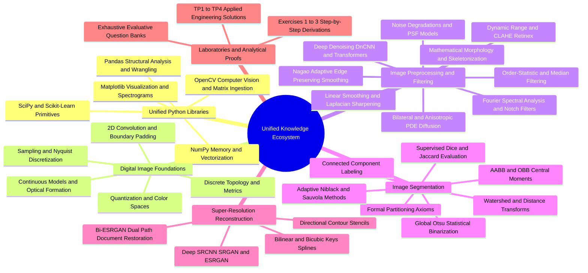

---

### Core Navigation Portals

1. **Unified Python Libraries Foundation:**
   * [[01.01. NumPy Foundations - Array Creation, Memory Layout, and Data Types]]
   * [[01.02. NumPy Array Manipulation - Reshaping, Slicing, and Striding]]
   * [[01.03. NumPy Broadcasting Mechanics and Vectorized Computations]]
   * [[01.04. NumPy Advanced Indexing, Masking, and Outlier Filtering]]
   * [[01.05. Matplotlib Foundations - Figures, Subplots, and Color Mapping]]
   * [[01.06. Matplotlib Advanced - Tonal Histograms, Surface Meshes, and Multi-Channel Grids]]
   * [[01.07. Pandas Foundations - Series, DataFrames, and Structural Indexing]]
   * [[01.08. Pandas Data Wrangling - Cleansing, Imputation, and Missing Values]]
   * [[01.09. Pandas Statistical Aggregation, GroupBy, and Cross-Tabulation]]
   * [[01.10. OpenCV Fundamentals - Image Ingestion, Channels, and Memory Buffers]]
   * [[01.11. OpenCV Color Space Transformations and Pixel Math]]
   * [[01.12. OpenCV Geometric Transformations, Interpolation, and Affine Warping]]
   * [[01.13. SciPy Signal and Spatial Operations - 2D Filtering and Morphology]]
   * [[01.14. Scikit-Learn Primitives - Clustering, Dimensionality, and Metrics]]

2. **Digital Image Foundations:**
   * [[02.1. Physical Image Formation and Optical Sensing]]
   * [[02.2. Discretization - Spatial Sampling and Nyquist-Shannon Theorem]]
   * [[02.3. Amplitude Quantization, Dynamic Range, and Bit Depth]]
   * [[02.4. Image Representations - Raster Matrix vs Mathematical Vector Primitives]]
   * [[02.5. Color Models - Additive RGB, Subtractive CMYK, and Photometric Grayscale]]
   * [[02.6. Perceptual and Broadcast Spaces - YUV, YCbCr, HSV, and Perceptually Uniform Lab]]
   * [[02.7. Digital File Encapsulation, Compression Standards, and Medical DICOM]]
   * [[02.8. Discrete Spatial Topology - Neighborhoods, Adjacency, and Metric Spaces]]
   * [[02.9. Tonal Histograms, Probability Densities, and Cumulative Distribution Functions]]
   * [[02.10. Mathematical 2D Spatial Convolution, Cross-Correlation, and Boundary Conditions]]
   * [[02.11. The Classical Vision Processing Hierarchy - Low, Mid, and High-Level Tasks]]

3. **Image Preprocessing, Filtering, and Restoration:**
   * [[03.1. Physical Noise Models - Point Spread Function, Additive Gaussian, Speckle, and Salt-and-Pepper]]
   * [[03.2. Quantitative Quality Metrics - Mean Squared Error (MSE) and Peak Signal-to-Noise Ratio (PSNR)]]
   * [[03.3. Linear Smoothing Filters - Box Mean and Separable Gaussian Convolutions]]
   * [[03.4. Spatial High-Pass Filtering - Differential Operators and Laplacian Sharpening]]
   * [[03.5. Order-Statistic Non-Linear Filtering - Median and Rank-Order Min-Max Operators]]
   * [[03.6. Structural Edge-Preserving Smoothing - The Nagao Adaptive Multi-Sector Filter]]
   * [[03.7. Fourier Spectral Analysis - 2D DFT, FFT Shift, and Frequency Domain Filtering]]
   * [[03.8. Specialized Spectral Operators - Band-Reject Notch Filters and Directional Gabor Filter Banks]]
   * [[03.9. Non-Linear Boundary-Preserving Filtering - The Joint Spatial-Radiometric Bilateral Filter]]
   * [[03.10. Partial Differential Equations in Restoration - Perona-Malik Anisotropic Diffusion]]
   * [[03.11. Feature Space Clustering Segmentation - Mean-Shift and 2SP-DBSCAN]]
   * [[03.12. Set-Theoretic Mathematical Morphology - Structuring Elements, Erosion, and Dilation]]
   * [[03.13. Compound Morphological Operators - Opening, Closing, Gradient, and Zhang-Suen Thinning]]
   * [[03.14. Tonal Modification - Dynamic Range Expansion, Global HE, AHE, and CLAHE]]
   * [[03.15. Advanced Contrast Models - Histogram Specification and Land's Retinex Illumination Separation]]
   * [[03.16. Deep Learning Denoising Architectures - From Patch MLPs to Residual DnCNN and Uformer]]

4. **Image Segmentation and Region Analysis:**
   * [[04.1. Formal Segmentation Axioms and Homogeneity Predicates]]
   * [[04.2. Global Statistical Thresholding - Mathematical Derivation of Otsu's Method]]
   * [[04.3. Local Adaptive Thresholding - Niblack and Dynamic Range-Constrained Sauvola Algorithms]]
   * [[04.4. Complex Document Segmentation - Gaceb's Multi-Scale Mixed Binarization]]
   * [[04.5. Morphological Watershed Segmentation and Topological Distance Transforms]]
   * [[04.6. Connected Component Analysis - Two-Pass Labeling and Equivalence Trees]]
   * [[04.7. Geometric Region Descriptors - Axis-Aligned Bounding Boxes, Central Moments, and OBB]]
   * [[04.8. Segmentation Evaluation Benchmarks - Dice DSC, Jaccard IoU, Hausdorff, and Zeboudj Contrast]]

5. **Image Super-Resolution and Analytical Reconstruction:**
   * [[05.1. Continuous Image Reconstruction - Nearest-Neighbor, Bilinear, and Keys' Bicubic Spline]]
   * [[05.2. Directional Reconstruction - Contour Stencils and Total Variation Minimization]]
   * [[05.3. Deep Super-Resolution Frameworks - SRCNN, Perceptual SRGAN, and ESRGAN RRDB Networks]]
   * [[05.4. Document Image Enhancement - Bi-ESRGAN Dual Path Architecture]]

6. **Laboratory Practicums and Engineering Solutions:**
   * [[06.1. Laboratory 1 - Development Environment, NumPy Array Manipulation, and Grayscale Thresholding]]
   * [[06.2. Laboratory 2 - Synthetic Noise Injection, Spatial Filtering, and Metric Benchmarking]]
   * [[06.3. Laboratory 3 - Algorithmic Engineering of the Nagao Edge-Preserving Filter]]
   * [[06.4. Laboratory 4 - Applied Mathematical Morphology, Cellular Counting, and Skeletonization]]

7. **Analytical Exercises and Mathematical Proofs:**
   * [[07.1. Exercise 1 - Complete Calculation of 2D Convolution and Boundary Padding Modes]]
   * [[07.2. Exercise 2 - Exhaustive Step-by-Step Optimization of Otsu's Inter-Class Variance]]
   * [[07.3. Exercise 3 - Analytical Sub-Pixel Reconstruction via Bilinear Interpolation]]

8. **Comprehensive Evaluative Question Banks:**
   * [[08.1. Question Bank 1 - Digital Image Fundamentals, Color Spaces, and Topology]]
   * [[08.2. Question Bank 2 - Noise Models, Spatial Transformations, and Spectral Filters]]
   * [[08.3. Question Bank 3 - Non-Linear Spatial Filters, Nagao Mechanics, and Morphology]]

---

### 00.2. Course Roadmap and Unified Learning Path.md

# Course Roadmap and Pedagogical Progression

This roadmap provides the operational sequence for traversing the knowledge base. It enforces a strict dependency rule: **No mathematical model, computational method, or library syntax is deployed in an academic chapter or lab before being fully defined and derived in the foundational notes.**

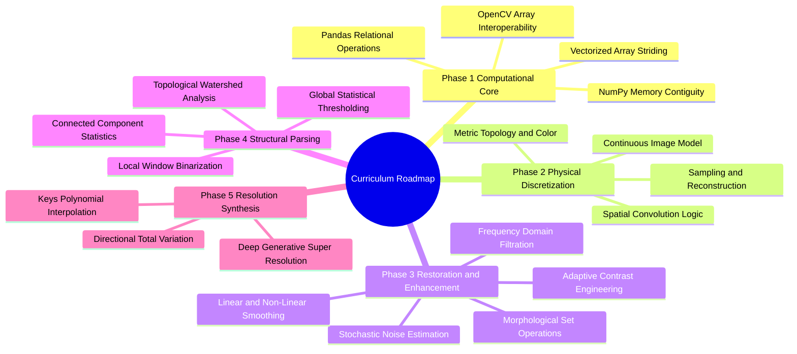

### Stage-by-Stage Dependency Architecture

#### Phase 1: The Computational Engine
* Goal: Master $N$-dimensional array manipulation, memory layout, vectorization, and data structures.
* Primary Notes: [[01.01. NumPy Foundations - Array Creation, Memory Layout, and Data Types]] through [[01.14. Scikit-Learn Primitives - Clustering, Dimensionality, and Metrics]].
* Prerequisite Knowledge: Standard Python data types (integers, floats, lists, tuples, dictionaries).

#### Phase 2: Discrete Optics and Signal Foundations
* Goal: Understand physical light propagation, sensor quantization, colorimetry, discrete metrics, and convolution.
* Primary Notes: [[02.1. Physical Image Formation and Optical Sensing]] through [[02.11. The Classical Vision Processing Hierarchy - Low, Mid, and High-Level Tasks]].
* Applications: [[06.1. Laboratory 1 - Development Environment, NumPy Array Manipulation, and Grayscale Thresholding]], [[07.1. Exercise 1 - Complete Calculation of 2D Convolution and Boundary Padding Modes]].

#### Phase 3: Filtering, PDE Methods, and Spectral Analysis
* Goal: Master noise attenuation, high-pass edge isolation, non-linear statistics, spatial-frequency duality, morphological operators, and contrast engineering.
* Primary Notes: [[03.1. Physical Noise Models - Point Spread Function, Additive Gaussian, Speckle, and Salt-and-Pepper]] through [[03.16. Deep Learning Denoising Architectures - From Patch MLPs to Residual DnCNN and Uformer]].
* Applications: [[06.2. Laboratory 2 - Synthetic Noise Injection, Spatial Filtering, and Metric Benchmarking]], [[06.3. Laboratory 3 - Algorithmic Engineering of the Nagao Edge-Preserving Filter]], [[06.4. Laboratory 4 - Applied Mathematical Morphology, Cellular Counting, and Skeletonization]].

#### Phase 4: Segmentation and Structural Measurement
* Goal: Isolate foreground entities from backgrounds via global, local, dynamic, and marker-controlled topological operations, followed by boundary evaluation.
* Primary Notes: [[04.1. Formal Segmentation Axioms and Homogeneity Predicates]] through [[04.8. Segmentation Evaluation Benchmarks - Dice DSC, Jaccard IoU, Hausdorff, and Zeboudj Contrast]].
* Applications: [[07.2. Exercise 2 - Exhaustive Step-by-Step Optimization of Otsu's Inter-Class Variance]].

#### Phase 5: Continuous Reconstruction and Super-Resolution
* Goal: Interpolate continuous surfaces from discrete lattices, direct interpolation along gradients, and infer high frequencies via deep adversarial learning.
* Primary Notes: [[05.1. Continuous Image Reconstruction - Nearest-Neighbor, Bilinear, and Keys' Bicubic Spline]] through [[05.4. Document Image Enhancement - Bi-ESRGAN Dual Path Architecture]].
* Applications: [[07.3. Exercise 3 - Analytical Sub-Pixel Reconstruction via Bilinear Interpolation]].

---

## 01. Unified Python Libraries Foundation

### 01.01. NumPy Foundations - Array Creation, Memory Layout, and Data Types.md

# NumPy Foundations: Array Creation, Memory Layout, and Data Types

The numerical computing foundation of both Data Science and Image Processing relies on `numpy.ndarray`. A digital image is physically represented as an array of numerical values, as is a tabular dataset or machine learning feature matrix.

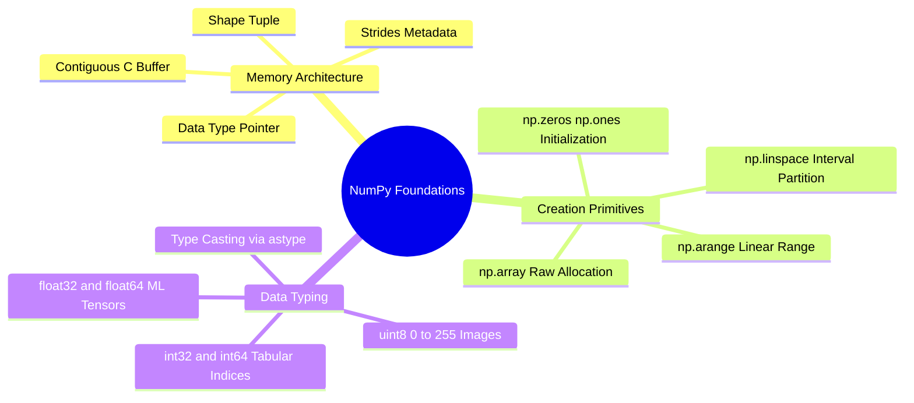

### 1. Memory Architecture: The C-Contiguous Buffer
A Python `list` is an array of pointers to arbitrary memory blocks, incurring pointer indirection and object header overhead. In contrast, a `numpy.ndarray` is a contiguous block of homogeneous memory wrapped by a Python metadata header:

$$\text{Data Pointer} \longrightarrow [b_0, b_1, b_2, b_3, b_4, \dots, b_K]$$

The array object stores:
1. **`data`**: Pointer to the first byte in the raw contiguous memory buffer.
2. **`dtype`**: The descriptor detailing how many bytes belong to each element and how those bits are interpreted (e.g., unsigned integer, IEEE 754 float).
3. **`shape`**: A tuple of integers describing the dimension sizes $(D_0, D_1, \dots, D_{d-1})$.
4. **`strides`**: A tuple of integers detailing how many bytes must be jumped in memory to advance by one step along each dimension.

For an 8-bit grayscale image of shape $(H, W)$ in C-order (row-major), advancing one row requires jumping $W \times 1$ bytes. Advancing one column requires jumping $1$ byte:

$$\text{Strides}_{(H, W)} = (W \cdot \text{itemsize}, \ \text{itemsize})$$

### 2. Standard Numerical Data Types (`dtype`)
Selecting the appropriate numerical type prevents overflow, underflow, and out-of-memory errors:

| `dtype` | Byte Size | Value Range | Primary Use Case |
| :--- | :--- | :--- | :--- |
| `np.uint8` | 1 byte | $0$ to $255$ ($2^8-1$) | Standard grayscale/color pixels, binary masks |
| `np.int16` | 2 bytes | $-32,768$ to $+32,767$ | Medical DICOM (Hounsfield Units) |
| `np.int32` | 4 bytes | $-2.14 \times 10^9$ to $+2.14 \times 10^9$ | Tabular discrete counters, connected component labels |
| `np.float32` | 4 bytes | $\approx \pm 3.4 \times 10^{38}$ (7 decimals) | Deep learning tensors, spatial image gradients |
| `np.float64` | 8 bytes | $\approx \pm 1.8 \times 10^{308}$ (16 decimals) | High-precision scientific optimization, statistical metrics |

### 3. Syntax and Construction Primitives

#### `np.array(object, dtype=None)`
Constructs an array from an existing sequence (Python list, nested list, or tuple).

```python
import numpy as np

# Constructing a 1D tabular vector (e.g., patient ages in Data Science)
ages = np.array([25, 42, 37, 61], dtype=np.int32)

# Constructing a 2D 3x3 pixel matrix (e.g., high-pass kernel or image patch)
patch = np.array([
    [100, 130, 110],
    [110,  90, 100],
    [130, 100,  90]
], dtype=np.uint8)

print("Ages Shape:", ages.shape, "| Strides:", ages.strides)
print("Patch Shape:", patch.shape, "| Strides:", patch.strides)
```

#### `np.zeros(shape, dtype=float)` and `np.ones(shape, dtype=float)`
Allocates a contiguous block of memory initialized to zero or one. Essential for pre-allocating output images in spatial filtering loops to prevent continuous dynamic reallocation.

```python
# Pre-allocating an empty HD grayscale image buffer (1080 rows, 1920 columns)
canvas_gray = np.zeros((1080, 1920), dtype=np.uint8)

# Pre-allocating a normalized 3-channel RGB image buffer
canvas_rgb = np.ones((512, 512, 3), dtype=np.float32)
```

#### `np.arange(start, stop, step, dtype=None)`
Generates values within a half-open interval $[start, stop)$ with discrete step sizes. Useful for building iteration counters and coordinate vectors.

```python
# Discrete coordinate steps along a 1D signal
steps = np.arange(0, 10, 2, dtype=np.int32)  # [0, 2, 4, 6, 8]
```

#### `np.linspace(start, stop, num=50, endpoint=True)`
Generates `num` evenly spaced samples over the closed interval $[start, stop]$. Essential for constructing continuous mathematical test signals, probability densities, and synthetic test gradients.

```python
# Constructing a normalized intensity ramp from 0.0 to 1.0 across 256 discrete levels
intensity_ramp = np.linspace(0.0, 1.0, num=256, dtype=np.float32)
```

#### Safe Type Casting: `.astype(dtype, copy=True)`
Never perform arithmetic on raw `np.uint8` arrays when values can exceed $255$ or drop below $0$. If you subtract two `uint8` values ($100 - 150$), unsigned modulo arithmetic wraps around:

$$100_{\text{uint8}} - 150_{\text{uint8}} = 206$$

To avoid this, cast the array to signed integers or floating-point values before computation:

```python
pixel_a = np.array([100], dtype=np.uint8)
pixel_b = np.array([150], dtype=np.uint8)

# Arithmetic error:
broken_diff = pixel_a - pixel_b  # Yields array([206], dtype=uint8)

# Correct procedure:
correct_diff = pixel_a.astype(np.float32) - pixel_b.astype(np.float32)  # Yields array([-50.], dtype=float32)
```

Related concepts: [[01.02. NumPy Array Manipulation - Reshaping, Slicing, and Striding]], [[02.3. Amplitude Quantization, Dynamic Range, and Bit Depth]], [[06.1. Laboratory 1 - Development Environment, NumPy Array Manipulation, and Grayscale Thresholding]].

---

### 01.02. NumPy Array Manipulation - Reshaping, Slicing, and Striding.md

# NumPy Array Manipulation: Reshaping, Slicing, and Striding

Extracting sub-regions, altering tensor shapes, flattening matrices, and processing sub-windows require a clear understanding of array view-vs-copy semantics and indexing mechanics.

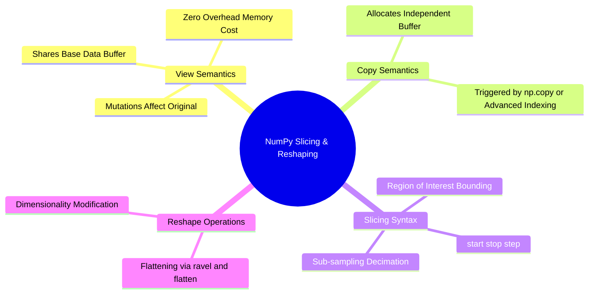

### 1. Slicing Syntax and Region of Interest (ROI)
The slicing operator follows Python's extended indexing syntax:

$$\text{array}[\text{start}_0:\text{stop}_0:\text{step}_0, \quad \text{start}_1:\text{stop}_1:\text{step}_1, \quad \dots]$$

In 2D image matrices, the first index indexes **rows** (spatial $y$-axis, vertical height), while the second index indexes **columns** (spatial $x$-axis, horizontal width).

```python
import numpy as np

# Create synthetic 6x6 test image
img = np.arange(36, dtype=np.uint8).reshape((6, 6))

# Extracting a 3x3 Region of Interest (ROI) from row 1 to 4, column 2 to 5
# Note: stop index is exclusive
roi = img[1:4, 2:5]

# Spatial Downsampling / Decimation by factor of 2 (skipping every second pixel)
decimated = img[::2, ::2]
```

### 2. Views vs. Deep Copies
Basic slicing creates a **view** of the original buffer, not a new copy. Modifying the slice directly alters the underlying data.

```python
base_canvas = np.zeros((4, 4), dtype=np.uint8)
view_slice = base_canvas[1:3, 1:3]
view_slice[:] = 255  # Modifying view directly modifies base_canvas!

print(base_canvas)
# [[  0   0   0   0]
#  [  0 255 255   0]
#  [  0 255 255   0]
#  [  0   0   0   0]]

# To prevent mutation, explicitly enforce a deep copy:
independent_copy = base_canvas[1:3, 1:3].copy()
independent_copy[:] = 42  # base_canvas remains unchanged
```

### 3. Structural Reshaping and Dimensionality Modification

#### `ndarray.reshape(new_shape, order='C')`
Changes the shape of an array without altering its underlying data buffer. The total number of elements $\prod D_i$ must remain constant.

```python
# Converting a 1D feature vector of length 784 (e.g., MNIST digit) into a 28x28 2D image
feature_vector = np.zeros(784, dtype=np.float32)
image_matrix = feature_vector.reshape((28, 28))

# Automatic dimension inference using -1:
# Let NumPy determine the column length given 28 rows:
image_inferred = feature_vector.reshape((28, -1))
```

#### Flattening Arrays: `ndarray.ravel()` vs. `ndarray.flatten()`
* `ravel()`: Returns a contiguous 1D view whenever possible. Extremely fast; no allocation.
* `flatten()`: Allocates and returns an independent 1D copy in memory.

```python
# Flattening a 2D matrix into a 1D sequence for computing an intensity histogram
hist_data = image_matrix.ravel()
```

#### Adding Axes: `np.newaxis` and `np.expand_dims(a, axis)`
Converts a 2D grayscale image $(H, W)$ into a 3D single-channel volume $(H, W, 1)$ or a 4D batch $(1, H, W, 1)$ for deep neural network ingestion:

```python
gray_img = np.zeros((256, 256), dtype=np.uint8)

# Expanding dimensions using np.newaxis
volume_img = gray_img[:, :, np.newaxis]       # Shape: (256, 256, 1)

# Expanding dimensions using np.expand_dims
batch_tensor = np.expand_dims(volume_img, axis=0)  # Shape: (1, 256, 256, 1)
```

Related concepts: [[01.03. NumPy Broadcasting Mechanics and Vectorized Computations]], [[02.4. Image Representations - Raster Matrix vs Mathematical Vector Primitives]], [[06.1. Laboratory 1 - Development Environment, NumPy Array Manipulation, and Grayscale Thresholding]].

---

### 01.03. NumPy Broadcasting Mechanics and Vectorized Computations.md

# NumPy Broadcasting Mechanics and Vectorized Computations

Explicit nested `for` loops in pure Python introduce considerable interpreter overhead. NumPy avoids this by implementing vectorized computations compiled in C, governed by the **Broadcasting Rule**.

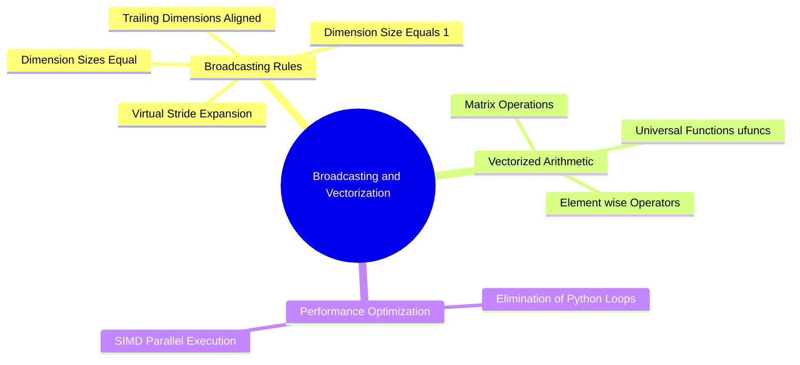

### 1. The Formal Broadcasting Rules
Two arrays can be combined in element-wise binary operations (addition, subtraction, multiplication) if their shapes satisfy compatibility checks, evaluated from **right to left** (trailing dimensions):

1. The dimensions are equal: $d_1 == d_2$
2. One of the dimensions is $1$: $d_1 == 1 \lor d_2 == 1$

If an array has fewer dimensions than the other, its shape is padded with ones on the left until the dimensionalities match. When a dimension size equals $1$, the array acts as if its data were repeated along that axis by setting the memory stride for that dimension to $0$.

```text
Dimension Alignment Example:
Array A (3D Image):    512 x 512 x 3
Array B (1D Weights):              3
-------------------------------------
Step 1: Pad B left:     1  x   1   x 3
Step 2: Check dims:    512    512    3
                       ↕      ↕      ↕
                        1      1     3  --> Compatible!
Resulting Shape:       512 x 512 x 3
```

### 2. Practical Applications in Data Science and Image Processing

#### Example A: Color Channel Weighting (Photometric Conversion)
Multiplying a color image of shape $(H, W, 3)$ by photometric luminance weights $(0.299, 0.587, 0.114)$ without manual loops:

```python
import numpy as np

# Generate a synthetic RGB image
img_rgb = np.ones((480, 640, 3), dtype=np.float32)

# Luminance coefficients vector
weights = np.array([0.299, 0.587, 0.114], dtype=np.float32)

# Element-wise broadcasting multiplication across channels:
weighted_channels = img_rgb * weights  # Shape: (480, 640, 3)

# Sum across the trailing color axis to produce a 2D luminance plane
grayscale_img = np.sum(weighted_channels, axis=2)  # Shape: (480, 640)
```

#### Example B: Data Feature Normalization (Data Science Feature Scaling)
Centering tabular features by subtracting the feature means and dividing by the standard deviations:

```python
# Synthetic tabular matrix: 1000 samples, 4 features
X = np.random.randn(1000, 4).astype(np.float32)

# Compute mean and standard deviation along the sample axis (axis=0)
mu = np.mean(X, axis=0)   # Shape: (4,)
sigma = np.std(X, axis=0) # Shape: (4,)

# Broadcast subtraction and division: (1000, 4) with (4,)
X_standardized = (X - mu) / sigma
```

### 3. Universal Functions (`ufuncs`)
NumPy provides vectorized universal functions (`ufuncs`) that operate element-wise on whole arrays at compiled speed:
* `np.add()`, `np.subtract()`, `np.multiply()`, `np.divide()`
* `np.exp()`, `np.log()`, `np.sqrt()`, `np.abs()`
* `np.sin()`, `np.cos()`, `np.arctan()`

```python
# Calculating the pixel magnitude of spatial derivatives Gx and Gy
Gx = np.array([[-1.0, 0.0, 1.0]], dtype=np.float32)
Gy = np.array([[ 1.0, 2.0, 1.0]], dtype=np.float32)

# Vectorized Euclidean hypotenuse: sqrt(Gx^2 + Gy^2)
gradient_magnitude = np.hypot(Gx, Gy)
```

Related concepts: [[01.04. NumPy Advanced Indexing, Masking, and Outlier Filtering]], [[02.5. Color Models - Additive RGB, Subtractive CMYK, and Photometric Grayscale]], [[06.2. Laboratory 2 - Synthetic Noise Injection, Spatial Filtering, and Metric Benchmarking]].

---

### 01.04. NumPy Advanced Indexing, Masking, and Outlier Filtering.md

# NumPy Advanced Indexing, Masking, and Outlier Filtering

Advanced indexing uses boolean masks or integer coordinate vectors to select, filter, or reassign specific values. This is fundamental for thresholding, segmenting regions, and filtering outliers.

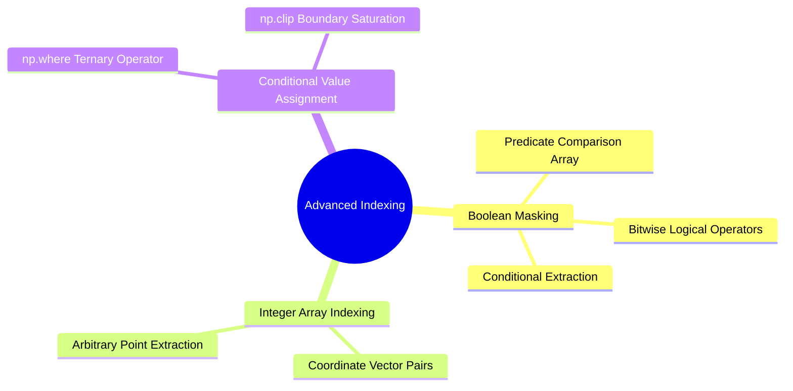

### 1. Boolean Masking
When a conditional relational operator is applied to an array, NumPy generates a boolean array of identical shape:

```python
import numpy as np

# Sample 1D array of intensity measurements
vals = np.array([12, 245, 18, 250, 89, 4], dtype=np.uint8)

# Relational evaluation yields a boolean mask
is_bright = vals > 100  # array([False,  True, False,  True, False, False])

# Advanced indexing extraction: extracts ONLY elements where mask is True
bright_pixels = vals[is_bright]  # array([245, 250], dtype=uint8)
```

#### Combining Logical Conditions
In NumPy, standard Python keywords `and`, `or`, and `not` **do not work** on element-wise array operations. You must use the bitwise operators:
* Bitwise AND: `&`
* Bitwise OR: `|`
* Bitwise NOT: `~`
* Enclose each comparison in parentheses to preserve operator precedence.

```python
# Filter pixels that lie strictly within an intensity band [100, 200]
in_band_mask = (vals >= 100) & (vals <= 200)
```

### 2. Value Clamping and Conditional Selection: `np.clip` and `np.where`

#### `np.clip(a, a_min, a_max, out=None)`
Restricts all array values to the closed interval $[a_{min}, a_{max}]$. Any value smaller than $a_{min}$ is mapped to $a_{min}$; any value larger than $a_{max}$ is mapped to $a_{max}$. This prevents arithmetic overflow when applying contrast enhancement filters.

```python
raw_intensities = np.array([-10, 50, 180, 260, 312], dtype=np.int32)
clamped_pixels = np.clip(raw_intensities, 0, 255).astype(np.uint8)
# Result: array([  0,  50, 180, 255, 255], dtype=uint8)
```

#### `np.where(condition, [x, y])`
The vectorized ternary operator. Evaluates `condition` element-wise: where `True`, yields $x$; where `False`, yields $y$.

```python
# Vectorized Binarization / Thresholding:
gray_canvas = np.array([[50, 180], [210, 30]], dtype=np.uint8)
threshold = 128

# If pixel >= 128 assign 255 (foreground), else assign 0 (background)
binary_mask = np.where(gray_canvas >= threshold, np.uint8(255), np.uint8(0))
# Result:
# [[  0 255]
#  [255   0]]
```

### 3. Outlier Filtering in Data Science
Filtering noisy samples using the statistical $Z$-score:

$$\mu = \frac{1}{N} \sum_{i=1}^{N} x_i, \quad \sigma = \sqrt{\frac{1}{N}\sum_{i=1}^{N}(x_i - \mu)^2}, \quad z_i = \left| \frac{x_i - \mu}{\sigma} \right|$$

```python
data_stream = np.array([10.2, 9.8, 10.1, 45.0, 10.0, 10.3], dtype=np.float32)

mean = np.mean(data_stream)
std = np.std(data_stream)
z_scores = np.abs((data_stream - mean) / std)

# Filter out elements whose Z-score exceeds 2 standard deviations
clean_data = data_stream[z_scores <= 2.0]
# Excludes the outlier 45.0
```

Related concepts: [[01.07. Pandas Foundations - Series, DataFrames, and Structural Indexing]], [[04.2. Global Statistical Thresholding - Mathematical Derivation of Otsu's Method]], [[06.1. Laboratory 1 - Development Environment, NumPy Array Manipulation, and Grayscale Thresholding]].

---

### 01.05. Matplotlib Foundations - Figures, Subplots, and Color Mapping.md

# Matplotlib Foundations: Figures, Subplots, and Color Mapping

Matplotlib provides visualization tools for displaying images, plotting analytical distributions, and analyzing training metrics.

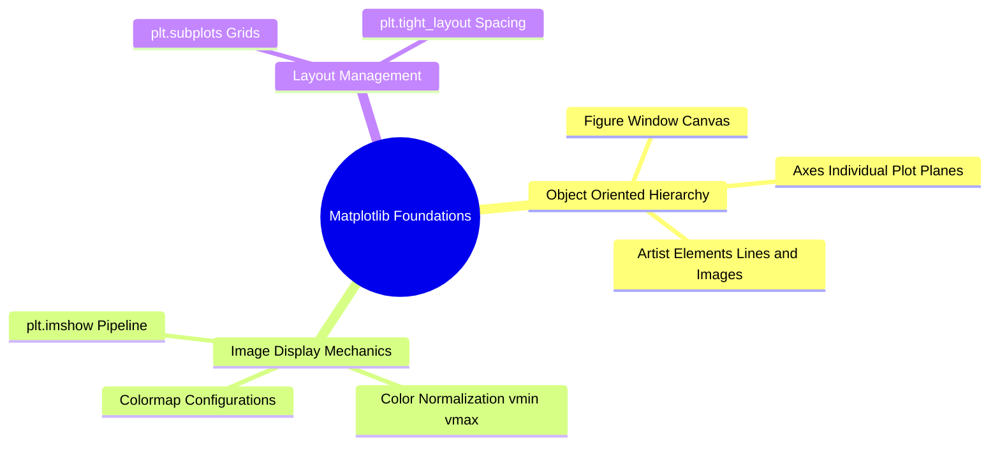

### 1. The Object-Oriented Interface (`Figure` and `Axes`)
Avoid state-machine calls (`plt.plot`, `plt.imshow`) when building production pipelines. Instead, use the object-oriented API by instantiating `Figure` and `Axes` objects:

```python
import matplotlib.pyplot as plt
import numpy as np

# Instantiate a canvas containing 1 row and 2 columns of subplots
fig, axes = plt.subplots(nrows=1, ncols=2, figsize=(10, 5), dpi=100)

# axes is a NumPy array containing references to the AxesSubplot instances
ax_left, ax_right = axes[0], axes[1]
```

### 2. Displaying Matrices: `Axes.imshow(X, cmap=None, vmin=None, vmax=None)`
`imshow` renders a 2D or 3D NumPy array as an image.

#### Key Parameters
* `X`: The array. Supported shapes:
  * $(M, N)$: 2D scalar array interpreted using a color map (`cmap`).
  * $(M, N, 3)$: 3D array interpreted as RGB floating-point values in $[0.0, 1.0]$ or unsigned integers in $[0, 255]$.
  * $(M, N, 4)$: 3D array with an Alpha channel (RGBA).
* `cmap`: Color lookup table for 2D scalar matrices. Common values:
  * `'gray'`: Linear grayscale ($0 \to \text{black}, \ 255 \to \text{white}$).
  * `'viridis'`: Perceptually uniform modern default.
  * `'jet'` / `'hsv'`: High-contrast rainbow spectra (can introduce visual artifacts).
* `vmin`, `vmax`: Normalization bounds. If set to `None`, Matplotlib scales the display linearly to the matrix's actual minimum and maximum values. **Always set `vmin=0, vmax=255` for 8-bit images** to prevent automatic scaling from exaggerating background noise in dark images.

```python
synthetic_matrix = np.array([
    [10, 20],
    [30, 40]
], dtype=np.uint8)

fig, ax = plt.subplots()

# Incorrect: Automatically stretches 10 to Black and 40 to White!
# ax.imshow(synthetic_matrix, cmap='gray')

# Correct: Explicitly anchors dynamic range to standard 8-bit limits
im = ax.imshow(synthetic_matrix, cmap='gray', vmin=0, vmax=255)
ax.set_title("Absolute 8-bit Grayscale Rendering")
plt.colorbar(im, ax=ax)
plt.show()
```

### 3. Rendering Multi-Panel Grids
Comparing an original image with its processed variants:

```python
# Creating an input signal and filtered counterpart
original = np.random.randint(0, 256, size=(100, 100), dtype=np.uint8)
filtered = np.zeros_like(original)

fig, axes = plt.subplots(1, 2, figsize=(8, 4))

axes[0].imshow(original, cmap='gray', vmin=0, vmax=255)
axes[0].set_title("Original Corrupted Signal")
axes[0].axis('off')  # Suppress axis ticks and labels

axes[1].imshow(filtered, cmap='gray', vmin=0, vmax=255)
axes[1].set_title("Restored Output")
axes[1].axis('off')

plt.tight_layout()
plt.show()
```

Related concepts: [[01.06. Matplotlib Advanced - Tonal Histograms, Surface Meshes, and Multi-Channel Grids]], [[01.10. OpenCV Fundamentals - Image Ingestion, Channels, and Memory Buffers]], [[06.1. Laboratory 1 - Development Environment, NumPy Array Manipulation, and Grayscale Thresholding]].

---

### 01.06. Matplotlib Advanced - Tonal Histograms, Surface Meshes, and Multi-Channel Grids.md

# Matplotlib Advanced: Tonal Histograms, Surface Meshes, and Multi-Channel Grids

Advanced visualization helps diagnose processing issues. This includes plotting intensity distributions, displaying 3D intensity terrains, and visualizing multi-channel frequency responses.

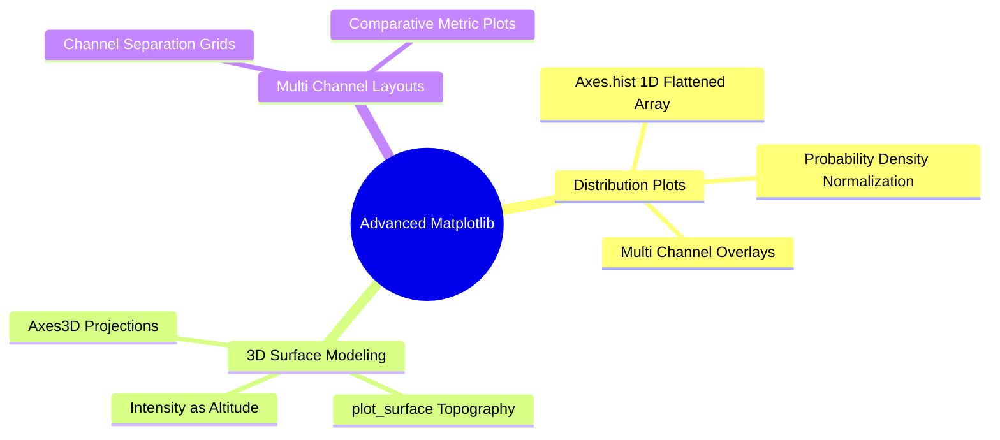

### 1. Tonal Histograms: `Axes.hist(x, bins=None, range=None, density=False)`
Plots the frequency distribution of pixel intensities across an image.

* `x`: Input data vector. Must be a **1D array**. Use `.ravel()` on 2D images.
* `bins`: Number of discrete bins. For an 8-bit grayscale image, use `bins=256`.
* `range`: Lower and upper bounds of the bins: `range=(0, 256)`.
* `density`: When `True`, normalizes the histogram so the total area under the curve equals $1$, forming an empirical Probability Density Function (PDF).

```python
import matplotlib.pyplot as plt
import numpy as np

img = np.random.normal(loc=128, scale=25, size=(256, 256)).clip(0, 255).astype(np.uint8)

fig, (ax_img, ax_hist) = plt.subplots(nrows=1, ncols=2, figsize=(10, 4))

# Visual representation of the matrix
ax_img.imshow(img, cmap='gray', vmin=0, vmax=255)
ax_img.set_title("Input Image Matrix")
ax_img.axis('off')

# Empirical intensity distribution
ax_hist.hist(img.ravel(), bins=256, range=(0, 256), color='black', alpha=0.7, density=True)
ax_hist.set_title("Normalized Intensity Distribution p(r_k)")
ax_hist.set_xlabel("Gray Level r_k")
ax_hist.set_ylabel("Probability Density")
ax_hist.set_xlim([0, 255])
ax_hist.grid(True, linestyle='--', alpha=0.5)

plt.tight_layout()
plt.show()
```

### 2. 3D Intensity Topography: `plot_surface`
Treating pixel values as elevation ($z$-axis) helps visualize why spatial gradients and morphological probes behave like physical surfaces.

```python
from mpl_toolkits.mplot3d import Axes3D

# Generate a synthetic 2D Gaussian bell curve
x = np.linspace(-2, 2, 50)
y = np.linspace(-2, 2, 50)
X, Y = np.meshgrid(x, y)
Z = np.exp(-(X**2 + Y**2))

fig = plt.figure(figsize=(8, 6))
ax = fig.add_subplot(111, projection='3d')

# Render the continuous topographical mesh
surf = ax.plot_surface(X, Y, Z, cmap='viridis', edgecolor='none')
ax.set_title("3D Intensity Topography")
fig.colorbar(surf, ax=ax, shrink=0.5)
plt.show()
```

Related concepts: [[01.05. Matplotlib Foundations - Figures, Subplots, and Color Mapping]], [[02.9. Tonal Histograms, Probability Densities, and Cumulative Distribution Functions]], [[03.12. Set-Theoretic Mathematical Morphology - Structuring Elements, Erosion, and Dilation]].

---

### 01.07. Pandas Foundations - Series, DataFrames, and Structural Indexing.md

# Pandas Foundations: Series, DataFrames, and Structural Indexing

Pandas provides structured data analysis tools. In computer vision, it handles image metadata, object bounding box coordinates, and performance benchmarks.

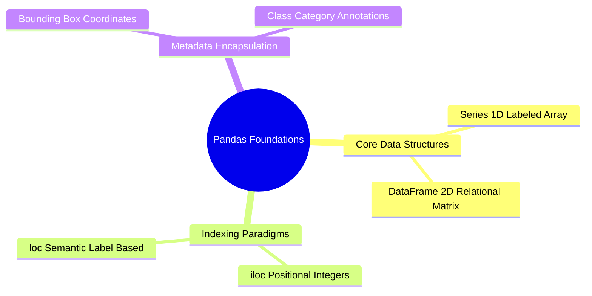

### 1. Data Structures: `pd.Series` and `pd.DataFrame`

* `pd.Series`: A one-dimensional labeled array built on top of a 1D NumPy array.
* `pd.DataFrame`: A two-dimensional tabular data structure with labeled axes (rows and columns). Each column is a `pd.Series` sharing a unified index.

```python
import pandas as pd
import numpy as np

# Constructing a DataFrame to hold image segmentation metrics
metrics_df = pd.DataFrame({
    'image_id': ['img_001.png', 'img_002.png', 'img_003.png'],
    'mse': [12.4, 45.1, 8.2],
    'psnr': [37.2, 31.6, 39.0],
    'is_corrupted': [False, True, False]
})

print(metrics_df.info())
```

### 2. Explicit Structural Indexing: `.iloc` vs. `.loc`

#### `.iloc[row_idx, col_idx]` (Integer-Location Based)
Selects rows and columns by their integer positions:

```python
# Extract the first two rows and the first three columns
subset_iloc = metrics_df.iloc[0:2, 0:3]
```

#### `.loc[row_label, col_label]` (Label/Name Based)
Selects rows and columns by their semantic labels or boolean masks:

```python
# Query images with a PSNR of at least 35 dB
high_fidelity_images = metrics_df.loc[metrics_df['psnr'] >= 35.0, ['image_id', 'psnr']]
```

Related concepts: [[01.08. Pandas Data Wrangling - Cleansing, Imputation, and Missing Values]], [[01.09. Pandas Statistical Aggregation, GroupBy, and Cross-Tabulation]], [[03.2. Quantitative Quality Metrics - Mean Squared Error (MSE) and Peak Signal-to-Noise Ratio (PSNR)]].

---

### 01.08. Pandas Data Wrangling - Cleansing, Imputation, and Missing Values.md

# Pandas Data Wrangling: Cleansing, Imputation, and Missing Values

Real-world datasets and object detection annotations often contain missing values (`NaN`), formatting errors, and outliers that must be cleaned prior to training or analysis.

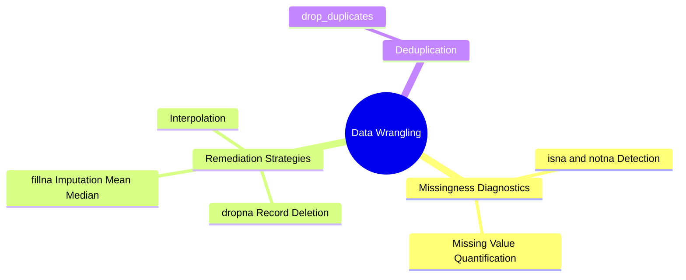

### 1. Identifying Missing Data
Pandas represents missing numerical values using IEEE 754 Floating-Point `NaN` (`np.nan`).

```python
import pandas as pd
import numpy as np

df = pd.DataFrame({
    'object_class': ['nucleus', 'cell', None, 'nucleus'],
    'area_pixels': [145.0, np.nan, 89.0, 150.0],
    'perimeter': [42.1, 75.3, 31.0, np.nan]
})

# Generate boolean presence mask
print(df.isna())

# Count missing values per column
print(df.isna().sum())
```

### 2. Handling Missing Values

#### Deletion: `df.dropna(axis=0, how='any', subset=None)`
Removes entire rows or columns containing missing values:

```python
# Drop any row where 'area_pixels' is missing
clean_rows = df.dropna(subset=['area_pixels'])
```

#### Imputation: `df.fillna(value=None, method=None)`
Replaces missing values with a statistical estimate (mean, median, or constant):

```python
# Impute missing numerical area measurements with the median
median_area = df['area_pixels'].median()
df['area_pixels'] = df['area_pixels'].fillna(median_area)

# Impute categorical annotations with a placeholder string
df['object_class'] = df['object_class'].fillna('unclassified')
```

Related concepts: [[01.07. Pandas Foundations - Series, DataFrames, and Structural Indexing]], [[01.09. Pandas Statistical Aggregation, GroupBy, and Cross-Tabulation]], [[04.7. Geometric Region Descriptors - Axis-Aligned Bounding Boxes, Central Moments, and OBB]].

---

### 01.09. Pandas Statistical Aggregation, GroupBy, and Cross-Tabulation.md

# Pandas Statistical Aggregation, GroupBy, and Cross-Tabulation

Evaluating image processing benchmarks across multiple degradation categories requires grouping records and calculating summary statistics.

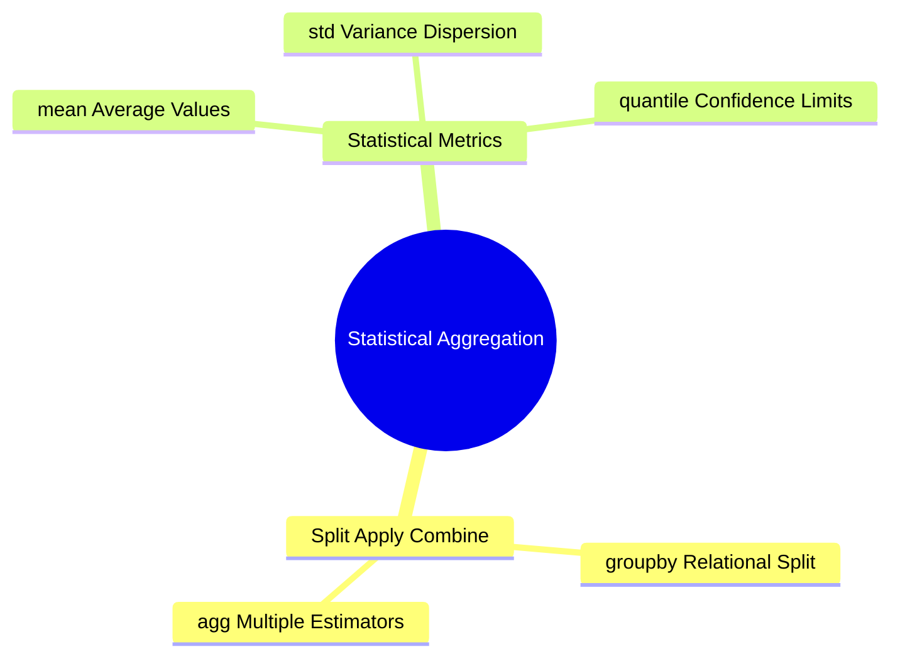

### 1. The Split-Apply-Combine Pattern (`df.groupby`)
Group statistics are computed using the split-apply-combine workflow:
1. **Split**: Segregates records into distinct subsets based on matching keys.
2. **Apply**: Computes summary statistics (e.g., mean, sum, variance) independently on each subset.
3. **Combine**: Merges the results back into a structured DataFrame.

```python
import pandas as pd

benchmark_data = pd.DataFrame({
    'filter_type': ['Median', 'Median', 'Gaussian', 'Gaussian', 'Nagao', 'Nagao'],
    'noise_level': [0.05, 0.20, 0.05, 0.20, 0.05, 0.20],
    'psnr': [34.2, 28.1, 31.0, 22.4, 36.5, 30.2],
    'execution_time_ms': [1.2, 1.3, 0.4, 0.4, 18.5, 19.1]
})

# Group by algorithm name and compute mean and standard deviation
performance_summary = benchmark_data.groupby('filter_type').agg({
    'psnr': ['mean', 'max'],
    'execution_time_ms': ['mean']
})

print(performance_summary)
```

Related concepts: [[01.07. Pandas Foundations - Series, DataFrames, and Structural Indexing]], [[03.2. Quantitative Quality Metrics - Mean Squared Error (MSE) and Peak Signal-to-Noise Ratio (PSNR)]], [[06.3. Laboratory 3 - Algorithmic Engineering of the Nagao Edge-Preserving Filter]].

---

### 01.10. OpenCV Fundamentals - Image Ingestion, Channels, and Memory Buffers.md

# OpenCV Fundamentals: Image Ingestion, Channels, and Memory Buffers

OpenCV (`cv2`) is an industry-standard computer vision library. It uses NumPy arrays as its core image representation, enabling seamless integration between OpenCV algorithms and custom mathematical processing.

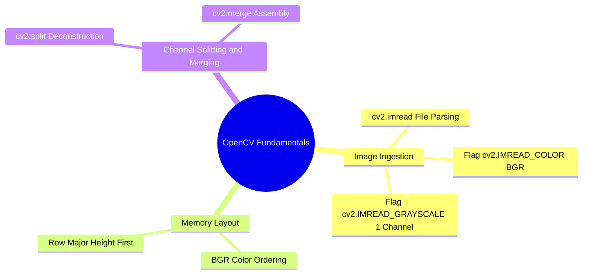

### 1. File Ingestion: `cv2.imread(filename, flags=cv2.IMREAD_COLOR)`
Reads an image file from disk and parses it into a NumPy array.

* `flags`:
  * `cv2.IMREAD_COLOR` (or `1`): Loads the image as an 8-bit unsigned integer array with 3 color channels. Discards any transparency/alpha channels.
  * `cv2.IMREAD_GRAYSCALE` (or `0`): Converts the image to a single 8-bit grayscale channel during loading.
  * `cv2.IMREAD_UNCHANGED` (or `-1`): Loads the image with all embedded channels intact, including 16-bit depths or 4-channel alpha transparency.

```python
import cv2
import numpy as np

# Load as 3-channel color image
img_color = cv2.imread('sample.png', cv2.IMREAD_COLOR)

# Load directly as single-channel grayscale
img_gray = cv2.imread('sample.png', cv2.IMREAD_GRAYSCALE)

print("Color Image Shape (H, W, C):", img_color.shape)  # e.g., (512, 512, 3)
print("Gray Image Shape (H, W):", img_gray.shape)        # e.g., (512, 512)
```

### 2. The BGR Channel Order
**Critical Insight:** OpenCV stores color images in **BGR (Blue, Green, Red)** channel order rather than the standard RGB order.

```text
Memory Index 0: Blue   Channel  --> I[:, :, 0]
Memory Index 1: Green  Channel  --> I[:, :, 1]
Memory Index 2: Red    Channel  --> I[:, :, 2]
```

If you display a raw OpenCV BGR image using Matplotlib's `plt.imshow` (which expects RGB), the red and blue channels will appear swapped, making human skin appear blue. You must swap the channels before displaying:

```python
# Convert BGR to RGB using OpenCV's conversion function
img_rgb = cv2.cvtColor(img_color, cv2.COLOR_BGR2RGB)

# Or swap channels using NumPy array slicing:
img_rgb_numpy = img_color[:, :, ::-1]
```

### 3. Channel Splitting and Merging
* `cv2.split(m)`: Separates a multi-channel image into individual single-channel arrays.
* `cv2.merge(mv)`: Combines a sequence of single-channel arrays into a multi-channel image.

```python
# Deconstruct into individual channels
b_chan, g_chan, r_chan = cv2.split(img_color)

# Reassemble into an OpenCV-compatible image
reconstructed_bgr = cv2.merge([b_chan, g_chan, r_chan])
```

Related concepts: [[01.11. OpenCV Color Space Transformations and Pixel Math]], [[02.5. Color Models - Additive RGB, Subtractive CMYK, and Photometric Grayscale]], [[06.1. Laboratory 1 - Development Environment, NumPy Array Manipulation, and Grayscale Thresholding]].

---

### 01.11. OpenCV Color Space Transformations and Pixel Math.md

# OpenCV Color Space Transformations and Pixel Math

OpenCV provides functions for converting images between color coordinate spaces and performing bounded saturation arithmetic.

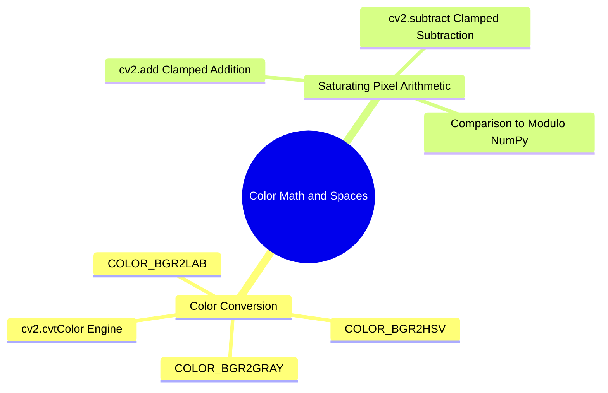

### 1. Color Space Transformations: `cv2.cvtColor(src, code)`
Converts an input image from one color space to another.

* `src`: The input NumPy array.
* `code`: The transformation flag specifying the source and target color spaces.
  * `cv2.COLOR_BGR2GRAY`: Computes luminance using the standard photometric formula: $Y = 0.299R + 0.587G + 0.114B$.
  * `cv2.COLOR_BGR2HSV`: Maps color values to Hue, Saturation, and Value components.
  * `cv2.COLOR_BGR2LAB`: Maps colors to the perceptually uniform CIE $L^*a^*b^*$ space.

```python
import cv2

bgr_input = cv2.imread('scene.png', cv2.IMREAD_COLOR)

# Transform to single-channel luminance
gray = cv2.cvtColor(bgr_input, cv2.COLOR_BGR2GRAY)

# Transform to CIE L*a*b* space for contrast enhancement
lab = cv2.cvtColor(bgr_input, cv2.COLOR_BGR2LAB)
```

### 2. Saturated vs. Modulo Arithmetic
A critical difference between OpenCV and NumPy is how they handle arithmetic overflow:
* **NumPy** uses standard computer arithmetic with modulo wrap-around:
  $$250_{\text{uint8}} + 20_{\text{uint8}} = 270 \pmod{256} = 14$$
* **OpenCV** uses saturated arithmetic that clamps values to the dynamic range:
  $$\text{cv2.add}(250_{\text{uint8}}, 20_{\text{uint8}}) = \min(270, 255) = 255$$
  $$\text{cv2.subtract}(10_{\text{uint8}}, 30_{\text{uint8}}) = \max(-20, 0) = 0$$

```python
import numpy as np
import cv2

p1 = np.array([250], dtype=np.uint8)
p2 = np.array([20], dtype=np.uint8)

print("NumPy Modulo Wrap-Around:", p1 + p2)             # Yields [14]
print("OpenCV Saturated Clamping:", cv2.add(p1, p2))    # Yields [[255]]
```

Related concepts: [[01.10. OpenCV Fundamentals - Image Ingestion, Channels, and Memory Buffers]], [[02.6. Perceptual and Broadcast Spaces - YUV, YCbCr, HSV, and Perceptually Uniform Lab]], [[03.14. Tonal Modification - Dynamic Range Expansion, Global HE, AHE, and CLAHE]].

---

### 01.12. OpenCV Geometric Transformations, Interpolation, and Affine Warping.md

# OpenCV Geometric Transformations, Interpolation, and Affine Warping

Geometric transformations alter the spatial layout of pixels by mapping input coordinates $(x, y)$ to new output coordinates $(x', y')$.

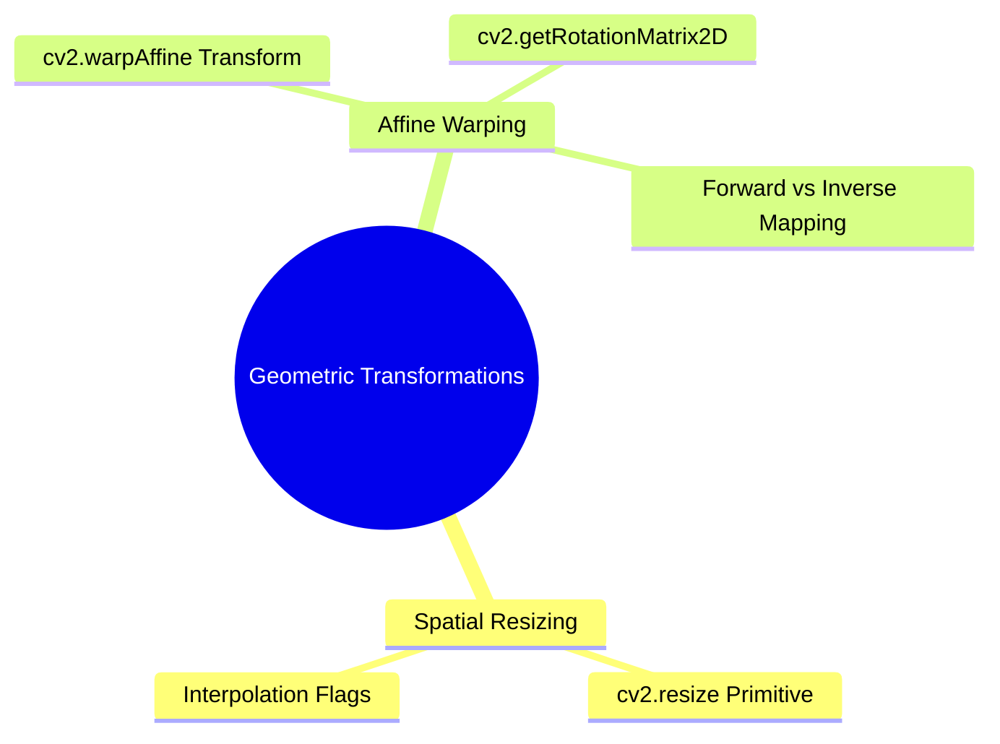

### 1. Spatial Resizing: `cv2.resize(src, dsize, fx=0, fy=0, interpolation=cv2.INTER_LINEAR)`
Rescales an image to a new spatial resolution.

* `dsize`: The output image dimensions given as a tuple of **`(width, height)`**. **Note:** This is the reverse of NumPy's `(rows, cols)` shape order!
* `fx`, `fy`: Optional scale factors along the horizontal and vertical axes when `dsize` is set to `(0, 0)`.
* `interpolation`: The analytical reconstruction algorithm:
  * `cv2.INTER_NEAREST`: Nearest-neighbor sampling. Fast, but produces visible pixelation and jagged edges.
  * `cv2.INTER_LINEAR`: Bilinear interpolation. Balanced performance; standard for general upsampling.
  * `cv2.INTER_CUBIC`: Bicubic spline interpolation over a $4 \times 4$ neighborhood. Produces sharper edges with fewer artifacts.
  * `cv2.INTER_AREA`: Resampling using pixel area relations. Preferred for downsampling images without aliasing.

```python
import cv2

img = cv2.imread('sample.png', cv2.IMREAD_GRAYSCALE)
h, w = img.shape[:2]

# Scale image by factor of 2 using Bicubic interpolation
upscaled = cv2.resize(img, (w * 2, h * 2), interpolation=cv2.INTER_CUBIC)
```

### 2. Affine Transformation: `cv2.warpAffine(src, M, dsize)`
Applies an affine transformation defined by a $2 \times 3$ transformation matrix:

$$\begin{pmatrix} x' \\ y' \end{pmatrix} = \begin{pmatrix} m_{00} & m_{01} \\ m_{10} & m_{11} \end{pmatrix} \begin{pmatrix} x \\ y \end{pmatrix} + \begin{pmatrix} m_{02} \\ m_{12} \end{pmatrix}$$

#### Image Rotation: `cv2.getRotationMatrix2D(center, angle, scale)`
Constructs the affine matrix for rotating an image around a specified center point:

```python
# Rotate 45 degrees counter-clockwise around the image center
center_point = (w // 2, h // 2)
rotation_matrix = cv2.getRotationMatrix2D(center=center_point, angle=45.0, scale=1.0)

# Warp the image onto an output canvas of size (w, h)
rotated_img = cv2.warpAffine(img, rotation_matrix, (w, h))
```

Related concepts: [[05.1. Continuous Image Reconstruction - Nearest-Neighbor, Bilinear, and Keys' Bicubic Spline]], [[07.3. Exercise 3 - Analytical Sub-Pixel Reconstruction via Bilinear Interpolation]].

---

### 01.13. SciPy Signal and Spatial Operations - 2D Filtering and Morphology.md

# SciPy Signal and Spatial Operations: 2D Filtering and Morphology

The `scipy.ndimage` and `scipy.signal` modules provide scientific algorithms for discrete 2D spatial filtering, frequency responses, and multi-dimensional analysis.

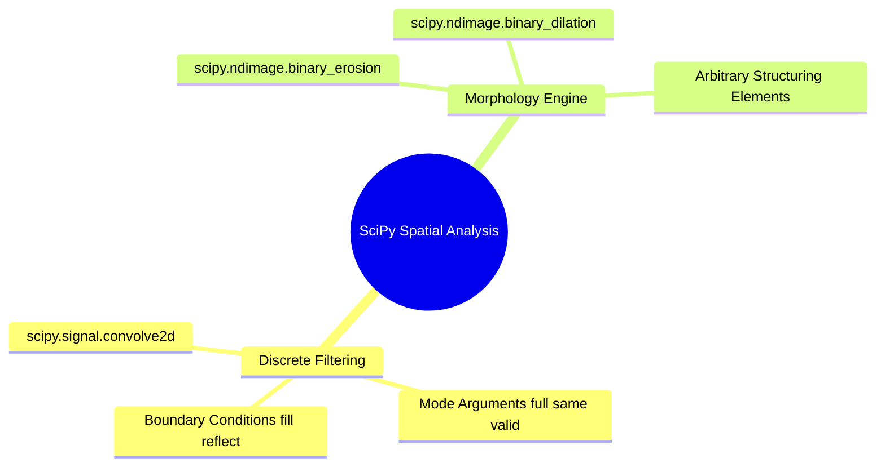

### 1. 2D Spatial Convolution: `scipy.signal.convolve2d(in1, in2, mode='full', boundary='fill', fillvalue=0)`
Computes the mathematically exact discrete two-dimensional convolution of two matrices:

* `mode`:
  * `'full'`: Computes convolution across all points of overlap. Output shape: $(M_1 + M_2 - 1, N_1 + N_2 - 1)$.
  * `'same'`: Returns the central portion of the convolution, matching the shape of `in1`.
  * `'valid'`: Computes output only for positions where the filter kernel overlaps completely with the input image. Output shape: $(M_1 - M_2 + 1, N_1 - N_2 + 1)$.
* `boundary`: Method for handling image edges:
  * `'fill'`: Pads borders with a constant value specified by `fillvalue`.
  * `'symm'` / `'reflect'`: Mirrors pixel values across the boundary.
  * `'wrap'`: Treats the image as periodic, wrapping values from the opposite edge.

```python
import numpy as np
from scipy import signal

# Define a 5x5 test image and a 3x3 averaging kernel
image = np.ones((5, 5), dtype=np.float32)
kernel = np.full((3, 3), 1.0 / 9.0, dtype=np.float32)

# Compute convolution with reflection padding, maintaining identical output dimensions
smooth = signal.convolve2d(image, kernel, mode='same', boundary='symm')
```

Related concepts: [[02.10. Mathematical 2D Spatial Convolution, Cross-Correlation, and Boundary Conditions]], [[07.1. Exercise 1 - Complete Calculation of 2D Convolution and Boundary Padding Modes]].

---

### 01.14. Scikit-Learn Primitives - Clustering, Dimensionality, and Metrics.md

# Scikit-Learn Primitives: Clustering, Dimensionality, and Metrics

Scikit-Learn (`sklearn`) provides machine learning algorithms used in mid-level image processing, such as color-based pixel clustering, dimensionality reduction, and evaluation metrics.

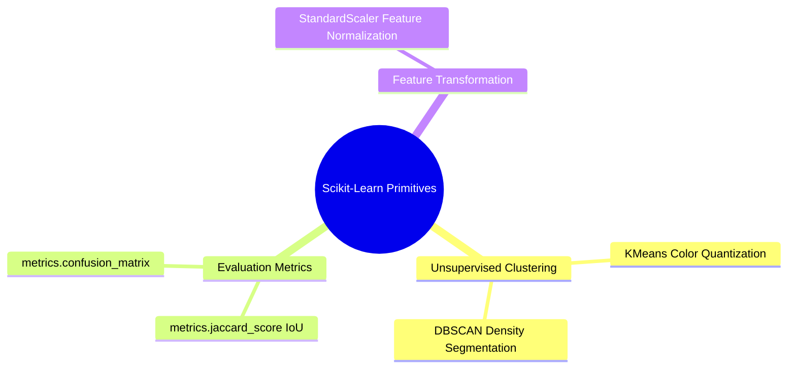

### 1. Pixel Feature Clustering: `sklearn.cluster.KMeans`
Partitions pixel colors into $K$ discrete clusters to perform color quantization or unsupervised segmentation:

```python
import numpy as np
from sklearn.cluster import KMeans

# Synthesize an image: 100 rows, 100 cols, 3 color channels
img = np.random.randint(0, 256, size=(100, 100, 3), dtype=np.uint8)

# Reshape the 3D image into a 2D feature matrix: (N_pixels, 3_features)
pixel_features = img.reshape((-1, 3)).astype(np.float32)

# Fit KMeans to group pixels into 3 color clusters
kmeans = KMeans(n_clusters=3, random_state=42, n_init='auto')
labels = kmeans.fit_predict(pixel_features)

# Reshape the 1D cluster labels back into the original 2D image shape
segmented_labels = labels.reshape((100, 100))
```

### 2. Segmentation Evaluation: `sklearn.metrics.jaccard_score`
Calculates the Jaccard similarity index (Intersection-over-Union, IoU) to measure overlap between a predicted binary segmentation and a ground-truth reference:

$$J(A, B) = \frac{|A \cap B|}{|A \cup B|}$$

```python
from sklearn.metrics import jaccard_score

# Flatten 2D binary masks to 1D arrays
gt_mask = np.array([0, 1, 1, 0, 1, 0], dtype=np.uint8)
pred_mask = np.array([0, 1, 0, 0, 1, 0], dtype=np.uint8)

iou = jaccard_score(gt_mask, pred_mask)
print("Jaccard IoU Score:", iou)
```

Related concepts: [[03.11. Feature Space Clustering Segmentation - Mean-Shift and 2SP-DBSCAN]], [[04.8. Segmentation Evaluation Benchmarks - Dice DSC, Jaccard IoU, Hausdorff, and Zeboudj Contrast]].

---

## 02. Introduction to Digital Images

### 02.1. Physical Image Formation and Optical Sensing.md

# Physical Image Formation and Optical Sensing

An optical image is formed by focused electromagnetic radiation captured by a sensor. Mathematically, a continuous physical scene is represented as a bounded, continuous bivariate radiant energy distribution:

$$f(x, y) \in \mathbb{R}^+, \quad (x, y) \in \Omega \subset \mathbb{R}^2$$

Where $(x, y)$ are spatial coordinates on the image plane $\Omega$, and $f(x, y)$ represents physical irradiance or illuminance. Because light energy cannot be negative or infinite in physical observation, the function is bounded:

$$0 < f(x, y) < \infty$$

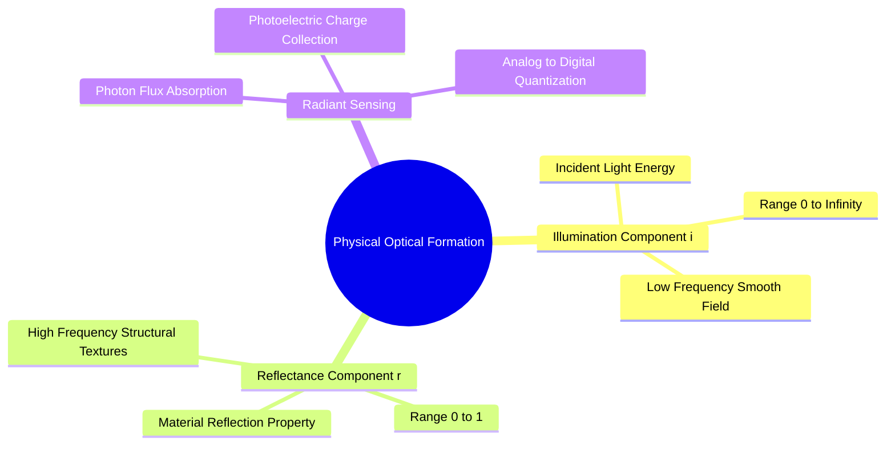

### The Illumination-Reflectance Decomposition Model
In optical imaging, the radiant intensity $f(x, y)$ entering the camera lens decomposes into two physical components:

$$f(x, y) = i(x, y) \cdot r(x, y)$$

1. **Illumination component $i(x, y)$:** The amount of incident light energy originating from environmental light sources that reaches the scene.
   $$0 < i(x, y) < \infty$$
   *Physical characteristic:* Varies smoothly across the scene, behaving as a low-frequency spatial signal.

2. **Reflectance component $r(x, y)$:** The fraction of incident light reflected by physical surfaces into the optical aperture.
   $$0 \le r(x, y) \le 1$$
   * $r = 0$: Total absorption by an ideal black body.
   * $r = 1$: Total reflection by an ideal reflector.
   *Physical characteristic:* Changes abruptly at material boundaries, surface contours, and textural transitions, behaving as a high-frequency spatial signal.

### Physical Sensor Acquisition
Optical light passes through a compound lens system and is focused onto a solid-state sensor array (such as a Charge-Coupled Device [CCD] or Complementary Metal-Oxide-Semiconductor [CMOS] active-pixel sensor). Over an exposure duration $T$, each photo-site absorbs incident photon flux and collects an electrical charge $Q$ via the photoelectric effect:

$$Q = \int_{0}^{T} \int_{A_s} \eta_q \cdot E(x, y, t) \, dx \, dy \, dt$$

where $\eta_q$ is the quantum efficiency, $A_s$ is the physical surface area of the photo-site, and $E(x, y, t)$ is the optical irradiance. This collected charge is converted to an analog voltage, amplified, passed through an anti-aliasing low-pass filter, and converted to discrete numbers by an Analog-to-Digital Converter (ADC).

Related concepts: [[02.2. Discretization - Spatial Sampling and Nyquist-Shannon Theorem]], [[03.15. Advanced Contrast Models - Histogram Specification and Land's Retinex Illumination Separation]].

---

### 02.2. Discretization - Spatial Sampling and Nyquist-Shannon Theorem.md

# Discretization: Spatial Sampling and Nyquist-Shannon Theorem

To process a continuous optical image $f(x, y)$ on a computer, it must be discretized into a matrix of numbers. This requires two steps: **spatial sampling** and **amplitude quantization**.

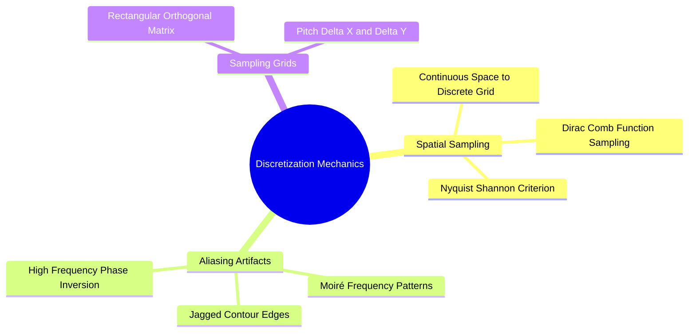

### 1. Spatial Sampling (Coordinate Discretization)
Sampling converts continuous spatial coordinates $(x, y) \in \mathbb{R}^2$ into discrete lattice coordinates $[m, n] \in \mathbb{Z}^2$. Mathematically, this is modeled as multiplying the continuous function $f(x, y)$ by an ideal two-dimensional Dirac comb function (impulse train) $s(x, y)$:

$$s(x, y) = \sum_{m=-\infty}^{\infty} \sum_{n=-\infty}^{\infty} \delta(x - m\Delta x, y - n\Delta y)$$

The sampled continuous signal $f_s(x, y)$ is:

$$f_s(x, y) = f(x, y) \cdot s(x, y) = \sum_{m=-\infty}^{\infty} \sum_{n=-\infty}^{\infty} f(m\Delta x, n\Delta y) \cdot \delta(x - m\Delta x, y - n\Delta y)$$

where $\Delta x$ and $\Delta y$ represent the sampling intervals (pixel pitch).

### 2. The Nyquist-Shannon Sampling Theorem
Let $U_{\text{max}}$ and $V_{\text{max}}$ denote the highest spatial frequencies present in the continuous scene along the horizontal and vertical directions. To reconstruct the continuous signal without distortion or loss of information, the sampling frequencies $(f_{s,x}, f_{s,y})$ must be strictly greater than twice the highest constituent spatial frequencies:

$$f_{s,x} = \frac{1}{\Delta x} > 2 U_{\text{max}}, \quad f_{s,y} = \frac{1}{\Delta y} > 2 V_{\text{max}}$$

The critical threshold $f_N = 2U_{\text{max}}$ is called the **Nyquist rate**.

### 3. Spatial Aliasing Artifacts
When an image is sampled below the Nyquist rate ($f_s \le 2U_{\text{max}}$), high-frequency components overlap with lower-frequency components in the frequency domain. This introduces **aliasing artifacts**, such as:
* **Moiré Patterns:** False, artificial ripple textures that appear when sampling fine, repetitive patterns (e.g., fabric weaves or brick lines).
* **Jagged Contours (Pixelation):** Diagonal edges appear as stair-stepped lines rather than smooth boundaries.

To prevent aliasing, physical cameras place an optical low-pass anti-aliasing filter (blur filter) in front of the sensor to remove frequencies above the Nyquist limit before sampling.

Related concepts: [[01.01. NumPy Foundations - Array Creation, Memory Layout, and Data Types]], [[02.3. Amplitude Quantization, Dynamic Range, and Bit Depth]], [[03.7. Fourier Spectral Analysis - 2D DFT, FFT Shift, and Frequency Domain Filtering]].

---

### 02.3. Amplitude Quantization, Dynamic Range, and Bit Depth.md

# Amplitude Quantization, Dynamic Range, and Bit Depth

While spatial sampling discretizes the continuous coordinate space $(x, y)$, **amplitude quantization** discretizes the continuous light intensity values $f(x, y)$ into a finite set of discrete values.

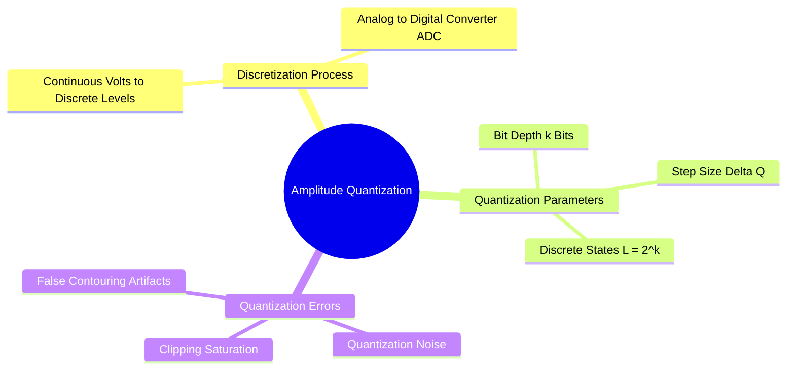

### 1. Mathematical Formulation
Let continuous sensor voltage $v \in [V_{\text{min}}, V_{\text{max}}]$ represent measured light intensity. An Analog-to-Digital Converter (ADC) maps this range to $L$ discrete levels:

$$L = 2^k$$

where $k$ is the **quantization resolution (bit depth)** in bits per pixel (bpp). The uniform quantization step size $\Delta q$ is:

$$\Delta q = \frac{V_{\text{max}} - V_{\text{min}}}{L}$$

The quantization function $Q(v)$ maps an analog voltage $v$ to an integer code $k \in \{0, 1, \dots, L-1\}$:

$$Q(v) = \min\left( L - 1, \ \left\lfloor \frac{v - V_{\text{min}}}{\Delta q} \right\rfloor \right)$$

### 2. Common Bit Depths in Computer Vision
* **1-bit (Binary):** $L = 2^1 = 2$ states ($\{0, 1\}$ or $\{0, 255\}$). Used for binary masks, document binarization, and structural silhouettes.
* **8-bit (Standard Grayscale):** $L = 2^8 = 256$ states ($[0, 255]$). The standard for digital displays, where $0$ represents absolute black and $255$ represents peak white.
* **12-bit / 14-bit (Digital Camera RAW):** $L = 4,096$ to $16,384$ states. Preserves highlight and shadow detail before tone-mapping.
* **16-bit (Medical Imaging):** $L = 2^{16} = 65,536$ states. Used in DICOM radiography, CT, and MRI to record subtle tissue density differences.

### 3. Quantization Artifacts: False Contouring
When an image is quantized with an insufficient bit depth (e.g., $k \le 4$, yielding $L \le 16$ levels), smooth intensity variations (such as a clear sky) degenerate into visible, distinct bands of constant tone. This artifact is known as **false contouring**.

Related concepts: [[01.01. NumPy Foundations - Array Creation, Memory Layout, and Data Types]], [[02.7. Digital File Encapsulation, Compression Standards, and Medical DICOM]], [[06.1. Laboratory 1 - Development Environment, NumPy Array Manipulation, and Grayscale Thresholding]].

---

### 02.4. Image Representations - Raster Matrix vs Mathematical Vector Primitives.md

# Image Representations: Raster Matrix vs. Mathematical Vector Primitives

Digital visual data is represented using two primary paradigms: **raster (bitmap)** representations and **vector** representations.

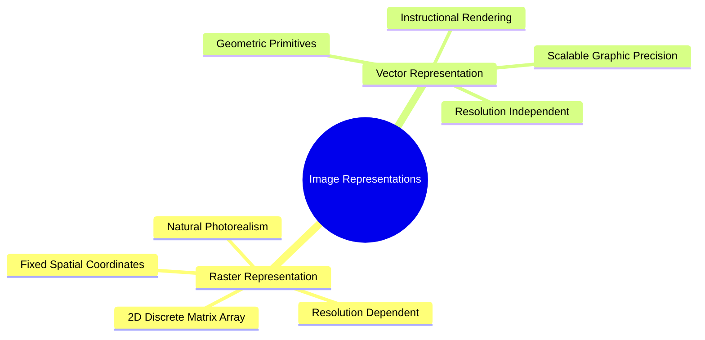

### 1. Raster Representation (Bitmap Arrays)
A raster image is an orthogonal two-dimensional matrix of discrete pixels. In an $M \times N$ raster matrix:

$$I = \begin{pmatrix}
I(0,0) & I(0,1) & \cdots & I(0,N-1) \\
I(1,0) & I(1,1) & \cdots & I(1,N-1) \\
\vdots & \vdots & \ddots & \vdots \\
I(M-1,0) & I(M-1,1) & \cdots & I(M-1,N-1)
\end{pmatrix}$$

#### Characteristics
* **Resolution Dependent:** Quality is tied to the physical pixel dimensions $(M \times N)$. Upscaling a raster image requires interpolation to estimate missing pixel values, which can introduce blurriness and pixelation.
* **Memory Intensive:** Memory usage scales directly with spatial resolution and color depth:
  $$\text{Bytes} = M \times N \times \text{Channels} \times \frac{k}{8}$$
* **Ideal for Continuous Scenes:** Well-suited for complex scenes with continuous variations in tone, such as natural photographs and medical scans.

### 2. Vector Representation (Parametric Primitives)
A vector image stores visual data as mathematical descriptions of geometric shapes (points, lines, Bézier curves, polygons, and fill attributes). For example, a circle is stored parametrically:

$$\mathcal{C} = \{ (x_c, y_c), \ r, \ \mathbf{c}_{\text{stroke}}, \ \mathbf{c}_{\text{fill}}, \ w_{\text{stroke}} \}$$

#### Characteristics
* **Resolution Independent:** Can be scaled to any resolution without loss of fidelity. The image is rendered dynamically at display time by evaluating the underlying mathematical formulas.
* **Compact Storage:** For typography, line art, and geometric diagrams, mathematical instructions take up significantly less storage space than high-resolution pixel matrices.
* **Ineffective for Complex Scenes:** Cannot efficiently model complex, continuous photographic scenes with millions of subtle color variations.

Related concepts: [[01.02. NumPy Array Manipulation - Reshaping, Slicing, and Striding]], [[02.7. Digital File Encapsulation, Compression Standards, and Medical DICOM]], [[05.1. Continuous Image Reconstruction - Nearest-Neighbor, Bilinear, and Keys' Bicubic Spline]].

---

### 02.5. Color Models - Additive RGB, Subtractive CMYK, and Photometric Grayscale.md

# Color Models: Additive RGB, Subtractive CMYK, and Photometric Grayscale

A color model is a mathematical framework that describes colors as tuples of numbers, typically using three or four primary color components.

```mermaid
mindmap
  root((Classical Color Spaces))
    Additive RGB
      Tristimulus Theory Red Green Blue
      Electronic Displays Origin Black
      Cube Geometry Coordinates
    Subtractive CMYK
      Cyan Magenta Yellow Key Black
      Print Pigment Absorption
      Origin White Subtractive Matrix
    Photometric Grayscale
      Luminance Synthesis Y
      Human Retinal Sensitivity
      Standard BT 601 Coefficients
```

### 1. Additive RGB Color Space
The RGB model is an **additive** system based on human trichromatic vision. Colors are created by mixing varying intensities of Red, Green, and Blue light. It is the primary color model used by digital displays, computer monitors, and digital cameras.

* Mathematical Domain: A 3D Cartesian cube $[0, 255]^3$ (for standard 8-bit channels):
  $$\mathbf{C}(x, y) = \begin{pmatrix} R(x, y) \\ G(x, y) \\ B(x, y) \end{pmatrix}, \quad R, G, B \in \{0, 1, \dots, 255\}$$
* Coordinate Extremes:
  * Origin $(0, 0, 0)$: Total absence of light $\to$ Absolute Black.
  * Maximum $(255, 255, 255)$: Full intensity of all three primary lights $\to$ Peak White.
  * Grayscale Diagonal: Line where $R = G = B$. Points along this vector represent neutral shades of gray.

### 2. Subtractive CMYK Color Space
The CMYK model is a **subtractive** system used in printing. Inks deposit pigments onto paper that absorb (subtract) specific wavelengths of light while reflecting others.

* The primary ink colors are Cyan ($C$), Magenta ($M$), and Yellow ($Y$), which are the exact complements of Red, Green, and Blue.
* Conversion from normalized RGB ($[0, 1]$) to CMY:
  $$\begin{pmatrix} C \\ M \\ Y \end{pmatrix} = \begin{pmatrix} 1 \\ 1 \\ 1 \end{pmatrix} - \begin{pmatrix} R \\ G \\ B \end{pmatrix}$$
* To save expensive color inks and produce deeper black tones, a fourth pigment called **Key (Black, $K$)** is added:
  $$K = \min(C, M, Y)$$
  $$C' = \frac{C - K}{1 - K}, \quad M' = \frac{M - K}{1 - K}, \quad Y' = \frac{Y - K}{1 - K} \quad (\text{if } K < 1)$$

### 3. Photometric Grayscale Conversion
Converting an RGB color image to a single grayscale channel requires a weighted sum of the three color components. The human eye does not perceive all wavelengths of light with equal brightness; the retina's green-sensitive cone cells make it far more sensitive to green wavelengths than to red or blue.

Using a simple arithmetic mean:

$$Y_{\text{unweighted}} = \frac{R + G + B}{3} \quad \text{(Perceptually Incorrect)}$$

produces images that do not match human perception of relative brightness. Instead, computer vision standards (such as ITU-R BT.601) use a **photometrically weighted sum** that accounts for human visual sensitivity:

$$Y = 0.299 \cdot R + 0.587 \cdot G + 0.114 \cdot B$$

Notice that Green contributes roughly $59\%$ of the perceived luminance, Red contributes roughly $30\%$, and Blue contributes only $11\%$.

Related concepts: [[01.03. NumPy Broadcasting Mechanics and Vectorized Computations]], [[01.11. OpenCV Color Space Transformations and Pixel Math]], [[02.6. Perceptual and Broadcast Spaces - YUV, YCbCr, HSV, and Perceptually Uniform Lab]].

---

### 02.6. Perceptual and Broadcast Spaces - YUV, YCbCr, HSV, and Perceptually Uniform Lab.md

# Perceptual and Broadcast Spaces: YUV, YCbCr, HSV, and Perceptually Uniform Lab

While RGB is well-suited for hardware displays, other color spaces are better designed for human color perception, image processing algorithms, and data compression.

```mermaid
mindmap
  root((Alternative Spaces))
    Decoupled Luminance
      YUV European Broadcast
      YCbCr JPEG Compression Standard
      Luma Isolated from Chroma
    Perceptually Intuitive
      HSV Hue Saturation Value
      HSL Hue Saturation Lightness
      Cylindrical Geometry
    Perceptually Uniform
      CIE XYZ Fundamental Anchor
      CIE Lab Delta E Metric
      Linear Perceptual Steps
```

### 1. Decoupled Luminance-Chrominance: YUV and YCbCr
In RGB images, brightness and color information are mixed across all three channels. This means changing the intensity of an image requires modifying all three channels, which can alter the overall hue.

The YUV and YCbCr spaces separate the **luminance (brightness, $Y$)** from the **chrominance (color information, $U, V$ or $Cb, Cr$)**. This separation is widely used in video compression (e.g., MPEG) and image standards (e.g., JPEG). Because the human visual system is far more sensitive to spatial variations in brightness than in color, the chrominance channels can be downsampled (chroma subsampling, like 4:2:0) to save bandwidth without noticeable loss of visual quality.

The standard conversion from RGB to YCbCr (ITU-R BT.601, scaled for 8-bit representations) is:

$$\begin{pmatrix} Y \\ Cb \\ Cr \end{pmatrix} = \begin{pmatrix} 0.299 & 0.587 & 0.114 \\ -0.168736 & -0.331264 & 0.5 \\ 0.5 & -0.418688 & -0.081312 \end{pmatrix} \begin{pmatrix} R \\ G \\ B \end{pmatrix} + \begin{pmatrix} 0 \\ 128 \\ 128 \end{pmatrix}$$

### 2. Perceptually Intuitive Spaces: HSL and HSV
The HSL (Hue, Saturation, Lightness) and HSV (Hue, Saturation, Value) models describe colors in terms that align more closely with human artistic perception:
* **Hue ($H \in [0^\circ, 360^\circ]$):** The pure color wavelength (e.g., red, orange, green, cyan). Represented as an angle around a central vertical axis.
* **Saturation ($S \in [0, 1]$):** The purity or vividness of the color. A saturation of $0$ yields neutral gray; a saturation of $1$ yields a pure, vivid color.
* **Value ($V \in [0, 1]$) / Lightness ($L \in [0, 1]$):** The relative brightness or luminance of the color.

*Advantage:* To isolate an object by color under varying lighting conditions, an algorithm can threshold only the **Hue** channel while ignoring fluctuations in **Value** caused by shadows or highlights.

### 3. Perceptually Uniform Space: CIE $L^*a^*b^*$
In RGB and HSV spaces, the Euclidean distance between two color vectors does not match how different those colors look to a human observer. For example, a small shift in coordinates in a green region may be completely imperceptible, while the same numerical shift in a blue region may appear as a noticeably different shade.

The **CIE $L^*a^*b^*$** space was designed to be **perceptually uniform**: the Euclidean distance $\Delta E^*$ between two color points corresponds directly to the visual difference perceived by a human observer:

$$\Delta E^* = \sqrt{(\Delta L^*)^2 + (\Delta a^*)^2 + (\Delta b^*)^2}$$

* $L^*$: Lightness ($0 \to \text{black}, \ 100 \to \text{diffuse white}$).
* $a^*$: Color axis from Green (negative values) to Red (positive values).
* $b^*$: Color axis from Blue (negative values) to Yellow (positive values).

Because of this uniformity, CIE $L^*a^*b^*$ is the standard space used for color-based image segmentation, histogram equalization, and industrial color-difference testing.

Related concepts: [[01.11. OpenCV Color Space Transformations and Pixel Math]], [[02.5. Color Models - Additive RGB, Subtractive CMYK, and Photometric Grayscale]], [[03.14. Tonal Modification - Dynamic Range Expansion, Global HE, AHE, and CLAHE]].

---

### 02.7. Digital File Encapsulation, Compression Standards, and Medical DICOM.md

# Digital File Encapsulation, Compression Standards, and Medical DICOM

A digital image file contains more than raw pixel matrices; it encapsulates header information, dimensions, color profiles, structural metadata, and compressed data streams.

```mermaid
mindmap
  root((File Formats))
    Lossless Standards
      PNG Run Length and Deflate
      TIFF Tagged High Depth
      BMP Direct Uncompressed Buffer
    Lossy Standards
      JPEG Discrete Cosine Transform
      Quantization Matrix Truncation
      Blocking Artifacts
    Specialized Standards
      RAW Unprocessed Sensor Data
      DICOM Clinical Medical Protocol
      Embedded Clinical Attributes
```

### 1. Compression Paradigms: Lossless vs. Lossy
* **Lossless Compression:** Reduces file size without discarding any image information. When decompressed, the reconstructed image is identical to the original pixel-for-pixel:
  $$\hat{I}(x, y) = I(x, y) \quad \forall (x, y)$$
  *Examples:* PNG (uses predictive filtering and DEFLATE/LZ77), TIFF.
* **Lossy Compression:** Achieves significantly smaller file sizes by permanently discarding image details that are less perceptible to the human visual system (such as subtle high-frequency color variations):
  $$\hat{I}(x, y) \neq I(x, y), \quad \text{MSE}(I, \hat{I}) > 0$$
  *Examples:* JPEG (uses the Discrete Cosine Transform [DCT], frequency quantization, and Huffman coding). At high compression ratios, JPEG introduces visible $8 \times 8$ block boundary artifacts.

### 2. Common Storage Formats

| Format | Compression Type | Transparency (Alpha) | Max Bit Depth | Primary Application |
| :--- | :--- | :--- | :--- | :--- |
| **BMP** | None (Raw Array) | Supported | 24-bit / 32-bit | Simple programmatic processing; avoids decompression overhead. |
| **PNG** | Lossless (DEFLATE)| Supported | 16-bit / channel | Web graphics, diagrams, binary segmentation masks. |
| **JPEG**| Lossy (DCT) | Not Supported | 8-bit / channel | Natural photographs, web media. Unsuitable for text or line drawings. |
| **TIFF**| Lossless / Lossy | Supported | Up to 32-bit float | Archival storage, high-resolution scientific and satellite imagery. |
| **RAW** | None (Unprocessed)| Not Supported | 12 to 14-bit | Professional photography. Direct sensor data prior to demosaicing. |

### 3. Specialized Formats: Medical DICOM
**DICOM (Digital Imaging and Communications in Medicine)** is an international standard for storing, transmitting, and viewing medical images. A `.dcm` file is not just an image container; it is a clinical record that bundles the pixel data with comprehensive metadata:
* **Patient Metadata:** Anonymized patient ID, age, sex, clinical history.
* **Acquisition Parameters:** Radiation dose, slice thickness (e.g., $1.0\text{ mm}$), scan orientation, magnetic field strength ($1.5\text{T}$, $3.0\text{T}$).
* **Radiometric Calibration:** Rescale slope and intercept values used to convert raw 16-bit integer pixel values into calibrated physical units (such as **Hounsfield Units [HU]** in CT scans).

Related concepts: [[01.10. OpenCV Fundamentals - Image Ingestion, Channels, and Memory Buffers]], [[02.3. Amplitude Quantization, Dynamic Range, and Bit Depth]], [[03.2. Quantitative Quality Metrics - Mean Squared Error (MSE) and Peak Signal-to-Noise Ratio (PSNR)]].

---

### 02.8. Discrete Spatial Topology - Neighborhoods, Adjacency, and Metric Spaces.md

# Discrete Spatial Topology: Neighborhoods, Adjacency, and Metric Spaces

Digital images are sampled onto an integer grid $\mathbb{Z}^2$. Analyzing connectivity, tracing boundaries, and calculating distances requires a formal definition of discrete spatial topology.

```mermaid
mindmap
  root((Discrete Spatial Topology))
    Neighborhood Systems
      4-Neighborhood V_4
      Diagonal Neighborhood V_D
      8-Neighborhood V_8
    Adjacency Paradoxes
      Jordan Curve Separation
      Connected Path Ambiguities
    Metric Distance Functions
      Manhattan Distance d_1
      Euclidean Distance d_2
      Chebyshev Chessboard d_inf
      Metric Ordering Inequality
```

### 1. Discrete Pixel Neighborhoods
Let a target pixel $P$ have integer coordinates $(x, y)$.

#### 4-Neighborhood ($V_4(P)$)
The set of four pixels that share a horizontal or vertical edge with $P$:

$$V_4(P) = \{ (x+1, y), \ (x-1, y), \ (x, y+1), \ (x, y-1) \}$$

#### Diagonal Neighborhood ($V_D(P)$)
The set of four pixels that share only a corner with $P$:

$$V_D(P) = \{ (x+1, y+1), \ (x+1, y-1), \ (x-1, y+1), \ (x-1, y-1) \}$$

#### 8-Neighborhood ($V_8(P)$)
The union of the 4-neighborhood and the diagonal neighborhood:

$$V_8(P) = V_4(P) \cup V_D(P)$$

```text
4-Neighborhood:          Diagonal:            8-Neighborhood:
       [X]                    [X]   [X]             [X] [X] [X]
   [X] [P] [X]                    [P]               [X] [P] [X]
       [X]                    [X]   [X]             [X] [X] [X]
```

### 2. Distance Metrics on the Discrete Grid
A distance metric $D(P, Q)$ between two pixels $P(x_p, y_p)$ and $Q(x_q, y_q)$ must satisfy four metric axioms:
1. Non-negativity: $D(P, Q) \ge 0$, and $D(P, Q) = 0 \iff P = Q$
2. Symmetry: $D(P, Q) = D(Q, P)$
3. Triangle inequality: $D(P, R) \le D(P, Q) + D(Q, R)$

#### A. Manhattan Distance ($d_1$, City-Block Distance)
Measures distance assuming movement is restricted to horizontal and vertical steps only (like walking along city blocks). Points at a distance $d_1 \le r$ form a diamond:

$$d_1(P, Q) = |x_p - x_q| + |y_p - y_q|$$

#### B. Euclidean Distance ($d_2$)
The standard straight-line distance in Euclidean space. Points at a distance $d_2 \le r$ form a circle:

$$d_2(P, Q) = \sqrt{(x_p - x_q)^2 + (y_p - y_q)^2}$$

#### C. Chebyshev Distance ($d_\infty$, Chessboard Distance)
Measures distance allowing horizontal, vertical, and diagonal steps, matching the movement of a king on a chessboard. Points at a distance $d_\infty \le r$ form a square:

$$d_\infty(P, Q) = \max(|x_p - x_q|, \ |y_p - y_q|)$$

#### The Fundamental Metric Ordering Inequality
For any two pixels $P$ and $Q$ on a discrete grid, these three metrics are ordered by the following inequality:

$$d_\infty(P, Q) \le d_2(P, Q) \le d_1(P, Q)$$

*Intuition:* Chebyshev distance is the "shortest" metric because diagonal steps cover the same coordinate distance as horizontal and vertical steps combined. Manhattan distance is the "longest" because it prohibits diagonal shortcuts. The straight-line Euclidean distance lies between the two.

### 3. The Connectivity Paradox (Jordan Curve Dilemma)
When analyzing binary images, you must avoid using the same connectivity definition for both the foreground objects and the background. 

Consider a continuous closed loop: by the **Jordan Curve Theorem**, a closed loop divides the plane into two disconnected regions (an interior and an exterior). However, on a discrete grid, if both the foreground loop and the background are evaluated using 8-connectivity, diagonal background pixels can pass directly through the diagonal connections of the foreground loop, breaking the boundary. Conversely, if both are evaluated using 4-connectivity, the foreground loop may be considered disconnected even though it visually appears solid.

**Standard Rule:** To prevent connectivity paradoxes, always use complementary connectivity definitions:
$$\text{Foreground Connectivity} = 8 \iff \text{Background Connectivity} = 4$$
$$\text{Foreground Connectivity} = 4 \iff \text{Background Connectivity} = 8$$

Related concepts: [[01.04. NumPy Advanced Indexing, Masking, and Outlier Filtering]], [[04.6. Connected Component Analysis - Two-Pass Labeling and Equivalence Trees]], [[06.4. Laboratory 4 - Applied Mathematical Morphology, Cellular Counting, and Skeletonization]].

---

### 02.9. Tonal Histograms, Probability Densities, and Cumulative Distribution Functions.md

# Tonal Histograms, Probability Densities, and Cumulative Distribution Functions

The histogram is a foundational tool for analyzing an image's tonal distribution. It provides a global summary of brightness and contrast without considering spatial pixel arrangements.

```mermaid
mindmap
  root((Tonal Histograms))
    Mathematical Distribution
      Discrete Bin Counting
      Probability Density Function PDF
      Cumulative Distribution Function CDF
    Tonal Diagnostics
      Dark Under Exposed Clustered Left
      Bright Over Exposed Clustered Right
      Low Contrast Clustered Center
      High Contrast Broad Dispersion
    Processing Applications
      Global Histogram Equalization
      Optimal Statistical Thresholding
```

### 1. Mathematical Definitions

#### Unnormalized Intensity Histogram
For a discrete grayscale image $I$ with $L$ gray levels in the range $[0, L-1]$:

$$H(r_k) = n_k$$

where $r_k$ is the $k$-th intensity level, and $n_k$ is the total number of pixels in the image with that intensity:

$$n_k = \sum_{x=0}^{M-1} \sum_{y=0}^{N-1} \delta(I(x, y) - r_k)$$

#### Normalized Histogram (Empirical Probability Density Function, PDF)
To make the histogram independent of image dimensions, divide each bin count by the total number of pixels $N_{\text{total}} = M \times N$:

$$p(r_k) = \frac{n_k}{M \times N}, \quad k = 0, 1, \dots, L-1$$

By definition, the sum of all probabilities equals $1$:

$$\sum_{k=0}^{L-1} p(r_k) = 1, \quad p(r_k) \ge 0$$

#### The Cumulative Distribution Function (CDF)
The Cumulative Distribution Function $P_c(r_k)$ sums the probabilities of all intensity levels up to $r_k$:

$$P_c(r_k) = \sum_{j=0}^{k} p(r_j) = \frac{1}{M \times N} \sum_{j=0}^{k} n_j$$

* Properties:
  * Non-decreasing monotonic step function: $P_c(r_{k}) \ge P_c(r_{k-1})$
  * Normalized bounds: $P_c(r_0) = p(r_0) \ge 0$, and $P_c(r_{L-1}) = 1.0$

### 2. Reading an Image from its Histogram Shape
* **Dark (Underexposed):** The histogram is skewed heavily to the **left** (clustered near intensity $0$).
* **Bright (Overexposed):** The histogram is skewed heavily to the **right** (clustered near intensity $255$).
* **Low Contrast:** The histogram is compressed into a narrow range in the middle. The image appears flat, gray, and washed out.
* **High Contrast:** The histogram spans the entire available range from $0$ to $255$.
* **Bimodal Distribution:** The histogram has two distinct peaks separated by a deep valley. Indicates a clear separation between a dark foreground and a bright background (or vice versa), making it ideal for segmentation via global thresholding.

Related concepts: [[01.06. Matplotlib Advanced - Tonal Histograms, Surface Meshes, and Multi-Channel Grids]], [[03.14. Tonal Modification - Dynamic Range Expansion, Global HE, AHE, and CLAHE]], [[04.2. Global Statistical Thresholding - Mathematical Derivation of Otsu's Method]].

---

### 02.10. Mathematical 2D Spatial Convolution, Cross-Correlation, and Boundary Conditions.md

# Mathematical 2D Spatial Convolution, Cross-Correlation, and Boundary Conditions

Linear spatial filtering is the primary operation used for image smoothing, sharpening, and gradient calculation. It operates by convolving an image with a small spatial weight matrix called a **kernel** (or mask).

```mermaid
mindmap
  root((2D Spatial Convolution))
    Mathematical Formulations
      Discrete Convolution Double Flip
      Cross Correlation Direct Shift
      Equivalence for Symmetric Kernels
    Boundary Padding Solutions
      Zero Constant Padding Artifacts
      Replication Clamp Edge Continuity
      Mirror Reflection Seamless
      Periodic Wrap Spectral
    Computational Optimization
      Kernel Separability Decomposition
      W^2 down to 2W Multiplications
```

### 1. Formulations: Convolution vs. Cross-Correlation

#### 2D Discrete Convolution ($*$)
Mathematically, true 2D discrete convolution requires flipping the filter kernel both horizontally and vertically (a $180^\circ$ rotation) before computing the sum of element-wise products:

$$g(x, y) = f(x, y) * h(x, y) = \sum_{s=-K}^{K} \sum_{t=-L}^{L} f(x - s, y - t) \cdot h(s, t)$$

#### 2D Discrete Cross-Correlation ($\otimes$)
Cross-correlation performs the same operation but **without flipping the kernel**:

$$g(x, y) = f(x, y) \otimes h(x, y) = \sum_{s=-K}^{K} \sum_{t=-L}^{L} f(x + s, y + t) \cdot h(s, t)$$

*Crucial Implementation Insight:* Most modern deep learning frameworks (e.g., PyTorch, TensorFlow) and computer vision libraries implement **cross-correlation** but call it "convolution." For spatially symmetric kernels (such as Gaussian, Laplacian, or Box filters), $h(s, t) = h(-s, -t)$, making the mathematical results of convolution and cross-correlation identical.

### 2. Kernel Separability and Computational Complexity
A 2D kernel $h(x, y)$ of size $W \times W$ is **separable** if it can be factored into the outer product of two 1D vectors:

$$h = \mathbf{v} \cdot \mathbf{u}^T$$

Applying a non-separable $W \times W$ kernel directly to an $M \times N$ image requires $W^2$ multiplications and additions per pixel:

$$\text{Complexity}_{\text{Direct}} = \mathcal{O}(M \cdot N \cdot W^2)$$

If the kernel is separable, the 2D operation can be decomposed into two consecutive 1D passes: first convolving each row with the horizontal kernel $\mathbf{u}^T$, then convolving each column of the result with the vertical kernel $\mathbf{v}$:

$$\text{Complexity}_{\text{Separated}} = \mathcal{O}(M \cdot N \cdot 2W)$$

*Example Performance Gain:* For a $15 \times 15$ filter ($W = 15$), a direct 2D convolution requires $W^2 = 225$ multiplications per pixel. A separable implementation requires only $2W = 30$ multiplications per pixel—an **$86.7\%$ reduction** in computational cost.

### 3. Boundary Effects and Padding Strategies
When a kernel is centered on pixels near the edge of an image, part of the kernel extends beyond the image boundaries, where pixel values are undefined.

```text
OutOfBounds   OutOfBounds   OutOfBounds
     ?             ?             ?
OutOfBounds [f(0,0)=100]  [f(0,1)=130]  ...
     ?
OutOfBounds [f(1,0)=110]  [f(1,1)=90]   ...
     ?
```

Four boundary handling strategies are commonly used:
1. **Zero Padding (Constant Border):** Sets all out-of-bounds pixels to zero ($f(x, y) = 0$). Simple to implement, but introduces an artificial dark edge that can distort high-pass filters and edge detectors.
2. **Replication (Clamp Padding):** Clamps out-of-bounds coordinates to the nearest edge pixel ($f(-1, y) = f(0, y)$). Preserves border intensity levels and prevents artificial edges.
3. **Mirror Padding (Reflection):** Reflects pixel values back into the image across the boundary ($f(-1, y) = f(1, y)$). Maintains local intensity gradients, minimizing boundary artifacts.
4. **Periodic Padding (Wrap-Around):** Wraps coordinates to the opposite edge of the image ($f(-1, y) = f(M-1, y)$). Required when performing convolution via the Discrete Fourier Transform (DFT).

Related concepts: [[01.13. SciPy Signal and Spatial Operations - 2D Filtering and Morphology]], [[03.3. Linear Smoothing Filters - Box Mean and Separable Gaussian Convolutions]], [[07.1. Exercise 1 - Complete Calculation of 2D Convolution and Boundary Padding Modes]].

---

### 02.11. The Classical Vision Processing Hierarchy - Low, Mid, and High-Level Tasks.md

# The Classical Vision Processing Hierarchy: Low, Mid, and High-Level Tasks

Computer vision and image analysis architectures are organized into a three-tiered hierarchy of abstraction, defined by the structure of their inputs and outputs.

```mermaid
mindmap
  root((Vision Hierarchy))
    Low Level Processing
      Input Raw Pixels
      Output Enhanced Pixels
      Tasks Noise Removal Contrast
    Mid Level Processing
      Input Discrete Pixels
      Output Symbolic Attributes
      Tasks Segmentation Bounding Boxes
    High Level Processing
      Input Attributes Geometry
      Output Semantic Decisions
      Tasks Object Recognition Scene Parsing
```

### 1. Low-Level Processing (Pixel-to-Pixel)
* **Inputs:** Raw pixel matrices.
* **Outputs:** Processed pixel matrices.
* **Objective:** Improve image quality, remove noise, correct non-uniform lighting, or enhance contrast to prepare the image for downstream analysis.
* **Representative Tasks:** Linear and non-linear filtering, contrast stretching, bilateral smoothing, morphological operations, super-resolution reconstruction.

### 2. Mid-Level Processing (Pixel-to-Attribute)
* **Inputs:** Processed pixel matrices.
* **Outputs:** Symbolic descriptors, segmented regions, coordinate boundaries, or geometric attributes.
* **Objective:** Group pixels into meaningful entities and extract structural features.
* **Representative Tasks:** Global and adaptive binarization, edge detection, morphological watershed segmentation, connected component analysis, bounding box extraction.

### 3. High-Level Processing (Attribute-to-Decision)
* **Inputs:** Structural features, geometric vectors, regional descriptors, and class labels.
* **Outputs:** Semantic interpretations, scene classifications, or automated decisions.
* **Objective:** Emulate biological vision by making inferences and decisions based on the extracted features.
* **Representative Tasks:** Automated medical diagnosis, optical character recognition (OCR), multi-object tracking, autonomous vehicle path planning.

Related concepts: [[02.1. Physical Image Formation and Optical Sensing]], [[03.1. Physical Noise Models - Point Spread Function, Additive Gaussian, Speckle, and Salt-and-Pepper]], [[04.1. Formal Segmentation Axioms and Homogeneity Predicates]].

---

## 03. Image Preprocessing, Filtering, and Restoration

### 03.1. Physical Noise Models - Point Spread Function, Additive Gaussian, Speckle, and Salt-and-Pepper.md

# Physical Noise Models: Point Spread Function, Additive Gaussian, Speckle, and Salt-and-Pepper

Image degradation can occur during acquisition, transmission, or optical focusing. A degraded observation $G(x, y)$ is modeled mathematically as:

$$G(x, y) = \mathcal{H}\{F(x, y)\} + \eta(x, y)$$

Where $F(x, y)$ is the original clean image, $\mathcal{H}$ represents the degradation operator, and $\eta(x, y)$ is an additive noise term. If $\mathcal{H}$ is linear and space-invariant (such as motion blur or out-of-focus optics), it can be modeled as a spatial convolution with the system's **Point Spread Function (PSF)** $h(x, y)$:

$$G(x, y) = F(x, y) * h(x, y) + \eta(x, y)$$

```mermaid
mindmap
  root((Image Noise Models))
    Physical Degradation
      Point Spread Function PSF
      Linear Spatial Invariant Blur
    Additive Gaussian
      Thermal Johnson Nyquist Noise
      Zero Mean Bell Curve
      Independent Identical Distribution
    Impulsive Salt and Pepper
      Transmission Dropped Bits
      Faulty ADC Memory Cell
      Extreme Min Max Saturation
    Multiplicative Speckle
      Coherent Wave Interference
      Proportional to Signal Intensity
      Ultrasound and Radar SAR
```

### 1. Additive Gaussian Noise
Arises from thermal vibrations of electrons in sensor electronics (Johnson-Nyquist noise) and sensor noise under low-light conditions.

* Mathematical Model:
  $$G(x, y) = F(x, y) + \eta_G(x, y)$$
* Probability Density Function (PDF):
  $$p(z) = \frac{1}{\sqrt{2\pi}\sigma} \exp\left( -\frac{(z - \mu)^2}{2\sigma^2} \right)$$
  where $\mu$ is the mean (typically $\mu = 0$) and $\sigma^2$ is the noise variance.
* Characteristics: Affects *every pixel* in the image by adding a small, random variation to its intensity. Effectively smoothed using linear averaging and Gaussian filters.

### 2. Impulsive Noise (Salt-and-Pepper Noise)
Caused by faulty sensor pixels (dead or stuck pixels), transmission errors, or analog-to-digital bit errors.

* Mathematical Model: Pixels are randomly replaced with either the minimum or maximum intensity value:
  $$G(x, y) = \begin{cases}
  0 \ (\text{Pepper, Black}) & \text{with probability } \frac{p}{2} \\
  255 \ (\text{Salt, White}) & \text{with probability } \frac{p}{2} \\
  F(x, y) & \text{with probability } 1 - p
  \end{cases}$$
* Characteristics: Affects only a *fraction* $p$ of pixels, while the remaining pixels remain clean. Because the noise values are extreme outliers ($0$ and $255$), linear averaging filters fail; rank-order filters (such as the Median filter) must be used instead.

### 3. Multiplicative Noise (Speckle Noise)
Occurs in coherent imaging systems, such as Synthetic Aperture Radar (SAR), sonar, and medical ultrasound, due to constructive and destructive interference of reflected waves.

* Mathematical Model:
  $$G(x, y) = F(x, y) \cdot \eta_M(x, y)$$
* Characteristics: The noise amplitude is proportional to the local image intensity: brighter regions exhibit larger noise variations, while dark regions exhibit little noise.

Related concepts: [[01.04. NumPy Advanced Indexing, Masking, and Outlier Filtering]], [[03.2. Quantitative Quality Metrics - Mean Squared Error (MSE) and Peak Signal-to-Noise Ratio (PSNR)]], [[03.5. Order-Statistic Non-Linear Filtering - Median and Rank-Order Min-Max Operators]], [[06.2. Laboratory 2 - Synthetic Noise Injection, Spatial Filtering, and Metric Benchmarking]].

---

### 03.2. Quantitative Quality Metrics - Mean Squared Error (MSE) and Peak Signal-to-Noise Ratio (PSNR).md

# Quantitative Quality Metrics: Mean Squared Error (MSE) and Peak Signal-to-Noise Ratio (PSNR)

To evaluate the performance of an image restoration or denoising algorithm, the restored image $\hat{F}(x, y)$ must be compared quantitatively against a reference ground-truth image $F(x, y)$.

```mermaid
mindmap
  root((Quality Metrics))
    Mean Squared Error
      L2 Norm Squared Difference
      Average Pixel Residual
      Penalizes Large Errors
    Peak Signal to Noise Ratio
      Decibel Logarithmic Scale
      Ratio of Signal Peak to MSE
      Higher Equals Superior Fidelity
```

### 1. Mean Squared Error (MSE)
The Mean Squared Error measures the average squared difference between the pixel values of the restored and reference images:

$$\text{MSE}(F, \hat{F}) = \frac{1}{M \cdot N} \sum_{x=0}^{M-1} \sum_{y=0}^{N-1} \Big( F(x, y) - \hat{F}(x, y) \Big)^2$$

* An MSE of $0$ indicates a perfect reconstruction ($\hat{F} = F$).
* Because the error term is squared, large localized errors are penalized much more heavily than small, widespread differences.

### 2. Peak Signal-to-Noise Ratio (PSNR)
PSNR expresses the ratio between the maximum possible power of the image signal and the power of corrupting noise on a logarithmic decibel (dB) scale:

$$\text{PSNR} = 10 \cdot \log_{10}\left( \frac{R^2}{\text{MSE}} \right) = 20 \cdot \log_{10}\left( \frac{R}{\sqrt{\text{MSE}}} \right)$$

where $R$ is the maximum possible pixel intensity:
* For standard 8-bit unsigned images: $R = 255$.
* For normalized floating-point images: $R = 1.0$.

#### Interpreting PSNR Values
* **PSNR $> 35\text{ dB}$:** High visual quality; artifacts are nearly imperceptible.
* **$30\text{ dB} \le \text{PSNR} \le 35\text{ dB}$:** Good restoration; minor artifacts visible upon close inspection.
* **$20\text{ dB} \le \text{PSNR} < 30\text{ dB}$:** Poor restoration; visible blurring or lingering noise.
* **PSNR $< 20\text{ dB}$:** Severe degradation; significant distortion of image details.
* As $\text{MSE} \to 0$, $\text{PSNR} \to \infty$.

Related concepts: [[01.03. NumPy Broadcasting Mechanics and Vectorized Computations]], [[03.1. Physical Noise Models - Point Spread Function, Additive Gaussian, Speckle, and Salt-and-Pepper]], [[06.2. Laboratory 2 - Synthetic Noise Injection, Spatial Filtering, and Metric Benchmarking]].

---

### 03.3. Linear Smoothing Filters - Box Mean and Separable Gaussian Convolutions.md

# Linear Smoothing Filters: Box Mean and Separable Gaussian Convolutions

Linear spatial smoothing filters reduce noise by replacing each pixel with a weighted average of its local neighborhood.

```mermaid
mindmap
  root((Linear Smoothing))
    Box Mean Filter
      Uniform Weight Matrix 1/N
      Efficient Convolution
      Heavy Edge Blurring
      Outlier Smearing Artifacts
    Gaussian Filter
      Isotropic Bell Curve
      Distance Weighted Smoothing
      Separable Decomposition
      Reduced Boundary Distortion
```

### 1. The Mean (Box) Filter
The simplest linear filter. Replaces each pixel with the arithmetic mean of its neighborhood. A standard $3 \times 3$ normalized box kernel is defined as:

$$H_{\text{mean}} = \frac{1}{9} \begin{pmatrix} 1 & 1 & 1 \\ 1 & 1 & 1 \\ 1 & 1 & 1 \end{pmatrix}$$

#### Characteristics and Limitations
* **Effective against Gaussian noise:** Averages zero-mean random fluctuations, reducing noise variance.
* **Ineffective against impulse noise:** Outliers (such as white salt pixels with value $255$) are averaged into the result, smearing the noise into a visible gray blur.
* **Blurs edges:** Treats all pixels in the neighborhood equally, causing sharp edges and fine details to become soft and blurry.

### 2. The Gaussian Filter
The Gaussian filter is an isotropic (rotationally symmetric) low-pass filter. Instead of weighting all neighbors equally, it weights pixels based on their spatial distance from the center, following a Gaussian distribution:

$$G(x, y) = \frac{1}{2\pi\sigma^2} \exp\left( -\frac{x^2 + y^2}{2\sigma^2} \right)$$

where $\sigma$ (the standard deviation) controls the width of the bell curve and the strength of the smoothing effect.

```mermaid
graph TD
    A[Continuous 2D Gaussian] -->|Sample at Integer Steps| B[Discrete Kernel Matrix]
    B -->|Divide by Sum| C[Normalized Matrix Sum = 1]
    C -->|Outer Product Factorization| D[1D Horizontal Vector] & E[1D Vertical Vector]
```

#### Sampling a Discrete $5 \times 5$ Gaussian Kernel
To construct a discrete $5 \times 5$ kernel with $\sigma = 1.4$, we sample coordinates $(x, y) \in [-2, 2] \times [-2, 2]$, calculate $G(x, y)$, and divide by the sum of all elements to ensure the weights sum to $1$ (preserving overall image brightness):

$$H_{\text{Gauss}} = \frac{1}{115} \begin{pmatrix}
2 & 4 & 5 & 4 & 2 \\
4 & 9 & 12 & 9 & 4 \\
5 & 12 & 15 & 12 & 5 \\
4 & 9 & 12 & 9 & 4 \\
2 & 4 & 5 & 4 & 2
\end{pmatrix}$$

#### Separable Decomposition
Because the 2D Gaussian function is mathematically separable:

$$G(x, y) = G_1(x) \cdot G_2(y) = \left( \frac{1}{\sqrt{2\pi}\sigma} e^{-\frac{x^2}{2\sigma^2}} \right) \cdot \left( \frac{1}{\sqrt{2\pi}\sigma} e^{-\frac{y^2}{2\sigma^2}} \right)$$

a 2D Gaussian convolution can be decomposed into two consecutive 1D convolutions: one along the rows using $G_1(x)$, followed by one along the columns using $G_2(y)$. This reduces computational complexity from $W^2$ to $2W$ operations per pixel.

Related concepts: [[01.10. OpenCV Fundamentals - Image Ingestion, Channels, and Memory Buffers]], [[02.10. Mathematical 2D Spatial Convolution, Cross-Correlation, and Boundary Conditions]], [[06.2. Laboratory 2 - Synthetic Noise Injection, Spatial Filtering, and Metric Benchmarking]].

---

### 03.4. Spatial High-Pass Filtering - Differential Operators and Laplacian Sharpening.md

# Spatial High-Pass Filtering: Differential Operators and Laplacian Sharpening

While low-pass filters smooth images by attenuating high frequencies, high-pass filters enhance sharp transitions, boundaries, and fine details using spatial derivatives.

```mermaid
mindmap
  root((Spatial High Pass Filtering))
    First Order Derivatives
      Gradient Vector Direction
      Sobel Operator
      Prewitt Operator
    Second Order Derivatives
      Laplacian Operator
      Isotropic Second Derivative
      Zero Crossing Edge Detection
    Image Sharpening
      Unsharp Masking
      Laplacian Edge Re Addition
```

### 1. The Image Gradient (First Derivatives)
The gradient of a continuous image $f(x, y)$ is a 2D vector pointing in the direction of maximum intensity change:

$$\nabla f = \begin{pmatrix} G_x \\ G_y \end{pmatrix} = \begin{pmatrix} \frac{\partial f}{\partial x} \\ \frac{\partial f}{\partial y} \end{pmatrix}$$

Its magnitude $|\nabla f|$ and orientation $\theta$ are:

$$|\nabla f| = \sqrt{G_x^2 + G_y^2} \approx |G_x| + |G_y|, \quad \theta = \arctan\left(\frac{G_y}{G_x}\right)$$

In discrete space, the derivatives are approximated using finite differences via kernels like the **Sobel operator**:

$$S_x = \begin{pmatrix} -1 & 0 & 1 \\ -2 & 0 & 2 \\ -1 & 0 & 1 \end{pmatrix}, \quad S_y = \begin{pmatrix} -1 & -2 & -1 \\ 0 & 0 & 0 \\ 1 & 2 & 1 \end{pmatrix}$$

### 2. The Laplacian Operator (Second Derivative)
The Laplacian $\nabla^2 f$ is an isotropic (rotation-invariant) second-order derivative:

$$\nabla^2 f = \frac{\partial^2 f}{\partial x^2} + \frac{\partial^2 f}{\partial y^2}$$

Approximating the second derivatives with finite differences:

$$\frac{\partial^2 f}{\partial x^2} \approx f(x+1, y) - 2f(x, y) + f(x-1, y)$$

$$\frac{\partial^2 f}{\partial y^2} \approx f(x, y+1) - 2f(x, y) + f(x, y-1)$$

Summing both equations yields the standard discrete $3 \times 3$ Laplacian kernel:

$$\nabla^2 = \begin{pmatrix} 0 & 1 & 0 \\ 1 & -4 & 1 \\ 0 & 1 & 0 \end{pmatrix} \quad \text{or including diagonals:} \quad \begin{pmatrix} 1 & 1 & 1 \\ 1 & -8 & 1 \\ 1 & 1 & 1 \end{pmatrix}$$

### 3. Laplacian Sharpening
Sharpening works by adding the spatial second derivative back to the original image to accentuate intensity transitions:

$$g(x, y) = f(x, y) - \nabla^2 f(x, y) \quad (\text{when using a negative-center Laplacian})$$

$$g(x, y) = f(x, y) + \nabla^2 f(x, y) \quad (\text{when using a positive-center Laplacian})$$

*Limitation:* Because second derivatives are highly sensitive to rapid fluctuations, the Laplacian amplifies noise significantly and should not be applied to noisy images without prior smoothing.

Related concepts: [[01.03. NumPy Broadcasting Mechanics and Vectorized Computations]], [[02.10. Mathematical 2D Spatial Convolution, Cross-Correlation, and Boundary Conditions]], [[07.1. Exercise 1 - Complete Calculation of 2D Convolution and Boundary Padding Modes]].

---

### 03.5. Order-Statistic Non-Linear Filtering - Median and Rank-Order Min-Max Operators.md

# Order-Statistic Non-Linear Filtering: Median and Rank-Order Min-Max Operators

Order-statistic filters are non-linear spatial filters whose response is based on sorting (ranking) the pixels in a local neighborhood rather than computing a weighted sum.

```mermaid
mindmap
  root((Order Statistic Filters))
    Median Filter
      Sorting Pixel Neighborhood
      Selection of Median Value
      Rejection of Extreme Outliers
      Edge Preservation
    Max Filter
      Selects Neighborhood Maximum
      Eliminates Pepper Black Noise
      Corresponds to Dilation
    Min Filter
      Selects Neighborhood Minimum
      Eliminates Salt White Noise
      Corresponds to Erosion
    Min Max Data Dependent
      Preserves Normal In Range Pixels
      Clamps Extreme Outliers
```

### 1. The Median Filter
The Median filter is designed to remove impulsive (salt-and-pepper) noise while preserving sharp edges.

#### Algorithm
1. Define a sliding window $W$ of size $(2K+1) \times (2K+1)$ centered at pixel $(x, y)$.
2. Collect the intensity values of all pixels within the window.
3. Sort the collected values in ascending order:
   $$\{z_1 \le z_2 \le z_3 \le \dots \le z_N\}, \quad N = (2K+1)^2$$
4. Assign the median (middle) value to the output pixel:
   $$g(x, y) = z_{\text{median}} = z_{\left(\frac{N+1}{2}\right)}$$

#### Why the Median Filter Rejects Outliers
Consider a clean $3 \times 3$ neighborhood corrupted by a single white salt pixel (value $255$):

$$\text{Neighborhood} = \{105, 108, 102, 106, \mathbf{255}, 107, 103, 104, 108\}$$

* **Mean filter:** $\frac{105+108+102+106+255+107+103+104+108}{9} = \frac{1098}{9} = \mathbf{122}$. The noise skews the average, producing a visible bright artifact.
* **Median filter:** Sorted sequence:
  $$\{102, 103, 104, 105, \mathbf{106}, 107, 108, 108, \mathbf{255}\}$$
  The median value is $\mathbf{106}$. The outlier $255$ is sorted to the end of the list and discarded completely.

### 2. Rank-Order Min and Max Filters
* **Max Filter:** Selects the maximum value in the neighborhood:
  $$g(x, y) = \max_{(s, t) \in W} f(x+s, y+t)$$
  *Effect:* Brightens the image; removes black "pepper" noise. Equivalent to grayscale morphological **dilation**.
* **Min Filter:** Selects the minimum value in the neighborhood:
  $$g(x, y) = \min_{(s, t) \in W} f(x+s, y+t)$$
  *Effect:* Darkens the image; removes white "salt" noise. Equivalent to grayscale morphological **erosion**.

### 3. The Data-Dependent Min-Max Filter
Instead of replacing every pixel unconditionally, the data-dependent Min-Max filter checks whether the current pixel falls within the dynamic range of its neighbors:
1. Examine the neighborhood $W$ excluding the center pixel $P$.
2. Calculate the minimum ($Min_N$) and maximum ($Max_N$) among the neighbors.
3. Decision rule:
   $$P_{\text{new}} = \begin{cases}
   P & \text{if } Min_N \le P \le Max_N \quad (\text{pixel blends normally with surroundings}) \\
   Max_N & \text{if } P > Max_N \quad (\text{clamped to prevent excessive brightness}) \\
   Min_N & \text{if } P < Min_N \quad (\text{clamped to prevent excessive darkness})
   \end{cases}$$

Related concepts: [[01.04. NumPy Advanced Indexing, Masking, and Outlier Filtering]], [[03.1. Physical Noise Models - Point Spread Function, Additive Gaussian, Speckle, and Salt-and-Pepper]], [[06.2. Laboratory 2 - Synthetic Noise Injection, Spatial Filtering, and Metric Benchmarking]].

---

### 03.6. Structural Edge-Preserving Smoothing - The Nagao Adaptive Multi-Sector Filter.md

# Structural Edge-Preserving Smoothing: The Nagao Adaptive Multi-Sector Filter

Linear smoothing filters blur edges because they average pixels across boundaries. The **Nagao filter** avoids this by dividing the local neighborhood into oriented sub-regions and averaging only within the most homogeneous one.

```mermaid
mindmap
  root((Nagao Filter))
    Sector Architecture
      5x5 Window
      9 Overlapping Sub Regions
      7 Pixels per Sub Region
    Variance Minimization
      Compute Variance for Each Sector
      Identify Minimum Variance Winner
      Most Homogeneous Flat Area
    Edge Preservation
      Never Averages Across Edge
      Averages Parallel to Contours
      Preserves Corner Geometries
```

### 1. Structural Architecture of the Nagao Filter
The filter operates within a $5 \times 5$ window centered on pixel $P(x, y)$. The window is divided into **nine overlapping sub-regions of 7 pixels each**, oriented in different directions around the center:
* One central sub-region (cross-like configuration centered on $P$).
* Four directional sub-regions aligned horizontally and vertically.
* Four corner sub-regions aligned diagonally.

```text
The 9 Nagao Sub-Regions (7 pixels each, centered on P):
Sub-Region 1 (Center):    Sub-Region 2 (Horizontal):    Sub-Region 3 (Diagonal):
    .  X  .  .  .               .  .  .  .  .                 X  X  .  .  .
    X  X  X  .  .               X  X  X  X  .                 X  X  X  .  .
    .  X  .  .  .               .  .  P  .  .                 .  X  P  .  .
    .  .  .  .  .               .  .  .  .  .                 .  .  .  .  .
    .  .  .  .  .               .  .  .  .  .                 .  .  .  .  .
```

### 2. Algorithmic Execution Steps
For each pixel $P(x, y)$ in the image:

**Step 1:** For each of the nine sub-regions $R_k \ (k = 1, \dots, 9)$, calculate the local mean $\mu_k$ and variance $\sigma_k^2$:

$$\mu_k = \frac{1}{7} \sum_{(i, j) \in R_k} f(i, j)$$

$$\sigma_k^2 = \frac{1}{7} \sum_{(i, j) \in R_k} \big( f(i, j) - \mu_k \big)^2 = \left( \frac{1}{7} \sum_{(i, j) \in R_k} f(i, j)^2 \right) - \mu_k^2$$

**Step 2:** Find the sub-region with the **lowest variance**:

$$k^* = \arg\min_{k \in \{1, \dots, 9\}} \Big( \sigma_k^2 \Big)$$

**Step 3:** Assign the mean of this winning sub-region to the output pixel:

$$g(x, y) = \mu_{k^*}$$

### 3. Why the Nagao Filter Preserves Edges
Variance measures local intensity dispersion:
* A sub-region that crosses an edge contains pixels from both sides of the boundary, resulting in a large variance $\sigma^2$.
* A sub-region that lies entirely on one side of an edge contains pixels of similar intensities, resulting in a small variance $\sigma^2$.

Because the filter selects the sub-region with the lowest variance, it always averages pixels that lie on the **same side of the edge as the center pixel**, smoothing noise without blurring across the boundary.

Related concepts: [[01.02. NumPy Array Manipulation - Reshaping, Slicing, and Striding]], [[03.3. Linear Smoothing Filters - Box Mean and Separable Gaussian Convolutions]], [[06.3. Laboratory 3 - Algorithmic Engineering of the Nagao Edge-Preserving Filter]].

---

### 03.7. Fourier Spectral Analysis - 2D DFT, FFT Shift, and Frequency Domain Filtering.md

# Fourier Spectral Analysis: 2D DFT, FFT Shift, and Frequency Domain Filtering

Fourier analysis transforms an image from the spatial domain into the frequency domain, representing the image as a weighted sum of sinusoidal basis functions of varying frequencies.

```mermaid
mindmap
  root((Fourier Spectral Analysis))
    Transform Formulations
      2D Discrete Fourier Transform DFT
      Inverse 2D DFT
      Fast Fourier Transform FFT O N log N
    Spectrum Management
      Zero Frequency DC Centering
      np.fft.fftshift Visual Center
      Magnitude vs Phase Spectra
    Convolution Theorem
      Spatial Convolution Is Spectral Product
      High Pass Edge Sharpening
      Low Pass Noise Attenuation
```

### 1. Mathematical Definitions

#### The 2D Discrete Fourier Transform (DFT)
For an $M \times N$ discrete image $f(x, y)$:

$$F(u, v) = \sum_{x=0}^{M-1} \sum_{y=0}^{N-1} f(x, y) \cdot \exp\left( -i 2\pi \left( \frac{ux}{M} + \frac{vy}{N} \right) \right)$$

where $u \in \{0, \dots, M-1\}$ and $v \in \{0, \dots, N-1\}$ are spatial frequency variables, and $i = \sqrt{-1}$.

#### The Inverse 2D DFT (IDFT)
Reconstructs the spatial image from its frequency spectrum:

$$f(x, y) = \frac{1}{M \cdot N} \sum_{u=0}^{M-1} \sum_{v=0}^{N-1} F(u, v) \cdot \exp\left( i 2\pi \left( \frac{ux}{M} + \frac{vy}{N} \right) \right)$$

#### Magnitude and Phase Spectra
Each Fourier coefficient is a complex number: $F(u, v) = R(u, v) + i \cdot I(u, v)$.
* **Magnitude Spectrum (Amplitude):**
  $$|F(u, v)| = \sqrt{R(u, v)^2 + I(u, v)^2}$$
  Describes the strength of each frequency component.
* **Phase Spectrum:**
  $$\phi(u, v) = \arctan\left( \frac{I(u, v)}{R(u, v)} \right)$$
  Preserves structural edge locations and spatial geometry.
* **Logarithmic Scaling:** Because the zero-frequency DC component $F(0, 0)$ is orders of magnitude larger than high frequencies, dynamic range compression is used for visualization:
  $$D(u, v) = \log\big( 1 + |F(u, v)| \big)$$

### 2. The Convolution Theorem
Spatial convolution is mathematically equivalent to element-wise multiplication in the frequency domain:

$$f(x, y) * h(x, y) \iff F(u, v) \cdot H(u, v)$$

```mermaid
graph LR
    A[Spatial Image f] -->|2D FFT| B[Spectrum F]
    C[Filter Mask h] -->|2D FFT| D[Transfer Function H]
    B & D -->|Element-wise Multiply| E[Filtered Spectrum G = F · H]
    E -->|Inverse 2D FFT| F[Filtered Spatial Image g]
```

### 3. Frequency Domain Filter Types
* **Low-Pass Filter (LPF):** Preserves frequencies near the center while attenuating high frequencies. Smooths noise but blurs edges.
* **High-Pass Filter (HPF):** Attenuates low frequencies near the center while passing high frequencies. Enhances sharp edges while removing smooth background tones.
* **Band-Reject (Notch) Filter:** Attenuates a specific band of frequencies, making it ideal for removing periodic interference patterns.

Related concepts: [[01.06. Matplotlib Advanced - Tonal Histograms, Surface Meshes, and Multi-Channel Grids]], [[02.10. Mathematical 2D Spatial Convolution, Cross-Correlation, and Boundary Conditions]], [[03.8. Specialized Spectral Operators - Band-Reject Notch Filters and Directional Gabor Filter Banks]].

---

### 03.8. Specialized Spectral Operators - Band-Reject Notch Filters and Directional Gabor Filter Banks.md

# Specialized Spectral Operators: Band-Reject Notch Filters and Directional Gabor Filter Banks

Specialized spectral filters target specific frequencies and orientations to remove periodic interference patterns or extract directional textures.

```mermaid
mindmap
  root((Specialized Spectral Filters))
    Periodic Noise Elimination
      Spectral Spikes Impulses
      Notch Band Reject Filters
      Selective Annihilation Mask
    Gabor Filter Theory
      Gaussian Envelope Spatial Localization
      Sinusoidal Wave Frequency Selection
      Orientation Sensitivity Theta
      Primary Visual Cortex Model
```

### 1. Band-Reject and Notch Filters
Periodic noise (e.g., electronic humming from alternating current) appears in the frequency spectrum as distinct, bright, symmetric spikes (impulses) at specific frequencies $(u_0, v_0)$.

A **Notch Reject Filter** places narrow zeros over these noise coordinates while preserving all other frequencies:

$$H_{\text{notch}}(u, v) = \prod_{k=1}^{Q} H_k(u, v) \cdot H_{-k}(u, v)$$

where each notch $H_k(u, v)$ is a high-pass filter shifted to the noise frequency $(u_k, v_k)$.

### 2. Directional Gabor Filters
A Gabor filter is a linear filter whose impulse response is defined by a **Gaussian envelope modulated by a sinusoidal plane wave**. It is optimal for joint spatial and frequency localization, modeling how the mammalian primary visual cortex processes directional textures.

#### Mathematical Formulation
The 2D Gabor filter function is defined as:

$$G(x, y; \lambda, \theta, \psi, \sigma, \gamma) = \exp\left( -\frac{x'^2 + \gamma^2 y'^2}{2\sigma^2} \right) \cdot \cos\left( 2\pi \frac{x'}{\lambda} + \psi \right)$$

where:

$$x' = x \cos\theta + y \sin\theta, \quad y' = -x \sin\theta + y \cos\theta$$

* **$\theta$ (Orientation):** The angle of the filter (e.g., $\theta = 0^\circ$ detects vertical edges; $\theta = 90^\circ$ detects horizontal edges).
* **$\lambda$ (Wavelength):** Controls the frequency/thickness of the stripes.
* **$\psi$ (Phase Offset):** Controls the symmetry of the wave ($\psi = 0$ is symmetric/real; $\psi = -\frac{\pi}{2}$ is antisymmetric/imaginary).
* **$\sigma$ (Gaussian Spread):** Sets the spatial size of the filter's receptive field.
* **$\gamma$ (Aspect Ratio):** Defines the ellipticity of the Gaussian envelope.

#### Gabor Filter Banks
In practice, a single Gabor filter is rarely used alone. Instead, a **filter bank** is constructed using multiple orientations (e.g., $\theta \in \{0^\circ, 45^\circ, 90^\circ, 135^\circ\}$) and wavelengths $\lambda$. Convolving an image with this filter bank produces a rich feature vector at each pixel, which is widely used for texture classification, fingerprint recognition, and biometric iris segmentation.

Related concepts: [[01.13. SciPy Signal and Spatial Operations - 2D Filtering and Morphology]], [[03.7. Fourier Spectral Analysis - 2D DFT, FFT Shift, and Frequency Domain Filtering]], [[04.7. Geometric Region Descriptors - Axis-Aligned Bounding Boxes, Central Moments, and OBB]].

---

### 03.9. Non-Linear Boundary-Preserving Filtering - The Joint Spatial-Radiometric Bilateral Filter.md

# Non-Linear Boundary-Preserving Filtering: The Joint Spatial-Radiometric Bilateral Filter

The Bilateral Filter is an edge-preserving smoothing filter that weights neighboring pixels by both their **spatial proximity** and their **radiometric similarity** (intensity difference).

```mermaid
mindmap
  root((Bilateral Filtering))
    Dual Domain Architecture
      Spatial Kernel Geometric Distance
      Range Kernel Intensity Distance
      Non Linear Weight Multiplication
    Edge Preservation
      Preserves Contrast Across Boundaries
      Smooths Uniform Internal Zones
    Computational Optimization
      Pixel Dependent Weights
      High Algorithmic Cost
```

### 1. Mathematical Formulation
For a pixel at coordinate $p$, its filtered intensity is defined as:

$$I_{\text{filtered}}(p) = \frac{1}{W_p} \sum_{q \in S} I(q) \cdot G_{\sigma_s}(\|p - q\|) \cdot G_{\sigma_r}(|I(p) - I(q)|)$$

where:
* $S$: The spatial neighborhood centered at pixel $p$.
* $G_{\sigma_s}(\|p - q\|)$: The **spatial domain kernel**, which weights pixels based on their geometric distance:
  $$G_{\sigma_s}(\|p - q\|) = \exp\left( -\frac{\|p - q\|^2}{2\sigma_s^2} \right)$$
* $G_{\sigma_r}(|I(p) - I(q)|)$: The **range (radiometric) kernel**, which weights pixels based on their intensity difference:
  $$G_{\sigma_r}(|I(p) - I(q)|) = \exp\left( -\frac{|I(p) - I(q)|^2}{2\sigma_r^2} \right)$$
* $W_p$: The normalization factor ensuring that all filter weights sum to $1$:
  $$W_p = \sum_{q \in S} G_{\sigma_s}(\|p - q\|) \cdot G_{\sigma_r}(|I(p) - I(q)|)$$

### 2. The Role of the Parameters ($\sigma_s$ and $\sigma_r$)
* **$\sigma_s$ (Spatial Parameter):** Controls the spatial neighborhood size. Larger values allow pixels farther away to contribute to the output, producing more smoothing.
* **$\sigma_r$ (Range Parameter):** Controls sensitivity to intensity boundaries:
  * **Large $\sigma_r$ ($\sigma_r \to \infty$):** The range kernel approaches $1$, causing the filter to behave like a standard linear Gaussian blur.
  * **Small $\sigma_r$ ($\sigma_r \to 0$):** Only pixels with nearly identical intensities are averaged together, preserving sharp edges.

```mermaid
graph LR
    A[Spatial Closeness G_σs] --> C{Multiply Element-wise}
    B[Intensity Similarity G_σr] --> C
    C --> D[Adaptive Pixel Kernel]
    D --> E[Normalized Weighted Average]
```

Related concepts: [[01.10. OpenCV Fundamentals - Image Ingestion, Channels, and Memory Buffers]], [[03.3. Linear Smoothing Filters - Box Mean and Separable Gaussian Convolutions]], [[03.10. Partial Differential Equations in Restoration - Perona-Malik Anisotropic Diffusion]].

---

### 03.10. Partial Differential Equations in Restoration - Perona-Malik Anisotropic Diffusion.md

# Partial Differential Equations in Restoration: Perona-Malik Anisotropic Diffusion

Anisotropic diffusion models image restoration as a physical heat diffusion process governed by a non-linear Partial Differential Equation (PDE). It smooths flat regions while halting diffusion across sharp boundaries.

```mermaid
mindmap
  root((Anisotropic Diffusion))
    PDE Heat Analogy
      Isotropic Gaussian Heat Spread
      Anisotropic Selective Directional Heat
    Perona Malik Equation
      Divergence of Conductance Times Gradient
      Conductance Coefficient c
    Threshold Tuning
      Kappa K Sensitivity
      Iterative Explicit Numerical Steps
      Staircasing Artifact Risk
```

### 1. Continuous Formulation
Standard heat diffusion (which produces isotropic Gaussian blurring) is described by:

$$\frac{\partial I}{\partial t} = \nabla^2 I = \text{div}(\nabla I)$$

Perona and Malik (1990) modified this equation to make diffusion **anisotropic** by introducing a gradient-dependent conductance coefficient $c(\|\nabla I\|)$:

$$\frac{\partial I}{\partial t} = \text{div}\Big( c\big(\|\nabla I\|\big) \cdot \nabla I \Big)$$

where $\nabla I$ is the spatial gradient vector, and $\text{div}$ is the divergence operator.

### 2. Conductance Coefficient Functions
Perona and Malik proposed two functions for the conductance coefficient $c(\|\nabla I\|)$:

1. **Exponential Function:** Favors high-contrast edges over low-contrast ones:
   $$c\big(\|\nabla I\|\big) = \exp\left( -\left(\frac{\|\nabla I\|}{K}\right)^2 \right)$$
2. **Rational/Quadratic Function:** Favors wider, smoother regions over sharp boundaries:
   $$c\big(\|\nabla I\|\big) = \frac{1}{1 + \left(\frac{\|\nabla I\|}{K}\right)^2}$$

#### The Role of the Sensitivity Threshold $K$
* In homogeneous areas with low gradients ($\|\nabla I\| \ll K$), $c\big(\|\nabla I\|\big) \to 1$, leading to standard isotropic smoothing.
* At sharp edges with high gradients ($\|\nabla I\| \gg K$), $c\big(\|\nabla I\|\big) \to 0$, halting diffusion and preserving the boundary.

### 3. Discrete Numerical Implementation
Using forward Euler time-stepping, the discrete update equation for iteration $t+1$ is:

$$I_{x, y}^{t+1} = I_{x, y}^t + \lambda \sum_{p \in \mathcal{N}_4} c\big(\nabla I_p\big) \cdot \nabla I_p$$

where $\mathcal{N}_4$ represents the 4-neighbors (North, South, East, West), $\nabla I_p$ is the directional difference, and $\lambda$ is a numerical stability parameter ($\lambda \le 0.25$ on 2D grids to prevent numerical divergence).

Related concepts: [[01.03. NumPy Broadcasting Mechanics and Vectorized Computations]], [[03.4. Spatial High-Pass Filtering - Differential Operators and Laplacian Sharpening]], [[03.9. Non-Linear Boundary-Preserving Filtering - The Joint Spatial-Radiometric Bilateral Filter]].

---

### 03.11. Feature Space Clustering Segmentation - Mean-Shift and 2SP-DBSCAN.md

# Feature Space Clustering Segmentation: Mean-Shift and 2SP-DBSCAN

Clustering algorithms group pixels in a multi-dimensional feature space combining spatial coordinates and color values: $(x, y, R, G, B)$ or $(x, y, L^*, a^*, b^*)$.

```mermaid
mindmap
  root((Clustering Segmentation))
    Mean Shift Algorithm
      Non Parametric Gradient Ascent
      Kernel Density Estimation
      Mode Convergence Attractor
      Posterization Effect
    2SP DBSCAN Optimization
      Two Space Spatial Color Splitting
      Integral Volume Acceleration
      Historical Document Restoration
```

### 1. Mean-Shift Filtering
Mean-Shift is a non-parametric iterative algorithm that shifts each point in feature space toward the local mode (the peak of a probability density function).

#### The Mean-Shift Vector
For a feature point $x$, the shift vector $m(x)$ is calculated as:

$$m(x) = \frac{\sum_{x_i \in S_h} x_i \cdot g\left( \big\|\frac{x - x_i}{h}\big\|^2 \right)}{\sum_{x_i \in S_h} g\left( \big\|\frac{x - x_i}{h}\big\|^2 \right)} - x$$

where $S_h$ is a multi-dimensional search window of bandwidth $h$, and $g(s) = -k'(s)$ is the derivative of the kernel profile.

#### Algorithmic Execution
1. Initialize a search window centered at pixel $x$.
2. Compute the mean feature vector of all points within the window.
3. Shift the center of the window to this new mean.
4. Repeat until the window converges ($m(x) \to 0$).
5. Assign the final convergence color to the original pixel.
*Result:* Groups pixels into flat regions of constant color with sharp boundaries, creating a posterized appearance.

### 2. 2SP-DBSCAN (UMBB Research)
Developed by the iVision research team at UMBB (Gaceb, Kezzoula), **Two-Space DBSCAN (2SP-DBSCAN)** improves document image restoration by accelerating standard density-based clustering.

* **Limitation of Standard DBSCAN:** Computing multi-dimensional distances between all pairs of pixels is computationally slow on high-resolution documents ($\mathcal{O}(N^2)$).
* **2SP-DBSCAN Formulation:**
  1. Decouples the clustering space into two separate domains: a 2D **spatial domain** $(x, y)$ and a 1D/3D **color/intensity domain**.
  2. Uses **integral volume tables** to count neighbor densities in $\mathcal{O}(1)$ constant time.
* **Application:** Restores historical manuscripts by removing ink bleed-through, stains, and paper aging artifacts while preserving thin character strokes.

Related concepts: [[01.14. Scikit-Learn Primitives - Clustering, Dimensionality, and Metrics]], [[04.3. Local Adaptive Thresholding - Niblack and Dynamic Range-Constrained Sauvola Algorithms]], [[04.4. Complex Document Segmentation - Gaceb's Multi-Scale Mixed Binarization]].

---

### 03.12. Set-Theoretic Mathematical Morphology - Structuring Elements, Erosion, and Dilation.md

# Set-Theoretic Mathematical Morphology: Structuring Elements, Erosion, and Dilation

Mathematical morphology processes binary and grayscale images based on shape, using principles from set theory and lattice topology. Images are probed with a small geometric template called a **Structuring Element (SE)**.

```mermaid
mindmap
  root((Mathematical Morphology))
    Structuring Elements SE
      Shape Rectangle Disk Cross
      Origin Center Pivot
    Erosion Operation
      Set Invariant Subtraction
      Shape Fitting Criterion
      Shrinks Foreground Objects
      Grayscale Local Minimum
    Dilation Operation
      Minkowski Set Addition
      Shape Hitting Criterion
      Expands Foreground Objects
      Grayscale Local Maximum
```

### 1. The Structuring Element (SE)
The structuring element is the morphological counterpart to a convolution kernel. It is a small binary matrix that defines the shape and neighborhood of the probe. Common shapes include:
* **Box / Square ($3 \times 3$):** Probes connectivity in all 8 directions equally.
* **Cross ($3 \times 3$):** Probes 4-connected horizontal and vertical features.
* **Disk:** Provides isotropic (rotationally symmetric) probing.

```text
3x3 Square SE:            3x3 Cross SE:
  1  1  1                    0  1  0
  1 [1] 1                    1 [1] 1   <-- [ ] denotes the origin (0,0)
  1  1  1                    0  1  0
```

### 2. Fundamental Operation 1: Erosion ($\ominus$)

#### Binary Formulation
Erosion shrinks foreground objects (white pixels). It is defined as the set of all translation points $z$ such that the structuring element $B$ translated by $z$ is completely contained within the foreground set $A$:

$$A \ominus B = \{ z \mid (B)_z \subseteq A \}$$

* Intuitive Logic: "Does the structuring element **FIT** completely inside the object?"
* Visual Effect: Shrinks objects, removes small noise specks (salt noise), and breaks thin bridges connecting adjacent structures.

#### Grayscale Formulation
For a grayscale image $f(x, y)$, erosion computes the local minimum within the neighborhood defined by $B$:

$$[f \ominus B](x, y) = \min_{(s, t) \in B} \{ f(x + s, y + t) \}$$

### 3. Fundamental Operation 2: Dilation ($\oplus$)

#### Binary Formulation
Dilation expands foreground objects. It is defined as the set of all translation points $z$ such that the reflected structuring element $\hat{B}$ translated by $z$ overlaps with the foreground set $A$ by at least one pixel:

$$A \oplus B = \{ z \mid (\hat{B})_z \cap A \neq \varnothing \}$$

* Intuitive Logic: "Does the structuring element **HIT** (touch) the object?"
* Visual Effect: Expands objects, fills small interior holes and gaps (pepper noise), and merges nearby structures together.

#### Grayscale Formulation
For a grayscale image $f(x, y)$, dilation computes the local maximum within the neighborhood defined by $B$:

$$[f \oplus B](x, y) = \max_{(s, t) \in B} \{ f(x - s, y - t) \}$$

Related concepts: [[01.13. SciPy Signal and Spatial Operations - 2D Filtering and Morphology]], [[03.13. Compound Morphological Operators - Opening, Closing, Gradient, and Zhang-Suen Thinning]], [[06.4. Laboratory 4 - Applied Mathematical Morphology, Cellular Counting, and Skeletonization]].

---

### 03.13. Compound Morphological Operators - Opening, Closing, Gradient, and Zhang-Suen Thinning.md

# Compound Morphological Operators: Opening, Closing, Gradient, and Zhang-Suen Thinning

By chaining erosion and dilation in specific sequences, compound morphological operators can remove noise, isolate shapes, and extract boundaries without permanently altering the size of objects.

```mermaid
mindmap
  root((Compound Morphology))
    Opening Filter
      Erosion Followed by Dilation
      Removes Small Outer Protrusions
      Isolates Thin Bridges
    Closing Filter
      Dilation Followed by Erosion
      Fills Small Internal Holes
      Bridges Gaps
    Morphological Gradient
      Dilation Minus Erosion
      Edge Boundary Extraction
    Topological Skeletonization
      Zhang Suen Parallel Thinning
      Preserves Connectivity
      Reduces to 1 Pixel Centerlines
```

### 1. Morphological Opening ($\circ$)
Opening is an **erosion followed by a dilation** using the same structuring element $B$:

$$A \circ B = (A \ominus B) \oplus B$$

* **Mechanism:** The initial erosion removes small noise specks and thin connections; the subsequent dilation restores the remaining structures to their original size.
* **Geometric Analogy:** Rolling a ball of shape $B$ *inside* the object. Any protrusion or bridge narrower than the ball is eliminated.
* **Application:** Removes small background noise and separates lightly touching objects without shrinking larger structures.

### 2. Morphological Closing ($\bullet$)
Closing is a **dilation followed by an erosion** using the same structuring element $B$:

$$A \bullet B = (A \oplus B) \ominus B$$

* **Mechanism:** The initial dilation expands boundaries, filling in small holes and gaps; the subsequent erosion restores the outer dimensions of the objects.
* **Geometric Analogy:** Rolling a ball of shape $B$ along the *outside* of the object. Any gap or indentation narrower than the ball is filled.
* **Application:** Fills interior holes (pepper noise) and bridges small breaks in contours.

### 3. The Morphological Gradient
Unlike differential operators (e.g., Sobel, Laplacian), the morphological gradient provides a non-linear method for detecting boundaries:

$$\text{Gradient}(A) = (A \oplus B) - (A \ominus B)$$

Subtracting the eroded image (which shrinks the boundary) from the dilated image (which expands the boundary) isolates a sharp outline of the object edges.

### 4. Topological Skeletonization (Zhang-Suen Thinning)
Skeletonization reduces binary objects to single-pixel-wide central skeletons while preserving the original topology and connectivity.

The **Zhang-Suen algorithm** is a parallel thinning algorithm that alternates between two sub-iterations. It examines the 8-neighbors of each boundary pixel $P_1$:

```text
Neighborhood Labeling:
  P9  P2  P3
  P8 [P1] P4
  P7  P6  P5
```

A foreground pixel $P_1$ is deleted if it satisfies four simultaneous conditions:
1. $2 \le B(P_1) \le 6$ (where $B(P_1)$ is the number of non-zero neighbors).
2. $A(P_1) = 1$ (where $A(P_1)$ is the number of $0 \to 1$ transitions in the ordered sequence $P_2, P_3, P_4, P_5, P_6, P_7, P_8, P_9, P_2$).
3. **Sub-iteration 1:** $P_2 \cdot P_4 \cdot P_6 = 0$ and $P_4 \cdot P_6 \cdot P_8 = 0$.
4. **Sub-iteration 2:** $P_2 \cdot P_4 \cdot P_8 = 0$ and $P_2 \cdot P_6 \cdot P_8 = 0$.

Iterations repeat until no further boundary pixels can be removed, leaving a 1-pixel-wide topological skeleton.

Related concepts: [[01.13. SciPy Signal and Spatial Operations - 2D Filtering and Morphology]], [[03.12. Set-Theoretic Mathematical Morphology - Structuring Elements, Erosion, and Dilation]], [[06.4. Laboratory 4 - Applied Mathematical Morphology, Cellular Counting, and Skeletonization]].

---

### 03.14. Tonal Modification - Dynamic Range Expansion, Global HE, AHE, and CLAHE.md

# Tonal Modification: Dynamic Range Expansion, Global HE, AHE, and CLAHE

Tonal modification techniques enhance image contrast by redistributing pixel intensities across the full available dynamic range.

```mermaid
mindmap
  root((Contrast Enhancement))
    Linear Stretching
      Min Max Normalization
      Dynamic Range Expansion
    Global Histogram Equalization
      Uniform PDF Transformation
      CDF Transfer Function
      Risk of Over Amplified Noise
    Adaptive Histogram Equalization AHE
      Local Sliding Windows
      Context Dependent Contrast
    CLAHE Standard
      Clip Limit Saturation
      Excess Bin Redistribution
      Bilinear Block Interpolation
```

### 1. Dynamic Range Expansion (Linear Contrast Stretching)
If an underexposed or poorly lit image spans only a narrow intensity range $[X_{\text{min}}, X_{\text{max}}]$, linear stretching maps these values to the full dynamic range $[Y_{\text{min}}, Y_{\text{max}}]$ (typically $[0, 255]$):

$$Y(x, y) = \frac{Y_{\text{max}} - Y_{\text{min}}}{X_{\text{max}} - X_{\text{min}}} \cdot \big( X(x, y) - X_{\text{min}} \big) + Y_{\text{min}}$$

*Limitation:* Because the transformation is linear, it cannot correct non-uniform lighting (e.g., an image with both harsh shadows and bright highlights).

### 2. Global Histogram Equalization (HE)
Global Histogram Equalization uses the image's Cumulative Distribution Function (CDF) as a non-linear mapping function to produce a uniform intensity histogram, maximizing global contrast.

#### Mathematical Derivation
1. Compute the empirical probability density $p_r(r_k) = \frac{n_k}{M \cdot N}$ for each intensity $r_k \in [0, L-1]$.
2. Compute the Cumulative Distribution Function (CDF):
   $$P_c(r_k) = \sum_{j=0}^{k} p_r(r_j)$$
3. Map each original intensity level $r_k$ to an equalized output level $s_k$:
   $$s_k = \text{round}\Big( (L - 1) \cdot P_c(r_k) \Big)$$

*Limitation:* Because the mapping is global, it can over-amplify background noise in near-constant regions and wash out subtle local details.

### 3. Contrast Limited Adaptive Histogram Equalization (CLAHE)
CLAHE addresses the limitations of global equalization by operating on small local tiles and capping contrast amplification.

```mermaid
graph TD
    A[Divide Image into 8x8 Non-overlapping Tiles] --> B[Compute Local Histogram for Each Tile]
    B --> C{Does Any Bin Exceed Clip Limit N_clip?}
    C -->|Yes| D[Clip Peak and Sum Total Excess Pixels]
    D --> E[Distribute Excess Evenly Across All Bins]
    C -->|No| F[Keep Histogram As-is]
    E & F --> G[Compute Local CDF and Map Gray Levels]
    G --> H[Bilinear Interpolation Across Tile Centers]
```

#### The CLAHE Pipeline
1. **Tile Division:** Divide the image into small, non-overlapping contextual tiles (typically $8 \times 8$ pixels).
2. **Histogram Clipping:** Compute the histogram for each tile. If any bin exceeds a predefined **Clip Limit** ($N_{\text{clip}}$), the excess pixels are clipped:
   $$E_{\text{total}} = \sum_{k=0}^{L-1} \max\big(0, \ H(k) - N_{\text{clip}}\big)$$
3. **Redistribution:** The total excess $E_{\text{total}}$ is redistributed evenly across all histogram bins:
   $$H_{\text{new}}(k) = \min\big(H(k), N_{\text{clip}}\big) + \frac{E_{\text{total}}}{L}$$
4. **Equalization:** Compute the CDF on this modified histogram to determine the mapping function for the tile.
5. **Bilinear Interpolation:** To eliminate visible seams between adjacent tiles, each pixel's final value is interpolated using the mapping functions of the four nearest neighboring tiles.

#### Equalizing Color Images Safely
**Critical Warning:** Never apply histogram equalization to the Red, Green, and Blue channels independently! Because the channels are equalized separately, the relative ratios between colors change, introducing severe color shifts (e.g., a blue sky turning purple).

**Correct Procedure:**
1. Convert the image from RGB to a decoupled space such as **CIE $L^*a^*b^*$** or **HSV**.
2. Apply CLAHE only to the luminance channel ($L^*$ in $L^*a^*b^*$, or $V$ in HSV).
3. Merge the equalized luminance channel with the original chrominance channels.
4. Convert back to RGB.

Related concepts: [[01.11. OpenCV Color Space Transformations and Pixel Math]], [[02.6. Perceptual and Broadcast Spaces - YUV, YCbCr, HSV, and Perceptually Uniform Lab]], [[02.9. Tonal Histograms, Probability Densities, and Cumulative Distribution Functions]].

---

### 03.15. Advanced Contrast Models - Histogram Specification and Land's Retinex Illumination Separation.md

# Advanced Contrast Models: Histogram Specification and Land's Retinex Illumination Separation

Advanced contrast enhancement techniques allow shaping an image's histogram to match a specific reference distribution, or decomposing an image into illumination and reflectance components to correct uneven lighting.

```mermaid
mindmap
  root((Advanced Contrast))
    Histogram Specification
      Direct Shape Matching
      Equalization Transfer Inversion
      S-Curve ArcTan Compression
    Retinex Illumination Theory
      Retina Cortex Eye Model
      Illumination Times Reflectance
      Logarithmic Domain Subtraction
      Gaussian Blur Scale Separation
```

### 1. Histogram Specification (Histogram Matching)
Rather than flattening the histogram to a uniform distribution (as in equalization), histogram specification transforms an image's histogram to match the shape of a target reference histogram (e.g., matching the lighting between different camera shots).

#### Algorithmic Method
1. Compute the equalizing transformation $s = T(r)$ for the input image using its CDF.
2. Compute the equalizing transformation $v = G(z)$ for the target reference image using its CDF.
3. Compute the inverse mapping:
   $$z = G^{-1}(s) = G^{-1}\big( T(r) \big)$$

#### The Thang & Zhuang S-Curve Model
To enhance contrast while preventing highlight and shadow clipping, Thang and Zhuang proposed an S-curve mapping based on the arctangent function:

$$F(x) = 0.5 + \frac{\arctan\big(\delta \cdot (x - m)\big)}{\pi}$$

The S-shape increases the slope (boosting contrast) in mid-tones while compressing shadows and highlights to prevent clipping.

### 2. Land's Retinex Theory (Illumination Correction)
Edwin Land's Retinex theory models how human vision achieves **color constancy**, perceiving true object colors regardless of variations in ambient illumination.

An observed image $I(x, y)$ is the product of incident **illumination** $L(x, y)$ and surface **reflectance** $R(x, y)$:

$$I(x, y) = L(x, y) \cdot R(x, y)$$

* Illumination $L(x, y)$ varies smoothly across the scene (low spatial frequencies).
* Reflectance $R(x, y)$ contains sharp details, edges, and textures (high spatial frequencies).

#### Single-Scale Retinex (SSR)
To isolate reflectance, transform the multiplicative relationship into an additive one using logarithms:

$$\log R(x, y) = \log I(x, y) - \log L(x, y)$$

Because illumination varies smoothly, it can be estimated by convolving the original image with a wide Gaussian low-pass filter $G_\sigma(x, y)$:

$$L(x, y) \approx I(x, y) * G_\sigma(x, y)$$

The Single-Scale Retinex output is:

$$R_{\text{SSR}}(x, y) = \log I(x, y) - \log\big( I(x, y) * G_\sigma(x, y) \big)$$

#### Multi-Scale Retinex (MSR)
Single-Scale Retinex involves a trade-off: small Gaussian scales preserve dynamic range in shadows, while large scales maintain accurate color rendition. **Multi-Scale Retinex (MSR)** resolves this by taking a weighted average of SSR outputs across multiple scales (e.g., $\sigma \in \{15, 80, 250\}$):

$$R_{\text{MSR}}(x, y) = \sum_{n=1}^{N} w_n \cdot \Big( \log I(x, y) - \log\big( I(x, y) * G_{\sigma_n}(x, y) \big) \Big)$$

where $\sum_{n=1}^N w_n = 1$.

Related concepts: [[02.1. Physical Image Formation and Optical Sensing]], [[03.3. Linear Smoothing Filters - Box Mean and Separable Gaussian Convolutions]], [[03.14. Tonal Modification - Dynamic Range Expansion, Global HE, AHE, and CLAHE]].

---

### 03.16. Deep Learning Denoising Architectures - From Patch MLPs to Residual DnCNN and Uformer.md

# Deep Learning Denoising Architectures: From Patch MLPs to Residual DnCNN and Uformer

Traditional filters rely on hand-crafted mathematical models. Deep learning approaches learn complex noise models directly from data pairs consisting of corrupted inputs and clean ground-truth targets.

```mermaid
mindmap
  root((Deep Denoising Paradigms))
    Patch Based Multi Layer Perceptrons
      Burger 2012 Fully Connected
      Vectorized Flattened Patches
      Loss of 2D Spatial Structure
    Convolutional Auto Encoders
      Encoder Decoder Hourglass
      Skip Connections U Net
    Residual Learning DnCNN
      Predicts Pure Noise Residual
      Residual Subtraction Output
      Batch Normalization Stability
    Transformers Uformer
      Global Self Attention Blocks
      Long Range Pattern Recovery
```

### 1. Patch-Based Multi-Layer Perceptrons (MLPs)
Early deep learning approaches (Burger et al., 2012) used fully connected neural networks to restore image patches.
* Mechanism: Small image patches (e.g., $17 \times 17$ pixels) are flattened into 1D vectors and passed through several fully connected layers.
* Limitation: Flattening 2D patches discards spatial pixel relationships, and fully connected layers require large numbers of parameters, making them slow on full-resolution images.

### 2. Residual Learning Frameworks: DnCNN (Zhang et al., 2017)
The **Denoising Convolutional Neural Network (DnCNN)** introduced two key innovations: **residual learning** and **batch normalization**.

```mermaid
graph LR
    Y[Noisy Input Y = X + V] --> Conv[Conv + ReLU Layers]
    Conv --> BN[Batch Normalization Layers]
    BN --> Out[Predicted Noise Residual V*]
    Y & Out --> Sub((Subtract: X* = Y - V*))
    Sub --> Clean[Restored Clean Image X*]
```

#### The Residual Formulation
Instead of training the network to predict the clean image $X$ directly from the noisy input $Y = X + V$, DnCNN trains the network $\mathcal{R}(Y)$ to predict the **corrupting noise residual** $V$:

$$\mathcal{L}(\Theta) = \frac{1}{2N} \sum_{i=1}^{N} \big\| \mathcal{R}(Y_i; \Theta) - (Y_i - X_i) \big\|_F^2$$

The restored image is obtained by subtracting the predicted noise from the input:

$$X^* = Y - \mathcal{R}(Y)$$

*Why Residual Learning Works:* The clean image contains complex semantic textures and edges that are difficult for a network to reconstruct from scratch. In contrast, the noise residual is simpler and more uniform, making it much easier for the network to learn.

### 3. Hierarchical Restoration Transformers: Uformer (Wang et al., 2021)
While Convolutional Neural Networks (CNNs) excel at learning local features, their small receptive fields make them less effective at capturing global image context.

**Uformer** addresses this by using a U-shaped hierarchical architecture built with **Transformer blocks** instead of standard convolutions. It uses **self-attention** to compute relationships between every pixel and all other pixels across the image, allowing it to reconstruct repetitive textures and patterns by referencing clean structures in distant parts of the image.

Related concepts: [[01.01. NumPy Foundations - Array Creation, Memory Layout, and Data Types]], [[03.1. Physical Noise Models - Point Spread Function, Additive Gaussian, Speckle, and Salt-and-Pepper]], [[05.3. Deep Super-Resolution Frameworks - SRCNN, Perceptual SRGAN, and ESRGAN RRDB Networks]].

---

## 04. Image Segmentation and Region Analysis

### 04.1. Formal Segmentation Axioms and Homogeneity Predicates.md

# Formal Segmentation Axioms and Homogeneity Predicates

Image segmentation partitions an image domain $I$ into $n$ distinct, homogeneous regions that correspond to physical objects or scene structures.

```mermaid
mindmap
  root((Formal Segmentation))
    Axiomatic Rules
      Completeness Entire Domain
      Disjointness No Spatial Overlap
      Homogeneity Region Uniformity
      Separability Adjacent Difference
      Connectivity Component Coherence
    Logical Predicates
      Predicate P Intensity Bounds
      Texture Similarity Variance
```

### 1. The Five Mathematical Axioms of Segmentation
A valid segmentation of an image domain $I$ into $n$ sub-regions $\{R_1, R_2, \dots, R_n\}$ must satisfy five formal conditions:

1. **Completeness:** The union of all partitioned regions must equal the entire image domain:
   $$\bigcup_{i=1}^{n} R_i = I$$
   *(Every pixel must belong to a region.)*

2. **Disjointness (Exclusivity):** The partitioned regions must not overlap:
   $$R_i \cap R_j = \varnothing \quad \forall \ i \neq j$$
   *(No pixel can belong to more than one region.)*

3. **Homogeneity:** All pixels within a region $R_i$ must satisfy a uniform property predicate $P(R_i)$ (e.g., matching intensity, color, or texture):
   $$P(R_i) = \text{True} \quad \forall \ i$$

4. **Separability:** Any two adjacent regions $R_i$ and $R_j$ must have different properties, meaning their union does not satisfy the homogeneity predicate:
   $$P(R_i \cup R_j) = \text{False} \quad \forall \text{ adjacent } R_i, R_j$$
   *(Adjacent regions cannot be merged without violating homogeneity.)*

5. **Connectivity:** Each partitioned region $R_i$ must form a connected component on the discrete pixel grid:
   $$R_i \text{ is a connected set of pixels}$$

Related concepts: [[02.8. Discrete Spatial Topology - Neighborhoods, Adjacency, and Metric Spaces]], [[04.2. Global Statistical Thresholding - Mathematical Derivation of Otsu's Method]], [[04.6. Connected Component Analysis - Two-Pass Labeling and Equivalence Trees]].

---

### 04.2. Global Statistical Thresholding - Mathematical Derivation of Otsu's Method.md

# Global Statistical Thresholding: Mathematical Derivation of Otsu's Method

Binarization maps a grayscale image $f(x, y)$ to a binary mask $g(x, y) \in \{0, 1\}$ using an intensity threshold $T$:

$$g(x, y) = \begin{cases} 1 & \text{if } f(x, y) \ge T \\ 0 & \text{if } f(x, y) < T \end{cases}$$

**Otsu's method** (1979) automatically calculates the optimal global threshold $T^*$ by maximizing the variance between two pixel classes: the background ($C_1$) and the foreground ($C_2$).

```mermaid
mindmap
  root((Otsu Binarization))
    Statistical Decomposition
      Class 1 Background
      Class 2 Foreground
    Variance Quantities
      Within Class Variance Sigma_W
      Between Class Variance Sigma_B
      Total Image Variance Sigma_T
    Optimization Target
      Maximize Between Class Variance
      Independent of Complex Iteration
```

### Mathematical Derivation of Otsu's Method

Let an image contain $N$ total pixels with $L$ discrete gray levels $\{0, 1, \dots, L-1\}$. The normalized histogram gives the empirical probability distribution $p_i = \frac{n_i}{N}$.

Partition the pixels into two classes using a candidate threshold $t$:
* $C_1$: Pixels with intensities in the range $[0, t]$ (Background).
* $C_2$: Pixels with intensities in the range $[t+1, L-1]$ (Foreground).

#### Step 1: Class Probabilities (Weights)

$$\omega_1(t) = \sum_{i=0}^{t} p_i, \quad \omega_2(t) = \sum_{i=t+1}^{L-1} p_i = 1 - \omega_1(t)$$

#### Step 2: Class Means

$$\mu_1(t) = \frac{1}{\omega_1(t)} \sum_{i=0}^{t} i \cdot p_i, \quad \mu_2(t) = \frac{1}{\omega_2(t)} \sum_{i=t+1}^{L-1} i \cdot p_i$$

The global mean $\mu_T$ of the entire image is:

$$\mu_T = \sum_{i=0}^{L-1} i \cdot p_i = \omega_1(t)\mu_1(t) + \omega_2(t)\mu_2(t)$$

#### Step 3: Class Variances

$$\sigma_1^2(t) = \frac{1}{\omega_1(t)} \sum_{i=0}^{t} (i - \mu_1(t))^2 \cdot p_i, \quad \sigma_2^2(t) = \frac{1}{\omega_2(t)} \sum_{i=t+1}^{L-1} (i - \mu_2(t))^2 \cdot p_i$$

#### Step 4: Total Variance Decomposition
The total variance $\sigma_T^2$ decomposes into the sum of the **within-class variance** $\sigma_W^2(t)$ and the **between-class variance** $\sigma_B^2(t)$:

$$\sigma_T^2 = \sigma_W^2(t) + \sigma_B^2(t)$$

$$\sigma_W^2(t) = \omega_1(t)\sigma_1^2(t) + \omega_2(t)\sigma_2^2(t)$$

$$\sigma_B^2(t) = \omega_1(t)\big(\mu_1(t) - \mu_T\big)^2 + \omega_2(t)\big(\mu_2(t) - \mu_T\big)^2 = \omega_1(t)\omega_2(t)\big(\mu_1(t) - \mu_2(t)\big)^2$$

#### Step 5: Optimization
Because the total variance $\sigma_T^2$ is constant for a given image, **minimizing the within-class variance $\sigma_W^2(t)$ is mathematically equivalent to maximizing the between-class variance $\sigma_B^2(t)$**.

The optimal threshold $T^*$ is found by evaluating $\sigma_B^2(t)$ across all candidate gray levels $t \in [0, L-1]$:

$$T^* = \arg\max_{0 \le t < L-1} \Big( \sigma_B^2(t) \Big)$$

Related concepts: [[01.04. NumPy Advanced Indexing, Masking, and Outlier Filtering]], [[02.9. Tonal Histograms, Probability Densities, and Cumulative Distribution Functions]], [[07.2. Exercise 2 - Exhaustive Step-by-Step Optimization of Otsu's Inter-Class Variance]].

---

### 04.3. Local Adaptive Thresholding - Niblack and Dynamic Range-Constrained Sauvola Algorithms.md

# Local Adaptive Thresholding: Niblack and Dynamic Range-Constrained Sauvola Algorithms

Global thresholding methods (such as Otsu's) fail when an image suffers from non-uniform lighting, shadows, or gradients across the scene. Local adaptive methods address this by computing a unique threshold for each pixel based on the statistics of its local neighborhood.

```mermaid
mindmap
  root((Local Thresholding))
    Niblack Algorithm
      Local Mean and Standard Deviation
      Linear Scaling Constant k
      Noise Amplification in Flat Areas
    Sauvola Algorithm
      Dynamic Range Normalization R
      Multiplicative Attenuation
      Noise Immunity in Uniform Backgrounds
```

### 1. Niblack's Local Thresholding Method
Niblack's algorithm computes a threshold $T(x, y)$ within a sliding window of size $W \times W$ centered on each pixel $(x, y)$:

$$T(x, y) = m(x, y) + k \cdot s(x, y)$$

where:
* $m(x, y)$: The local mean intensity within the window.
* $s(x, y)$: The local standard deviation within the window:
  $$s(x, y) = \sqrt{\frac{1}{W^2} \sum_{i} \sum_{j} f(i, j)^2 - m(x, y)^2}$$
* $k$: A user-defined tuning parameter (typically set to $k = -0.1$ or $-0.2$ for dark text on a light background).

*Limitation:* In flat, homogeneous background regions, the standard deviation is very small ($s(x, y) \approx 0$). This causes the threshold to match the local mean ($T \approx m$), mistakenly classifying subtle background noise as foreground text.

### 2. Sauvola's Local Thresholding Method
Sauvola and Pietikäinen (2000) resolved Niblack's noise amplification problem by scaling the threshold using the dynamic range of the standard deviation:

$$T(x, y) = m(x, y) \cdot \left[ 1 + k \cdot \left( \frac{s(x, y)}{R} - 1 \right) \right]$$

where:
* $m(x, y)$ and $s(x, y)$ are the local mean and standard deviation.
* $R$: The dynamic range of the standard deviation ($R = 128$ for standard 8-bit images).
* $k$: A scaling parameter (typically $k \in [0.2, 0.5]$).

#### Why Sauvola Prevents Noise in Background Regions
* **Near High-Contrast Edges (e.g., Text Strokes):** The local standard deviation is high ($s(x, y) \approx R$). The term $\left(\frac{s(x, y)}{R} - 1\right)$ approaches $0$, keeping the threshold close to the local mean:
  $$T(x, y) \approx m(x, y)$$
  This produces crisp, accurate character boundaries.
* **In Flat Background Regions:** The standard deviation is near zero ($s(x, y) \to 0$). The term $\left(\frac{s(x, y)}{R} - 1\right)$ approaches $-1$, significantly lowering the threshold below the mean:
  $$T(x, y) \approx m(x, y) \cdot (1 - k)$$
  Because the threshold drops far below the background intensity, subtle noise fluctuations are not falsely detected as foreground.

Related concepts: [[01.02. NumPy Array Manipulation - Reshaping, Slicing, and Striding]], [[04.2. Global Statistical Thresholding - Mathematical Derivation of Otsu's Method]], [[04.4. Complex Document Segmentation - Gaceb's Multi-Scale Mixed Binarization]].

---

### 04.4. Complex Document Segmentation - Gaceb's Multi-Scale Mixed Binarization.md

# Complex Document Segmentation: Gaceb's Multi-Scale Mixed Binarization

Developed by D. Gaceb (2006), this hybrid binarization framework combines the speed of global thresholding with the adaptability of local thresholding to restore degraded historical documents.

```mermaid
graph TD
    A[Degraded Document Image] --> B[Step 1: Spatial Block Decomposition]
    B --> C[Step 2: Global Fisher Discriminant Classification]
    C --> D{Is Block Pure Background?}
    D -->|Yes| E[Fast Direct Global Thresholding]
    D -->|No: Mixed Region| F[Step 3: Cumulative Stroke Extraction]
    F --> G[Step 4: Local Sauvola Adaptive Thresholding]
    E & G --> H[Merged High-Fidelity Binary Document]
```

### Algorithmic Pipeline
1. **Spatial Block Decomposition:** The document is partitioned into rectangular blocks of varying sizes to isolate regions with different illumination levels.
2. **Global Background Analysis:** Fisher discriminant analysis classifies each block as either pure background or mixed content. Uniform background blocks are binarized immediately using global thresholding.
3. **Cumulative Stroke Extraction:** In mixed blocks containing degraded or faded text, a cumulative gradient operator identifies potential character strokes.
4. **Adaptive Local Thresholding:** Sauvola's local thresholding is applied *only* within the active text regions identified in Step 3. This preserves fine character details while keeping background regions clean.

Related concepts: [[03.11. Feature Space Clustering Segmentation - Mean-Shift and 2SP-DBSCAN]], [[04.2. Global Statistical Thresholding - Mathematical Derivation of Otsu's Method]], [[04.3. Local Adaptive Thresholding - Niblack and Dynamic Range-Constrained Sauvola Algorithms]].

---

### 04.5. Morphological Watershed Segmentation and Topological Distance Transforms.md

# Morphological Watershed Segmentation and Topological Distance Transforms

The **Watershed algorithm** treats a grayscale image as a 3D topographic relief surface, where pixel intensity corresponds to altitude.

```mermaid
mindmap
  root((Watershed Segmentation))
    Topological Metaphor
      Intensity as Altitude Surface
      Catchment Basins Catchment
      Watershed Ridge Dam Boundaries
    Distance Transformation
      Euclidean Distance to Background
      Sure Foreground Marker Isolation
    Over Segmentation Mitigation
      Marker Controlled Watershed
      Internal and External Markers
```

### 1. The Topographic Flooding Concept
Imagine piercing holes at each local minimum in the topographic surface and immersing the surface in water:
* Water rises from the minima, filling the surrounding **catchment basins**.
* Where rising water from adjacent basins meets, imaginary dams (**watershed lines**) are built.
* When the water reaches the highest peak, the network of dams forms the final segmentation boundaries.

### 2. The Over-Segmentation Problem
Applying the watershed algorithm directly to raw image gradients often causes severe **over-segmentation**, dividing the image into thousands of tiny, meaningless fragments due to local noise fluctuations.

```mermaid
graph TD
    A[Binary Image of Touching Objects] --> B[Compute Exact Euclidean Distance Transform]
    B --> C[Threshold Distance Map to Extract Sure Foreground Markers]
    C --> D[Dilate Binary Image to Extract Sure Background Markers]
    D --> E[Subtract Foreground from Background to Find Unknown Boundary Zone]
    E --> F[Run Marker-Controlled Watershed on Image Gradient]
```

### 3. Marker-Controlled Watershed Pipeline
To prevent over-segmentation, **marker-controlled watershed** initializes flooding only from predefined marker regions:
1. **Compute the Distance Transform:** For each foreground pixel in a binary image, calculate its Euclidean distance to the nearest background pixel:
   $$D(p) = \min_{q \in \text{Background}} \|p - q\|$$
2. **Identify Sure Foreground Markers:** Threshold the distance transform to isolate the centers of objects (e.g., touching cells).
3. **Identify Sure Background Markers:** Perform morphological dilation on the binary image to identify pixels that are guaranteed to belong to the background.
4. **Define the Unknown Region:** Subtract the sure foreground from the sure background to identify the boundary zone where object edges lie.
5. **Flood from Markers:** Run the watershed algorithm on the image gradient using only the verified markers as flooding sources.

Related concepts: [[01.13. SciPy Signal and Spatial Operations - 2D Filtering and Morphology]], [[03.12. Set-Theoretic Mathematical Morphology - Structuring Elements, Erosion, and Dilation]], [[06.4. Laboratory 4 - Applied Mathematical Morphology, Cellular Counting, and Skeletonization]].

---

### 04.6. Connected Component Analysis - Two-Pass Labeling and Equivalence Trees.md

# Connected Component Analysis: Two-Pass Labeling and Equivalence Trees

Connected Component Labeling (CCL) scans a binary image and groups adjacent foreground pixels into uniquely labeled objects.

```mermaid
mindmap
  root((Connected Component Labeling))
    Two Pass Algorithm
      Pass 1 Provisional Raster Labeling
      Equivalence Table Recording
      Pass 2 Global Label Harmonization
    Union Find Forest
      Equivalence Resolution
      Path Compression
```

### The Classical Two-Pass CCL Algorithm (8-Connectivity)

#### Pass 1: Provisional Labeling
Scan the image row by row from top to bottom, and left to right. For each foreground pixel $P(x, y)$:
1. Examine its four already-scanned neighbors:
   $$\mathcal{N}_{\text{prior}}(P) = \{ (x-1, y-1), \ (x, y-1), \ (x+1, y-1), \ (x-1, y) \}$$
2. **Case A:** If all four neighbors are background pixels (unlabeled), assign a new unique integer label to $P$:
   $$\text{Label}(P) = \text{new\_label}()$$
3. **Case B:** If exactly one neighbor has a label, copy that label to $P$.
4. **Case C:** If multiple neighbors have different labels, assign the smallest label to $P$ and record the equivalence between the labels in a **Union-Find equivalence table**:
   $$\text{Label}(P) = \min(\text{neighbor labels})$$
   $$\text{Union}(\text{Label}_A, \text{Label}_B)$$

#### Pass 2: Resolving Equivalences
Scan the image a second time. For each pixel, replace its provisional label with the root label of its equivalence class from the Union-Find table. This merges connected regions that were initially assigned different labels.

Related concepts: [[01.04. NumPy Advanced Indexing, Masking, and Outlier Filtering]], [[02.8. Discrete Spatial Topology - Neighborhoods, Adjacency, and Metric Spaces]], [[04.7. Geometric Region Descriptors - Axis-Aligned Bounding Boxes, Central Moments, and OBB]].

---

### 04.7. Geometric Region Descriptors - Axis-Aligned Bounding Boxes, Central Moments, and OBB.md

# Geometric Region Descriptors: Axis-Aligned Bounding Boxes, Central Moments, and OBB

Once connected components are labeled, geometric descriptors are extracted to quantify each object's size, shape, and orientation.

```mermaid
mindmap
  root((Geometric Descriptors))
    Axis Aligned Bounding Box AABB
      Extrema Coordinates
      Width Height Area Aspect Ratio
    Image Moments
      Raw Moments Spatial Area
      Central Moments Translation Invariance
      Principal Axis Orientation Theta
    Oriented Bounding Box OBB
      Rotated Minimum Area Rectangle
```

### 1. Axis-Aligned Bounding Box (AABB)
The smallest rectangle enclosing an object whose sides are parallel to the coordinate axes:

$$\mathbf{AABB}(C) = [x_{\text{min}}, \ y_{\text{min}}, \ x_{\text{max}}, \ y_{\text{max}}]$$

$$x_{\text{min}} = \min_{(x, y) \in C} x, \quad x_{\text{max}} = \max_{(x, y) \in C} x, \quad y_{\text{min}} = \min_{(x, y) \in C} y, \quad y_{\text{max}} = \max_{(x, y) \in C} y$$

* Descriptors:
  * Width: $W = x_{\text{max}} - x_{\text{min}} + 1$
  * Height: $H = y_{\text{max}} - y_{\text{min}} + 1$
  * Aspect Ratio: $AR = \frac{W}{H}$
  * Extent: $\frac{\text{Area}(C)}{W \cdot H}$

```text
Axis-Aligned Bounding Box (AABB):
  (x_min, y_min) ┌──────────────┐
                 │     ***      │
                 │   *******    │
                 │     ***      │
                 └──────────────┘ (x_max, y_max)
```

### 2. Statistical Image Moments and Centroids

#### Raw Spatial Moments
The $(p+q)$-th raw spatial moment of a discrete region is:

$$m_{pq} = \sum_{(x, y) \in C} x^p \cdot y^q$$

* $m_{00}$: The total pixel **area** of the object.
* The **centroid** (center of mass) $(\bar{x}, \bar{y})$ is:
  $$\bar{x} = \frac{m_{10}}{m_{00}}, \quad \bar{y} = \frac{m_{01}}{m_{00}}$$

#### Central Moments (Translation Invariant)
Central moments are calculated relative to the centroid:

$$\mu_{pq} = \sum_{(x, y) \in C} (x - \bar{x})^p \cdot (y - \bar{y})^q$$

### 3. Object Orientation ($\theta$) and the Oriented Bounding Box (OBB)
The orientation angle $\theta$ of an object's principal axis of inertia is computed from its second-order central moments:

$$\theta = \frac{1}{2} \arctan\left( \frac{2\mu_{11}}{\mu_{20} - \mu_{02}} \right)$$

An **Oriented Bounding Box (OBB)** aligns with this principal angle $\theta$, providing a tighter bounding box for elongated or rotated objects than an axis-aligned box.

Related concepts: [[01.12. OpenCV Geometric Transformations, Interpolation, and Affine Warping]], [[04.6. Connected Component Analysis - Two-Pass Labeling and Equivalence Trees]], [[04.8. Segmentation Evaluation Benchmarks - Dice DSC, Jaccard IoU, Hausdorff, and Zeboudj Contrast]].

---

### 04.8. Segmentation Evaluation Benchmarks - Dice DSC, Jaccard IoU, Hausdorff, and Zeboudj Contrast.md

# Segmentation Evaluation Benchmarks: Dice DSC, Jaccard IoU, Hausdorff, and Zeboudj Contrast

To validate a segmentation algorithm, its output is evaluated quantitatively using **supervised metrics** (compared against a ground-truth reference) or **unsupervised metrics** (measuring intrinsic properties like region homogeneity).

```mermaid
mindmap
  root((Segmentation Benchmarks))
    Supervised Overlap
      Dice Similarity Coefficient DSC
      Jaccard Index Intersection over Union
      Mathematical Coupling Relationship
    Boundary Spatial Metrics
      Hausdorff Distance Sup Inf Extremes
      Edge Deviation Sensitivity
    Unsupervised Intrinsic
      Zeboudj Contrast Metric
      Intra Region Variance Uniformity
```

### 1. Supervised Overlap Metrics
Let $A$ represent the segmented region produced by the algorithm, and let $B$ represent the ground-truth region.

#### Dice Similarity Coefficient (DSC)
Measures the relative overlap between the two regions:

$$\text{Dice}(A, B) = \frac{2 |A \cap B|}{|A| + |B|}$$

* Ranges from $0$ (no overlap) to $1$ (perfect match).

#### Jaccard Index (Intersection over Union, IoU)
The ratio of the intersection area to the union area:

$$\text{Jaccard}(A, B) = \frac{|A \cap B|}{|A \cup B|} = \frac{|A \cap B|}{|A| + |B| - |A \cap B|}$$

#### Relationship between Dice and Jaccard

$$\text{Dice} = \frac{2 \cdot \text{Jaccard}}{1 + \text{Jaccard}}, \quad \text{Jaccard} = \frac{\text{Dice}}{2 - \text{Dice}}$$

### 2. Boundary Distance: The Hausdorff Distance ($d_H$)
Overlap metrics do not measure how closely segmented boundaries match ground-truth contours. The **Hausdorff distance** measures the maximum distance between the boundaries of regions $A$ and $B$:

$$d_H(A, B) = \max\left( \sup_{a \in \partial A} \inf_{b \in \partial B} \|a - b\|, \ \sup_{b \in \partial B} \inf_{a \in \partial A} \|a - b\| \right)$$

* Sensitive to outliers and localized boundary errors.

### 3. Unsupervised Evaluation Metrics
When ground-truth references are unavailable, unsupervised metrics evaluate segmentation quality by measuring intrinsic region properties:
* **Intra-Region Variance:** Measures the sum of intensity variances within each segmented region, weighted by region area:
  $$U(R) = \sum_{i=1}^{n} \frac{|R_i|}{|I|} \sigma^2(R_i)$$
  Lower values indicate more homogeneous, well-defined segments.
* **Zeboudj Contrast Metric:** Measures the contrast between adjacent regions relative to their internal homogeneity. Higher scores indicate well-separated regions with distinct boundaries.

Related concepts: [[01.14. Scikit-Learn Primitives - Clustering, Dimensionality, and Metrics]], [[04.1. Formal Segmentation Axioms and Homogeneity Predicates]], [[04.2. Global Statistical Thresholding - Mathematical Derivation of Otsu's Method]].

---

## 05. Image Super-Resolution and Analytical Reconstruction

### 05.1. Continuous Image Reconstruction - Nearest-Neighbor, Bilinear, and Keys' Bicubic Spline.md

# Continuous Image Reconstruction: Nearest-Neighbor, Bilinear, and Keys' Bicubic Spline

Super-resolution reconstructs a continuous image surface $\hat{f}(x, y)$ from a discrete grid of pixel samples.

```mermaid
mindmap
  root((Analytical Reconstruction))
    Nearest Neighbor
      Zero Order Hold Box
      Blocky Pixelation Artifacts
    Bilinear Interpolation
      First Order Bi linear Equation
      4 Local Point Average
      High Frequency Edge Blurring
    Keys Bicubic Spline
      Third Order Polynomial Kernel
      16 Grid Neighbor Matrix
      Preserves Edge Gradients
```

### 1. Nearest-Neighbor Interpolation (Zero-Order Hold)
Assigns each target point the intensity of the nearest known pixel:

$$\hat{f}(x, y) = f\big(\text{round}(x), \ \text{round}(y)\big)$$

* Highly computationally efficient, but produces severe blockiness and jagged edges (aliasing).

### 2. Bilinear Interpolation
Performs linear interpolation along both axes using the four nearest neighboring pixels: $Q_{11}(x_1, y_1)$, $Q_{21}(x_2, y_1)$, $Q_{12}(x_1, y_2)$, and $Q_{22}(x_2, y_2)$.

$$\begin{aligned}
\hat{f}(x, y) = \frac{1}{(x_2 - x_1)(y_2 - y_1)} \Big[
& f(Q_{11})(x_2 - x)(y_2 - y) + f(Q_{21})(x - x_1)(y_2 - y) \\
+ & f(Q_{12})(x_2 - x)(y - y_1) + f(Q_{22})(x - x_1)(y - y_1)
\Big]
\end{aligned}$$

* Produces smoother results than nearest-neighbor, but blurs high-frequency details and sharp edges.

### 3. Bicubic Interpolation (Keys' Spline Formulation)
Computes the target value using a weighted average of the **16 nearest neighbors** on a $4 \times 4$ grid:

$$\hat{f}(x, y) = \sum_{i=-1}^{2} \sum_{j=-1}^{2} f(x_i, y_j) \cdot W(x - x_i) \cdot W(y - y_j)$$

The weight function $W(d)$ is defined by **Keys' cubic convolution kernel**:

$$W(d) = \begin{cases}
(a + 2)|d|^3 - (a + 3)|d|^2 + 1 & \text{for } 0 \le |d| \le 1 \\
a|d|^3 - 5a|d|^2 + 8a|d| - 4a & \text{for } 1 < |d| \le 2 \\
0 & \text{for } |d| > 2
\end{cases}$$

where $a = -0.5$ matches the Taylor expansion of the continuous function.
* Preserves sharp edges and fine details much better than bilinear interpolation.

Related concepts: [[01.12. OpenCV Geometric Transformations, Interpolation, and Affine Warping]], [[05.2. Directional Reconstruction - Contour Stencils and Total Variation Minimization]], [[07.3. Exercise 3 - Analytical Sub-Pixel Reconstruction via Bilinear Interpolation]].

---

### 05.2. Directional Reconstruction - Contour Stencils and Total Variation Minimization.md

# Directional Reconstruction: Contour Stencils and Total Variation Minimization

Standard interpolation methods (bilinear, bicubic) interpolate isotropically, which blurs edges by averaging pixels across boundaries. **Contour Stencils** (Getreuer, 2009) estimates local edge orientations before interpolating to keep edges sharp.

```mermaid
graph TD
    A[Target Pixel for Upsampling] --> B[Evaluate Total Variation Across 12 Directional Stencils]
    B --> C[Identify Direction with Minimum Variation: S*]
    C --> D[Interpolate Strictly Parallel to Direction S*]
    D --> E[Sharp Edge Preserved in High-Resolution Output]
```

### Algorithmic Execution Steps
1. **Total Variation (TV) Estimation:** For a set of candidate directional stencils $S$, calculate the local Total Variation over neighboring pixels:
   $$\text{TV}(S) = \frac{1}{|S|} \sum_{e \in \text{edges}(S)} w_e \cdot |v_{\alpha_e} - v_{\beta_e}|$$
2. **Direction Selection:** Evaluate TV across 12 distinct stencil angles. Select the optimal orientation $S^*$ with the **minimum total variation**:
   $$S^* = \arg\min_{S \in \Sigma} \Big( \text{TV}(S) \Big)$$
3. **Directional Interpolation:** Interpolate missing pixels along the path of $S^*$. By interpolating parallel to the edge rather than across it, boundaries remain sharp and free of blur.

Related concepts: [[03.6. Structural Edge-Preserving Smoothing - The Nagao Adaptive Multi-Sector Filter]], [[05.1. Continuous Image Reconstruction - Nearest-Neighbor, Bilinear, and Keys' Bicubic Spline]], [[07.3. Exercise 3 - Analytical Sub-Pixel Reconstruction via Bilinear Interpolation]].

---

### 05.3. Deep Super-Resolution Frameworks - SRCNN, Perceptual SRGAN, and ESRGAN RRDB Networks.md

# Deep Super-Resolution Frameworks: SRCNN, Perceptual SRGAN, and ESRGAN RRDB Networks

Deep learning super-resolution frameworks learn to predict high-frequency details from low-resolution observations using deep convolutional and adversarial networks.

```mermaid
mindmap
  root((Deep Super Resolution))
    SRCNN Pioneer
      Patch Extraction Conv 9x9
      Non Linear Mapping Conv 1x1
      Reconstruction Conv 5x5
      Mean Squared Error Loss
    SRGAN Adversarial
      Generative Adversarial Network
      Perceptual Loss VGG Features
      Adversarial Realism Loss
    ESRGAN Modern Standard
      Residual in Residual Dense Block RRDB
      Removal of Batch Normalization
      Relativistic Discriminator RaGAN
```

### 1. SRCNN (Dong et al., 2014)
The first deep learning super-resolution model. Uses a three-layer convolutional neural network to learn the mapping from low-resolution to high-resolution patches:

```mermaid
graph LR
    LR[Bicubic Upsampled Input] --> L1[Conv 9x9: Patch Extraction]
    L1 --> L2[Conv 1x1 / 5x5: Non-linear Mapping]
    L2 --> L3[Conv 5x5: Reconstruction]
    L3 --> HR[High-Resolution Output]
```

* Limitation: Trained using pixel-wise Mean Squared Error (MSE) loss, which averages possible high-frequency patterns and produces overly smooth textures.

### 2. SRGAN (Ledig et al., 2017)
Introduced Generative Adversarial Networks (GANs) and **Perceptual Loss** to generate realistic high-frequency textures:

$$\mathcal{L}_{\text{perceptual}} = \mathcal{L}_{\text{VGG/content}} + 10^{-3} \cdot \mathcal{L}_{\text{adversarial}}$$

* **VGG Content Loss:** Computes the Euclidean distance between feature representations extracted from a pre-trained VGG network, preserving perceptual textures rather than raw pixel values.
* **Adversarial Loss:** Pushes the generator to produce high-frequency details that fool a discriminator network.

### 3. ESRGAN (Wang et al., 2018)
Improves upon SRGAN through three architectural enhancements:
1. **Residual-in-Residual Dense Block (RRDB):** Replaces basic residual blocks with multi-level residual connections, increasing model capacity and training stability.
2. **Removes Batch Normalization:** Eliminates Batch Normalization layers to remove visual artifacts and reduce computational overhead.
3. **Relativistic Average Discriminator (RaGAN):** Estimates the probability that the real image is relatively more realistic than the generated image, producing sharper edges and natural textures.

Related concepts: [[03.16. Deep Learning Denoising Architectures - From Patch MLPs to Residual DnCNN and Uformer]], [[05.4. Document Image Enhancement - Bi-ESRGAN Dual Path Architecture]].

---

### 05.4. Document Image Enhancement - Bi-ESRGAN Dual Path Architecture.md

# Document Image Enhancement: Bi-ESRGAN Dual Path Architecture

Developed by Z. Kezzoula and D. Gaceb (UMBB, 2023), **Bi-ESRGAN** is a specialized dual-path deep learning architecture designed for document restoration and super-resolution.

```mermaid
graph TD
    A[Degraded Document Image] --> B[Dual Path Decomposition]
    B --> C[Path 1: Text Foreground Network]
    B --> D[Path 2: Background Denoising Network]
    C -->|High-Frequency Edge Optimization| E[Text Stroke Reconstruction]
    D -->|Smooth Background Inpainting| F[Stain and Artifact Removal]
    E & F --> G[Channel Fusion Network]
    G --> H[High-Resolution Restored Document]
```

### Architectural Pipeline
* **Text Foreground Path:** Focuses on extracting and sharpening text strokes, preserving the legibility and connectivity of fine characters.
* **Background Path:** Focuses on removing stains, ink bleed-through, paper grain, and non-uniform illumination.
* **Feature Fusion:** Merges the outputs of both paths to produce a clean, high-resolution document image with sharp text and a uniform background.

Related concepts: [[03.11. Feature Space Clustering Segmentation - Mean-Shift and 2SP-DBSCAN]], [[04.4. Complex Document Segmentation - Gaceb's Multi-Scale Mixed Binarization]], [[05.3. Deep Super-Resolution Frameworks - SRCNN, Perceptual SRGAN, and ESRGAN RRDB Networks]].

---

## 06. Laboratory Practicums and Engineering Solutions

### 06.1. Laboratory 1 - Development Environment, NumPy Array Manipulation, and Grayscale Thresholding.md

# Laboratory 1: Development Environment, NumPy Array Manipulation, and Grayscale Thresholding

### Objective
Configure a scientific Python development environment and master fundamental pixel-level array manipulations using OpenCV and NumPy.

```mermaid
mindmap
  root((Lab 1 Implementation))
    Environment Engineering
      Virtual Environment Isolation
      Library Dependency Binding
    Pixel Mechanics
      Array Ingestion and Addressing
      Row y by Column x Mapping
      BGR to Gray Conversion
    Custom Binarization
      Pure Python Iteration
      Vectorized np.where
      Performance Benchmark
```

---

### Exercise 1: Environment Architecture
1. Isolate project dependencies using a virtual environment:
   ```bash
   python3 -m venv vision_env
   source vision_env/bin/activate
   pip install numpy matplotlib opencv-python pandas scipy scikit-learn
   ```

---

### Exercise 2: Pixel-Level Matrix Operations
Load an image, inspect its dimensions, extract its color channels, and modify local pixel values.

```python
import cv2
import numpy as np

# Load image in 3-channel color mode
img = cv2.imread('input.png', cv2.IMREAD_COLOR)

# Critical check: verify file loaded successfully
if img is None:
    raise FileNotFoundError("Image file could not be opened.")

# Inspect dimensions: (Height, Width, Channels)
h, w, c = img.shape
print(f"Height (Rows): {h}, Width (Cols): {w}, Channels: {c}")

# Access a specific pixel at spatial coordinate (x=150, y=100)
# Remember: Array indexing is [row, col] -> [y, x]
b, g, r = img[100, 150]
print(f"Pixel values at (150, 100): B={b}, G={g}, R={r}")

# Modify a 50x50 block of pixels to pure blue (BGR: [255, 0, 0])
img[50:100, 50:100] = [255, 0, 0]

# Save modified image
cv2.imwrite('output_modified.png', img)
```

---

### Exercise 3: Manual vs. Vectorized Thresholding
Compare a manual nested-loop thresholding implementation with a vectorized NumPy implementation to measure the speedup achieved by vectorization.

```python
import cv2
import numpy as np
import time

# Load image in grayscale mode
gray = cv2.imread('input.png', cv2.IMREAD_GRAYSCALE)
h, w = gray.shape
threshold_value = 128

# Method A: Manual nested loops (pure Python)
output_manual = np.zeros((h, w), dtype=np.uint8)

start_manual = time.perf_counter()
for i in range(h):
    for j in range(w):
        if gray[i, j] >= threshold_value:
            output_manual[i, j] = 255
        else:
            output_manual[i, j] = 0
time_manual = time.perf_counter() - start_manual

# Method B: Vectorized NumPy implementation
start_vectorized = time.perf_counter()
output_vectorized = np.where(gray >= threshold_value, np.uint8(255), np.uint8(0))
time_vectorized = time.perf_counter() - start_vectorized

# Verify that both methods produce identical results
assert np.array_equal(output_manual, output_vectorized), "Implementations produced different outputs!"

print(f"Manual Loop Execution Time:     {time_manual:.5f} seconds")
print(f"Vectorized NumPy Execution Time: {time_vectorized:.5f} seconds")
print(f"Vectorization Speedup Factor:   {time_manual / time_vectorized:.2f}x")
```

Related concepts: [[01.01. NumPy Foundations - Array Creation, Memory Layout, and Data Types]], [[01.04. NumPy Advanced Indexing, Masking, and Outlier Filtering]], [[01.10. OpenCV Fundamentals - Image Ingestion, Channels, and Memory Buffers]].

---

### 06.2. Laboratory 2 - Synthetic Noise Injection, Spatial Filtering, and Metric Benchmarking.md

# Laboratory 2: Synthetic Noise Injection, Spatial Filtering, and Metric Benchmarking

### Objective
Synthesize Gaussian and impulse noise, implement spatial filtering algorithms, and measure restoration performance using quantitative quality metrics (MSE and PSNR).

```mermaid
mindmap
  root((Lab 2 Implementation))
    Synthetic Noise Injection
      Gaussian Thermal Box Muller
      Salt and Pepper Density Mask
    Restoration Engines
      Linear Spatial Box Smoothing
      Non Linear Median Ranking
    Quantitative Quality Metrics
      MSE Implementation
      PSNR Calculation in dB
```

---

### 1. Synthetic Noise Injection

```python
import numpy as np
import cv2

def add_gaussian_noise(image: np.ndarray, mean: float = 0.0, sigma: float = 20.0) -> np.ndarray:
    """Injects zero-mean additive Gaussian noise into an input image."""
    # Generate Gaussian noise matching image shape
    noise = np.random.normal(mean, sigma, image.shape)
    # Add noise to image using signed floating-point representation
    noisy = image.astype(np.float32) + noise
    # Clamp pixel values to valid [0, 255] range and cast back to uint8
    return np.clip(noisy, 0, 255).astype(np.uint8)

def add_salt_and_pepper_noise(image: np.ndarray, prob: float = 0.05) -> np.ndarray:
    """Injects impulsive salt-and-pepper noise at a given corruption density."""
    noisy = image.copy()
    num_corrupted = int(prob * image.size)
    
    # Generate random coordinate indices for salt noise (white pixels: 255)
    num_salt = num_corrupted // 2
    r_coords = [np.random.randint(0, i - 1, num_salt) for i in image.shape]
    noisy[tuple(r_coords)] = 255
    
    # Generate random coordinate indices for pepper noise (black pixels: 0)
    num_pepper = num_corrupted // 2
    r_coords = [np.random.randint(0, i - 1, num_pepper) for i in image.shape]
    noisy[tuple(r_coords)] = 0
    
    return noisy
```

---

### 2. Quantitative Quality Metrics

```python
def calculate_mse(img_true: np.ndarray, img_pred: np.ndarray) -> float:
    """Computes the Mean Squared Error between two images."""
    diff = img_true.astype(np.float64) - img_pred.astype(np.float64)
    return np.mean(diff ** 2)

def calculate_psnr(img_true: np.ndarray, img_pred: np.ndarray) -> float:
    """Computes the Peak Signal-to-Noise Ratio (in dB) between two images."""
    mse = calculate_mse(img_true, img_pred)
    if mse == 0.0:
        return float('inf')
    return 20.0 * np.log10(255.0 / np.sqrt(mse))
```

---

### 3. Filter Benchmarking Pipeline

```python
# Load clean reference image
clean_img = cv2.imread('input.png', cv2.IMREAD_GRAYSCALE)

# Generate noisy test images
gauss_noisy = add_gaussian_noise(clean_img, sigma=25.0)
sp_noisy = add_salt_and_pepper_noise(clean_img, prob=0.08)

# Denoise Gaussian noise using Mean and Median filters
mean_filtered_gauss = cv2.blur(gauss_noisy, (5, 5))
median_filtered_gauss = cv2.medianBlur(gauss_noisy, 5)

# Denoise Salt-and-Pepper noise using Mean and Median filters
mean_filtered_sp = cv2.blur(sp_noisy, (5, 5))
median_filtered_sp = cv2.medianBlur(sp_noisy, 5)

# Evaluate and print PSNR benchmarks
print("--- Gaussian Noise Results ---")
print(f"Noisy Input PSNR:      {calculate_psnr(clean_img, gauss_noisy):.2f} dB")
print(f"Mean Filter PSNR:       {calculate_psnr(clean_img, mean_filtered_gauss):.2f} dB")
print(f"Median Filter PSNR:     {calculate_psnr(clean_img, median_filtered_gauss):.2f} dB")

print("\n--- Salt-and-Pepper Noise Results ---")
print(f"Noisy Input PSNR:      {calculate_psnr(clean_img, sp_noisy):.2f} dB")
print(f"Mean Filter PSNR:       {calculate_psnr(clean_img, mean_filtered_sp):.2f} dB")
print(f"Median Filter PSNR:     {calculate_psnr(clean_img, median_filtered_sp):.2f} dB (Superior Rejection)")
```

Related concepts: [[03.1. Physical Noise Models - Point Spread Function, Additive Gaussian, Speckle, and Salt-and-Pepper]], [[03.2. Quantitative Quality Metrics - Mean Squared Error (MSE) and Peak Signal-to-Noise Ratio (PSNR)]], [[03.5. Order-Statistic Non-Linear Filtering - Median and Rank-Order Min-Max Operators]].

---

### 06.3. Laboratory 3 - Algorithmic Engineering of the Nagao Edge-Preserving Filter.md

# Laboratory 3: Algorithmic Engineering of the Nagao Edge-Preserving Filter

### Objective
Implement the 9-sector Nagao edge-preserving smoothing filter from scratch, optimize its variance calculations using vectorized sub-region masks, and benchmark its performance against standard linear smoothing filters.

```mermaid
mindmap
  root((Lab 3 Implementation))
    Geometry Layout
      5x5 Window Setup
      9 Sub Region Boolean Masks
    Variance Engine
      Mean Pixel Calculation
      Variance Calculation
      Argmin Sector Selection
    Benchmarking
      Comparison with Box Filter
      Edge Sharpness Preservation
```

---

### Vectorized Implementation of the Nagao Filter

```python
import numpy as np
import cv2

def nagao_filter(image: np.ndarray) -> np.ndarray:
    """
    Applies the edge-preserving Nagao filter to an 8-bit grayscale image
    using 9 directional sub-regions within a 5x5 sliding window.
    """
    h, w = image.shape
    # Pad image borders by 2 pixels using reflection to support the 5x5 window
    padded = cv2.copyMakeBorder(image, 2, 2, 2, 2, cv2.BORDER_REFLECT).astype(np.float32)
    output = np.zeros((h, w), dtype=np.uint8)
    
    # Define the 9 Nagao sub-region masks within the 5x5 window (7 pixels each)
    masks = np.zeros((9, 5, 5), dtype=bool)
    
    # Sector 1: Center Cross
    masks[0, 1:4, 2] = True
    masks[0, 2, 1:4] = True
    
    # Sector 2: North
    masks[1, 0:2, 1:4] = True
    masks[1, 2, 2] = True
    
    # Sector 3: South
    masks[2, 3:5, 1:4] = True
    masks[2, 2, 2] = True
    
    # Sector 4: East
    masks[3, 1:4, 3:5] = True
    masks[3, 2, 2] = True
    
    # Sector 5: West
    masks[4, 1:4, 0:2] = True
    masks[4, 2, 2] = True
    
    # Sector 6: North-East
    masks[5, 0:2, 2:5] = True
    masks[5, 2, 2] = True
    
    # Sector 7: North-West
    masks[6, 0:2, 0:3] = True
    masks[6, 2, 2] = True
    
    # Sector 8: South-East
    masks[7, 3:5, 2:5] = True
    masks[7, 2, 2] = True
    
    # Sector 9: South-West
    masks[8, 3:5, 0:3] = True
    masks[8, 2, 2] = True

    # Slide the 5x5 window across every pixel in the image
    for i in range(h):
        for j in range(w):
            # Extract the local 5x5 patch
            patch = padded[i:i+5, j:j+5]
            
            min_variance = float('inf')
            best_mean = 0.0
            
            # Evaluate mean and variance across all 9 sub-regions
            for k in range(9):
                pixels = patch[masks[k]]
                mean_val = np.mean(pixels)
                var_val = np.var(pixels)
                
                # Keep the mean of the sub-region with the lowest variance
                if var_val < min_variance:
                    min_variance = var_val
                    best_mean = mean_val
                    
            output[i, j] = int(round(best_mean))
            
    return output
```

Related concepts: [[01.02. NumPy Array Manipulation - Reshaping, Slicing, and Striding]], [[03.3. Linear Smoothing Filters - Box Mean and Separable Gaussian Convolutions]], [[03.6. Structural Edge-Preserving Smoothing - The Nagao Adaptive Multi-Sector Filter]].

---

### 06.4. Laboratory 4 - Applied Mathematical Morphology, Cellular Counting, and Skeletonization.md

# Laboratory 4: Applied Mathematical Morphology, Cellular Counting, and Skeletonization

### Objective
Apply morphological operators (erosion, dilation, opening, and closing) to clean noisy microscopy images, separate touching red blood cells, count individual cells, and extract 1-pixel-wide topological skeletons using the Zhang-Suen algorithm.

```mermaid
mindmap
  root((Lab 4 Implementation))
    Microscopy Cleaning
      Binary Thresholding
      Morphological Opening Noise Erasure
      Morphological Closing Hole Filling
    Cell Separation
      Erosion Bridge Decoupling
      Connected Component Counting
    Skeletonization
      Zhang Suen Parallel Thinning
      Preserves Topological Connectivity
```

---

### 1. Cellular Isolation and Counting Pipeline

```python
import cv2
import numpy as np

# Load binary cell image (foreground cells = 255, background = 0)
binary_cells = cv2.imread('blood_cells.png', cv2.IMREAD_GRAYSCALE)

# Step 1: Remove small background noise specks using Morphological Opening
kernel_disk = cv2.getStructuringElement(cv2.MORPH_ELLIPSE, (3, 3))
cleaned = cv2.morphologyEx(binary_cells, cv2.MORPH_OPEN, kernel_disk)

# Step 2: Fill interior holes inside cells using Morphological Closing
closed = cv2.morphologyEx(cleaned, cv2.MORPH_CLOSE, kernel_disk)

# Step 3: Separate touching cells by eroding connecting bridges
# Use a larger structuring element to shrink cells and break thin overlaps
kernel_erode = cv2.getStructuringElement(cv2.MORPH_ELLIPSE, (5, 5))
separated = cv2.erode(closed, kernel_erode, iterations=2)

# Step 4: Count isolated cells using Connected Component Labeling
num_labels, labels_im = cv2.connectedComponents(separated)

# Subtract 1 to exclude the background component
total_cells = num_labels - 1
print(f"Total Isolated Red Blood Cells Counted: {total_cells}")
```

---

### 2. Zhang-Suen Thinning Skeletonization Implementation

```python
def zhang_suen_thinning(binary_image: np.ndarray) -> np.ndarray:
    """
    Applies the Zhang-Suen parallel thinning algorithm to reduce binary objects
    to single-pixel-wide central skeletons while preserving topological connectivity.
    """
    # Normalize image to binary {0, 1}
    skeleton = (binary_image // 255).astype(np.uint8)
    h, w = skeleton.shape
    
    while True:
        points_to_delete = []
        
        # --- Sub-Iteration 1 ---
        for r in range(1, h - 1):
            for c in range(1, w - 1):
                if skeleton[r, c] == 1:
                    # Extract 8-neighbors in clockwise order:
                    # P9  P2  P3
                    # P8 [P1] P4
                    # P7  P6  P5
                    p2 = skeleton[r-1, c]
                    p3 = skeleton[r-1, c+1]
                    p4 = skeleton[r, c+1]
                    p5 = skeleton[r+1, c+1]
                    p6 = skeleton[r+1, c]
                    p7 = skeleton[r+1, c-1]
                    p8 = skeleton[r, c-1]
                    p9 = skeleton[r-1, c-1]
                    
                    neighbors = [p2, p3, p4, p5, p6, p7, p8, p9]
                    
                    # Condition 1: Number of non-zero neighbors
                    b_p1 = sum(neighbors)
                    
                    # Condition 2: Number of 0 -> 1 transitions
                    transitions = [
                        (p2, p3), (p3, p4), (p4, p5), (p5, p6),
                        (p6, p7), (p7, p8), (p8, p9), (p9, p2)
                    ]
                    a_p1 = sum(1 for p_curr, p_next in transitions if p_curr == 0 and p_next == 1)
                    
                    # Condition 3 & 4 for Sub-Iteration 1
                    if (2 <= b_p1 <= 6) and (a_p1 == 1):
                        if (p2 * p4 * p6 == 0) and (p4 * p6 * p8 == 0):
                            points_to_delete.append((r, c))
                            
        # Delete pixels identified in sub-iteration 1
        for r, c in points_to_delete:
            skeleton[r, c] = 0
            
        has_deleted = len(points_to_delete) > 0
        points_to_delete = []
        
        # --- Sub-Iteration 2 ---
        for r in range(1, h - 1):
            for c in range(1, w - 1):
                if skeleton[r, c] == 1:
                    p2 = skeleton[r-1, c]
                    p3 = skeleton[r-1, c+1]
                    p4 = skeleton[r, c+1]
                    p5 = skeleton[r+1, c+1]
                    p6 = skeleton[r+1, c]
                    p7 = skeleton[r+1, c-1]
                    p8 = skeleton[r, c-1]
                    p9 = skeleton[r-1, c-1]
                    
                    neighbors = [p2, p3, p4, p5, p6, p7, p8, p9]
                    b_p1 = sum(neighbors)
                    
                    transitions = [
                        (p2, p3), (p3, p4), (p4, p5), (p5, p6),
                        (p6, p7), (p7, p8), (p8, p9), (p9, p2)
                    ]
                    a_p1 = sum(1 for p_curr, p_next in transitions if p_curr == 0 and p_next == 1)
                    
                    # Condition 3 & 4 for Sub-Iteration 2
                    if (2 <= b_p1 <= 6) and (a_p1 == 1):
                        if (p2 * p4 * p8 == 0) and (p2 * p6 * p8 == 0):
                            points_to_delete.append((r, c))
                            
        for r, c in points_to_delete:
            skeleton[r, c] = 0
            
        # Terminate when no more pixels can be removed
        if not has_deleted and len(points_to_delete) == 0:
            break
            
    # Rescale back to standard 8-bit range: {0, 255}
    return (skeleton * 255).astype(np.uint8)
```

Related concepts: [[01.13. SciPy Signal and Spatial Operations - 2D Filtering and Morphology]], [[03.12. Set-Theoretic Mathematical Morphology - Structuring Elements, Erosion, and Dilation]], [[03.13. Compound Morphological Operators - Opening, Closing, Gradient, and Zhang-Suen Thinning]].

---

## 07. Analytical Exercises and Mathematical Proofs

### 07.1. Exercise 1 - Complete Calculation of 2D Convolution and Boundary Padding Modes.md

# Exercise 1: Complete Calculation of 2D Convolution and Boundary Padding Modes

### Problem Statement
Given an input $5 \times 5$ grayscale image $f(x, y)$ and a $3 \times 3$ high-pass filter kernel $h(i, j)$, calculate the filtered intensity of the corner pixel $f(0, 0)$ using two boundary handling strategies:
1. **Zero Padding**
2. **Mirror Padding**

The input image $f(x, y)$ is:

$$f(x, y) = \begin{pmatrix} 
100 & 130 & 110 & 120 & 110 \\ 
110 & 90  & 100 & 90  & 100 \\ 
130 & 100 & 90  & 130 & 110 \\ 
120 & 100 & 130 & 110 & 120 \\ 
90  & 110 & 80  & 120 & 100 
\end{pmatrix}$$

The $3 \times 3$ high-pass filter kernel $h(i, j)$ is:

$$h(i, j) = \begin{pmatrix} 
-1 & -1 & -1 \\ 
-1 &  8 & -1 \\ 
-1 & -1 & -1 
\end{pmatrix}$$

---

### Step-by-Step Mathematical Derivation

#### The Unpadded Local Neighborhood
Centering the $3 \times 3$ filter kernel over coordinate $(0, 0)$ requires values from out-of-bounds coordinates where row $< 0$ or col $< 0$:

$$\text{Neighborhood} = \begin{pmatrix} 
f(-1,-1) & f(-1,0) & f(-1,1) \\ 
f(0,-1)


& f(0,0) & f(0,1) \\ 
f(1,-1) & f(1,0) & f(1,1) 
\end{pmatrix} = \begin{pmatrix} 
? & ? & ? \\ 
? & 100 & 130 \\ 
? & 110 & 90 
\end{pmatrix}$$

Because the kernel $h(i, j)$ is symmetric along both horizontal and vertical axes ($h(i, j) = h(-i, -j)$), 2D convolution and 2D cross-correlation yield identical numerical expressions.

---

### Part A: Convolution with Zero Padding (Constant Border)

In zero padding, any spatial index falling outside the defined matrix bounds $[0, 4] \times [0, 4]$ is assigned a value of zero:

$$f(x, y) = 0 \quad \text{for } x < 0 \text{ or } y < 0$$

#### 1. Construct the Padded Neighborhood Matrix

Substituting $0$ for all undefined coordinates:

$$f_{\text{zero}} = \begin{pmatrix} 
0 & 0 & 0 \\ 
0 & 100 & 130 \\ 
0 & 110 & 90 
\end{pmatrix}$$

#### 2. Element-Wise Kernel Multiplication

Align the center element of the high-pass kernel ($w_5 = 8$) with the target pixel $f(0, 0) = 100$:

$$\begin{aligned}
g_{\text{zero}}(0, 0) = & \sum_{i=-1}^{1} \sum_{j=-1}^{1} f_{\text{zero}}(i, j) \cdot h(i, j) \\
= & (0 \times -1) + (0 \times -1) + (0 \times -1) \\
  & + (0 \times -1) + (100 \times 8) + (130 \times -1) \\
  & + (0 \times -1) + (110 \times -1) + (90 \times -1)
\end{aligned}$$

#### 3. Sum the Products

$$g_{\text{zero}}(0, 0) = 0 + 0 + 0 + 0 + 800 - 130 + 0 - 110 - 90$$

$$g_{\text{zero}}(0, 0) = 800 - (130 + 110 + 90) = 800 - 330 = \mathbf{470}$$

---

### Part B: Convolution with Mirror Padding (Reflection Border)

In mirror (reflection) padding, out-of-bounds coordinates are filled by reflecting interior pixel values across the boundary:

* Top-left diagonal: $f(-1, -1) = f(1, 1) = 90$
* Top edge: $f(-1, 0) = f(1, 0) = 110$
* Top-right corner: $f(-1, 1) = f(1, 1) = 90$
* Left edge: $f(0, -1) = f(0, 1) = 130$
* Bottom-left: $f(1, -1) = f(1, 1) = 90$

#### 1. Construct the Padded Neighborhood Matrix

$$f_{\text{mirror}} = \begin{pmatrix} 
90  & 110 & 90 \\ 
130 & 100 & 130 \\ 
90  & 110 & 90 
\end{pmatrix}$$

#### 2. Element-Wise Kernel Multiplication

$$\begin{aligned}
g_{\text{mirror}}(0, 0) = & \sum_{i=-1}^{1} \sum_{j=-1}^{1} f_{\text{mirror}}(i, j) \cdot h(i, j) \\
= & (90 \times -1) + (110 \times -1) + (90 \times -1) \\
  & + (130 \times -1) + (100 \times 8) + (130 \times -1) \\
  & + (90 \times -1) + (110 \times -1) + (90 \times -1)
\end{aligned}$$

#### 3. Sum the Products

$$g_{\text{mirror}}(0, 0) = (-90 - 110 - 90 - 130) + 800 + (-130 - 90 - 110 - 90)$$

$$\text{Negative Sum} = -(90 + 110 + 90 + 130 + 130 + 90 + 110 + 90) = -840$$

$$g_{\text{mirror}}(0, 0) = 800 - 840 = \mathbf{-40}$$

---

### Comparative Analysis and Takeaways

| Boundary Strategy | Raw Filter Output | 8-Bit Clamped Value | Observed Artifact |
| :--- | :--- | :--- | :--- |
| **Zero Padding** | $+470$ | $255$ (Saturated White) | Artificial high-contrast border edge |
| **Mirror Padding**| $-40$ | $0$ (Clamped Black) | Preserves local continuity |

```mermaid
mindmap
  root((Boundary Padding Effects))
    Zero Padding
      Replaces Boundary with Zero
      Creates Artificial Step Edge
      Causes High Pass Kernels to Spike
      Distorts Gradient Measurements
    Mirror Padding
      Reflects Local Texture
      Preserves Spatial Continuity
      Eliminates False Boundary Contrast
      Stable Gradient Output
```

#### Why the Outputs Differ
* The high-pass kernel calculates the difference between the center pixel and its neighbors. Because the kernel weights sum to zero ($-1 \times 8 + 8 = 0$), the filter outputs $0$ in completely flat, uniform areas.
* **With Zero Padding:** Filling five neighbor positions with zeros creates a large, artificial step edge ($100 \to 0$). The high-pass filter interprets this artificial drop as a sharp edge, producing a large positive response ($+470$).
* **With Mirror Padding:** Reflecting neighboring pixels maintains local intensity levels ($90, 110, 130$). Because the target pixel ($100$) is close to its neighbors' average, the filter outputs a value near zero ($-40$).

Related concepts: [[01.13. SciPy Signal and Spatial Operations - 2D Filtering and Morphology]], [[02.10. Mathematical 2D Spatial Convolution, Cross-Correlation, and Boundary Conditions]], [[03.4. Spatial High-Pass Filtering - Differential Operators and Laplacian Sharpening]].

---

### 07.2. Exercise 2 - Exhaustive Step-by-Step Optimization of Otsu's Inter-Class Variance.md

# Exercise 2: Exhaustive Step-by-Step Optimization of Otsu's Inter-Class Variance

### Problem Statement
Given a $6 \times 6$ discrete image containing three intensity levels ($0, 1,$ and $2$), determine the optimal binarization threshold $T^*$ using Otsu's method by maximizing the between-class variance $\sigma_B^2(t)$.

Pixel counts per intensity level:
* Level $0$: $n_0 = 12$ pixels
* Level $1$: $n_1 = 16$ pixels
* Level $2$: $n_2 = 8$ pixels

Total number of pixels:

$$N = 6 \times 6 = 36 \text{ pixels}$$

```mermaid
mindmap
  root((Otsu Optimization Derivation))
    Histogram Analysis
      p0 = 12/36 = 0.3333
      p1 = 16/36 = 0.4444
      p2 = 8/36 = 0.2222
    Global Statistics
      Global Mean mu_T = 0.8889
      Total Variance Sigma_T^2
    Candidate Threshold t = 0
      Class 1 contains 0
      Class 2 contains 1 and 2
      Inter-Class Variance = 0.3951
    Candidate Threshold t = 1
      Class 1 contains 0 and 1
      Class 2 contains 2
      Inter-Class Variance = 0.3527
    Optimal Selection
      T* = 0 Maximizes Variance
```

---

### Step-by-Step Mathematical Derivation

#### Step 1: Compute Empirical Probability Distribution $p_i$

$$p_0 = \frac{n_0}{N} = \frac{12}{36} = \frac{1}{3} \approx 0.33333$$

$$p_1 = \frac{n_1}{N} = \frac{16}{36} = \frac{4}{9} \approx 0.44444$$

$$p_2 = \frac{n_2}{N} = \frac{8}{36} = \frac{2}{9} \approx 0.22222$$

Check: $\sum_{i=0}^2 p_i = \frac{1}{3} + \frac{4}{9} + \frac{2}{9} = \frac{9}{9} = 1.0$.

#### Step 2: Compute the Global Mean $\mu_T$

$$\begin{aligned}
\mu_T = \sum_{i=0}^{2} i \cdot p_i = & (0 \cdot p_0) + (1 \cdot p_1) + (2 \cdot p_2) \\
= & \left(0 \times \frac{3}{9}\right) + \left(1 \times \frac{4}{9}\right) + \left(2 \times \frac{2}{9}\right) \\
= & 0 + \frac{4}{9} + \frac{4}{9} = \frac{8}{9} \approx \mathbf{0.88889}
\end{aligned}$$

---

### Evaluating Candidate Threshold $t = 0$

Partition the intensity levels into two classes:
* Background Class $C_1 = \{0\}$
* Foreground Class $C_2 = \{1, 2\}$

#### 1. Class Probabilities (Weights)
$$\omega_1(0) = p_0 = \frac{3}{9} = \frac{1}{3} \approx 0.33333$$

$$\omega_2(0) = p_1 + p_2 = \frac{4}{9} + \frac{2}{9} = \frac{6}{9} = \frac{2}{3} \approx 0.66667$$

Check: $\omega_1(0) + \omega_2(0) = \frac{1}{3} + \frac{2}{3} = 1.0$.

#### 2. Class Means
$$\mu_1(0) = \frac{1}{\omega_1(0)} \sum_{i=0}^{0} i \cdot p_i = \frac{0 \cdot p_0}{p_0} = \mathbf{0.0}$$

$$\mu_2(0) = \frac{1}{\omega_2(0)} \sum_{i=1}^{2} i \cdot p_i = \frac{(1 \cdot p_1) + (2 \cdot p_2)}{\omega_2(0)} = \frac{\frac{4}{9} + \frac{4}{9}}{\frac{6}{9}} = \frac{\frac{8}{9}}{\frac{6}{9}} = \frac{8}{6} = \frac{4}{3} \approx \mathbf{1.33333}$$

Verify using the global mean relation:
$$\omega_1 \mu_1 + \omega_2 \mu_2 = \left(\frac{1}{3} \times 0\right) + \left(\frac{2}{3} \times \frac{4}{3}\right) = 0 + \frac{8}{9} = \mu_T \quad \text{(Confirmed)}$$

#### 3. Between-Class Variance $\sigma_B^2(0)$
$$\begin{aligned}
\sigma_B^2(0) = & \omega_1(0) \cdot \omega_2(0) \cdot \big(\mu_1(0) - \mu_2(0)\big)^2 \\
= & \left(\frac{1}{3}\right) \cdot \left(\frac{2}{3}\right) \cdot \left(0 - \frac{4}{3}\right)^2 \\
= & \frac{2}{9} \cdot \left(-\frac{4}{3}\right)^2 = \frac{2}{9} \cdot \frac{16}{9} = \frac{32}{81} \approx \mathbf{0.39506}
\end{aligned}$$

---

### Evaluating Candidate Threshold $t = 1$

Partition the intensity levels into two classes:
* Background Class $C_1 = \{0, 1\}$
* Foreground Class $C_2 = \{2\}$

#### 1. Class Probabilities (Weights)
$$\omega_1(1) = p_0 + p_1 = \frac{3}{9} + \frac{4}{9} = \frac{7}{9} \approx 0.77778$$

$$\omega_2(1) = p_2 = \frac{2}{9} \approx 0.22222$$

Check: $\omega_1(1) + \omega_2(1) = \frac{7}{9} + \frac{2}{9} = 1.0$.

#### 2. Class Means
$$\mu_1(1) = \frac{1}{\omega_1(1)} \sum_{i=0}^{1} i \cdot p_i = \frac{(0 \cdot p_0) + (1 \cdot p_1)}{\omega_1(1)} = \frac{0 + \frac{4}{9}}{\frac{7}{9}} = \frac{4}{7} \approx \mathbf{0.57143}$$

$$\mu_2(1) = \frac{1}{\omega_2(1)} \sum_{i=2}^{2} i \cdot p_i = \frac{2 \cdot p_2}{p_2} = \mathbf{2.0}$$

Verify using the global mean relation:
$$\omega_1 \mu_1 + \omega_2 \mu_2 = \left(\frac{7}{9} \times \frac{4}{7}\right) + \left(\frac{2}{9} \times 2\right) = \frac{4}{9} + \frac{4}{9} = \frac{8}{9} = \mu_T \quad \text{(Confirmed)}$$

#### 3. Between-Class Variance $\sigma_B^2(1)$
$$\begin{aligned}
\sigma_B^2(1) = & \omega_1(1) \cdot \omega_2(1) \cdot \big(\mu_1(1) - \mu_2(1)\big)^2 \\
= & \left(\frac{7}{9}\right) \cdot \left(\frac{2}{9}\right) \cdot \left(\frac{4}{7} - 2\right)^2 \\
= & \frac{14}{81} \cdot \left(\frac{4 - 14}{7}\right)^2 = \frac{14}{81} \cdot \left(-\frac{10}{7}\right)^2 = \frac{14}{81} \cdot \frac{100}{49} \\
= & \frac{2 \times 7 \times 100}{81 \times 49} = \frac{2 \times 100}{81 \times 7} = \frac{200}{567} \approx \mathbf{0.35273}
\end{aligned}$$

---

### Optimal Threshold Selection

Compare the calculated between-class variances:
* For candidate threshold $t = 0$: $\sigma_B^2(0) = \frac{32}{81} \approx \mathbf{0.39506}$
* For candidate threshold $t = 1$: $\sigma_B^2(1) = \frac{200}{567} \approx \mathbf{0.35273}$

Because $\sigma_B^2(0) > \sigma_B^2(1)$, Otsu's criterion identifies the optimal threshold as:

$$T^* = \mathbf{0}$$

#### Final Binarization Rule
Using $T^* = 0$, every pixel in the image is classified as:

$$g(x, y) = \begin{cases} 
0 \ (\text{Background}) & \text{if } f(x, y) \le 0 \implies f(x, y) = 0 \\
1 \ (\text{Foreground}) & \text{if } f(x, y) > 0 \implies f(x, y) \in \{1, 2\}
\end{cases}$$

Related concepts: [[01.04. NumPy Advanced Indexing, Masking, and Outlier Filtering]], [[02.9. Tonal Histograms, Probability Densities, and Cumulative Distribution Functions]], [[04.2. Global Statistical Thresholding - Mathematical Derivation of Otsu's Method]].

---

### 07.3. Exercise 3 - Analytical Sub-Pixel Reconstruction via Bilinear Interpolation.md

# Exercise 3: Analytical Sub-Pixel Reconstruction via Bilinear Interpolation

### Problem Statement
An image is upsampled by a factor of $2$. Calculate the continuous reconstructed intensity at sub-pixel coordinate $P(1.5, 1.5)$ using the four nearest neighboring grid points:

* $Q_{11}(x_1=1, y_1=1) = 120$
* $Q_{21}(x_2=2, y_1=1) = 140$
* $Q_{12}(x_1=1, y_2=2) = 100$
* $Q_{22}(x_2=2, y_2=2) = 180$

```mermaid
mindmap
  root((Bilinear Interpolation))
    Grid Geometry
      Q11 at 1,1 val 120
      Q21 at 2,1 val 140
      Q12 at 1,2 val 100
      Q22 at 2,2 val 180
    Sub-Pixel Target
      Target Point P at 1.5, 1.5
      Delta X = 0.5
      Delta Y = 0.5
    Sequential Method
      Interpolate Along X Axis
      Interpolate Along Y Axis
    Direct Weighting
      Normalized Quadrant Areas
      Linear Convex Combination
    Result
      Reconstructed Intensity = 135.0
```

---

### Method 1: Sequential 1D Linear Interpolations

Bilinear interpolation can be computed as three consecutive 1D linear interpolations: first along the horizontal $x$-axis, then along the vertical $y$-axis.

#### Step 1: Interpolate Horizontally along Row $y = 1$
Interpolate between $Q_{11}(1, 1)$ and $Q_{21}(2, 1)$ at $x = 1.5$:

$$\begin{aligned}
f(x, 1) = & \frac{x_2 - x}{x_2 - x_1} \cdot f(Q_{11}) + \frac{x - x_1}{x_2 - x_1} \cdot f(Q_{21}) \\
= & \frac{2.0 - 1.5}{2 - 1} \cdot 120 + \frac{1.5 - 1.0}{2 - 1} \cdot 140 \\
= & (0.5 \times 120) + (0.5 \times 140) = 60 + 70 = \mathbf{130}
\end{aligned}$$

#### Step 2: Interpolate Horizontally along Row $y = 2$
Interpolate between $Q_{12}(1, 2)$ and $Q_{22}(2, 2)$ at $x = 1.5$:

$$\begin{aligned}
f(x, 2) = & \frac{x_2 - x}{x_2 - x_1} \cdot f(Q_{12}) + \frac{x - x_1}{x_2 - x_1} \cdot f(Q_{22}) \\
= & \frac{2.0 - 1.5}{2 - 1} \cdot 100 + \frac{1.5 - 1.0}{2 - 1} \cdot 180 \\
= & (0.5 \times 100) + (0.5 \times 180) = 50 + 90 = \mathbf{140}
\end{aligned}$$

#### Step 3: Interpolate Vertically along Column $x = 1.5$
Interpolate between the intermediate values $f(1.5, 1) = 130$ and $f(1.5, 2) = 140$ at $y = 1.5$:

$$\begin{aligned}
f(1.5, 1.5) = & \frac{y_2 - y}{y_2 - y_1} \cdot f(1.5, 1) + \frac{y - y_1}{y_2 - y_1} \cdot f(1.5, 2) \\
= & \frac{2.0 - 1.5}{2 - 1} \cdot 130 + \frac{1.5 - 1.0}{2 - 1} \cdot 140 \\
= & (0.5 \times 130) + (0.5 \times 140) = 65 + 70 = \mathbf{135.0}
\end{aligned}$$

---

### Method 2: Direct 2D Formulation

Using the full 2D bilinear interpolation equation:

$$\begin{aligned}
f(x, y) = \frac{1}{(x_2 - x_1)(y_2 - y_1)} \Big[ & f(Q_{11})(x_2 - x)(y_2 - y) + f(Q_{21})(x - x_1)(y_2 - y) \\
+ & f(Q_{12})(x_2 - x)(y - y_1) + f(Q_{22})(x - x_1)(y - y_1) \Big]
\end{aligned}$$

Substitute the coordinate values:
* $(x_2 - x_1) = (2 - 1) = 1.0$
* $(y_2 - y_1) = (2 - 1) = 1.0$
* Weight for $Q_{11}$: $(2.0 - 1.5)(2.0 - 1.5) = 0.5 \times 0.5 = 0.25$
* Weight for $Q_{21}$: $(1.5 - 1.0)(2.0 - 1.5) = 0.5 \times 0.5 = 0.25$
* Weight for $Q_{12}$: $(2.0 - 1.5)(1.5 - 1.0) = 0.5 \times 0.5 = 0.25$
* Weight for $Q_{22}$: $(1.5 - 1.0)(1.5 - 1.0) = 0.5 \times 0.5 = 0.25$

Sum the weighted pixel contributions:

$$f(1.5, 1.5) = 0.25 \cdot \Big[ f(Q_{11}) + f(Q_{21}) + f(Q_{12}) + f(Q_{22}) \Big]$$

$$f(1.5, 1.5) = 0.25 \cdot \big[ 120 + 140 + 100 + 180 \big] = 0.25 \cdot \big[ 540 \big] = \mathbf{135.0}$$

Both methods yield the exact reconstructed intensity of **135.0**.

Related concepts: [[01.12. OpenCV Geometric Transformations, Interpolation, and Affine Warping]], [[05.1. Continuous Image Reconstruction - Nearest-Neighbor, Bilinear, and Keys' Bicubic Spline]], [[05.2. Directional Reconstruction - Contour Stencils and Total Variation Minimization]].

---

## 08. Comprehensive Evaluative Question Banks

### 08.1. Question Bank 1 - Digital Image Fundamentals, Color Spaces, and Topology.md

# Question Bank 1: Digital Image Fundamentals, Color Spaces, and Topology

```mermaid
mindmap
  root((Question Bank 1 Review))
    Representation Concepts
      Continuous vs Discrete
      Sampling vs Quantization
      Matrix Organization
    Color Spaces
      Additive RGB Displays
      Subtractive CMYK Printing
      Decoupled Luminance YUV
      Uniform CIE Lab
    Discrete Metrics
      Euclidean Straight Line
      Manhattan Grid Movement
      Chebyshev Chessboard King
      Metric Inequality Ordering
```

---

### Section 1: Conceptual True / False

> [!question] A digital image is an inherently continuous representation of a physical visual scene.
>> [!success]- Answer
>> **False.** A digital image is discrete in both spatial coordinates (via spatial sampling) and intensity amplitudes (via quantization). Continuous physical scenes must be converted to discrete numerical matrices for computer processing.

> [!question] Vector images lose visual sharpness when scaled up because they are composed of a fixed grid of pixels.
>> [!success]- Answer
>> **False.** Vector images are stored as mathematical parametric descriptions (e.g., lines, Bézier curves, polygons) and are resolution-independent. Raster (bitmap) images are composed of a fixed pixel grid and lose quality when scaled up.

> [!question] In OpenCV and NumPy, an image is indexed using Cartesian coordinates `[x, y]` where `x` represents horizontal width.
>> [!success]- Answer
>> **False.** In NumPy and OpenCV array representations, matrices are indexed in row-major order: `[row, column]`, which corresponds to `[y, x]`. The first index represents vertical height ($y$), and the second represents horizontal width ($x$).

> [!question] The metric ordering inequality $d_\infty(P, Q) \le d_2(P, Q) \le d_1(P, Q)$ holds for any two pixels on a discrete integer grid.
>> [!success]- Answer
>> **True.** Chebyshev distance ($d_\infty$) allows diagonal steps without distance penalties, making it the shortest metric. Manhattan distance ($d_1$) restricts movement to horizontal and vertical steps only, making it the longest. Straight-line Euclidean distance ($d_2$) lies between the two.

> [!question] Applying histogram equalization independently to the Red, Green, and Blue channels of an RGB image is the standard method for color contrast enhancement.
>> [!success]- Answer
>> **False.** Equalizing RGB channels independently changes the relative ratios between colors, causing severe shifts in hue. To enhance contrast safely, the image should be converted to a decoupled luminance-chrominance space (such as CIE $L^*a^*b^*$ or HSV), where equalization is applied only to the luminance channel ($L^*$ or $V$).

---

### Section 2: Multiple Choice Questions

> [!question] Which mathematical step converts continuous spatial coordinates $(x, y)$ into discrete integer grid indices $[m, n]$?
> a) Amplitude Quantization  
> b) Spatial Sampling  
> c) Color Demosaicing  
> d) Histogram Specification  
>> [!success]- Answer
>> **b) Spatial Sampling.** Sampling discretizes continuous spatial coordinates $(x, y)$, while quantization discretizes continuous intensity amplitudes $f(x, y)$.

> [!question] How many distinct colors can be represented in a standard 24-bit True Color RGB image?
> a) $256$  
> b) $65,536$  
> c) $16,777,216$ ($2^{24}$)  
> d) $4,294,967,296$ ($2^{32}$)  
>> [!success]- Answer
>> **c) $16,777,216$ ($2^{24}$).** Each of the three color channels (Red, Green, Blue) uses 8 bits ($2^8 = 256$ levels), yielding $256 \times 256 \times 256 = 16,777,216$ possible colors.

> [!question] Which color space is designed to be perceptually uniform, meaning Euclidean coordinate distances match differences perceived by human vision?
> a) RGB  
> b) CMYK  
> c) CIE $L^*a^*b^*$  
> d) YCbCr  
>> [!success]- Answer
>> **c) CIE $L^*a^*b^*$.** CIE $L^*a^*b^*$ was mathematically derived so that the Euclidean distance $\Delta E^*$ between two color vectors directly corresponds to the perceptual difference perceived by human observers.

> [!question] What is the standard formula for converting RGB values to grayscale luminance while accounting for human visual sensitivity?
> a) $Y = \frac{R + G + B}{3}$  
> b) $Y = 0.333R + 0.333G + 0.333B$  
> c) $Y = 0.299R + 0.587G + 0.114B$  
> d) $Y = \max(R, G, B)$  
>> [!success]- Answer
>> **c) $Y = 0.299R + 0.587G + 0.114B$.** This weighted sum (ITU-R BT.601) reflects the distribution of cone cells in the human retina, which is most sensitive to green wavelengths and least sensitive to blue.

> [!question] Which distance metric describes the movement of a king on a chessboard?
> a) Euclidean Distance ($d_2$)  
> b) Manhattan Distance ($d_1$)  
> c) Chebyshev Distance ($d_\infty$)  
> d) Mahalanobis Distance  
>> [!success]- Answer
>> **c) Chebyshev Distance ($d_\infty$).** Defined as $d_\infty(P, Q) = \max(|x_p - x_q|, |y_p - y_q|)$, matching the king's ability to move one square horizontally, vertically, or diagonally.

---

### Section 3: Matching Concept Associations

> [!question] Match each distance metric with its geometric property.
>> [!example] Column A
>> a) Manhattan Distance ($d_1$)  
>> b) Euclidean Distance ($d_2$)  
>> c) Chebyshev Distance ($d_\infty$)  
>
>> [!example] Column B
>> 1) Straight-line distance using the Pythagorean theorem; forms circular contours.  
>> 2) Restricts movement to horizontal and vertical steps; forms diamond-shaped contours.  
>> 3) Maximum of coordinate differences; forms square contours.  
>
>> [!success]- Answer
>> * a) $\to$ 2)
>> * b) $\to$ 1)
>> * c) $\to$ 3)

> [!question] Match each image format with its primary characteristic.
>> [!example] Column A
>> a) PNG  
>> b) JPEG  
>> c) DICOM  
>> d) RAW  
>
>> [!example] Column B
>> 1) Lossy compression using DCT; introduces $8 \times 8$ blocking artifacts at low bitrates.  
>> 2) Lossless compression using DEFLATE; supports alpha transparency channels.  
>> 3) Unprocessed sensor data with high bit-depth prior to camera demosaicing.  
>> 4) Bundles pixel data with clinical metadata, acquisition settings, and calibration parameters.  
>
>> [!success]- Answer
>> * a) $\to$ 2)
>> * b) $\to$ 1)
>> * c) $\to$ 4)
>> * d) $\to$ 3)

---

### 08.2. Question Bank 2 - Noise Models, Spatial Transformations, and Spectral Filters.md

# Question Bank 2: Noise Models, Spatial Transformations, and Spectral Filters

```mermaid
mindmap
  root((Question Bank 2 Review))
    Noise Mechanisms
      Thermal Gaussian Additive
      Salt and Pepper Saturation
      Coherent Multiplicative Speckle
    Quality Metrics
      L2 Mean Squared Error
      Decibel Logarithmic PSNR
    Spatial Smoothing
      Box Mean vs Isotropic Gaussian
      Kernel Separability Complexity
    Frequency Domain
      Fourier Convolution Theorem
      DC Spectrum Centering
      Notch Periodic Filtering
```

---

### Section 1: Conceptual True / False

> [!question] Thermal sensor noise is most accurately modeled as impulsive salt-and-pepper noise.
>> [!success]- Answer
>> **False.** Thermal sensor noise is modeled as zero-mean additive Gaussian noise. Salt-and-pepper noise is caused by transmission bit errors, dead sensor photo-sites, or analog-to-digital converter failures.

> [!question] The Convolution Theorem states that 2D spatial convolution is mathematically equivalent to element-wise multiplication in the frequency domain.
>> [!success]- Answer
>> **True.** $f(x, y) * h(x, y) \iff F(u, v) \cdot H(u, v)$. This equivalence allows large spatial convolutions to be computed efficiently in the frequency domain using the Fast Fourier Transform (FFT).

> [!question] A higher Peak Signal-to-Noise Ratio (PSNR) indicates greater error and lower visual fidelity relative to the original image.
>> [!success]- Answer
>> **False.** PSNR is inversely proportional to the Mean Squared Error (MSE). Lower MSE values produce higher PSNR values, indicating better restoration quality and higher fidelity to the reference image.

> [!question] Decomposing a $W \times W$ 2D separable filter into two 1D passes reduces computational complexity from $\mathcal{O}(W^2)$ to $\mathcal{O}(2W)$ operations per pixel.
>> [!success]- Answer
>> **True.** For example, convolving an image with a $15 \times 15$ separable Gaussian filter requires only $15 + 15 = 30$ multiplications per pixel, compared to $15^2 = 225$ multiplications for a direct 2D convolution.

> [!question] A low-pass filter in the frequency domain attenuates high frequencies, producing an image sharpening effect.
>> [!success]- Answer
>> **False.** High frequencies correspond to sharp transitions, edges, and fine details. Attenuating high frequencies smooths and blurs the image. Image sharpening requires a high-pass filter.

---

### Section 2: Multiple Choice Questions

> [!question] Which noise model is described by the equation $G(x, y) = F(x, y) \cdot \eta(x, y)$?
> a) Additive Thermal Noise  
> b) Multiplicative Speckle Noise  
> c) Impulsive Salt-and-Pepper Noise  
> d) Uniform Quantization Noise  
>> [!success]- Answer
>> **b) Multiplicative Speckle Noise.** In multiplicative noise models, noise amplitude is proportional to the local signal intensity. It is common in coherent imaging systems like radar (SAR) and medical ultrasound.

> [!


question] What does the DC component at the center of a shifted 2D Fourier spectrum represent?
> a) The highest spatial frequency in the image  
> b) The total average luminance (brightness) of the entire image  
> c) The variance of high-frequency noise  
> d) The direction of the dominant edge gradient  
>> [!success]- Answer
>> **b) The total average luminance (brightness) of the entire image.** The DC term $F(0, 0)$ is the sum of all pixel intensities in the spatial domain: $F(0, 0) = \sum_{x} \sum_{y} f(x, y)$. When centered via `fftshift`, it represents the zero-frequency spatial baseline, which is directly proportional to the average image brightness.

> [!question] When designing a spatial Gaussian filter, what is the effect of increasing the standard deviation parameter $\sigma$?
> a) The filter kernel size automatically shrinks  
> b) The bell curve widens, smoothing across a larger spatial neighborhood and increasing blur  
> c) High-frequency details and sharp edges are accentuated  
> d) The kernel values become negative at the periphery  
>> [!success]- Answer
>> **b) The bell curve widens, smoothing across a larger spatial neighborhood and increasing blur.** As $\sigma$ increases, the Gaussian distribution spreads out, assigning more weight to distant neighboring pixels. This lowers the filter's cutoff frequency, attenuating more high frequencies and producing a stronger blurring effect.

> [!question] Which frequency-domain filter is most effective for removing structured, periodic patterns (such as electrical interference stripes)?
> a) Ideal Low-Pass Filter  
> b) Butterworth High-Pass Filter  
> c) Band-Reject (Notch) Filter  
> d) Homomorphic Filter  
>> [!success]- Answer
>> **c) Band-Reject (Notch) Filter.** Periodic patterns in the spatial domain manifest as concentrated, symmetrical impulse spikes at specific frequency coordinates $(u_0, v_0)$ in the Fourier spectrum. A notch reject filter places localized attenuation zeros directly over these frequency spikes without disturbing the rest of the spectrum.

---

### Section 3: Matching Concept Associations

> [!question] Match each noise type with its underlying physical cause.
>> [!example] Column A
>> a) Additive Gaussian Noise  
>> b) Impulsive Salt-and-Pepper Noise  
>> c) Multiplicative Speckle Noise  
>> d) Periodic Striping Noise  
>
>> [!example] Column B
>> 1) Sensor heating, electronic circuit thermal agitation (Johnson-Nyquist noise).  
>> 2) Coherent wave interference in ultrasound and Synthetic Aperture Radar (SAR).  
>> 3) Faulty analog-to-digital converters, dead detector photo-sites, or transmission dropouts.  
>> 4) AC electromagnetic interference from alternating current power lines.  
>
>> [!success]- Answer
>> * a) $\to$ 1)
>> * b) $\to$ 3)
>> * c) $\to$ 2)
>> * d) $\to$ 4)

> [!question] Match each spatial filter with its corresponding mathematical operation and purpose.
>> [!example] Column A
>> a) Normalized Box Mean Filter  
>> b) Discrete Laplacian Filter  
>> c) Separable Gaussian Filter  
>> d) Sobel Gradient Operator  
>
>> [!example] Column B
>> 1) Second-order spatial derivative used for edge sharpening and contour isolation.  
>> 2) Equal-weight spatial averaging that blurs edges and smears impulsive noise.  
>> 3) First-order directional finite difference for estimating edge magnitude and orientation.  
>> 4) Distance-weighted low-pass smoothing factorable into two orthogonal 1D passes.  
>
>> [!success]- Answer
>> * a) $\to$ 2)
>> * b) $\to$ 1)
>> * c) $\to$ 4)
>> * d) $\to$ 3)

---

### 08.3. Question Bank 3 - Non-Linear Spatial Filters, Nagao Mechanics, and Morphology.md

# Question Bank 3: Non-Linear Spatial Filters, Nagao Mechanics, and Morphology

```mermaid
mindmap
  root((Question Bank 3 Review))
    Order-Statistic Filters
      Median Filter Ranking
      Outlier Rejection Logic
      Min and Max Extremes
    Edge-Preserving Systems
      Nagao 9-Sector Variance
      Bilateral Dual Range Kernel
      Anisotropic PDE Diffusion
    Mathematical Morphology
      Structuring Element Probes
      Erosion Set Containment
      Dilation Set Intersection
      Opening and Closing Duals
      Zhang-Suen Skeletonization
```

---

### Section 1: Conceptual True / False

> [!question] The Median filter is a linear filter because its output is calculated using a convolution sum with a fixed weight matrix.
>> [!success]- Answer
>> **False.** The Median filter is **non-linear**. It relies on an order-statistic sorting operation: the pixels in the neighborhood are ranked in ascending order, and the middle value is selected. This operation cannot be expressed as a linear combination (weighted sum) of input pixels.

> [!question] In the Nagao edge-preserving filter, the central pixel is replaced by the mean of the sub-region that exhibits the maximum intensity variance.
>> [!success]- Answer
>> **False.** The Nagao filter selects the sub-region with the **minimum** variance ($\arg\min \sigma_k^2$). The region with the lowest variance is the most homogeneous, meaning it does not cross an edge. Averaging within this region smooths flat areas without blurring across boundaries.

> [!question] Morphological Opening is defined as an Erosion followed by a Dilation using the same Structuring Element.
>> [!success]- Answer
>> **True.** Opening is $A \circ B = (A \ominus B) \oplus B$. The initial erosion removes small isolated foreground noise and thins connections; the subsequent dilation restores surviving objects to their original dimensions without reintroducing the removed noise.

> [!question] Increasing the range parameter $\sigma_r$ in a Bilateral Filter causes it to behave more like an edge-preserving filter with sharper boundaries.
>> [!success]- Answer
>> **False.** The range parameter $\sigma_r$ controls sensitivity to photometric intensity differences. As $\sigma_r \to \infty$, the radiometric weight $G_{\sigma_r}(|I(p) - I(q)|) \to 1$ for all pixel pairs, causing the Bilateral Filter to degenerate into a standard linear Gaussian blur that blurs across edges.

> [!question] In the Perona-Malik anisotropic diffusion equation, the diffusion rate approaches zero in regions where the spatial gradient $\|\nabla I\|$ is significantly larger than the threshold parameter $K$.
>> [!success]- Answer
>> **True.** The conductance functions $c(\|\nabla I\|)$ are designed such that when $\|\nabla I\| \gg K$, $c(\|\nabla I\|) \to 0$. This stops diffusion across high-contrast boundaries, preserving sharp edges while allowing smoothing to continue in flat regions where $\|\nabla I\| \approx 0$.

> [!question] The Zhang-Suen thinning algorithm can alter the topological connectivity of a binary object during skeletonization.
>> [!success]- Answer
>> **False.** The Zhang-Suen algorithm uses strict topological conditions (such as checking for exactly one $0 \to 1$ transition in the ordered neighborhood: $A(P_1) = 1$) to ensure that removing a boundary pixel does not break an object into disconnected components or create interior holes.

---

### Section 2: Multiple Choice Questions

> [!question] Why is the Median filter substantially more effective at removing salt-and-pepper noise than the Mean filter?
> a) It computes the Fast Fourier Transform internally  
> b) Extreme outlier values ($0$ and $255$) are sorted to the ends of the rank-ordered list and discarded  
> c) It multiplies out-of-bounds pixels by zero  
> d) It amplifies high-frequency image gradients  
>> [!success]- Answer
>> **b) Extreme outlier values ($0$ and $255$) are sorted to the ends of the rank-ordered list and discarded.** In a sorting operation, extreme noise spikes fall at the beginning or end of the ordered sequence. As long as corrupted pixels make up less than half of the neighborhood window ($< 50\%$), the median value is drawn from the uncorrupted background pixels.

> [!question] How many pixels are contained within each of the 9 directional sub-regions of a standard $5 \times 5$ Nagao filter?
> a) $3$ pixels  
> b) $5$ pixels  
> c) $7$ pixels  
> d) $9$ pixels  
>> [!success]- Answer
>> **c) $7$ pixels.** In the classical Nagao-Matsuyama formulation, each of the nine sub-regions (one central cross, four cardinal directions, four diagonal corners) consists of exactly $7$ pixels, including the central pivot pixel.

> [!question] Which morphological operation is best suited for closing small interior holes and bridging narrow cracks within foreground objects?
> a) Erosion  
> b) Morphological Opening  
> c) Morphological Closing  
> d) Skeleton Thinning  
>> [!success]- Answer
>> **c) Morphological Closing.** Closing is a Dilation followed by an Erosion ($A \bullet B = (A \oplus B) \ominus B$). The initial dilation expands boundaries, merging nearby edges and filling interior holes; the subsequent erosion restores the outer dimensions of the object.

> [!question] What is the mathematical definition of the Morphological Gradient?
> a) $(A \oplus B) + (A \ominus B)$  
> b) $(A \oplus B) - (A \ominus B)$  
> c) $(A \circ B) - (A \bullet B)$  
> d) $A - (A \ominus B)$  
>> [!success]- Answer
>> **b) $(A \oplus B) - (A \ominus B)$.** The morphological gradient subtracts the eroded image (which shrinks object boundaries) from the dilated image (which expands boundaries), isolating the structural boundary contours of the foreground regions.

> [!question] In the Bilateral Filter, what two weights are multiplied together to determine the filtering contribution of a neighbor pixel $q$ to center pixel $p$?
> a) Spatial Euclidean distance and spectral Fourier magnitude  
> b) Spatial geometric distance kernel $G_{\sigma_s}$ and photometric intensity difference kernel $G_{\sigma_r}$  
> c) Directional gradient orientation and local variance  
> d) Structuring element shape and dynamic range clip limit  
>> [!success]- Answer
>> **b) Spatial geometric distance kernel $G_{\sigma_s}$ and photometric intensity difference kernel $G_{\sigma_r}$.** The bilateral filter weights each neighbor by $G_{\sigma_s}(\|p - q\|) \cdot G_{\sigma_r}(|I(p) - I(q)|)$, ensuring that only pixels that are both spatially close *and* similar in intensity contribute to the smoothed result.

> [!question] What unwanted artifact can occur when running iterative anisotropic diffusion (Perona-Malik) for too many iterations?
> a) False contouring and staircasing (turning smooth continuous gradients into piecewise flat steps)  
> b) Ringing Gibbs oscillations around high-contrast edges  
> c) High-frequency salt-and-pepper noise amplification  
> d) Inversion of grayscale luminance values  
>> [!success]- Answer
>> **a) False contouring and staircasing (turning smooth continuous gradients into piecewise flat steps).** Because anisotropic diffusion stops smoothing across gradients that exceed $K$, smooth continuous ramps (such as skies or soft shading) can segment into flat plateaus separated by sharp artificial steps, an effect known as "staircasing."

---

### Section 3: Matching Concept Associations

> [!question] Match each morphological operation with its primary visual and geometric effect.
>> [!example] Column A
>> a) Binary Erosion ($A \ominus B$)  
>> b) Binary Dilation ($A \oplus B$)  
>> c) Morphological Opening ($A \circ B$)  
>> d) Morphological Closing ($A \bullet B$)  
>
>> [!example] Column B
>> 1) Expands foreground boundaries, bridges small gaps, and fills interior holes.  
>> 2) Shrinks foreground boundaries, eliminates small outer noise specks, and breaks thin bridges.  
>> 3) Fills interior holes and joins nearby components without permanently expanding object size.  
>> 4) Eliminates small isolated noise specks and smooths contours from the inside without permanently shrinking object size.  
>
>> [!success]- Answer
>> * a) $\to$ 2)
>> * b) $\to$ 1)
>> * c) $\to$ 4)
>> * d) $\to$ 3)

> [!question] Match each non-linear edge-preserving algorithm with its core mathematical mechanism.
>> [!example] Column A
>> a) Nagao Filter  
>> b) Bilateral Filter  
>> c) Perona-Malik Filter  
>> d) Median Filter  
>
>> [!example] Column B
>> 1) Evaluates local variance across 9 directional sectors and averages within the most homogeneous one.  
>> 2) Multiplies a spatial Gaussian kernel by a range Gaussian kernel based on radiometric intensity differences.  
>> 3) Non-linear Partial Differential Equation (PDE) where conductance depends on the local spatial gradient magnitude.  
>> 4) Order-statistic rank selection that replaces the central pixel with the median of the sorted local window.  
>
>> [!success]- Answer
>> * a) $\to$ 1)
>> * b) $\to$ 2)
>> * c) $\to$ 3)
>> * d) $\to$ 4)

---

## 09. Practical Verification and End-to-End Pipeline

### 09.1. Applied Project - End-to-End Document Cleaning and Text Extraction Pipeline.md

# Applied Project: End-to-End Document Cleaning and Text Extraction Pipeline

This complete applied project integrates the foundations taught across the entire curriculum. It implements an automated, robust document restoration and segmentation pipeline for historical manuscripts corrupted by non-uniform lighting, bleed-through stains, and sensor noise.

```mermaid
mindmap
  root((End-to-End Pipeline))
    Stage 1 Ingestion
      OpenCV Array Reading
      Photometric Luminance Conversion
    Stage 2 Restoration
      Bilateral Edge Preserving Smoothing
      Single Scale Retinex Background Flattening
    Stage 3 Adaptive Binarization
      Local Window Sauvola Thresholding
      Dynamic Range Constraints
    Stage 4 Morphological Refinement
      Opening Noise Removal
      Closing Stroke Consolidation
    Stage 5 Region Extraction
      Connected Component Labeling
      AABB Bounding Box Filtering
      Automated Character Counting
```

---

### Complete Python Implementation

```python
"""
End-to-End Historical Document Restoration and Text Extraction Pipeline
Unifying: OpenCV, NumPy, SciPy, Matplotlib, and Sauvola Thresholding.
"""

import cv2
import numpy as np
import matplotlib.pyplot as plt

def single_scale_retinex(image: np.ndarray, sigma: float = 80.0) -> np.ndarray:
    """
    Applies Single-Scale Retinex (SSR) to estimate and normalize non-uniform illumination.
    Formula: R(x, y) = log(I(x, y) + 1) - log(I(x, y) * G_sigma(x, y) + 1)
    """
    img_float = image.astype(np.float32) + 1.0  # Prevent log(0)
    
    # Estimate smoothly varying illumination using a wide Gaussian blur
    illumination = cv2.GaussianBlur(img_float, ksize=(0, 0), sigmaX=sigma, sigmaY=sigma)
    
    # Subtract log illumination from log intensity to isolate surface reflectance
    log_reflectance = np.log(img_float) - np.log(illumination)
    
    # Normalize reflectance back to standard 8-bit dynamic range [0, 255]
    norm_reflectance = cv2.normalize(log_reflectance, None, alpha=0, beta=255, norm_type=cv2.NORM_MINMAX)
    return norm_reflectance.astype(np.uint8)

def sauvola_threshold(image: np.ndarray, window_size: int = 25, k: float = 0.2, r: float = 128.0) -> np.ndarray:
    """
    Applies local adaptive Sauvola binarization to extract text strokes under varying contrast.
    Formula: T(x, y) = m(x, y) * [1 + k * (s(x, y) / R - 1)]
    """
    # Ensure window dimensions are odd
    if window_size % 2 == 0:
        window_size += 1
        
    img_float = image.astype(np.float32)
    
    # Compute local mean m(x, y) using an averaging box filter
    mean = cv2.boxFilter(img_float, ddepth=-1, ksize=(window_size, window_size), borderType=cv2.BORDER_REFLECT)
    
    # Compute local standard deviation s(x, y) = sqrt(E[X^2] - (E[X])^2)
    mean_sq = cv2.boxFilter(img_float ** 2, ddepth=-1, ksize=(window_size, window_size), borderType=cv2.BORDER_REFLECT)
    variance = np.maximum(mean_sq - (mean ** 2), 0.0)
    std_dev = np.sqrt(variance)
    
    # Compute the dynamic pixel-wise threshold surface
    threshold_surface = mean * (1.0 + k * ((std_dev / r) - 1.0))
    
    # Binarize: text pixels (darker than local threshold) become 255 (foreground)
    binary = np.where(img_float < threshold_surface, np.uint8(255), np.uint8(0))
    return binary

def run_document_processing_pipeline(image_path: str):
    """
    Executes the complete multi-stage restoration and segmentation pipeline.
    """
    # --- Stage 1: Ingestion and Preprocessing ---
    raw_bgr = cv2.imread(image_path, cv2.IMREAD_COLOR)
    if raw_bgr is None:
        # Generate synthetic degraded document if no file path is provided
        h, w = 400, 600
        raw_gray = np.full((h, w), 200, dtype=np.uint8)
        # Add non-uniform illumination gradient (shadow across the page)
        gradient = np.tile(np.linspace(50, 220, w, dtype=np.uint8), (h, 1))
        raw_gray = cv2.addWeighted(raw_gray, 0.5, gradient, 0.5, 0)
        # Draw synthetic text strokes
        cv2.putText(raw_gray, "Image Processing & Analysis", (50, 150), cv2.FONT_HERSHEY_SIMPLEX, 1.0, 30, 3)
        cv2.putText(raw_gray, "Master 1 APDS & Data Science", (50, 250), cv2.FONT_HERSHEY_SIMPLEX, 1.0, 40, 3)
        # Corrupt with Gaussian noise
        noise = np.random.normal(0, 15, raw_gray.shape).astype(np.float32)
        raw_gray = np.clip(raw_gray.astype(np.float32) + noise, 0, 255).astype(np.uint8)
    else:
        # Convert BGR to standard grayscale luminance
        raw_gray = cv2.cvtColor(raw_bgr, cv2.COLOR_BGR2GRAY)

    # --- Stage 2: Illumination Correction and Denoising ---
    # Flatten uneven illumination field using Single-Scale Retinex
    retinex_clean = single_scale_retinex(raw_gray, sigma=60.0)
    
    # Suppress noise while preserving text stroke edges using a Bilateral Filter
    bilateral_smooth = cv2.bilateralFilter(retinex_clean, d=9, sigmaColor=50, sigmaSpace=50)

    # --- Stage 3: Local Adaptive Binarization ---
    # Segment foreground text strokes using Sauvola thresholding
    binary_raw = sauvola_threshold(bilateral_smooth, window_size=25, k=0.25, r=128.0)

    # --- Stage 4: Morphological Refinement ---
    # Remove isolated salt noise specks using Morphological Opening
    kernel_open = cv2.getStructuringElement(cv2.MORPH_RECT, (2, 2))
    cleaned_mask = cv2.morphologyEx(binary_raw, cv2.MORPH_OPEN, kernel_open)
    
    # Bridge small gaps in broken character strokes using Morphological Closing
    kernel_close = cv2.getStructuringElement(cv2.MORPH_RECT, (2, 1))
    refined_mask = cv2.morphologyEx(cleaned_mask, cv2.MORPH_CLOSE, kernel_close)

    # --- Stage 5: Connected Component Analysis and Character Extraction ---
    # Label connected components (using 8-connectivity for foreground text)
    num_labels, labels, stats, centroids = cv2.connectedComponentsWithStats(refined_mask, connectivity=8)
    
    # Create an RGB visual canvas to display extracted bounding boxes
    annotated_output = cv2.cvtColor(refined_mask, cv2.COLOR_GRAY2BGR)
    
    extracted_characters = 0
    for label_id in range(1, num_labels):  # Skip background label 0
        x = stats[label_id, cv2.CC_STAT_LEFT]
        y = stats[label_id, cv2.CC_STAT_TOP]
        w = stats[label_id, cv2.CC_STAT_WIDTH]
        h = stats[label_id, cv2.CC_STAT_HEIGHT]
        area = stats[label_id, cv2.CC_STAT_AREA]
        
        # Filter out noise components based on minimum pixel area and aspect ratio
        if 20 < area < 5000 and h > 8:
            extracted_characters += 1
            # Draw Axis-Aligned Bounding Box (AABB) around the extracted character
            cv2.rectangle(annotated_output, (x, y), (x + w, y + h), (0, 255, 0), 1)

    # --- Stage 6: Multi-Stage Visualization Canvas ---
    fig, axes = plt.subplots(nrows=2, ncols=3, figsize=(14, 8), dpi=100)
    
    axes[0, 0].imshow(raw_gray, cmap='gray', vmin=0, vmax=255)
    axes[0, 0].set_title("1. Input Degraded Document")
    axes[0, 0].axis('off')
    
    axes[0, 1].imshow(retinex_clean, cmap='gray', vmin=0, vmax=255)
    axes[0, 1].set_title("2. Retinex Illumination Correction")
    axes[0, 1].axis('off')
    
    axes[0, 2].imshow(bilateral_smooth, cmap='gray', vmin=0, vmax=255)
    axes[0, 2].set_title("3. Edge-Preserving Bilateral Filter")
    axes[0, 2].axis('off')
    
    axes[1, 0].imshow(binary_raw, cmap='gray', vmin=0, vmax=255)
    axes[1, 0].set_title("4. Raw Sauvola Adaptive Binarization")
    axes[1, 0].axis('off')
    
    axes[1, 1].imshow(refined_mask, cmap='gray', vmin=0, vmax=255)
    axes[1, 1].set_title("5. Morphological Refinement")
    axes[1, 1].axis('off')
    
    axes[1, 2].imshow(cv2.cvtColor(annotated_output, cv2.COLOR_BGR2RGB))
    axes[1, 2].set_title(f"6. Extracted Characters (Count: {extracted_characters})")
    axes[1, 2].axis('off')
    
    plt.tight_layout()
    plt.show()

if __name__ == '__main__':
    run_document_processing_pipeline(image_path="")
```

Related concepts: [[01.10. OpenCV Fundamentals - Image Ingestion, Channels, and Memory Buffers]], [[03.9. Non-Linear Boundary-Preserving Filtering - The Joint Spatial-Radiometric Bilateral Filter]], [[03.15. Advanced Contrast Models - Histogram Specification and Land's Retinex Illumination Separation]], [[04.3. Local Adaptive Thresholding - Niblack and Dynamic Range-Constrained Sauvola Algorithms]], [[04.6. Connected Component Analysis - Two-Pass Labeling and Equivalence Trees]], [[04.7. Geometric Region Descriptors - Axis-Aligned Bounding Boxes, Central Moments, and OBB]].

---

## 10. Master Verification Matrix and File Map

### Complete System File Index

| File Path / Markdown Note Title | Primary Conceptual Domain | Key Algorithms / Mathematical Concepts Covered |
| :--- | :--- | :--- |
| `00. Navigation/00.1. Master Index and Knowledge Graph MOC.md` | Vault Architecture | Map of Content, Global Knowledge Graph, Course Traversal Nodes |
| `00. Navigation/00.2. Course Roadmap and Unified Learning Path.md` | Educational Pedagogy | Prerequisite Dependency Chains, Phased Traversal Strategy |
| `01. Libraries/01.01. NumPy Foundations - Array Creation, Memory Layout, and Data Types.md` | Numerical Computing | C-order Contiguous Buffers, Strides, Data Types, Overflows |
| `01. Libraries/01.02. NumPy Array Manipulation - Reshaping, Slicing, and Striding.md` | Array Architecture | View vs. Copy Semantics, Slicing Syntax, ROI Bounding, Reshaping |
| `01. Libraries/01.03. NumPy Broadcasting Mechanics and Vectorized Computations.md` | Vectorization | Trailing Dimension Alignment, ufuncs, Channel Math, Normalization |
| `01. Libraries/01.04. NumPy Advanced Indexing, Masking, and Outlier Filtering.md` | Data Selection | Boolean Masks, Bitwise Operators, `np.where`, `np.clip`, $Z$-scores |
| `01. Libraries/01.05. Matplotlib Foundations - Figures, Subplots, and Color Mapping.md` | Data Visualization | Figure/Axes Object Model, `imshow`, Dynamic Normalization, `vmin`/`vmax` |
| `01. Libraries/01.06. Matplotlib Advanced - Tonal Histograms, Surface Meshes, and Multi-Channel Grids.md` | Spectral Visualization | Empirical PDFs, Dynamic Subplots, 3D Topographical Surfaces |
| `01. Libraries/01.07. Pandas Foundations - Series, DataFrames, and Structural Indexing.md` | Data Wrangling | Series/DataFrames, `.iloc` Integer vs. `.loc` Semantic Label Selection |
| `01. Libraries/01.08. Pandas Data Wrangling - Cleansing, Imputation, and Missing Values.md` | Data Cleansing | Missing Value Analysis, `dropna` Deletion, `fillna` Median Imputation |
| `01. Libraries/01.09. Pandas Statistical Aggregation, GroupBy, and Cross-Tabulation.md` | Tabular Analytics | Split-Apply-Combine Strategy, Group-wise Mean/Variance Metrics |
| `01. Libraries/01.10. OpenCV Fundamentals - Image Ingestion, Channels, and Memory Buffers.md` | Computer Vision Core | Ingestion Modes, BGR Channel Ordering, Channel Splitting/Merging |
| `01. Libraries/01.11. OpenCV Color Space Transformations and Pixel Math.md` | Colorimetrics | `cvtColor`, Saturated Arithmetic vs. Modulo Overflow Wrap-Around |
| `01. Libraries/01.12. OpenCV Geometric Transformations, Interpolation, and Affine Warping.md` | Spatial Transforms | `resize`, Affine Rotation Matrices, Forward vs. Inverse Mapping |
| `01. Libraries/01.13. SciPy Signal and Spatial Operations - 2D Filtering and Morphology.md` | Signal Processing | `convolve2d`, Full/Same/Valid Padding, Binary Structuring Operators |
| `01. Libraries/01.14. Scikit-Learn Primitives - Clustering, Dimensionality, and Metrics.md` | Applied ML | K-Means Pixel Clustering, Jaccard IoU Segmentation Scoring |
| `02. Foundations/02.1. Physical Image Formation and Optical Sensing.md` | Optical Physics | Radiant Energy, Illumination-Reflectance Model ($I = i \cdot r$), Photoelectric Effect |
| `02. Foundations/02.2. Discretization - Spatial Sampling and Nyquist-Shannon Theorem.md` | Signal Sampling | 2D Dirac Comb Function, Nyquist Criterion ($f_s > 2f_{\text{max}}$), Moiré Aliasing |
| `02. Foundations/02.3. Amplitude Quantization, Dynamic Range, and Bit Depth.md` | Amplitude Sampling | ADC Voltage Discretization, Step Size $\Delta q$, False Contouring |
| `02. Foundations/02.4. Image Representations - Raster Matrix vs Mathematical Vector Primitives.md` | Graphics Formats | Matrix Representation, Spatial Scalability, Parametric Primitives |
| `02. Foundations/02.5. Color Models - Additive RGB, Subtractive CMYK, and Photometric Grayscale.md` | Colorimetrics | Tristimulus Theory, Subtractive Printing Inks, BT.601 Photometric Luminance |
| `02. Foundations/02.6. Perceptual and Broadcast Spaces - YUV, YCbCr, HSV, and Perceptually Uniform Lab.md` | Color Representation | Chroma Subsampling, Cylindrical Color Coordinates, Uniform CIE $\Delta E^*$ |
| `02. Foundations/02.7. Digital File Encapsulation, Compression Standards, and Medical DICOM.md` | File Architecture | Lossless vs. Lossy DCT Compression, Clinical Attributes, Hounsfield Units |
| `02. Foundations/02.8. Discrete Spatial Topology - Neighborhoods, Adjacency, and Metric Spaces.md` | Discrete Topology | $V_4$, $V_8$, Jordan Curve Paradox, Manhattan, Euclidean, and Chebyshev Metrics |
| `02. Foundations/02.9. Tonal Histograms, Probability Densities, and Cumulative Distribution Functions.md` | Statistical Metrics | Empirical PDFs, Monotonic CDFs, Histogram Diagnostics |
| `02. Foundations/02.10. Mathematical 2D Spatial Convolution, Cross-Correlation, and Boundary Conditions.md` | Linear Filtering | Convolution vs. Cross-Correlation, Separability, Border Padding Strategies |
| `02. Foundations/02.11. The Classical Vision Processing Hierarchy - Low, Mid, and High-Level Tasks.md` | Vision Systems | Pixel-to-Pixel Preprocessing, Mid-Level Feature Segmentation, High-Level Inference |
| `03. Preprocessing/03.1. Physical Noise Models - Point Spread Function, Additive Gaussian, Speckle, and Salt-and-Pepper.md` | Noise Phenomenology | Optical PSF Degradation, Gaussian Thermal Noise, Multiplicative Speckle, Impulse Noise |
| `03. Preprocessing/03.2. Quantitative Quality Metrics - Mean Squared Error (MSE) and Peak Signal-to-Noise Ratio (PSNR).md` | Restoration Metrics | L2 Norm Pixel Residuals, Decibel Scaling, Dynamic Range Limits |
| `03. Preprocessing/03.3. Linear Smoothing Filters - Box Mean and Separable Gaussian Convolutions.md` | Spatial Smoothing | Normalized Box Averaging, Continuous Gaussian Discretization, 1D Separability |
| `03. Preprocessing/03.4. Spatial High-Pass Filtering - Differential Operators and Laplacian Sharpening.md` | Spatial Derivatives | Directional Sobel Gradients, Second-Order Laplacian, Unsharp Sharpening |
| `03. Preprocessing/03.5. Order-Statistic Non-Linear Filtering - Median and Rank-Order Min-Max Operators.md` | Non-Linear Systems | Rank-Order Sorting, Impulse Rejection, Clamped Min-Max Operators |
| `03. Preprocessing/03.6. Structural Edge-Preserving Smoothing - The Nagao Adaptive Multi-Sector Filter.md` | Adaptive Smoothing | 9-Sector Geometry, Minimum Variance Region Selection, Contour Preservation |
| `03. Preprocessing/03.7. Fourier Spectral Analysis - 2D DFT, FFT Shift, and Frequency Domain Filtering.md` | Frequency Analysis | 2D DFT Formulation, Convolution Theorem, Magnitude/Phase Spectra |
| `03. Preprocessing/03.8. Specialized Spectral Operators - Band-Reject Notch Filters and Directional Gabor Filter Banks.md` | Specialized Spectral | Impulse Notch Rejection, Gaussian Sinusoidal Gabor Modulation, Filter Banks |
| `03. Preprocessing/03.9. Non-Linear Boundary-Preserving Filtering - The Joint Spatial-Radiometric Bilateral Filter.md` | Non-Linear Smoothing | Spatial Closeness Kernel $G_{\sigma_s}$, Radiometric Similarity Kernel $G_{\sigma_r}$ |
| `03. Preprocessing/03.10. Partial Differential Equations in Restoration - Perona-Malik Anisotropic Diffusion.md` | PDE Restoration | Non-linear Heat Equation, Gradient-Dependent Conductance, Euler Iteration |
| `03. Preprocessing/03.11. Feature Space Clustering Segmentation - Mean-Shift and 2SP-DBSCAN.md` | Unsupervised Grouping | Mean-Shift Density Ascent, Accelerated Integral Volume 2SP-DBSCAN |
| `03. Preprocessing/03.12. Set-Theoretic Mathematical Morphology - Structuring Elements, Erosion, and Dilation.md` | Mathematical Morphology | Structuring Element Probes, Set Fit Containment, Set Hit Intersection |
| `03. Preprocessing/03.13. Compound Morphological Operators - Opening, Closing, Gradient, and Zhang-Suen Thinning.md` | Advanced Morphology | Idempotent Opening/Closing, Edge Gradients, Parallel Zhang-Suen Skeletonization |
| `03. Preprocessing/03.14. Tonal Modification - Dynamic Range Expansion, Global HE, AHE, and CLAHE.md` | Contrast Enhancement | Linear Dynamic Range Stretching, CDF Transfer Functions, Local CLAHE Clipping |
| `03. Preprocessing/03.15. Advanced Contrast Models - Histogram Specification and Land's Retinex Illumination Separation.md` | Contrast Physics | Inverted Histogram Specification, Land's Retinex Logarithmic Subtraction |
| `03. Preprocessing/03.16. Deep Learning Denoising Architectures - From Patch MLPs to Residual DnCNN and Uformer.md` | Deep Denoising | Patch Flattening MLPs, U-Net Skip Connections, Residual Noise Learning, Uformer |
| `04. Segmentation/04.1. Formal Segmentation Axioms and Homogeneity Predicates.md` | Segmentation Axioms | Completeness, Disjointness, Homogeneity, Separability, Connectivity Axioms |
| `04. Segmentation/04.2. Global Statistical Thresholding - Mathematical Derivation of Otsu's Method.md` | Statistical Thresholding| Inter-Class Variance Maximization, Intra-Class Variance Minimization |
| `04. Segmentation/04.3. Local Adaptive Thresholding - Niblack and Dynamic Range-Constrained Sauvola Algorithms.md` | Local Thresholding | Dynamic Window Statistics, Dynamic Range Standard Deviation Normalization |
| `04. Segmentation/04.4. Complex Document Segmentation - Gaceb's Multi-Scale Mixed Binarization.md` | Document Analysis | Multi-Scale Spatial Partitioning, Fisher Classification, Local Text Extraction |
| `04. Segmentation/04.5. Morphological Watershed Segmentation and Topological Distance Transforms.md` | Topological Flooding | Topographical Relief, Catchment Basins, Euclidean Distance Map Markers |
| `04. Segmentation/04.6. Connected Component Analysis - Two-Pass Labeling and Equivalence Trees.md` | Structural Labeling | Raster Scanning, Equivalence Resolving Trees, Complementary Connectivity |
| `04. Segmentation/04.7. Geometric Region Descriptors - Axis-Aligned Bounding Boxes, Central Moments, and OBB.md` | Shape Descriptors | Axis-Aligned Extrema, Spatial Moments, Centroid, Principal Axis Angle $\theta$ |
| `04. Segmentation/04.8. Segmentation Evaluation Benchmarks - Dice DSC, Jaccard IoU, Hausdorff, and Zeboudj Contrast.md` | Segmentation Metrics | Dice DSC, Jaccard IoU, Hausdorff Sup-Inf Distance, Zeboudj Contrast |
| `05. Super Resolution/05.1. Continuous Image Reconstruction - Nearest-Neighbor, Bilinear, and Keys' Bicubic Spline.md` | Analytical Interpolation| Zero-Order Hold, 2D Bilinear Area Weighting, Keys' Cubic Spline Kernel |
| `05. Super Resolution/05.2. Directional Reconstruction - Contour Stencils and Total Variation Minimization.md` | Edge-Adaptive Interpolation | 12-Orientation Stencil Variation, Edge-Parallel Gradient Interpolation |
| `05. Super Resolution/05.3. Deep Super-Resolution Frameworks - SRCNN, Perceptual SRGAN, and ESRGAN RRDB Networks.md` | Deep Reconstruction | Patch Convolution Layers, VGG Perceptual Loss, RRDB Dense Connections |
| `05. Super Resolution/05.4. Document Image Enhancement - Bi-ESRGAN Dual Path Architecture.md` | Document Restorations | Dual-Path Separation, Text Edge Reconstruction, Stain Background Inpainting |
| `06. Laboratories/06.1. Laboratory 1 - Development Environment, NumPy Array Manipulation, and Grayscale Thresholding.md` | Applied Engineering | OpenCV Ingestion, Row-Column Indexing, Vectorized Array Benchmarks |
| `06. Laboratories/06.2. Laboratory 2 - Synthetic Noise Injection, Spatial Filtering, and Metric Benchmarking.md` | Applied Engineering | Gaussian Noise Generators, Salt-and-Pepper Masks, MSE and PSNR Calculations |
| `06. Laboratories/06.3. Laboratory 3 - Algorithmic Engineering of the Nagao Edge-Preserving Filter.md` | Applied Engineering | 9-Sector Window Masks, Vectorized Variance Optimization, Edge Preservation |
| `06. Laboratories/06.4. Laboratory 4 - Applied Mathematical Morphology, Cellular Counting, and Skeletonization.md` | Applied Engineering | Microscopy Cell Separation, Connected Component Counting, Zhang-Suen Algorithm |
| `07. Exercises/07.1. Exercise 1 - Complete Calculation of 2D Convolution and Boundary Padding Modes.md` | Analytical Derivations | Discrete 2D Convolution, High-Pass Kernel Math, Zero vs. Mirror Reflection |
| `07. Exercises/07.2. Exercise 2 - Exhaustive Step-by-Step Optimization of Otsu's Inter-Class Variance.md` | Analytical Derivations | Discrete Probability Calculations, Class Means, Inter-Class Variance Maximization |
| `07. Exercises/07.3. Exercise 3 - Analytical Sub-Pixel Reconstruction via Bilinear Interpolation.md` | Analytical Derivations | Sub-Pixel Coordinate Mapping, 1D Sequential and 2D Area Weight Interpolation |
| `08. Question Banks/08.1. Question Bank 1 - Digital Image Fundamentals, Color Spaces, and Topology.md` | Evaluative Review | True/False, Multiple Choice, and Matching Banks for Image Foundations |
| `08. Question Banks/08.2. Question Bank 2 - Noise Models, Spatial Transformations, and Spectral Filters.md` | Evaluative Review | True/False, Multiple Choice, and Matching Banks for Noise, Transforms, and Spectra |
| `08. Question Banks/08.3. Question Bank 3 - Non-Linear Spatial Filters, Nagao Mechanics, and Morphology.md` | Evaluative Review | True/False, Multiple Choice, and Matching Banks for Non-Linear and Morphological Systems |
| `09. Projects/09.1. Applied Project - End-to-End Document Cleaning and Text Extraction Pipeline.md` | Production Engineering | Complete Integrated Pipeline: Retinex, Bilateral, Sauvola, Morphology, and CCL |